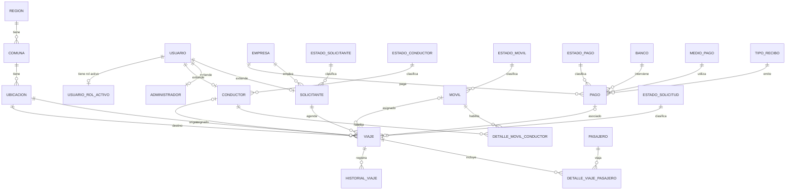
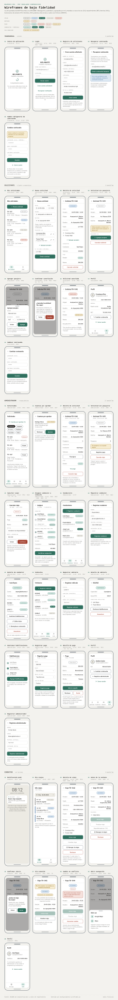

# Aplicacion de Belmonte Spa.
## Especificaciones del proyecto.

**Ultima modificacion:** 19-10-2026

## Integrantes:
* Daniel Muñoz
* Michel Sanhueza

## Indice

- [Introduccion](#introduccion)
  - [Cómo leer esta especificación](#cómo-leer-esta-especificación)
  - [Problemática y actores](#problemática-y-actores)
- [Máquinas de estado](#máquinas-de-estado)
  - [Viaje](#viaje)
  - [Abordaje](#abordaje)
  - [Pago](#pago)
  - [Conductor y vehículo](#conductor-y-vehículo)
- [Requisitos](#requisitos)
  - [Casos de uso](#casos-de-uso)
  - [Requerimientos funcionales](#requerimientos-funcionales)
  - [Requisitos no funcionales](#requisitos-no-funcionales)
  - [Historias de usuario y Backlog](#historias-de-usuario-y-backlog)
- [Modelamiento del problema](#modelamiento-del-problema)
  - [Modelo de datos](#modelo-de-datos)
  - [Decisiones de modelo](#decisiones-de-modelo)
  - [Modelo relacional](#modelo-relacional)
- [Arquitectura](#arquitectura)
  - [Stack](#stack)
  - [Servicios locales](#servicios-locales)
  - [Entornos](#entornos)
- [API REST](#api-rest)
  - [Convenciones](#convenciones)
  - [Recursos y roles](#recursos-y-roles)
  - [Consultas y alcance por rol](#consultas-y-alcance-por-rol)
  - [Flujo de una solicitud (CU-01 / RF02)](#flujo-de-una-solicitud-cu-01--rf02)
  - [Ubicaciones desde Google Places](#ubicaciones-desde-google-places)
  - [Acciones de negocio](#acciones-de-negocio)
  - [Autenticación](#autenticación)
  - [Contratos JSON](#contratos-json)
  - [Validaciones](#validaciones)
    - [Fechas y cambios de hora de Chile](#fechas-y-cambios-de-hora-de-chile)
  - [Errores](#errores)
    - [Errores de varios campos](#errores-de-varios-campos)
- [Estructura del backend](#estructura-del-backend)
  - [Paquetes y capas](#paquetes-y-capas)
  - [Persistencia MariaDB](#persistencia-mariadb)
    - [Evolución de migraciones](#evolución-de-migraciones)
    - [Transacciones](#transacciones)
    - [Datos iniciales](#datos-iniciales)
  - [Configuración](#configuración)
  - [Notificaciones externas](#notificaciones-externas)
  - [Pruebas](#pruebas)
- [Frontend (Android)](#frontend-android)
  - [Arquitectura y responsabilidades](#arquitectura-y-responsabilidades)
    - [Contratos internos de Android](#contratos-internos-de-android)
  - [Tecnologías](#tecnologías)
    - [Aceptación de compatibilidad](#aceptación-de-compatibilidad)
  - [Organización del código](#organización-del-código)
  - [Navegación y pantallas](#navegación-y-pantallas)
  - [Estado y restauración de pantallas](#estado-y-restauración-de-pantallas)
  - [Textos y tema](#textos-y-tema)
  - [Accesibilidad](#accesibilidad)
  - [API y sesión](#api-y-sesión)
    - [Sesión guardada](#sesión-guardada)
    - [Carga de catálogos](#carga-de-catálogos)
    - [Cierre de sesión local y remoto](#cierre-de-sesión-local-y-remoto)
  - [Persistencia y conectividad](#persistencia-y-conectividad)
  - [Base de datos local](#base-de-datos-local)
  - [Notificaciones y navegación externa](#notificaciones-y-navegación-externa)
  - [Abordaje con código QR](#abordaje-con-código-qr)
  - [Compilación, firma y distribución](#compilación-firma-y-distribución)
  - [Modo demostración sin backend](#modo-demostración-sin-backend)
  - [Pruebas Android](#pruebas-android)
  - [Limitaciones aceptadas](#limitaciones-aceptadas)
- [Proceso de desarrollo](#proceso-de-desarrollo)
  - [Ramas y pull requests](#ramas-y-pull-requests)
  - [Integración continua](#integración-continua)
  - [Definición de terminado](#definición-de-terminado)
  - [Plan de trabajo](#plan-de-trabajo)

## Introduccion

Especificación de referencia del proyecto: requisitos, arquitectura, contratos y
tecnologías. No registra el avance de implementación ni certifica que el código cumpla lo
descrito; su revisión evalúa la coherencia y suficiencia de la especificación, y la
conformidad del código se revisa aparte.

Belmonte SpA hace transporte privado corporativo (traslados ejecutivos y aeropuerto). El MVP
móvil centraliza el flujo: captura de solicitudes, asignación a conductores, abordaje de los
pasajeros con un código QR y enlace con navegación externa (Google Maps/Waze).

### Cómo leer esta especificación

- **Precedencia:** este README es la fuente de verdad. Los [mockups](mockups/wireframes-belmonte.html)
  ilustran las pantallas; si discrepan, gana el README. `docs/` guarda el material de origen (el
  Anexo de Requerimiento y las instrucciones del curso) y no se implementa directamente.
- **Rangos:** "de A a B" y "entre A y B" incluyen ambos extremos, salvo que se diga otra cosa.
- **Hora:** "ahora" es la hora del servidor en `America/Santiago` al recibir la petición; las
  fechas no llevan zona ([Contratos JSON](#contratos-json)).
- **Códigos y etiquetas:** la API y la base usan códigos en mayúsculas (`EN_CURSO`); la app
  muestra su etiqueta en español ([Textos y tema](#textos-y-tema)).
- **Obligatoriedad:** lo descrito es obligatorio. Lo que no se menciona no se implementa en el MVP
  (p. ej. borrar registros, pagos en línea, mapa embebido).

### Problemática y actores

Hoy las solicitudes se coordinan a mano (teléfono, correo, WhatsApp): datos críticos
erróneos (horarios, direcciones), respuestas lentas y retraso en que el conductor reciba su ruta.

| ID | Actor | Rol |
|---|---|---|
| ACT-01 | Cliente corporativo / Solicitante | Agenda el traslado (datos del viaje y del pasajero). |
| ACT-02 | Pasajero | Quien viaja; puede no ser el solicitante. No necesita cuenta: registra su abordaje con el código QR del vehículo (CU-19). |
| ACT-03 | Recepcionista / Administrador | Asigna solicitudes a conductores; gestiona flota (vehículos y habilitaciones) y pagos. |
| ACT-04 | Conductor | Ejecuta el traslado; ve sus viajes del día y abre la ruta en un navegador externo. |
| ACT-05 | Sistema de navegación externo (Google Maps / Waze) | Recibe las coordenadas por Intent y traza la ruta. Sin tabla: no hay datos propios que persistir. |

El Anexo de Requerimiento (§2.4) agrupa Solicitante y Pasajero; aquí se separan porque el
Pasajero no pertenece necesariamente a la empresa que paga (`PASAJERO` no tiene FK a
`EMPRESA`) y el Solicitante puede no viajar.

## Máquinas de estado

Fuente única de las transiciones; los CU, RF, HU y la API remiten aquí. Toda transición
inválida responde 409. Los triggers de `db/migration` vuelven a validar los estados
permitidos, la capacidad y la auditoría, pero no las reglas horarias (rango de `fh_agenda`,
ventana de inicio, solapamiento y vencido): esas las valida solo el backend
([Fechas y cambios de hora de Chile](#fechas-y-cambios-de-hora-de-chile)).

### Viaje

`ESTADO_SOLICITUD`: `PENDIENTE → ASIGNADO → EN_CURSO → FINALIZADO`, más `CANCELADO` desde
`PENDIENTE` o `ASIGNADO`. Sin reapertura; el único retroceso es el rechazo del Conductor (V8,
`ASIGNADO` → `PENDIENTE`). `EN_CURSO` y `FINALIZADO` no se cancelan, reasignan ni rechazan. Cada
cambio registra su fecha/hora.

| ID | Transición | Quién | Precondiciones | Efectos |
|---|---|---|---|---|
| V1 | alta → `PENDIENTE` | Solicitante aprobado (CU-01/RF02) | `fh_agenda` de 2 horas a 90 días desde ahora ([Validaciones](#validaciones); si no, 400) | La base genera el `folio` (`TR-` y un correlativo, inmutable; ver `VIAJE.folio`); `fh_creacion`. Push a los Administradores. |
| V2 | `PENDIENTE`/`ASIGNADO` → `ASIGNADO` (asignar o reasignar) | Administrador (CU-04/RF05/RF22) | Viaje no vencido (ver Retraso; si no, 409 "El viaje está vencido"). Al menos un pasajero (`cantidad_pasajeros` ≥ 1). Conductor y vehículo activos y Disponibles (sin otro viaje `EN_CURSO`); conductor habilitado para el vehículo; pasajeros ≤ capacidad. Sin solapamiento: ni el conductor ni el vehículo tienen otro viaje `ASIGNADO` o `EN_CURSO` cuya ventana de inicio (ver V3) se cruce con la de este, es decir, con `abs(fh_agenda − fh_agenda del otro) < 2 horas` (a 2 horas exactas no se solapan). Al reasignar, la disponibilidad y el solapamiento se validan solo para lo que cambia (sin contar el propio viaje) y la habilitación para el par resultante. Sin reasignación automática. | `fh_asignacion`. No cambia el estado del conductor ni del vehículo: ambos pueden tener varios viajes `ASIGNADO`. Al reasignar puede cambiar solo el conductor, solo el vehículo o ambos; el viaje sale de la agenda de los reemplazados y, si cambia el vehículo, los pasajeros vuelven a Por abordar ([Abordaje](#abordaje)). Push al conductor (nuevo), al solicitante y, si cambia el conductor, al reemplazado. |
| V3 | `ASIGNADO` → `EN_CURSO` | Conductor asignado (RF09) | Dentro de la ventana de inicio: `fh_agenda − 1 hora ≤ ahora ≤ fh_agenda + 1 hora`. Conductor y vehículo Disponibles (sin otro viaje `EN_CURSO`). | `fh_inicio`; conductor → Ocupado, vehículo → En uso. Push al solicitante. |
| V4 | `EN_CURSO` → `FINALIZADO` | Conductor asignado (RF09) | — | `fh_fin`; conductor y vehículo → Disponible. Push al solicitante. |
| V5 | `PENDIENTE`/`ASIGNADO` → `CANCELADO` (cancelar) | Solicitante dueño (CU-08/RF15) | Viaje no vencido (ver Retraso). | Si había conductor: push al conductor y el viaje sale de su agenda ("Mis viajes", en su fecha). No cambia el estado de conductor ni vehículo (en `PENDIENTE`/`ASIGNADO` este viaje no los ocupa). Pago `PAGADO` → `REEMBOLSADO` con `monto_reembolsado` = 50 % del monto, redondeado hacia abajo (P4); `PENDIENTE` → `ANULADO` (P5); en otro estado el pago no cambia. No modifica `fh_fin`: el momento queda en `HISTORIAL_VIAJE`. |
| V6 | `PENDIENTE`/`ASIGNADO` → `CANCELADO` (por anulación del pago) | Sistema, al anular el Administrador el pago (P2 o P3; CU-12/RF19) | — | Mismos efectos de V5 (agenda y push al conductor) sin reembolso, y push al solicitante. |
| V7 | `PENDIENTE`/`ASIGNADO` → `CANCELADO` (por el Administrador) | Administrador (CU-15/RF23) | `motivo` obligatorio. | Guarda el `motivo`; agenda y push al conductor como en V5, y push al solicitante. Pago `PAGADO` → `REEMBOLSADO` (P4): con el viaje no vencido, `monto_reembolsado` = monto (100 %); vencido, el monto que fije el Administrador entre 0 y el monto (con 0 el pago no cambia). Pago `PENDIENTE` → `ANULADO` (P5). |
| V8 | `ASIGNADO` → `PENDIENTE` (rechazo) | Conductor asignado (CU-16/RF24) | `motivo` obligatorio; solo con conexión (no va a la cola sin conexión). | Guarda el `motivo`; deja en NULL conductor, móvil y `fh_asignacion`, y el abordaje de sus pasajeros ([Abordaje](#abordaje)); el viaje sale de su agenda. Push a los Administradores y al solicitante. El pago no cambia. |

`CANCELADO` se suma a los 4 estados del Anexo (§3.2) para conservar la auditoría: la
solicitud no se borra.

**Retraso.** Se calcula a partir de `fh_agenda` y no es un estado: lo calculan el backend al
validar y la app al mostrar, incluso sin conexión. Un viaje `PENDIENTE` o `ASIGNADO` está:

- **Atrasado**, si `fh_agenda < ahora ≤ fh_agenda + 1 hora`: todavía puede iniciarse.
- **Vencido**, si `ahora > fh_agenda + 1 hora`: no se inicia (V3), no se asigna ni reasigna (V2)
  y no lo cancela el Solicitante (V5). Nada cambia solo: el Administrador lo cancela con V7 y
  decide el reembolso.

### Abordaje

El abordaje es una marca por pasajero dentro de su viaje (`DETALLE_VIAJE_PASAJERO.fh_abordaje`),
no un estado del viaje ni del pasajero: con fecha, Abordado; en NULL, Por abordar. No cambia el
estado del viaje, del conductor, del vehículo ni del pago.

- **Registrar (CU-19/RF28):** `POST /api/v1/abordajes`, público, con la patente y el
  `codigo_abordaje` del vehículo leídos del QR y el documento del pasajero. Los viajes
  candidatos son los de ese vehículo `ASIGNADO` dentro de su ventana de inicio
  (`fh_agenda − 1 hora ≤ ahora ≤ fh_agenda + 1 hora`, como V3) o `EN_CURSO`. El documento
  normalizado, convertido en `dni_hash`, elige entre ellos el viaje en que viaja; si calza en
  más de uno, el de `fh_agenda` más cercana a ahora. Fija `fh_abordaje` = ahora si estaba en
  NULL y responde la marca guardada: repetir no la cambia.
- **Rechazo:** patente inexistente, código distinto del de esa patente, vehículo sin viaje
  candidato o documento que no está en ninguno responden el mismo 404 "No encontramos un
  viaje para este documento en este vehículo"; nunca se revela si el documento viaja ni
  cuándo (RNF08). No hay 409 de abordaje.
- **Limpieza:** V2 que cambia el vehículo y V8 dejan en NULL el `fh_abordaje` de todos los
  pasajeros del viaje, en la misma transacción. Un pasajero agregado a un viaje `ASIGNADO`
  nace Por abordar.
- **Arqueo (RF29):** "Abordaron X de N" (X, pasajeros con `fh_abordaje`; N,
  `cantidad_pasajeros`) y la lista de los que faltan. Lo calcula la app desde los `pasajeros`
  de `ViajeDTOResponse`; el backend no guarda contadores.
- **Limitación aceptada:** el código impreso no caduca. Una foto del adhesivo permite marcar
  a distancia a quien conozca el documento de un pasajero; la marca no cambia estados ni
  pagos y el Conductor confirma en la puerta quién subió.

### Pago

`ESTADO_PAGO`. Relación 1:1 con el viaje: un viaje tiene a lo más un pago y un pago pertenece a un solo viaje.

| ID | Desde | Hacia | Quién / cómo |
|---|---|---|---|
| P1 | alta | `PENDIENTE` | Administrador (CU-11/RF18), para un viaje en cualquier estado distinto de `CANCELADO`; el backend genera su `hash` (único; ver `PAGO.hash`). |
| P2 | `PENDIENTE` | `PAGADO`, `RECHAZADO` o `ANULADO` | Manual, Administrador (CU-12/RF19). Al pasar a `PAGADO`, el backend fija `fecha_pago`. Push al solicitante. |
| P3 | `PAGADO` | `ANULADO` | Manual, Administrador. Push al solicitante. |
| P4 | `PAGADO` | `REEMBOLSADO` | Automático al cancelar el viaje: en V5 (Solicitante, 50 %) o en V7 (Administrador, 100 % o el monto que fije si el viaje está vencido). Fija `monto_reembolsado`; nunca manual. Push al solicitante. |
| P5 | `PENDIENTE` | `ANULADO` | Automático al cancelar el viaje en V5 o V7: no queda nada que cobrar. Nunca manual (la anulación manual es P2). Push al solicitante. |

- `RECHAZADO`, `ANULADO` y `REEMBOLSADO` son terminales.
- `ANULADO` por P2 o P3 (problema con el banco u otro motivo) cancela el viaje si está `PENDIENTE` o `ASIGNADO` (V6). P5 no dispara V6: el viaje ya está cancelado.
- Un viaje `CANCELADO` nunca queda con un pago `PENDIENTE` ni `PAGADO`, salvo el `PAGADO` de V7 vencido con reembolso 0.
- Sin re-cobro: el pago no se reemplaza ni se registra otro. Un viaje con su pago `RECHAZADO`, o
  `ANULADO` estando `EN_CURSO` o `FINALIZADO`, queda sin cobro (`POST /pagos` responde 409 porque ya tiene pago).

### Conductor y vehículo

- **Conductor** (`ESTADO_CONDUCTOR`): nace Disponible (CU-07); Ocupado solo mientras tiene un
  viaje `EN_CURSO` (de V3 a V4).
- **Vehículo** (`ESTADO_MOVIL`): nace Disponible (CU-09); En uso solo mientras tiene un viaje
  `EN_CURSO` (de V3 a V4).
- Disponible = sin viaje `EN_CURSO`. Asignar (V2) no cambia estos estados: ambos pueden tener
  varios viajes `ASIGNADO` (su agenda), pero a lo más uno `EN_CURSO`.
- **Activo** (`activo`, independiente de lo anterior): nacen activos. El Administrador los
  desactiva (baja de un conductor desvinculado o de un vehículo en taller) solo si no tienen
  viajes `ASIGNADO` ni `EN_CURSO` (409), y los puede reactivar (CU-07/CU-09/RF25). Un inactivo no
  es asignable (V2) ni aparece en "Asignar"; un Conductor inactivo no inicia sesión (mismo 401
  genérico). Su JWT ya emitido vale hasta su `exp` (es stateless), pero sin viajes `ASIGNADO`
  ni `EN_CURSO` no puede ejecutar transiciones. Las habilitaciones no cambian. Desactivar o reactivar con el mismo valor
  que ya tiene responde `200` sin cambios; reactivar no tiene precondiciones.

## Requisitos

### Casos de uso

| CU | Actor | Flujo | Excepciones |
|---|---|---|---|
| CU-01 Registrar solicitud de traslado | ACT-01 | Ingresa pasajero(s), fecha/hora, origen, destino y n.º de vuelo (si aplica) → viaje `PENDIENTE` con sus pasajeros, en tres llamadas ([Flujo de una solicitud](#flujo-de-una-solicitud-cu-01--rf02)). | Datos incompletos o inválidos: 400 según [Validaciones](#validaciones). |
| CU-02 Visualizar viajes asignados | ACT-04 | Lista sus viajes asignados del día, actualizados desde el backend. | Sin conectividad: muestra los viajes ya sincronizados (RF11/HU11). Sin viajes: lista vacía. |
| CU-03 Navegar a la ruta del viaje | ACT-04 | "Navegar" en el detalle de un viaje propio: en `ASIGNADO` hacia el origen (recoger a los pasajeros) y en `EN_CURSO` hacia el destino, desde la ubicación actual → Intent con las coordenadas de ese punto → Google Maps o Waze navega ([Notificaciones y navegación externa](#notificaciones-y-navegación-externa)). En otros estados no se ofrece. | Ninguna app compatible instalada: aviso. |
| CU-04 Gestionar y distribuir solicitudes | ACT-03 | Elige una solicitud y un conductor disponible (se sugieren sus vehículos habilitados) y confirma: [V2](#viaje) `PENDIENTE` → `ASIGNADO`. | Sin conductores disponibles. Viaje vencido o sin pasajeros: no se ofrece y se rechaza (409). Conductor o vehículo con otro viaje a menos de 2 horas: 409 ([V2](#viaje)). Sin reasignación automática; la manual de un `ASIGNADO` sigue el mismo flujo (RF22). |
| CU-05 Actualizar estado del traslado | ACT-03, ACT-04 | Ciclo [V2](#viaje) `PENDIENTE` → `ASIGNADO` (el Administrador asigna), [V3](#viaje) `ASIGNADO` → `EN_CURSO` y [V4](#viaje) `EN_CURSO` → `FINALIZADO` (el Conductor inicia y finaliza). | Sin reapertura; el único retroceso es el rechazo del Conductor (CU-16, [V8](#viaje)). La cancelación es CU-08, CU-15 o la anulación del pago (CU-12). |
| CU-06 Trazar ruta óptima hacia el destino | ACT-05 | Con coordenadas válidas, calcula la ruta con el tráfico disponible y la muestra al conductor. | Algoritmo, proveedor de tráfico y criterios son del sistema externo. |
| CU-07 Registrar conductor | ACT-03 | El Administrador ingresa nombre, correo (único), contraseña inicial (se guarda como hash) y teléfono opcional; la cuenta queda activa para autenticarse y, una vez habilitada para un vehículo (CU-10), para ser asignada (CU-04). Sin autorregistro. Desde su ficha el Administrador lo desactiva o reactiva ([Conductor y vehículo](#conductor-y-vehículo), RF25). | Correo existente o campo faltante: rechazo. Desactivar con viajes `ASIGNADO` o `EN_CURSO`: 409. El Conductor no tiene "cambiar contraseña": el Administrador la reemplaza en su ficha. No se envía correo: el Administrador le comunica la contraseña en persona. |
| CU-08 Cancelar solicitud de traslado | ACT-01 | Solicitud propia en `PENDIENTE` o `ASIGNADO`: "Cancelar" en el detalle → [V5](#viaje) `PENDIENTE`/`ASIGNADO` → `CANCELADO`, con fecha/hora. | En `EN_CURSO` o `FINALIZADO`, o con el viaje vencido, no hay botón y se rechaza (409). |
| CU-09 Registrar vehículo | ACT-03 | Patente (única), capacidad y serial GPS opcional (dato de flota; el MVP no registra ubicación en vivo); queda Disponible, activo, habilitable y asignable. Desde su ficha el Administrador lo desactiva (taller) o reactiva (RF25). | Patente existente o campo faltante: rechazo. Desactivar con viajes `ASIGNADO` o `EN_CURSO`: 409. |
| CU-10 Habilitar conductor para vehículo | ACT-03 | Relaciona un conductor (CU-07) con uno o más vehículos (CU-09); M:N. | Relación existente: se ignora sin duplicar. Las habilitaciones no se eliminan en el MVP. |
| CU-11 Registrar pago de un viaje | ACT-03 | En un viaje no `CANCELADO`: monto, banco, medio de pago y tipo de recibo → pago `PENDIENTE` asociado al viaje. | Viaje `CANCELADO`: no se registra. |
| CU-12 Actualizar estado de un pago | ACT-03 | Sobre un pago `PENDIENTE` (o `PAGADO`, solo para anularlo) marca `PAGADO`, `RECHAZADO` o `ANULADO` ([P2](#pago) desde `PENDIENTE`; [P3](#pago) `PAGADO` → `ANULADO`); anular cancela el viaje `PENDIENTE` o `ASIGNADO` ([V6](#viaje)). | Estado terminal: no cambia. |
| CU-13 Recuperar contraseña | ACT-01, ACT-03 | Ingresa su correo en "Recuperar contraseña". Si es de un Solicitante o Administrador: contraseña temporal aleatoria, guardada hasheada en `password_temporal_hash` con `password_temporal_expira`, sin tocar la contraseña actual, y enviada en texto plano solo a ese correo vía `EmailClient` (único momento en claro; nunca se persiste así, RNF01). Sirve para el login (CU-14) hasta expirar y obliga a cambiar la contraseña al entrar. | Correo inexistente o de un Conductor: mismo mensaje genérico. Expirada sin uso: pedir otra. |
| CU-14 Iniciar sesión | ACT-01, ACT-03, ACT-04 | Cuenta autorregistrada (Solicitante, RF01), creada por el Administrador (Conductor, RF14; Administrador, RF27) o por migración Flyway (Administrador inicial). Envía correo, contraseña y el token FCM si existe (RF13). Se valida contra `USUARIO.password_hash` o contra la temporal vigente (`password_temporal_hash`, RF21), que obliga a cambiar la contraseña. El rol es la tabla (`SOLICITANTE`/`ADMINISTRADOR`/`CONDUCTOR`) donde existe el `id_usuario`, único por `USUARIO_ROL_ACTIVO`. Se guarda o reemplaza `USUARIO.token_fcm` y se emite un JWT de 8 horas (`sub` = correo, `rol`, `exp`; RNF01, [Autenticación](#autenticación)); con la temporal, un JWT restringido a cambiar la contraseña. El cliente adjunta el JWT en cada request protegida y el `SecurityFilterChain` lo valida aplicando el mapeo rol→endpoint. | Correo inexistente, contraseña incorrecta, temporal expirada o Conductor inactivo: mismo error genérico. Solicitante no aprobado: 403 "Cuenta pendiente de aprobación" o "Cuenta rechazada" (CU-17). |
| CU-15 Cancelar un viaje (Administrador) | ACT-03 | En el detalle de un viaje `PENDIENTE` o `ASIGNADO`: "Cancelar viaje", motivo y, si el viaje está vencido, monto a reembolsar → [V7](#viaje), con reembolso según [P4](#pago) o, si el pago está `PENDIENTE`, su anulación ([P5](#pago)). | `EN_CURSO`, `FINALIZADO` o `CANCELADO`: no hay botón y se rechaza (409). Sin motivo: 400. |
| CU-16 Rechazar una asignación | ACT-04 | En el detalle de un viaje propio `ASIGNADO`, antes de iniciarlo: "Rechazar", motivo → [V8](#viaje); el viaje vuelve a `PENDIENTE` y sale de su agenda. | Sin conexión: no se ofrece (no se encola). Sin motivo: 400. |
| CU-17 Aprobar un Solicitante | ACT-03 | Quien se registra con el RUT de una empresa existente queda `PENDIENTE` (RF01). El Administrador lo ve en "Cuentas por aprobar" y lo aprueba (puede crear solicitudes) o rechaza (no inicia sesión). | Cuenta ya revisada: 409. |
| CU-18 Registrar un Administrador | ACT-03 | Un Administrador ingresa nombre, correo, teléfono opcional y una contraseña inicial, que queda como temporal por `ALTA_TEMPORAL_HORAS` y obliga a cambiarla al entrar. No se envía correo: quien lo registra le comunica la contraseña en persona. | Correo existente o campo faltante: rechazo. |
| CU-19 Registrar abordaje | ACT-02 | "Abordar viaje" en el Login (sin cuenta) o en el Perfil de un Solicitante con sesión: escanea el código QR de la puerta del vehículo (o ingresa su patente y código) y su documento (RUT o pasaporte) → se registra `fh_abordaje` en su viaje de ese vehículo ([Abordaje](#abordaje), [Abordaje con código QR](#abordaje-con-código-qr)). El Conductor y el Administrador ven el arqueo: cuántos y cuáles pasajeros faltan. | Código que no es de Belmonte: aviso, sin enviar. Sin viaje para ese documento en ese vehículo en este momento: 404 genérico, que no revela si el documento viaja (RNF08). Sin conexión: no se encola. Repetido: responde la misma hora. |

El Conductor queda fuera de CU-13 a propósito: solo el Administrador reemplaza su contraseña
(CU-07/RF14), para que un desvinculado no recupere acceso por su cuenta.

### Requerimientos funcionales

"Sistema" = requisito sin actor que lo inicie.

| ID | Actor | Requisito |
|---|---|---|
| **RF01** | Solicitante | Registrarse (razón social y RUT de su empresa crean o reutilizan una fila en `EMPRESA`) y autenticarse (CU-14). Con un RUT nuevo la cuenta queda aprobada; con uno existente, `PENDIENTE` hasta que la apruebe un Administrador (CU-17/RF26), y se conserva la razón social registrada. |
| **RF02** | Solicitante | Registrar una solicitud: pasajero, fecha, hora, origen y destino (autocompletado de Google Places, con coordenadas) y n.º de vuelo si aplica. |
| **RF03** | Solicitante | Ver el historial y estado de sus solicitudes. |
| **RF04** | Administrador | Ver las solicitudes pendientes de asignación. |
| **RF05** | Administrador | Asignar a un viaje con al menos un pasajero un conductor activo y disponible y un vehículo activo habilitado para él, ninguno con otro viaje a menos de 2 horas: la solicitud pasa a Asignado ([V2](#viaje) `PENDIENTE` → `ASIGNADO`); conductor y vehículo pasan a Ocupado/En uso recién al iniciar ([V3](#viaje)). |
| **RF06** | Conductor | Autenticarse con credenciales asignadas por el Administrador, sin autorregistro (CU-14). |
| **RF07** | Conductor | Ver en tiempo real los viajes asignados del día. |
| **RF08** | Conductor | Ver el detalle de un viaje asignado (pasajero, origen, destino). |
| **RF09** | Conductor | Pasar un traslado a En Curso, dentro de la ventana de una hora antes a una hora después de la agendada, y a Finalizado; al finalizar, conductor y vehículo vuelven a Disponible. |
| **RF10** | Sistema | Abrir por Intents de Android una app de navegación externa (Google Maps/Waze) que trace la ruta desde las coordenadas. |
| **RF11** | Sistema | Persistir localmente (Room/SQLite) solicitudes y viajes ya consultados para verlos sin conexión; los cambios offline (p. ej. de estado) van a una cola local y se sincronizan por API REST al reconectar. |
| **RF12** | Sistema | Push (FCM) a los actores afectados ante cambios relevantes (nueva solicitud, asignación o reasignación, rechazo, En Curso, Finalizado, cancelación, cambios del pago y cuentas por aprobar), sin recarga manual. |
| **RF13** | Sistema | Registrar y mantener actualizado el token FCM de cada usuario autenticado. |
| **RF14** | Administrador | Registrar una cuenta de Conductor (nombre, correo, contraseña inicial; teléfono opcional), utilizable de inmediato. |
| **RF15** | Solicitante | Cancelar una solicitud propia en Pendiente o Asignado: el viaje sale de la agenda del conductor, si había uno, y se le avisa por push; un pago Pagado pasa a Reembolsado con devolución del 50 % del monto y uno Pendiente se anula. No se puede con el viaje vencido ([V5](#viaje) `PENDIENTE`/`ASIGNADO` → `CANCELADO`; [P4](#pago) `PAGADO` → `REEMBOLSADO`; [P5](#pago) `PENDIENTE` → `ANULADO`). |
| **RF16** | Administrador | Registrar un vehículo con patente y capacidad; serial GPS opcional, como dato de flota (el MVP no registra ubicación en vivo). |
| **RF17** | Administrador | Habilitar uno o más conductores para un vehículo. |
| **RF18** | Administrador | Registrar el pago de un viaje en cualquier estado previo a Cancelado (monto, banco, medio de pago, tipo de recibo); nace en Pendiente. |
| **RF19** | Administrador | Marcar un pago Pagado, Rechazado o Anulado (p. ej. problema con el banco); Anulado cancela el viaje en Pendiente o Asignado. Reembolsado lo fija el sistema (RF15/RF23). |
| **RF20** | Solicitante | Ver el estado de pago de sus viajes en el detalle de la solicitud. |
| **RF21** | Solicitante, Administrador | Recuperar la contraseña con su correo (CU-13): temporal enviada al correo, con expiración, que no reemplaza la actual y obliga a cambiarla al entrar. El Conductor no tiene este autoservicio (solo RF14). |
| **RF22** | Administrador | Reasignar una solicitud Asignado (conductor, vehículo o ambos) con las reglas de RF05; sigue Asignado, el viaje sale de la agenda de los reemplazados y se avisa por push al nuevo conductor, al conductor reemplazado y al solicitante (RF12). |
| **RF23** | Administrador | Cancelar un viaje Pendiente o Asignado con motivo: un pago Pagado se reembolsa al 100 %, o en el monto que decida si el viaje está vencido, y uno Pendiente se anula ([V7](#viaje), [P4](#pago), [P5](#pago)). |
| **RF24** | Conductor | Rechazar con motivo un viaje Asignado antes de iniciarlo: vuelve a Pendiente y se avisa a los Administradores y al solicitante ([V8](#viaje)). |
| **RF25** | Administrador | Desactivar y reactivar conductores y vehículos sin viajes Asignado ni En Curso ([Conductor y vehículo](#conductor-y-vehículo)). |
| **RF26** | Administrador | Aprobar o rechazar a los Solicitantes que se registran en una empresa existente (CU-17). |
| **RF27** | Administrador | Registrar otra cuenta de Administrador con contraseña inicial temporal (CU-18). |
| **RF28** | Pasajero | Registrar su abordaje sin necesitar cuenta, leyendo con la cámara el código QR de la puerta del vehículo asignado (o ingresando la patente y el código escritos bajo él) e identificándose con su documento (CU-19). |
| **RF29** | Conductor, Administrador | Ver el arqueo de abordaje de un viaje: cuántos pasajeros abordaron y cuáles faltan. |

### Requisitos no funcionales

- **RNF01 Seguridad:** contraseñas solo como hash; app↔backend con JWT de acceso de 8 horas, sin renovación
  (CU-14); autorización por rol en un `SecurityFilterChain` centralizado. Única excepción al
  "nunca en texto plano": la contraseña temporal de RF21, enviada una vez por correo y nunca
  guardada en claro.
- **RNF02 Conectividad:** Internet continuo (Anexo §3.3); no es offline-first y crear o
  recibir una solicitud nueva exige conexión. Tolera cortes breves para datos ya
  sincronizados (Room/SQLite) y para los cambios de estado del Conductor (En Curso/Finalizado)
  de un viaje ya asignado, que se encolan y reintentan al reconectar (RF11).
- **RNF03 Tiempo de respuesta:** consultas (solicitudes, viajes del día) < 2 s con 4G/Wi-Fi;
  un push (RF12/RF13) se refleja en segundos, no minutos.
- **RNF04 Usabilidad en terreno:** pantallas del Conductor con botones grandes y legibles y
  mínimos pasos para En Curso/Finalizado o abrir la navegación; toda la app cumple
  [Accesibilidad](#accesibilidad) (WCAG 2.1 AA).
- **RNF05 Compatibilidad:** Android 8.0 (API 26) o superior. El backend expone solo contratos
  JSON REST, sin acoplarse a un cliente.
- **RNF06 Mantenibilidad:** capas estrictas (`Controller-Service-Repository` en Spring Boot,
  `Model-View-ViewModel` en Android): una regla de negocio se cambia en un solo lugar.
- **RNF07 Servicios externos:** tres dependencias con cuota gratuita limitada (Google Places
  API, Firebase Cloud Messaging y un proveedor de correo transaccional por SMTP, para RF21/CU-13
  y CU-17); el uso se monitorea para no exceder el nivel gratuito.
- **RNF08 Privacidad:** nombre, teléfono y dirección de pasajeros y solicitantes no van a
  logs, y solo los ven el Solicitante, el Administrador y el Conductor asignado de cada
  solicitud.
- **RNF09 Datos académicos:** solo datos ficticios, sintéticos, agregados o públicos
  anonimizados (Anexo §4; Ley N.º 21.719 y Ley N.º 19.628); los antecedentes se comparten por
  canales institucionales con acceso restringido.
- **RNF10 Entregable:** colaboración y documentación en Git/GitHub; el ejecutable final es un
  APK firmado en modo release (Anexo, "Alcance tecnológico comprometido"), publicado en GitHub
  Releases ([Compilación, firma y distribución](#compilación-firma-y-distribución)).

### Historias de usuario y Backlog

Los efectos de estado se citan por el ID de su transición en [Máquinas de estado](#máquinas-de-estado) (V1–V8 viaje, P1–P5 pago) y forman parte del criterio.

| HU | RF | Prio. | SP | Historia | Criterios de aceptación |
|---|---|---|---|---|---|
| HU01 | RF01 | Alta | 3 | Solicitante: registro y login | Rechazo si el correo existe o falta un obligatorio (empresa, nombre de contacto, correo, contraseña); teléfono opcional. Login válido → "Mis solicitudes"; inválido → error sin indicar qué falló. La empresa (razón social + RUT) se crea o reutiliza en `EMPRESA`, sin duplicar; con un RUT existente la cuenta queda pendiente de aprobación (HU27) y el login responde 403 hasta entonces. |
| HU02 | RF02 | Alta | 5 | Solicitante: nueva solicitud con Google Places | Origen y destino solo desde las sugerencias (nunca texto libre), capturando latitud y longitud; sin eso no se envía. Obligatorios: al menos un pasajero (nombre y documento, RUT o pasaporte, con su `tipoDocumento`), fecha, hora, origen y destino; vuelo opcional. La app los exige antes de enviar y registra viaje y pasajeros en llamadas separadas. |
| HU03 | RF03 | Media | 3 | Solicitante: historial y estado | Por solicitud propia: pasajero, fecha/hora, origen→destino y estado (el del último cambio). |
| HU04 | RF04 | Alta | 3 | Administrador: pendientes | Filtro inicial "Pendientes" (solo `PENDIENTE`); cada fila abre el detalle y, si el viaje no está vencido y tiene pasajeros, su botón "Asignar" abre directo "Asignar conductor" (HU05). |
| HU05 | RF05 | Alta | 5 | Administrador: asignar | Solo conductores activos y disponibles (sin viaje en curso). Conductor o vehículo con otro viaje `ASIGNADO` o `EN_CURSO` a menos de 2 horas: 409 con el motivo. Al confirmar, [V2](#viaje) `PENDIENTE` → `ASIGNADO` con un vehículo habilitado para él, y el viaje aparece en la agenda del conductor ("Mis viajes", en su fecha). |
| HU06 | RF06 | Alta | 2 | Conductor: login con credenciales del Administrador | Sin "crear cuenta"; credenciales inválidas no revelan si el correo existe. |
| HU07 | RF07 | Alta | 3 | Conductor: viajes del día en tiempo real | Solo los suyos, de la fecha actual (más su viaje `EN_CURSO` de una fecha anterior, si lo tiene), por hora; con pasajero, hora y estado. |
| HU08 | RF08 | Alta | 3 | Conductor: detalle del viaje | Pasajero, vuelo (si aplica), origen y destino completos; "Navegar" y controles de estado. |
| HU09 | RF09 | Alta | 3 | Conductor: En Curso y Finalizado | "Iniciar viaje" ([V3](#viaje)) solo en `ASIGNADO` y dentro de la ventana de `fh_agenda` ± 1 hora, "Finalizar viaje" ([V4](#viaje)) solo en `EN_CURSO`; cada cambio registra fecha/hora; al finalizar, conductor y vehículo → Disponible. |
| HU10 | RF10 | Alta | 3 | Conductor: ruta en Google Maps o Waze | "Navegar" los abre con el origen precargado en `ASIGNADO` y con el destino en `EN_CURSO`; en otros estados no aparece. Sin app instalada, aviso en vez de fallar en silencio. |
| HU11 | RF11 | Media | 8 | Conductor: uso sin conexión | Lo ya cargado se consulta offline; un cambio de estado offline va a una cola local marcado "pendiente de sincronizar" y se envía solo al reconectar. |
| HU12 | RF12 | Media | 5 | Solicitante: push de estado | Push al pasar a `ASIGNADO`, `EN_CURSO` o `FINALIZADO`; al abrirlo o abrir "Mis solicitudes", el estado ya está actualizado. |
| HU13 | RF12 | Alta | 5 | Conductor: push de asignación | Push al asignársele; al abrirlo, el viaje está en su agenda ("Mis viajes", en su fecha) con datos completos. |
| HU14 | RF13 | Alta | 3 | Todos: token de notificaciones | El login registra o actualiza el token FCM; si cambia (reinstalación, otro dispositivo), reemplaza al anterior sin duplicar. |
| HU15 | RF14 | Alta | 3 | Administrador: alta de Conductor | Rechazo si el correo existe o falta un obligatorio; teléfono opcional. El Administrador define la contraseña (no se genera sola), guardada como hash. Aparece en "Asignar conductor" (HU05) mientras esté activo; para asignarle un viaje necesita al menos un vehículo habilitado (HU18). Sin "cambiar contraseña" para el Conductor: la reemplaza el Administrador en su ficha. |
| HU16 | RF15 | Alta | 3 | Solicitante: cancelar | "Cancelar" solo en `PENDIENTE` o `ASIGNADO` y con el viaje no vencido; [V5](#viaje) `PENDIENTE`/`ASIGNADO` → `CANCELADO` registra fecha/hora, avisa al conductor (RF12), saca el viaje de su agenda, reembolsa el 50 % de un pago `PAGADO` ([P4](#pago)) y anula uno `PENDIENTE` ([P5](#pago)); otro estado no cambia. |
| HU17 | RF16 | Media | 3 | Administrador: alta de vehículo | Patente obligatoria y única; capacidad de 1 a 20; GPS serial opcional, como dato de flota; nace Disponible y activo. |
| HU18 | RF17 | Media | 2 | Administrador: habilitaciones | Solo conductores registrados (HU15); M:N; una relación existente no se duplica. |
| HU19 | RF18 | Media | 5 | Administrador: registrar pago | Viaje en cualquier estado salvo `CANCELADO`; hash único; banco, medio de pago y tipo de recibo desde catálogos; nace `PENDIENTE`. |
| HU20 | RF19 | Media | 3 | Administrador: estado del pago | Transiciones [P2](#pago) `PENDIENTE` → `PAGADO`/`RECHAZADO`/`ANULADO`, [P3](#pago) `PAGADO` → `ANULADO`, [P4](#pago) `PAGADO` → `REEMBOLSADO` y [P5](#pago) `PENDIENTE` → `ANULADO` (solo automáticas, al cancelar el viaje: HU16 y HU24); `RECHAZADO`, `ANULADO` y `REEMBOLSADO` terminales. Anular cancela el viaje `PENDIENTE` o `ASIGNADO` ([V6](#viaje)) con los efectos de HU16 (agenda y push al conductor). |
| HU21 | RF20 | Baja | 2 | Solicitante: estado de pago | En "Detalle de solicitud" (HU03), solo si el viaje tiene pago. |
| HU22 | RF21 | Media | 3 | Solicitante/Administrador: recuperar contraseña | Solo esos roles; cualquier otro correo recibe el mismo mensaje genérico. La temporal no reemplaza la actual y expira; usarla obliga a cambiar la contraseña; sin uso, se pide otra. |
| HU23 | RF22 | Media | 3 | Administrador: reasignar | [V2](#viaje) `ASIGNADO` → `ASIGNADO`, solo en `ASIGNADO`. Cambia conductor, vehículo o ambos con las reglas de HU05; sigue `ASIGNADO`; el viaje sale de la agenda de los reemplazados; push al nuevo conductor, al reemplazado y al solicitante (RF12); queda en `HISTORIAL_VIAJE`. |
| HU24 | RF23 | Alta | 3 | Administrador: cancelar un viaje | Solo en `PENDIENTE` o `ASIGNADO`; motivo obligatorio. [V7](#viaje): push al conductor y al solicitante; pago `PAGADO` reembolsado al 100 % o, con el viaje vencido, en el monto que se indique (0 lo deja `PAGADO`); pago `PENDIENTE` anulado ([P5](#pago)). |
| HU25 | RF24 | Media | 2 | Conductor: rechazar una asignación | Solo `ASIGNADO`, antes de iniciar y con conexión; motivo obligatorio. [V8](#viaje): vuelve a `PENDIENTE`, sale de su agenda y avisa a los Administradores y al solicitante. |
| HU26 | RF25 | Media | 3 | Administrador: dar de baja | Desactivar o reactivar un conductor o un vehículo desde su ficha; 409 con viajes `ASIGNADO` o `EN_CURSO`. Inactivo: no aparece en "Asignar"; un Conductor inactivo no inicia sesión. |
| HU27 | RF26 | Media | 3 | Administrador: aprobar solicitantes | "Cuentas por aprobar" lista los `PENDIENTE` con su empresa; aprobar o rechazar avisa por correo al Solicitante. |
| HU28 | RF27 | Baja | 2 | Administrador: registrar otro Administrador | Nombre, correo y contraseña inicial; teléfono opcional. Al entrar debe cambiar la contraseña. |
| HU29 | RF28 | Alta | 5 | Pasajero: abordar con el código QR | Sin cuenta desde el Login, o desde el Perfil si es un Solicitante con sesión (que no ve el arqueo); lee el QR con la cámara o recibe patente y código escritos. Con su documento y el viaje `ASIGNADO` dentro de su ventana de inicio o `EN_CURSO` en ese vehículo, queda abordado con la hora; repetir responde la misma hora. Sin viaje candidato o con un documento que no viaja, el mismo aviso genérico (404). El documento no se guarda en el teléfono. El Administrador ve el código de abordaje de cada vehículo en su detalle. |
| HU30 | RF29 | Alta | 3 | Conductor: arqueo de abordaje | En el detalle del viaje (también el del Administrador), en `ASIGNADO`, `EN_CURSO` y `FINALIZADO`: "Abordaron X de N", cada pasajero como Abordado o Por abordar y la lista de los que faltan. Se actualiza al abrir o deslizar. "Iniciar viaje" no exige abordaje completo: su confirmación avisa cuántos faltan. |

## Modelamiento del problema

### Modelo de datos

MariaDB; el esquema lo crean las migraciones Flyway de `backend/src/main/resources/db/migration`.
Las PK simples usan `AUTO_INCREMENT`. `Nulo` es explícito en cada atributo; `UQ` = UNIQUE.

| Entidad | Atributo | Tipo | Nulo | Clave | Descripción |
|---|---|---|---|---|---|
| REGION | id_region | BIGINT UNSIGNED | NOT NULL | PK, AUTO_INCREMENT |  |
| REGION | nombre | VARCHAR(60) | NOT NULL | UQ |  |
| COMUNA | id_comuna | BIGINT UNSIGNED | NOT NULL | PK, AUTO_INCREMENT |  |
| COMUNA | nombre | VARCHAR(80) | NOT NULL | UQ compuesto (nombre, id_region) |  |
| COMUNA | id_region | BIGINT UNSIGNED | NOT NULL | FK → REGION |  |
| UBICACION | id_ubicacion | BIGINT UNSIGNED | NOT NULL | PK, AUTO_INCREMENT |  |
| UBICACION | direccion | VARCHAR(200) | NOT NULL | UQ compuesto (direccion, id_comuna, latitud, longitud) | Dirección georreferenciada reutilizable como origen o destino (RF10). |
| UBICACION | id_comuna | BIGINT UNSIGNED | NOT NULL | FK → COMUNA |  |
| UBICACION | latitud | DECIMAL(9,6) | NOT NULL | UQ compuesto (direccion, id_comuna, latitud, longitud) |  |
| UBICACION | longitud | DECIMAL(9,6) | NOT NULL | UQ compuesto (direccion, id_comuna, latitud, longitud) |  |
| USUARIO | id_usuario | BIGINT UNSIGNED | NOT NULL | PK, AUTO_INCREMENT |  |
| USUARIO | nombre | VARCHAR(120) | NOT NULL | — |  |
| USUARIO | correo | VARCHAR(150) | NOT NULL | UQ | Login. |
| USUARIO | telefono | VARCHAR(20) | NULL | — | Opcional, para todos los roles. |
| USUARIO | password_hash | VARCHAR(200) | NOT NULL | — | Contraseña normal (BCrypt). Nunca texto plano; recuperar la contraseña no la reemplaza. Un Administrador que nace con contraseña temporal (el inicial y los de CU-18) recibe aquí el BCrypt de 32 bytes aleatorios que nunca se revelan: inutilizable hasta que cambie su contraseña. |
| USUARIO | password_temporal_hash | VARCHAR(200) | NULL | — | Contraseña temporal pendiente (RF21), BCrypt; NULL si no hay. Siempre NULL para CONDUCTOR. |
| USUARIO | password_temporal_expira | DATETIME | NULL | — | Vencimiento (hora de Chile) de `password_temporal_hash`; NULL junto con ella (RF21). Siempre NULL para CONDUCTOR. |
| USUARIO | fecha_registro | DATETIME | NOT NULL | DEFAULT CURRENT_TIMESTAMP |  |
| USUARIO | token_fcm | VARCHAR(255) | NULL | UQ | Token push del último dispositivo del usuario; NULL hasta el primer login desde la app o tras cerrar sesión. Se reemplaza en el login o con `POST /auth/token-fcm` y, al guardarlo, se quita de cualquier otro usuario (RF13). |
| USUARIO_ROL_ACTIVO | id_usuario | BIGINT UNSIGNED | NOT NULL | PK, FK → USUARIO | Exclusividad de rol: triggers `BEFORE INSERT` en `SOLICITANTE`/`ADMINISTRADOR`/`CONDUCTOR` insertan aquí primero; la PK rechaza un segundo rol. Sin columnas propias. |
| EMPRESA | id_empresa | BIGINT UNSIGNED | NOT NULL | PK, AUTO_INCREMENT |  |
| EMPRESA | razon_social | VARCHAR(50) | NOT NULL | — |  |
| EMPRESA | rut | VARCHAR(15) | NOT NULL | UQ | Identificador legal único. |
| SOLICITANTE | id_usuario | BIGINT UNSIGNED | NOT NULL | PK, FK → USUARIO | Extensión 1:1 (RF01). |
| SOLICITANTE | empresa_id_empresa | BIGINT UNSIGNED | NOT NULL | FK → EMPRESA |  |
| SOLICITANTE | estado_solicitante_id | BIGINT UNSIGNED | NOT NULL | FK → ESTADO_SOLICITANTE | `APROBADO` si creó la empresa; `PENDIENTE` si se unió a una existente, hasta que un Administrador lo apruebe o rechace (CU-17/RF26). |
| ESTADO_SOLICITANTE | id | BIGINT UNSIGNED | NOT NULL | PK, AUTO_INCREMENT |  |
| ESTADO_SOLICITANTE | nombre | VARCHAR(20) | NOT NULL | UQ | PENDIENTE, APROBADO o RECHAZADO. |
| ADMINISTRADOR | id_usuario | BIGINT UNSIGNED | NOT NULL | PK, FK → USUARIO | Extensión 1:1, sin atributos propios. El inicial se crea por migración Flyway de carga inicial; los demás, con `POST /administradores` (CU-18/RF27). Sin autorregistro. |
| ESTADO_CONDUCTOR | id_estado | BIGINT UNSIGNED | NOT NULL | PK, AUTO_INCREMENT |  |
| ESTADO_CONDUCTOR | estado | VARCHAR(20) | NOT NULL | UQ | `DISPONIBLE` u `OCUPADO` (ver [Conductor y vehículo](#conductor-y-vehículo)). |
| CONDUCTOR | id_usuario | BIGINT UNSIGNED | NOT NULL | PK, FK → USUARIO | Extensión 1:1. |
| CONDUCTOR | estado_conductor_id_estado | BIGINT UNSIGNED | NOT NULL | FK → ESTADO_CONDUCTOR | Estado operativo del Conductor: nace Disponible (CU-07); Ocupado solo con un viaje `EN_CURSO` (ver [Conductor y vehículo](#conductor-y-vehículo)). |
| CONDUCTOR | activo | BOOLEAN | NOT NULL | DEFAULT TRUE | Baja de un desvinculado (RF25): inactivo no inicia sesión ni es asignable. |
| ESTADO_MOVIL | id_estado_mov | BIGINT UNSIGNED | NOT NULL | PK, AUTO_INCREMENT |  |
| ESTADO_MOVIL | nombre | VARCHAR(20) | NOT NULL | UQ | `DISPONIBLE` o `EN_USO` (ver [Conductor y vehículo](#conductor-y-vehículo)). |
| MOVIL | id_movil | BIGINT UNSIGNED | NOT NULL | PK, AUTO_INCREMENT |  |
| MOVIL | patente | VARCHAR(6) | NOT NULL | UQ |  |
| MOVIL | gps_serial | INT | NULL | — | Opcional (RF16). |
| MOVIL | estado_movil_id_estado_mov | BIGINT UNSIGNED | NOT NULL | FK → ESTADO_MOVIL |  |
| MOVIL | capacidad | INT | NOT NULL | — | Pasajeros. |
| MOVIL | activo | BOOLEAN | NOT NULL | DEFAULT TRUE | Baja de un vehículo en taller o retirado (RF25): inactivo no es asignable. |
| MOVIL | codigo_abordaje | CHAR(16) | NOT NULL | UQ | Código del QR de abordaje de la puerta ([Abordaje](#abordaje)): 16 hexadecimales en mayúsculas de 8 bytes aleatorios (`SecureRandom`), generados por el backend al registrar el vehículo. No cambia en el MVP; solo lo ve el Administrador. |
| DETALLE_MOVIL_CONDUCTOR | id_movil | BIGINT UNSIGNED | NOT NULL | PK, FK → MOVIL | Habilitación vehículo↔conductor. |
| DETALLE_MOVIL_CONDUCTOR | id_usuario | BIGINT UNSIGNED | NOT NULL | PK, FK → CONDUCTOR |  |
| PASAJERO | id_pasajero | BIGINT UNSIGNED | NOT NULL | PK, AUTO_INCREMENT |  |
| PASAJERO | dni_hash | VARCHAR(50) | NOT NULL | UQ | Hash del documento de identidad: RUT chileno o pasaporte extranjero. Es el HMAC-SHA256 del documento normalizado (sin puntos, guion ni espacios, en mayúsculas), en Base64url sin relleno (43 caracteres). El cliente envía el documento en `dni` y el backend calcula el hash; nunca se guarda en claro. |
| PASAJERO | nombre | VARCHAR(120) | NOT NULL | — | Puede no coincidir con el solicitante (CU-01). |
| ESTADO_SOLICITUD | id_estado | BIGINT UNSIGNED | NOT NULL | PK, AUTO_INCREMENT |  |
| ESTADO_SOLICITUD | nombre_estado | VARCHAR(20) | NOT NULL | UQ | `PENDIENTE`, `ASIGNADO`, `EN_CURSO`, `FINALIZADO` (RF05/RF09) y `CANCELADO` (RF15/CU-08). |
| BANCO | id | BIGINT UNSIGNED | NOT NULL | PK, AUTO_INCREMENT |  |
| BANCO | nombre | VARCHAR(50) | NOT NULL | — | Los 14 bancos de [Datos iniciales](#datos-iniciales). |
| BANCO | cod_sbif | INT | NOT NULL | UQ | Código SBIF; identificador externo único. |
| ESTADO_PAGO | id | BIGINT UNSIGNED | NOT NULL | PK, AUTO_INCREMENT |  |
| ESTADO_PAGO | estado | VARCHAR(20) | NOT NULL | UQ | `PENDIENTE`, `PAGADO`, `RECHAZADO`, `ANULADO` o `REEMBOLSADO` (RF18/RF19). `ANULADO` manual (P2/P3) cancela el viaje si está Pendiente o Asignado (RF19, V6); también es automático (P5) cuando se cancela el viaje con el pago Pendiente. `REEMBOLSADO` es automático (P4) cuando el Solicitante (RF15, V5) o el Administrador (RF23, V7) cancela con el pago Pagado. |
| MEDIO_PAGO | id | BIGINT UNSIGNED | NOT NULL | PK, AUTO_INCREMENT |  |
| MEDIO_PAGO | nombre | VARCHAR(20) | NOT NULL | UQ | `TRANSFERENCIA`, `TARJETA_DEBITO`, `TARJETA_CREDITO` o `EFECTIVO`. |
| TIPO_RECIBO | id | BIGINT UNSIGNED | NOT NULL | PK, AUTO_INCREMENT |  |
| TIPO_RECIBO | nombre | VARCHAR(20) | NOT NULL | UQ | `BOLETA` o `FACTURA`. |
| PAGO | id | BIGINT UNSIGNED | NOT NULL | PK, AUTO_INCREMENT |  |
| PAGO | hash | VARCHAR(50) | NOT NULL | UQ | Generado por el backend al crear el pago, sin pasarela externa: 32 caracteres hexadecimales en minúsculas, aleatorios (UUID v4 sin guiones). Es la clave de ruta y no se muestra al usuario: la app identifica el pago por el folio de su viaje. |
| PAGO | monto | INT | NOT NULL | — | Monto cobrado. |
| PAGO | estado_pago_id | BIGINT UNSIGNED | NOT NULL | FK → ESTADO_PAGO |  |
| PAGO | banco_id | BIGINT UNSIGNED | NOT NULL | FK → BANCO |  |
| PAGO | empresa_id_empresa | BIGINT UNSIGNED | NOT NULL | FK → EMPRESA | Empresa que paga. |
| PAGO | medio_pago_id | BIGINT UNSIGNED | NOT NULL | FK → MEDIO_PAGO |  |
| PAGO | tipo_recibo_id | BIGINT UNSIGNED | NOT NULL | FK → TIPO_RECIBO |  |
| PAGO | fecha_pago | DATETIME | NULL | — | Fecha de cobro: NULL hasta que el pago pasa a Pagado (P2), cuando la fija el backend. |
| PAGO | monto_reembolsado | INT | NULL | — | Monto devuelto al pasar a Reembolsado (P4): 50 % redondeado hacia abajo en V5; el monto completo o el que fije el Administrador en V7. NULL en otro estado. |
| VIAJE | id_viaje | BIGINT UNSIGNED | NOT NULL | PK, AUTO_INCREMENT |  |
| VIAJE | folio | VARCHAR(20) | NOT NULL | UQ | Identificador público y clave de ruta en la API: `TR-` seguido de un correlativo decimal sin ceros a la izquierda que parte en 1001 (`TR-1001`, `TR-1002`…). Lo genera la base al insertar (trigger de `V2` con una secuencia): crece, nunca se reutiliza y puede tener huecos si una inserción se revierte. Inmutable. |
| VIAJE | id_solicitante | BIGINT UNSIGNED | NOT NULL | FK → SOLICITANTE |  |
| VIAJE | id_origen | BIGINT UNSIGNED | NOT NULL | FK → UBICACION |  |
| VIAJE | id_destino | BIGINT UNSIGNED | NOT NULL | FK → UBICACION |  |
| VIAJE | id_estado | BIGINT UNSIGNED | NOT NULL | FK → ESTADO_SOLICITUD |  |
| VIAJE | movil_id_movil | BIGINT UNSIGNED | NULL | FK → MOVIL | NULL hasta la asignación. |
| VIAJE | pago_id | BIGINT UNSIGNED | NULL | FK → PAGO, UQ | NULL si no hay pago. Único: un pago pertenece a un solo viaje (1:1). |
| VIAJE | cantidad_pasajeros | INT | NOT NULL | DEFAULT 0 | Mantenido por trigger desde `DETALLE_VIAJE_PASAJERO` (nunca lo escribe el cliente); no puede superar la capacidad del móvil asignado. |
| VIAJE | fh_creacion | DATETIME | NOT NULL | DEFAULT CURRENT_TIMESTAMP | Registro de la solicitud. Inmutable. |
| VIAJE | fh_agenda | DATETIME | NOT NULL | — | Fecha y hora agendada del traslado (RF02), ingresada por el Solicitante. |
| VIAJE | fh_asignacion | DATETIME | NULL | — |  |
| VIAJE | fh_inicio | DATETIME | NULL | — | Paso a En Curso. |
| VIAJE | fh_fin | DATETIME | NULL | — | Paso a Finalizado. |
| VIAJE | conductor_id_usuario | BIGINT UNSIGNED | NULL | FK → CONDUCTOR | NULL hasta la asignación (RF05). Por ser FK a `CONDUCTOR`, solo referencia usuarios con ese rol. |
| VIAJE | numero_vuelo | VARCHAR(20) | NULL | — | Opcional. |
| VIAJE | motivo | VARCHAR(200) | NULL | — | Motivo de la cancelación por el Administrador (V7) o del rechazo del Conductor (V8); el trigger lo registra en `HISTORIAL_VIAJE`. |
| DETALLE_VIAJE_PASAJERO | id_viaje | BIGINT UNSIGNED | NOT NULL | PK, FK → VIAJE |  |
| DETALLE_VIAJE_PASAJERO | id_pasajero | BIGINT UNSIGNED | NOT NULL | PK, FK → PASAJERO |  |
| DETALLE_VIAJE_PASAJERO | fh_abordaje | DATETIME | NULL | — | Hora de Chile en que el pasajero registró su abordaje (CU-19); NULL, Por abordar. Vuelve a NULL con V2 que cambia el vehículo y con V8. |
| HISTORIAL_VIAJE | id_historial | BIGINT UNSIGNED | NOT NULL | PK, AUTO_INCREMENT |  |
| HISTORIAL_VIAJE | id_viaje | BIGINT UNSIGNED | NOT NULL | FK → VIAJE |  |
| HISTORIAL_VIAJE | campo_modificado | VARCHAR(30) | NOT NULL | — | Uno de: `estado`, `conductor`, `movil`, `cantidad_pasajeros`, `pago`, `motivo` (ver [Decisiones de modelo](#decisiones-de-modelo)). |
| HISTORIAL_VIAJE | valor | VARCHAR(200) | NOT NULL | — | Valor nuevo como texto: el código del estado, el correo del conductor, la patente, el número, el `hash` del pago o el motivo. Un conductor o móvil que queda en NULL (V8) se registra como texto vacío (`''`). |
| HISTORIAL_VIAJE | fecha_cambio | DATETIME | NOT NULL | DEFAULT CURRENT_TIMESTAMP |  |

El actor ACT-05 no tiene tabla: no hay datos propios que persistir.

### Decisiones de modelo

- **`CANCELADO`** extiende los 4 estados del Anexo (§3.2): auditoría sin borrar la solicitud ni
  reutilizar otro estado (RF15/CU-08).
- **`HISTORIAL_VIAJE`**: una fila por columna cambiada en cada `UPDATE` de `VIAJE`, solo para
  `id_estado` (`estado`), `conductor_id_usuario` (`conductor`), `movil_id_movil` (`movil`),
  `cantidad_pasajeros`, `pago_id` (`pago`) y `motivo`; una reasignación del conductor y del
  vehículo genera dos filas. La escriben los triggers de `VIAJE`, no la aplicación. El `INSERT`
  (V1) y las columnas `fh_*` no generan fila: la `fecha_cambio` de la fila de `estado` registra el
  momento. `folio` y `fh_creacion` son inmutables. No se expone por la API.
- **Roles como tabla por subtipo** (extensiones 1:1 de `USUARIO`) en vez de `TIPO_USUARIO` con
  `CHECK`; `USUARIO_ROL_ACTIVO` impone la exclusividad que el subtipo no garantiza.
- **Catálogos en vez de `CHECK`** (`ESTADO_SOLICITUD`, `ESTADO_SOLICITANTE`, `ESTADO_CONDUCTOR`,
  `ESTADO_MOVIL`, `ESTADO_PAGO`, `MEDIO_PAGO`, `TIPO_RECIBO`): agregar o renombrar un valor no altera el DDL.
- **`VIAJE.cantidad_pasajeros`**: denormalización deliberada mantenida por trigger; evita un
  `COUNT(*)` en cada consulta de "viajes del día" (RNF03).
- **`fh_abordaje` en `DETALLE_VIAJE_PASAJERO`**: el abordaje depende del par viaje-pasajero, no
  del pasajero solo. Es una marca, no un catálogo de estados, y no genera fila en
  `HISTORIAL_VIAJE` (solo audita columnas de `VIAJE`).
- **3FN:** `UBICACION` separada de `VIAJE` (las coordenadas dependen de la dirección);
  `PASAJERO` + `DETALLE_VIAJE_PASAJERO` evitan el grupo repetitivo; `id_comuna` es atributo
  propio de `UBICACION`, así que `COMUNA`/`REGION` es una jerarquía geográfica normal.

### Modelo relacional

Solo relaciones; las columnas están en [Modelo de datos](#modelo-de-datos).



## Arquitectura

### Stack

| Capa | Decisión |
|---|---|
| Base de datos | **MariaDB** (oficial): `InnoDB` (ACID), soporte directo en Spring (`MariaDBDialect`, `mariadb-java-client`), GPL v2, bajo consumo en desarrollo local. |
| Backend | **Spring Boot 4.1**, Java 21, Gradle; API REST JSON para Android (Retrofit); `Controller` ➔ `Service` ➔ `Repository`; Spring Data JPA; Flyway. |
| Seguridad | JWT stateless (Spring Security *resource server*, HS256). Un único `SecurityFilterChain` con `denyAll` por defecto; sin JWT solo `/api/v1/auth/login` y `/recuperar-password`, `POST /api/v1/solicitantes` (autorregistro, RF01) y `POST /api/v1/abordajes` (abordaje con QR, CU-19). |
| Integraciones | Push con Firebase Admin SDK (FCM) desde la capa `Service`; correo con `spring-boot-starter-mail` a un SMTP configurable. Ambos después del commit, en otro hilo y sin afectar la operación ([Notificaciones externas](#notificaciones-externas)). |
| Android | Kotlin + Jetpack Compose, Model-View-ViewModel con un Repository simple sobre el DAO ([Frontend (Android)](#frontend-android)). |

### Servicios locales

Docker Compose en `database/docker-compose.yaml`:

| Servicio | Contenedor | Puertos | Uso |
|---|---|---|---|
| `mariadb` | `belmonte-mariadb` | `3307` | Base de datos de la API. Escucha solo en `127.0.0.1`. |
| `mailpit` | `belmonte-mailpit` | `1025` (SMTP), `8025` (web) | SMTP de desarrollo: recibe los correos del backend (RF21 y CU-17) y los muestra en <http://localhost:8025> sin entregarlos. Escucha solo en `127.0.0.1` porque no tiene contraseña. |

Desde la raíz del repositorio:

```bash
docker compose -f database/docker-compose.yaml up -d
# valores propios (puertos, credenciales): .env fuera de Git, pasado explícitamente porque
# el compose está en database/ y no encuentra solo el .env de la raíz
cp .env.example .env            # en PowerShell: Copy-Item .env.example .env
docker compose --env-file .env -f database/docker-compose.yaml up -d
docker compose -f database/docker-compose.yaml down      # conserva los datos; down -v los borra
```

El `.env` solo lo lee Docker Compose. La API recibe `DB_URL`, `DB_USER` y `DB_PASSWORD`
(valores locales en `.env.example`) del entorno o de la configuración del IDE, y Flyway migra
al iniciar. Las credenciales se cambian en cualquier entorno compartido.

### Entornos

No hay entorno publicado: el sistema se entrega como demostración en un computador anfitrión,
y la app también se demuestra sola, sin backend, con la build `demo`.

| Entorno | Dónde | Backend y base | Correo | Push | App |
|---|---|---|---|---|---|
| Desarrollo | Equipo de cada integrante | Compose local y `./gradlew bootRun` | Mailpit | Opcional (sin `FIREBASE_CREDENTIALS_FILE` queda desactivado) | Debug contra `10.0.2.2` (emulador) |
| Demostración | Un computador anfitrión en una red controlada (sala o hotspot) | El mismo compose y el backend con las variables de `.env.demo` | Proveedor transaccional ([Notificaciones externas](#notificaciones-externas)) | Firebase real | APK release contra la IP del anfitrión |
| Demostración sin backend | Un teléfono o emulador, sin computador anfitrión | Ninguno: la app usa sus datos de ejemplo en Room ([Modo demostración sin backend](#modo-demostración-sin-backend)) | No se envía | Sin push | Build `demo` |

- **Anfitrión:** IP fija en la red de la demo; el puerto `8080` se abre solo en esa red. MariaDB
  y Mailpit siguen escuchando solo en `127.0.0.1`.
- **Datos de demostración:** antes de cada presentación se carga `database/demo.sql` (RNF09).
  Ese script no es una migración de Flyway y nunca corre en las pruebas del backend; solo lo usa
  `FlujosE2ETest` ([Pruebas Android](#pruebas-android)), que lo recarga antes de cada corrida. Vacía las tablas de
  negocio (conserva catálogos, regiones y comunas), así que se puede volver a ejecutar, y carga
  como mínimo:
  - 2 Administradores, 4 Conductores (1 inactivo) y 4 vehículos (1 inactivo), con cada
    Conductor activo habilitado para al menos un vehículo activo;
  - 2 empresas y 3 Solicitantes (1 `PENDIENTE` de aprobación);
  - viajes en los 5 estados, uno atrasado y uno vencido, con `fh_agenda` relativa a `NOW()`, y
    pagos en los 5 estados;
  - un `codigo_abordaje` fijo y ficticio por vehículo, para armar sus QR de prueba, y un
    viaje `ASIGNADO` a `NOW()` + 30 minutos (dentro de su ventana de inicio), de un Conductor
    activo en un vehículo habilitado, con 3 pasajeros y 1 ya abordado.

  Todas las cuentas usan la misma contraseña ficticia, escrita en un comentario al inicio del
  script (sin contraseña temporal pendiente), que también nombra al Conductor del viaje en ventana.
- **Respaldo:** `mariadb-dump` de la base antes de cada demostración, guardado fuera del
  repositorio.
- **Sin TLS solo en la demo:** el backend responde por HTTP dentro de la red de la demostración.
  Es una limitación aceptada: el JWT viaja sin cifrar dentro de esa red. Publicar el sistema
  exige HTTPS detrás de un proxy y quitar las excepciones de HTTP de la app.
- **Secretos:** `JWT_SECRET`, `DNI_SECRET`, las credenciales SMTP y el JSON de Firebase viven
  solo en el anfitrión. `.env.demo` y el JSON quedan fuera de Git y legibles solo por su usuario;
  `.env.demo.example` documenta las variables sin valores. La demostración nunca usa los valores
  de desarrollo.

## API REST

### Convenciones

- Prefijo `/api/v1/`, JSON. El `id` interno nunca se expone: las rutas usan la columna `UNIQUE`
  de negocio.

  | Método | Ruta | Acción |
  |---|---|---|
  | `GET` | `/api/v1/{recurso}` | Listar |
  | `GET` | `/api/v1/{recurso}/{valor_unique_key}` | Consultar uno |
  | `POST` | `/api/v1/{recurso}` | Crear (`201` con el recurso; `POST /pasajeros` responde `200` si el documento ya existía; `POST /abordajes` no crea un recurso: marca el abordaje y responde `200`) |
  | `PUT` | `/api/v1/{recurso}/{valor_unique_key}` | Solo `usuarios` (la cuenta propia) y `conductores` (el Administrador) (`200`), p. ej. el Administrador reemplazando la contraseña de un Conductor (CU-07) |

- **Sin `DELETE`:** ninguna fila se destruye por API; a lo más cambia de estado (p. ej. un viaje
  pasa a `CANCELADO`), y el cambio queda en `HISTORIAL_VIAJE`.
- **`viajes` y `pagos` no se mutan por `PUT`:** conductor, móvil y estado de `VIAJE`, y el estado
  de `PAGO`, cambian solo por [Acciones de negocio](#acciones-de-negocio) (`200`);
  `cantidad_pasajeros` la mantiene un trigger al asociar pasajeros (`POST /pasajeros-viaje`). Los
  triggers validan y auditan todos estos cambios.
- **No son recursos:** los 10 catálogos, que cambian solo por migración y no tienen CRUD. Los 5
  de captura (bancos, medios de pago, tipos de recibo, regiones y comunas) se leen juntos con
  `GET /api/v1/catalogos`; los 5 de estado (`ESTADO_SOLICITUD`, `ESTADO_PAGO`,
  `ESTADO_CONDUCTOR`, `ESTADO_MOVIL`, `ESTADO_SOLICITANTE`) son códigos fijos del contrato y van
  solo dentro de las respuestas. Tampoco `ubicaciones`, que se crea y consulta solo como parte de
  `viajes`.
- **Tablas puente:** clave de negocio de dos columnas, se crean como unidad y no tienen `PUT`:
  `/api/v1/habilitaciones-movil-conductor/{patente}/{correo}` y
  `/api/v1/pasajeros-viaje/{folio}/{dni_hash}`.

### Recursos y roles

| Recurso | Clave de ruta | Roles | Alcance |
|---|---|---|---|
| `auth` | — | Público; `logout` y `token-fcm` con JWT de cualquier rol | Login (CU-14), cierre de sesión, token FCM (RF13) y recuperación de contraseña (CU-13/RF21). |
| `catalogos` | — | Solicitante, Administrador, Conductor (lectura) | Solo `GET /api/v1/catalogos`: bancos, medios de pago, tipos de recibo, regiones y comunas. |
| `usuarios` | `correo` | Solicitante, Administrador, Conductor | Cada uno solo su cuenta (RNF08): `GET` y, salvo el Conductor, `PUT` (datos y contraseña propios). Sin `POST`: cada cuenta se crea por su rol (`solicitantes`, `conductores`, `administradores`). El Conductor solo consulta; su cuenta y contraseña las edita el Administrador (`PUT /conductores`). |
| `administradores` | `correo` | Administrador | Consulta y alta (`POST`, CU-18/RF27); el inicial se crea por migración. |
| `conductores` | `correo` | Administrador (crea, edita y activa o desactiva; CU-07/RF25); Conductor | El Conductor solo su cuenta. |
| `solicitantes` | `correo` | Público (`POST`, autorregistro RF01); Solicitante (su cuenta, lectura); Administrador (lectura, aprobar y rechazar; CU-17/RF26) | El Solicitante solo su cuenta; sus datos y contraseña se editan con `PUT /usuarios/{correo}` y su empresa no cambia. Sin `PUT`. |
| `empresas` | `rut` | Administrador (lectura) | Se crean o reutilizan dentro de `POST /solicitantes` (autorregistro público, RF01), no por esta ruta. |
| `moviles` | `patente` | Administrador | Gestión de flota y bajas (CU-09, CU-10, RF25). |
| `habilitaciones-movil-conductor` | `{patente}/{correo}` | Administrador | Habilitar conductores para un vehículo (CU-10). |
| `pagos` | `hash` | Administrador (gestión, CU-11/CU-12); Solicitante (lectura) | El Solicitante solo los pagos de sus viajes (RF20). |
| `pasajeros` | `dni_hash` | Solicitante (los registra, CU-01); Administrador (lectura) | Solicitante y Conductor ven los pasajeros de sus viajes dentro de `viajes` (`ViajeDTOResponse`). |
| `pasajeros-viaje` | `{folio}/{dni_hash}` | Solicitante (asocia pasajeros a su viaje, CU-01); Administrador (lectura) | El Solicitante solo en viajes propios; la lectura de pasajeros va en `viajes`. |
| `viajes` | `folio` | Solicitante (propios, RF02/RF03); Administrador (todos, CU-04); Conductor (asignados, RF07/RF08) | Ver [Consultas y alcance por rol](#consultas-y-alcance-por-rol). |
| `abordajes` | — | Público (solo `POST`, CU-19/RF28) | Registra el abordaje de un pasajero según [Abordaje](#abordaje); no tiene consulta propia: el arqueo va en `pasajeros` de `viajes`. |

Sin token, o con uno alterado o vencido: 401. Rol o método que esta matriz no autoriza en la ruta, o
ruta fuera de ella: 403; método inexistente en una ruta que el rol sí puede usar: 405 (ver [Errores](#errores)).

### Consultas y alcance por rol

- `GET /usuarios` devuelve solo la cuenta propia, y lo mismo `GET /conductores` del Conductor y
  `GET /solicitantes` del Solicitante (una lista de un elemento). En `usuarios`, `conductores`
  (Conductor) y `solicitantes` (Solicitante), pedir la cuenta de otra persona responde 403 exista
  o no, para no revelar qué correos están registrados.
- **Alcance de `viajes`** (listas, `GET /viajes/{folio}` y acciones): Administrador, todos
  (CU-04); Solicitante, los de `VIAJE.id_solicitante` propio (RF03), no los de otros empleados
  de su empresa; Conductor, los de `VIAJE.conductor_id_usuario` propio en cualquier estado (RF07).
  Un viaje reasignado a otro conductor o rechazado (V8) deja de ser del Conductor anterior. Fuera
  del alcance: 403. Para el Conductor, `hashPago` y `estadoPago` van en `null` (los pagos no son
  de su rol).
- `GET /viajes`, parámetros combinables, para todos los roles dentro de su alcance:
  - `estado`: uno de los 5 de `ESTADO_SOLICITUD`; `?estado=PENDIENTE` es la lista de pendientes
    del Administrador (RF04).
  - `fecha` (`AAAA-MM-DD`): viajes con `fhAgenda` ese día.
  - Sin parámetros, el Conductor recibe su agenda de hoy y los demás roles, todo su alcance.
  - La agenda del Conductor (sin `estado`, de hoy o de la `fecha` pedida) trae sus viajes
    `ASIGNADO`, `EN_CURSO` y `FINALIZADO` de ese día; uno `CANCELADO` ([V5](#viaje) a
    [V7](#viaje)) o rechazado ([V8](#viaje)) sale de ella. La agenda de hoy incluye además su
    viaje `EN_CURSO` de una fecha anterior, si lo tiene (p. ej. uno iniciado antes de la
    medianoche), para que pueda finalizarlo.
- `GET /solicitantes` (Administrador): todos o, con `?estado=PENDIENTE`, las cuentas por aprobar
  (CU-17).
- `GET /habilitaciones-movil-conductor`: todas, o filtradas por `?patente=` (conductores de un
  vehículo) y/o `?correo=` (vehículos de un conductor).
- Un parámetro mal formado o con un valor fuera de su lista responde 400; uno desconocido se
  ignora.
- `ViajeDTOResponse` incluye `pasajeros` (`dniHash`, `nombre`, `fhAbordaje`): cada rol ve los pasajeros de los
  viajes que ya puede consultar (RF03, RF08, HU07), sin leer `pasajeros` ni `pasajeros-viaje`.
- `GET /pagos` del Solicitante: solo los de sus viajes (RF20).
- `POST /pagos` (CU-11/RF18): 409 si el viaje está cancelado o ya tiene pago; 400 si el banco
  (`codSbif`), el medio de pago o el tipo de recibo no existen en su catálogo.
- `POST /pasajeros` recibe el documento en `dni`, con su tipo en `tipoDocumento`, y el backend calcula el `dni_hash` (ver
  [Configuración](#configuración)). Documento nuevo: `201` con `dniHash` y `nombre`. Documento ya
  existente: `200` con su `dniHash` y `nombre` en `null`, sin duplicarlo ni exponer el `nombre`
  guardado (RNF08); el `nombre` enviado se ignora y el guardado no cambia.
- **Sin paginación:** cada lista responde completa según sus filtros, y la app guarda sus
  viajes en Room ([Base de datos local](#base-de-datos-local)).
- **Orden fijo:**
  - `viajes`, por `fhAgenda` ascendente (lo próximo primero) en la agenda del Conductor y con
    `estado` `PENDIENTE`, `ASIGNADO` o `EN_CURSO`; descendente (lo reciente primero) sin `estado`
    o con `FINALIZADO` o `CANCELADO`. El empate se desata por `folio`, en el mismo sentido.
  - `usuarios`, `conductores`, `solicitantes` y `pasajeros`, por `nombre`; `empresas`, por
    `razonSocial`; `moviles`, por `patente`; `habilitaciones-movil-conductor`, por `patente` y
    `nombreConductor`; `pagos`, por `folio` descendente.
  - El orden por `folio` es numérico, por su correlativo, no alfabético: `TR-9999` va antes que
    `TR-10000`. Los textos se ordenan con la intercalación de la base (`utf8mb4_unicode_ci`: sin
    distinguir mayúsculas ni tildes).
- **Asociaciones repetidas:** "uno o más" conductores por vehículo (RF17/CU-10) se registra con un
  `POST /habilitaciones-movil-conductor` por par. Un par nuevo responde `201`; uno existente,
  `200` con el mismo cuerpo, sin duplicar. Igual con `POST /pasajeros-viaje`.
- **`GET /api/v1/catalogos`:** para cualquier rol autenticado; responde `CatalogosDTOResponse`
  ([Contratos JSON](#contratos-json)) con bancos, medios de pago, tipos de recibo, regiones y
  comunas. La app lo pide tras el login y lo mantiene en memoria durante la sesión, para los
  selects de "Registrar pago" y el selector de comuna de
  [Ubicaciones desde Google Places](#ubicaciones-desde-google-places).
  Al abrir la app con una sesión guardada, también los solicita.

Consultas por pantalla ([Navegación y pantallas](#navegación-y-pantallas)); al abrir una
notificación, su destino según `data.tipo` (`VIAJE`: `GET /viajes/{folio}`; ver
[Notificaciones y navegación externa](#notificaciones-y-navegación-externa)); al cerrar sesión
desde un Perfil, `POST /auth/logout` si hay conexión, sin impedir el cierre local cuando falla:

| Pantalla | Llamadas |
|---|---|
| Inicio de aplicación | Lee la sesión guardada en DataStore: si existe y no venció, abre el inicio del rol sin esperar a la red e inicia `GET /catalogos`; si no, abre el Login. |
| Login | `POST /auth/login`; luego `GET /catalogos` o, con `cambioPasswordRequerido`, "Cambiar contraseña". |
| Registro de solicitante | `POST /solicitantes`. |
| Recuperar contraseña | `POST /auth/recuperar-password`. |
| Abordar viaje | `POST /abordajes`, sin JWT aun con sesión ([Abordaje con código QR](#abordaje-con-código-qr)). |
| Mis solicitudes | `GET /viajes`. |
| Nueva solicitud | Places ([Ubicaciones desde Google Places](#ubicaciones-desde-google-places)), luego el [Flujo de una solicitud](#flujo-de-una-solicitud-cu-01--rf02). |
| Detalle de solicitud (Solicitante) | `GET /viajes/{folio}` y, si trae `hashPago`, `GET /pagos/{hash}`; agregar pasajero, `POST /pasajeros` y `POST /pasajeros-viaje`; cancelar, `POST /viajes/{folio}/cancelar`. |
| Perfil (Solicitante) | `GET /solicitantes/{correo}`. |
| Cambiar contraseña | `PUT /usuarios/{correo}` con los datos actuales, `passwordActual` y la nueva `password` (Solicitante y Administrador). |
| Solicitudes (Administrador) | `GET /viajes?estado=PENDIENTE` y `GET /solicitantes?estado=PENDIENTE` (la cantidad del enlace a "Cuentas por aprobar") al abrir; cada filtro, `GET /viajes?estado=…`; "Todas", `GET /viajes`. |
| Detalle de solicitud (Administrador) | `GET /viajes/{folio}` y, si trae `hashPago`, `GET /pagos/{hash}`; cancelar, `POST /viajes/{folio}/cancelar` con `motivo` (y `montoReembolso` si está vencido). |
| Cuentas por aprobar | `GET /solicitantes?estado=PENDIENTE`; `POST /solicitantes/{correo}/aprobar` o `/rechazar`. |
| Asignar conductor y vehículo | `GET /conductores` (se elige uno `DISPONIBLE`, con `viajesAsignados` y `folioEnCurso` como contexto); `GET /habilitaciones-movil-conductor?correo=` del elegido (vehículos con `capacidad` y `estadoMovil`); confirmar, `POST /viajes/{folio}/asignar`. |
| Conductores | `GET /conductores`. |
| Registrar conductor | `POST /conductores`. |
| Detalle de conductor | `GET /conductores/{correo}` y `GET /habilitaciones-movil-conductor?correo=`; editar o reemplazar la contraseña, `PUT /conductores/{correo}`; desactivar o reactivar, `POST /conductores/{correo}/activo`. |
| Vehículos | `GET /moviles`. |
| Registrar vehículo | `POST /moviles`. |
| Detalle de vehículo | `GET /moviles/{patente}` (incluye `codigoAbordaje`, con el que la app genera el QR) y `GET /habilitaciones-movil-conductor?patente=`; desactivar o reactivar, `POST /moviles/{patente}/activo`. |
| Gestionar habilitaciones | Desde el vehículo, `GET /conductores` y `GET /habilitaciones-movil-conductor?patente=`; desde el conductor, `GET /moviles` y `?correo=`. Un `POST /habilitaciones-movil-conductor` por cada par nuevo. |
| Registrar pago | `GET /catalogos` (ya en memoria); `POST /pagos`. |
| Detalle de pago | `GET /pagos/{hash}`; cambiar estado, `POST /pagos/{hash}/estado`. |
| Perfil (Administrador) | `GET /administradores/{correo}`. |
| Registrar administrador | `POST /administradores`. |
| Mis viajes | `GET /viajes` (hoy) o `GET /viajes?fecha=AAAA-MM-DD`. |
| Detalle de viaje | `GET /viajes/{folio}`; iniciar y finalizar, `POST /viajes/{folio}/estado` (o la cola sin conexión, RF11); rechazar, `POST /viajes/{folio}/rechazar` (solo con conexión). |
| Perfil (Conductor) | `GET /conductores/{correo}`. |

### Flujo de una solicitud (CU-01 / RF02)

Tres llamadas del Solicitante autenticado, porque viaje, pasajero y asociación son recursos distintos:

| Paso | Llamada | Cuerpo | Resultado |
|---|---|---|---|
| 1 | `POST /api/v1/pasajeros` | `tipoDocumento`, `dni`, `nombre` | Pasajero con su `dniHash` (si el documento ya existe, solo su `dniHash`). Uno por pasajero. |
| 2 | `POST /api/v1/viajes` | `fhAgenda` (de 2 horas a 90 días desde ahora), `origen` y `destino` (`direccion`, `comuna`, `region`, `latitud`, `longitud`), `numeroVuelo` opcional | Viaje `PENDIENTE` a nombre del Solicitante del JWT; devuelve su `folio`. |
| 3 | `POST /api/v1/pasajeros-viaje` | `folio`, `dniHash` | Asocia el pasajero; repetir una asociación existente no la duplica. |

Los pasos 1 y 2 son independientes; el 3 necesita el `dniHash` del 1 y el `folio` del 2. Solo el
Solicitante dueño agrega pasajeros, y solo con el viaje `PENDIENTE` o `ASIGNADO` (409 si no). Con
vehículo asignado no se admiten más pasajeros que su capacidad (409). Cada asociación suma 1 a
`VIAJE.cantidad_pasajeros` por trigger. Un pasajero asociado no se quita (no hay `DELETE`).

Orden en la app al pulsar "Enviar solicitud" (el botón queda bloqueado hasta terminar):

1. Un `POST /pasajeros` por pasajero. Si alguno falla, no se crea el viaje y el formulario
   muestra el error para corregirlo y enviar de nuevo.
2. `POST /viajes`. Si falla, el formulario muestra el error y conserva los datos.
3. Un `POST /pasajeros-viaje` por pasajero. Si una asociación falla, la app abre igual el
   detalle del viaje ya creado: con 0 pasajeros muestra "Faltan pasajeros: el viaje no se puede
   asignar hasta agregar al menos uno", y "Agregar pasajero" (pasos 1 y 3 para un pasajero)
   completa los que faltan.

Si el servidor no responde a tiempo en el paso 2, la app no repite el envío por su cuenta:
muestra "No pudimos confirmar el envío. Revisa «Mis solicitudes» antes de enviarla de nuevo."
y recarga la lista.

### Ubicaciones desde Google Places

`origen` y `destino` salen siempre de una sugerencia de Google Places, nunca de texto libre (HU02).

**En Android (Places SDK for Android):**

- Autocompletado restringido a Chile (`CL`) y en español, con un token de sesión por búsqueda
  para que las sugerencias y el detalle se cobren como una sola sesión (RNF07).
- Al elegir una sugerencia se piden solo el nombre, la dirección formateada, los componentes de
  dirección y las coordenadas del lugar.

| Campo de `origen`/`destino` | Origen en Places |
|---|---|
| `direccion` | Nombre del lugar si es un establecimiento (p. ej. un aeropuerto u hotel); si no, calle y número de la dirección formateada. Se corta a 200 caracteres. |
| `comuna` | Componente `administrative_area_level_3`; si falta, `locality`. |
| `region` | Componente `administrative_area_level_1`. |
| `latitud`, `longitud` | Coordenadas del lugar, redondeadas a 6 decimales. |

**En el backend (cotejo con el catálogo):**

1. Normaliza `comuna` y `region`: minúsculas, sin tildes ni diéresis, `ñ` como `n`, espacios
   simples y sin los prefijos "región de la", "región del", "región de" ni "región".
2. Busca la comuna por nombre normalizado. El catálogo no repite nombres de comuna, así que la
   región solo desempataría si se repitieran: una región escrita distinto (p. ej. "Región del
   Libertador Gral. Bernardo O'Higgins") no rechaza una comuna que calza.
3. Sin coincidencia responde 400 con `origen.comuna: No existe en el catálogo.` (o
   `destino.comuna`).
4. Guarda y devuelve los nombres oficiales del catálogo, no los de Places.

**Respaldo en la app:** si Places no trae comuna o el backend responde ese 400, la app muestra un
selector de región y comuna con los datos de `GET /catalogos`, conserva la dirección y las
coordenadas de Places y reenvía. El selector solo corrige la comuna; no permite escribir la
dirección.

**Catálogo geográfico:** la cadena de migraciones de datos iniciales carga las 16 regiones y las 346 comunas de
Chile con su nombre oficial, sin el prefijo "Región" (p. ej. "Metropolitana de Santiago",
"Pudahuel"). Cambia solo por migración.

### Acciones de negocio

Métodos adicionales de `ViajeController`, `PagoController`, `ConductorController`,
`MovilController` y `SolicitanteController`, fuera de `CrudController`, y el único método de
`AbordajeController`; reciben el DTO de su fila ([Contratos JSON](#contratos-json)) y devuelven
la respuesta del recurso (el abordaje, `AbordajeDTOResponse`). Reglas y efectos en
[Máquinas de estado](#máquinas-de-estado).

| Método | Ruta | Rol | Cuerpo | Acción |
|---|---|---|---|---|
| `POST` | `/api/v1/viajes/{folio}/asignar` | Administrador | `correoConductor`, `patente` | [V2](#viaje): asignar o reasignar (CU-04/RF05/RF22); viaje `PENDIENTE` o `ASIGNADO`. |
| `POST` | `/api/v1/viajes/{folio}/estado` | Conductor asignado | `estado`: `EN_CURSO` o `FINALIZADO` | [V3](#viaje) `ASIGNADO` → `EN_CURSO` o [V4](#viaje) `EN_CURSO` → `FINALIZADO` (CU-05/RF09). |
| `POST` | `/api/v1/viajes/{folio}/cancelar` | Solicitante dueño | — | [V5](#viaje) `PENDIENTE`/`ASIGNADO` → `CANCELADO` (CU-08/RF15), con [P4](#pago) al 50 % si el pago está `PAGADO` o [P5](#pago) si está `PENDIENTE`. |
| `POST` | `/api/v1/viajes/{folio}/cancelar` | Administrador | `motivo`; `montoReembolso` si el viaje está vencido y el pago `PAGADO` | [V7](#viaje) (CU-15/RF23), con [P4](#pago) al 100 % o en el monto indicado si el pago está `PAGADO`, o [P5](#pago) si está `PENDIENTE`. |
| `POST` | `/api/v1/viajes/{folio}/rechazar` | Conductor asignado | `motivo` | [V8](#viaje) `ASIGNADO` → `PENDIENTE` (CU-16/RF24). |
| `POST` | `/api/v1/pagos/{hash}/estado` | Administrador | `estado`: `PAGADO`, `RECHAZADO` o `ANULADO` | [P2](#pago) o [P3](#pago) (CU-12/RF19); `ANULADO` dispara [V6](#viaje). `REEMBOLSADO` (P4) no pasa por esta ruta. |
| `POST` | `/api/v1/conductores/{correo}/activo` | Administrador | `activo` | Desactivar o reactivar un Conductor (RF25); 409 con viajes `ASIGNADO` o `EN_CURSO`. |
| `POST` | `/api/v1/moviles/{patente}/activo` | Administrador | `activo` | Desactivar o reactivar un vehículo (RF25); misma regla. |
| `POST` | `/api/v1/solicitantes/{correo}/aprobar` | Administrador | — | `PENDIENTE` → `APROBADO` (CU-17/RF26); correo al Solicitante. 409 si ya fue revisado. |
| `POST` | `/api/v1/solicitantes/{correo}/rechazar` | Administrador | — | `PENDIENTE` → `RECHAZADO` (CU-17/RF26); correo al Solicitante. 409 si ya fue revisado. |
| `POST` | `/api/v1/abordajes` | Público (sin JWT) | `patente`, `codigoAbordaje`, `tipoDocumento`, `dni` | Registra el abordaje del pasajero (CU-19/RF28) según [Abordaje](#abordaje); `200` con `fhAbordaje`, también al repetir. |

### Autenticación

| Método | Ruta | JWT | Acción |
|---|---|---|---|
| `POST` | `/api/v1/auth/login` | No | Autenticar con correo y contraseña (CU-14). |
| `POST` | `/api/v1/auth/logout` | Sí | Cerrar sesión: borra el token FCM del usuario. |
| `POST` | `/api/v1/auth/token-fcm` | Sí | Reemplazar el token FCM del usuario (RF13). |
| `POST` | `/api/v1/auth/recuperar-password` | No | Pedir una contraseña temporal por correo (CU-13/RF21). |

Las atiende `AuthController` con `LoginDTORequest`/`LoginDTOResponse`, `TokenFcmDTORequest` y
`RecuperarPasswordDTORequest` ([Contratos JSON](#contratos-json)).

- **Login:** recibe `correo`, `password` y, opcional, `tokenFcm`. La contraseña puede ser la
  normal (`password_hash`) o la temporal vigente (`password_temporal_hash`, RF21):
  - Con la normal: responde el `accessToken` y anula una temporal pendiente.
  - Con la temporal: responde el `accessToken` y `cambioPasswordRequerido: true`; la app abre
    "Cambiar contraseña" antes que cualquier otra pantalla. Ese JWT lleva `temporal: true` y solo
    autoriza `GET` y `PUT /usuarios/{correo}` de la cuenta propia y `POST /auth/logout`; cualquier
    otra ruta responde 403 "Debes cambiar la contraseña". Tras cambiarla, la app inicia sesión
    con la nueva.

  Todo fallo (correo desconocido, contraseña incorrecta, temporal vencida, usuario sin rol o
  Conductor inactivo) da el mismo 401 "Credenciales inválidas".
- **JWT de acceso:** HS256 con `JWT_SECRET`; lleva `sub` (correo), `rol` y `exp`
  (`JWT_EXPIRATION_SECONDS`, 28800 s: 8 horas). Va en cada petición protegida como
  `Authorization: Bearer <token>`. Es stateless: no se renueva ni se revoca, y vale hasta su
  `exp`; al vencer, la app pide iniciar sesión de nuevo.
- **Logout:** `POST /auth/logout` deja `USUARIO.token_fcm` en NULL y responde `204`.
- **Contraseñas:** BCrypt.
- **Recuperar contraseña:** solo Solicitante y Administrador (el Conductor recurre al
  Administrador, CU-07/RF14). Siempre `204`, exista o no el correo. Genera una temporal de 12
  caracteres, la guarda hasheada en `password_temporal_hash` con vencimiento a los
  `PASSWORD_TEMPORAL_MINUTOS` (30) y la envía por correo; nunca va a los logs. **No reemplaza la
  contraseña actual:** ambas sirven hasta que se use una, y un nuevo pedido reemplaza la temporal
  anterior. Cambiar la contraseña con `PUT /api/v1/usuarios/{correo}` (con `passwordActual`, que
  puede ser la temporal) deja la temporal en NULL.
- **Token FCM (RF13):** `USUARIO.token_fcm` guarda el del último dispositivo del usuario. Se fija
  en el login (`tokenFcm`) o con `POST /auth/token-fcm` si cambia durante la sesión, y se borra
  con `logout`. Es único: al guardarlo se quita de cualquier otro usuario, para que una cuenta
  anterior en el mismo teléfono no reciba sus push.
- **Administrador inicial:** la migración crea `admin@belmontespa.cl` con una contraseña
  temporal de desarrollo (en el comentario de la migración) en `password_temporal_hash`, que vence
  a los 30 días, y un `password_hash` inutilizable: al entrar debe cambiarla. Se reemplaza en
  cualquier entorno compartido.

### Contratos JSON

Cuerpos de petición y respuesta de cada DTO. Convenciones comunes:

- Nombres en camelCase. Los valores de estado, rol y tipo son códigos en mayúsculas
  (`PENDIENTE`, `EN_USO`, `ADMINISTRADOR`, `RUT`); los de `medioPago` y `tipoRecibo` son el
  `nombre` de su catálogo.
- Fechas de negocio como fecha y hora local sin zona, ISO 8601 (`2026-09-24T14:30:00`),
  interpretadas en `America/Santiago`; el parámetro `fecha` es `AAAA-MM-DD`. El único instante
  con zona es `ApiError.timestamp` (UTC, sufijo `Z`). Las operaciones sobre fechas y la
  validación de horarios siguen [Fechas y cambios de hora de Chile](#fechas-y-cambios-de-hora-de-chile).
- Coordenadas como número decimal; montos como entero en pesos chilenos (CLP).
- Un opcional ausente equivale a `null`, y un texto vacío o solo con espacios equivale a ausente.
  Los campos desconocidos se ignoran.
- Las respuestas incluyen los opcionales con `null` y nunca llevan `id` interno,
  `password_hash` ni el documento del pasajero en claro.
- Las reglas de cada campo están en [Validaciones](#validaciones).

**Peticiones** (`?` = opcional):

| DTO | Rutas | Campos |
|---|---|---|
| `LoginDTORequest` | `POST /auth/login` | `correo`, `password`, `tokenFcm?` |
| `TokenFcmDTORequest` | `POST /auth/token-fcm` | `tokenFcm` |
| `RecuperarPasswordDTORequest` | `POST /auth/recuperar-password` | `correo` |
| `SolicitanteDTORequest` | `POST /solicitantes` | `nombre`, `correo`, `telefono?`, `password`, `razonSocial`, `rutEmpresa` |
| `ConductorDTORequest` | `POST /conductores`, `PUT /conductores/{correo}` | `nombre`, `correo`, `telefono?`, `password` (opcional en `PUT`) |
| `AdministradorDTORequest` | `POST /administradores` | `nombre`, `correo`, `telefono?`, `password` (inicial y temporal, CU-18) |
| `UsuarioDTORequest` | `PUT /usuarios/{correo}` | `nombre`, `correo`, `telefono?`, `password?`, `passwordActual?` (obligatoria si viene `password`) |
| `MovilDTORequest` | `POST /moviles` | `patente`, `capacidad`, `gpsSerial?` |
| `DetalleMovilConductorDTORequest` | `POST /habilitaciones-movil-conductor` | `patente`, `correoConductor` |
| `PasajeroDTORequest` | `POST /pasajeros` | `tipoDocumento` (`RUT` o `PASAPORTE`), `dni`, `nombre` |
| `DetalleViajePasajeroDTORequest` | `POST /pasajeros-viaje` | `folio`, `dniHash` |
| `ViajeDTORequest` | `POST /viajes` | `fhAgenda`, `origen`, `destino`, `numeroVuelo?`; `origen` y `destino` son objetos `{direccion, comuna, region, latitud, longitud}` |
| `PagoDTORequest` | `POST /pagos` | `folio`, `monto`, `codSbif`, `medioPago`, `tipoRecibo` |
| `AsignarViajeDTORequest` | `POST /viajes/{folio}/asignar` | `correoConductor`, `patente` |
| `CambiarEstadoViajeDTORequest` | `POST /viajes/{folio}/estado` | `estado` (`EN_CURSO` o `FINALIZADO`) |
| `CambiarEstadoPagoDTORequest` | `POST /pagos/{hash}/estado` | `estado` (`PAGADO`, `RECHAZADO` o `ANULADO`) |
| `CancelarViajeDTORequest` | `POST /viajes/{folio}/cancelar` (Administrador; el Solicitante no envía cuerpo) | `motivo`, `montoReembolso?` |
| `RechazarViajeDTORequest` | `POST /viajes/{folio}/rechazar` | `motivo` |
| `ActivoDTORequest` | `POST /conductores/{correo}/activo`, `POST /moviles/{patente}/activo` | `activo` (booleano) |
| `AbordajeDTORequest` | `POST /abordajes` | `patente`, `codigoAbordaje`, `tipoDocumento` (`RUT` o `PASAPORTE`), `dni` |

- **`PUT`** (`UsuarioDTORequest` o `ConductorDTORequest`) reemplaza todos los campos editables: `nombre`, `telefono`
  (ausente o `null` lo borra) y, si viene, `password`. `correo` debe coincidir con el de la ruta:
  no se cambia (400 si difiere). Sin `password` se conserva la actual; con ella se reemplaza y la
  temporal pendiente queda en NULL (RF21). Solo hay `PUT` en `usuarios` (la cuenta propia) y
  `conductores` (el Administrador).
- **Contraseña propia:** en `PUT /usuarios` con `password`, el dueño de la cuenta envía
  `passwordActual` (obligatoria; una temporal vigente cuenta como actual). Si falta o no coincide:
  400 `passwordActual: No coincide.`, sin más detalle. En `PUT /conductores` el Administrador
  reemplaza la contraseña del Conductor sin `passwordActual` (CU-07).
- **`PagoDTORequest`**: la empresa que paga (`PAGO.empresa_id_empresa`) es la del Solicitante
  del viaje; no viene en el cuerpo. El banco se identifica por `codSbif`.
- **`PasajeroDTORequest`**: `dni` es el único campo que lleva el documento en claro; el backend
  lo normaliza, calcula el `dni_hash` y lo descarta. `tipoDocumento` solo decide la validación
  y no se guarda. `AbordajeDTORequest` trata `dni` igual: solo calcula el hash para buscar al
  pasajero.

**Respuestas** (`?` = puede ser `null`):

| DTO | Campos |
|---|---|
| `LoginDTOResponse` | `accessToken`, `tokenType` (`Bearer`), `expiresIn` (segundos), `cambioPasswordRequerido` (booleano), `correo`, `rol` (`SOLICITANTE`, `ADMINISTRADOR` o `CONDUCTOR`) |
| `UsuarioDTOResponse`, `AdministradorDTOResponse` | `nombre`, `correo`, `telefono?`, `fechaRegistro` |
| `ConductorDTOResponse` | Los de `UsuarioDTOResponse`, `activo`, `estadoConductor` (`DISPONIBLE` u `OCUPADO`), `viajesAsignados` (cantidad de sus viajes `ASIGNADO`) y `folioEnCurso?` (su viaje `EN_CURSO`, si tiene) |
| `SolicitanteDTOResponse` | Los de `UsuarioDTOResponse`, `razonSocial`, `rutEmpresa` y `estadoSolicitante` (`PENDIENTE`, `APROBADO` o `RECHAZADO`) |
| `EmpresaDTOResponse` | `razonSocial`, `rut` |
| `MovilDTOResponse` | `patente`, `capacidad`, `gpsSerial?`, `activo`, `estadoMovil` (`DISPONIBLE` o `EN_USO`), `codigoAbordaje` (solo lo recibe el Administrador, único rol de `moviles`) |
| `DetalleMovilConductorDTOResponse` | `patente`, `capacidad`, `estadoMovil`, `activoMovil`, `correoConductor`, `nombreConductor`, `estadoConductor`, `activoConductor` |
| `PasajeroDTOResponse` | `dniHash`, `nombre?` (`null` solo en `POST /pasajeros` cuando el documento ya existía, RNF08), `fhAbordaje?` (solo dentro de `ViajeDTOResponse`; `null` si está Por abordar y en `POST /pasajeros`) |
| `DetalleViajePasajeroDTOResponse` | `folio`, `dniHash`, `nombrePasajero` |
| `ViajeDTOResponse` | `folio`, `estado`, `correoSolicitante`, `nombreSolicitante`, `telefonoSolicitante?`, `razonSocial` (empresa del Solicitante; RNF08), `origen` y `destino` (mismo objeto que en la petición), `fhCreacion`, `fhAgenda`, `fhAsignacion?`, `fhInicio?`, `fhFin?`, `numeroVuelo?`, `cantidadPasajeros`, `correoConductor?`, `nombreConductor?`, `patenteMovil?`, `hashPago?`, `estadoPago?` (ambos `null` para el Conductor), `motivo?` (de V7 o V8), `pasajeros` (lista de `PasajeroDTOResponse`, con `nombre` y `fhAbordaje?`) |
| `AbordajeDTOResponse` | `fhAbordaje` (la marca guardada; la misma si se repite) |
| `PagoDTOResponse` | `hash`, `folio`, `monto`, `estadoPago` (`PENDIENTE`, `PAGADO`, `RECHAZADO`, `ANULADO` o `REEMBOLSADO`), `banco`, `codSbif`, `rutEmpresa`, `medioPago`, `tipoRecibo`, `fechaPago?`, `montoReembolsado?` |
| `CatalogosDTOResponse` | `bancos` (lista de `{nombre, codSbif}`), `mediosPago` y `tiposRecibo` (listas de nombres), `regiones` (lista de `{nombre, comunas}`, con `comunas` como lista de nombres); todo por `nombre` |
| `ApiError` | `timestamp`, `status`, `error`, `message`, `path` ([Errores](#errores)) |

Ejemplo, paso 2 del [Flujo de una solicitud](#flujo-de-una-solicitud-cu-01--rf02).
`POST /api/v1/viajes`:

```json
{"fhAgenda": "2026-09-24T14:30:00",
 "origen": {"direccion": "Aeropuerto Arturo Merino Benítez", "comuna": "Pudahuel",
            "region": "Metropolitana de Santiago", "latitud": -33.392975, "longitud": -70.785803},
 "destino": {"direccion": "Av. Apoquindo 5400", "comuna": "Las Condes",
             "region": "Metropolitana de Santiago", "latitud": -33.411520, "longitud": -70.575384},
 "numeroVuelo": "LA1502"}
```

Respuesta `201` (`origen` y `destino` iguales a los enviados, omitidos aquí):

```json
{"folio": "TR-1042", "estado": "PENDIENTE", "correoSolicitante": "crios@andesconsult.cl",
 "nombreSolicitante": "Constanza Ríos", "telefonoSolicitante": "+56955550101",
 "razonSocial": "Andes Consultores SpA",
 "fhCreacion": "2026-09-20T10:05:12", "fhAgenda": "2026-09-24T14:30:00",
 "fhAsignacion": null, "fhInicio": null, "fhFin": null, "numeroVuelo": "LA1502",
 "cantidadPasajeros": 0, "correoConductor": null, "nombreConductor": null,
 "patenteMovil": null, "hashPago": null, "estadoPago": null, "motivo": null, "pasajeros": []}
```

### Validaciones

Reglas de cada campo, comunes a todos los DTO que lo usan. Se aplican tras normalizar; el
backend guarda y devuelve el valor normalizado. Un fallo responde 400 con `message` en forma
`campo: motivo` (anidados como `origen.latitud`), con todos los campos fallidos juntos.

| Campo | Regla | Normalización |
|---|---|---|
| `correo`, `correoConductor` | Obligatorio; `^[^\s@]+@[^\s@]+\.[^\s@]+$` (una `@` y un punto en el dominio); hasta 150 caracteres. | Sin espacios en los extremos y en minúsculas; el login compara así, sin distinguir mayúsculas. |
| `nombre` (usuario y pasajero) | De 2 a 120 caracteres. | Sin espacios en los extremos. |
| `razonSocial` | De 2 a 50 caracteres. | Sin espacios en los extremos. |
| `telefono` | Opcional; 9 dígitos chilenos, con o sin el prefijo `+56`; normalizado debe cumplir `^\+56[0-9]{9}$`. | Sin espacios, guiones ni paréntesis y con prefijo: `+56955550101`. |
| `passwordActual` | Obligatoria solo al cambiar la contraseña propia (ver `PUT` en [Contratos JSON](#contratos-json)); se compara con el hash guardado. | Ninguna: no se recortan espacios. |
| `password` | De 8 a 72 caracteres (hasta 72 bytes en UTF-8, límite de BCrypt), con al menos una letra (`\p{L}`, incluye `ñ` y tildes) y un dígito (`[0-9]`). Rige en el autorregistro, el alta de Conductor y de Administrador, y todo `PUT` que la cambie. La temporal de RF21 (12 caracteres) se genera cumpliéndola. | Ninguna: no se recortan espacios. |
| `rutEmpresa`, `dni` con `tipoDocumento` `RUT` | Cuerpo de 7 u 8 dígitos y dígito verificador válido (módulo 11: dígitos de derecha a izquierda por 2, 3, 4, 5, 6, 7, 2…; `11 − suma mod 11`, donde 11 → `0` y 10 → `K`). Se aceptan puntos y guion. | `EMPRESA.rut`: sin puntos, con guion y `K` mayúscula (`76543210-3`). `dni`: la de `PASAJERO.dni_hash`. |
| `dni` con `tipoDocumento` `PASAPORTE` | De 5 a 20 letras `A-Z` o dígitos, tras normalizar. | La de `PASAJERO.dni_hash` (sin espacios ni guiones, en mayúsculas). |
| `tipoDocumento` | `RUT` o `PASAPORTE`. | — |
| `patente` | Formato antiguo `AA1234` o actual `BBBB12`: `^([A-Z]{2}[0-9]{4}\|[A-Z]{4}[0-9]{2})$`. | En mayúsculas, sin espacios ni guion. |
| `codigoAbordaje` | 16 hexadecimales: `^[0-9A-F]{16}$`. | En mayúsculas y sin espacios. |
| `capacidad` | Entero de 1 a 20. | — |
| `gpsSerial` | Opcional; entero mayor que 0. | — |
| `fhAgenda` | `ahora + 2 horas ≤ fhAgenda ≤ ahora + 90 días`, en hora civil de Chile al recibir la petición; horario existente y no repetido, según el apartado siguiente. | Se truncan segundos y fracción (`14:30:45` → `14:30:00`) antes de validar. |
| `direccion` | De 1 a 200 caracteres. | Sin espacios en los extremos. |
| `comuna`, `region` | Se cotejan con el catálogo según [Ubicaciones desde Google Places](#ubicaciones-desde-google-places); sin coincidencia, 400. | La del cotejo; se guardan y devuelven los nombres oficiales. |
| `latitud`, `longitud` | Entre −90 y 90, y entre −180 y 180; hasta 6 decimales. `origen` y `destino` no pueden tener las mismas coordenadas. | — |
| `numeroVuelo` | Opcional; código de aerolínea de 2 caracteres, 1 a 4 dígitos y una letra opcional: `^[A-Z0-9]{2}[0-9]{1,4}[A-Z]?$`. | En mayúsculas y sin espacios: `la 1502` → `LA1502`. |
| `monto` | Entero mayor que 0 (CLP). | — |
| `codSbif`, `medioPago`, `tipoRecibo` | Deben existir en su catálogo. | `medioPago` y `tipoRecibo` en mayúsculas. |
| `estado` | Uno de los valores de su DTO. | — |
| `motivo` | De 5 a 200 caracteres. | Sin espacios en los extremos. |
| `montoReembolso` | Entero de 0 al `monto` del pago. Obligatorio solo cuando el Administrador cancela un viaje vencido con pago `PAGADO`; en otro caso se ignora. | — |
| `activo` | Booleano obligatorio. | — |
| `tokenFcm` | Opcional en el login, obligatorio en `/auth/token-fcm`; hasta 255 caracteres. | — |
| `folio`, `hash`, `dniHash` | `folio`: `^TR-[1-9][0-9]{3,16}$`; `hash`: `^[0-9a-f]{32}$`; `dniHash`: 43 caracteres Base64url. En el cuerpo, un valor mal formado es 400; en la ruta, 404, igual que uno inexistente. | — |

Orden de evaluación de toda petición (la primera regla que falla decide la respuesta):

1. JWT ausente, alterado o vencido: 401. JWT de una contraseña temporal en una ruta no
   permitida: 403 "Debes cambiar la contraseña".
2. Rol o ruta que la matriz no autoriza: 403; método inexistente en una ruta autorizada: 405.
3. Recurso de la ruta (`folio`, `hash`, `patente`, `correo`, `dniHash`) mal formado o
   inexistente: 404; fuera del alcance del usuario: 403. En cuentas ajenas, 403 exista o no
   ([Consultas y alcance por rol](#consultas-y-alcance-por-rol)).
4. Cuerpo ilegible: 400 "Cuerpo inválido".
5. Reglas de esta tabla, o dato inexistente en su catálogo o geografía: 400.
6. Recurso del cuerpo inexistente (`folio`, `patente`, `correo`, `dniHash`): 404. En
   `POST /abordajes`, también la falta de un viaje candidato para el documento en ese
   vehículo: el mismo 404 ([Abordaje](#abordaje)).
7. Reglas de negocio y [Máquinas de estado](#máquinas-de-estado): 409 (salvo el abordaje,
   que responde 404). Un `estado` válido pero no permitido desde el estado actual es 409,
   no 400.

Android aplica las mismas reglas antes de enviar (HU02), sin reemplazar las del backend.

#### Fechas y cambios de hora de Chile

- Las fechas de negocio son `LocalDateTime` en `America/Santiago`. El backend toma "ahora" de
  un bean `Clock` en esa zona (Android, de su `Clock` inyectado), nunca de la zona del sistema.
- V1–V3, el solapamiento de V2, Atrasado y Vencido usan aritmética civil sobre la hora local:
  `plusHours(2)`, `minusHours(1)` y `plusDays(90)`. `fhAgenda` se trunca al minuto antes de
  validar. Los triggers no evalúan reglas horarias.
- `fhCreacion`, `fhAsignacion`, `fhInicio`, `fhFin` y `fhAbordaje` registran el momento del
  evento y no participan en reglas de negocio.
- En los cambios de hora de Chile, una hora inexistente o repetida no se rechaza
  ([Limitaciones aceptadas](#limitaciones-aceptadas)).

### Errores

Los errores de la aplicación responden `ApiError`:

```json
{"timestamp": "2026-10-16T18:30:00Z", "status": 409, "error": "Conflict",
 "message": "El correo ya está registrado", "path": "/api/v1/conductores"}
```

| Código | Cuándo | Cuerpo |
|---|---|---|
| `400` | Validación del cuerpo ([Validaciones](#validaciones); `message` lista `campo: motivo`), JSON ilegible ("Cuerpo inválido"), parámetro mal formado (p. ej. `fecha`) o dato inexistente en su catálogo o geografía. | `ApiError` |
| `401` | Sin token, o token alterado o vencido (cabecera `WWW-Authenticate: Bearer`); también el login fallido. | Vacío; el login fallido lleva `ApiError` |
| `403` | La matriz no autoriza ese método en esa ruta para el rol, o la ruta no figura en ella (cabecera `WWW-Authenticate`); también un recurso o cuenta ajena, el login de un Solicitante no aprobado, o una ruta no permitida con el JWT de una contraseña temporal ("Debes cambiar la contraseña"). | Vacío en los dos primeros casos; `ApiError` en los demás |
| `404` | El recurso no existe; en el abordaje, también sin viaje candidato para ese documento y vehículo ([Abordaje](#abordaje)). | `ApiError` |
| `405` | La matriz autoriza al rol en esa ruta pero el método no existe (p. ej. `PUT /moviles/{patente}` del Administrador, que tiene `moviles` completo). | `ApiError` |
| `409` | Regla de negocio o restricción: correo o patente repetidos, transición inválida, viaje vencido, capacidad superada, solapamiento de viajes o rechazo de un trigger ("La operación viola una restricción de datos"). | `ApiError` |
| `500` | Error inesperado; mensaje genérico ("Error interno"), detalle solo en el log. | `ApiError` |

#### Errores de varios campos

Un 400 de validación lleva en `message` una línea `campo: motivo` por cada campo fallido,
unidas con un salto de línea (`\n` en JSON). El campo usa el nombre del contrato JSON, con
puntos en los objetos (`origen.latitud`). Cada motivo empieza con mayúscula, termina en punto
y no incluye el valor rechazado. Android separa cada línea en el primer `: ` y muestra el motivo
bajo su campo; si el campo no está en la pantalla o la línea no tiene ese formato, muestra
"Revisa los datos ingresados."

Ejemplo de respuesta con dos campos inválidos (un LF representado como `\n`):

```json
{"timestamp":"2026-10-18T15:00:00Z","status":400,"error":"Bad Request",
 "message":"nombre: Debe tener entre 2 y 120 caracteres.\ntelefono: Debe tener 9 dígitos chilenos.",
 "path":"/api/v1/conductores"}
```

## Estructura del backend

### Paquetes y capas

Monolito por capas: cada capa existe una sola vez y reúne todas las entidades. Gradle (Groovy DSL,
wrapper `gradlew`/`gradlew.bat`); paquete base `cl.belmontespa.transporte`.

```text
backend/
├── .gitattributes, .gitignore, settings.gradle, build.gradle
├── gradlew, gradlew.bat, gradle/wrapper/gradle-wrapper.properties
└── src/
    ├── main/java/cl/belmontespa/transporte/
    │   ├── TransporteApplication.java
    │   ├── client/       EmailClient, FirebaseClient, FcmSender, FirebaseFcmSender, EnvioDiferido
    │   ├── config/       JwtProvider, SecurityConfig, FirebaseConfig, ClockConfig
    │   ├── controller/   CrudController, AuthController, CatalogoController, AbordajeController, {E}Controller
    │   ├── dto/request/  {E}DTORequest, LoginDTORequest, TokenFcmDTORequest, RecuperarPasswordDTORequest,
    │   │                 AsignarViajeDTORequest, CambiarEstadoViajeDTORequest, CambiarEstadoPagoDTORequest,
    │   │                 CancelarViajeDTORequest, RechazarViajeDTORequest, ActivoDTORequest, AbordajeDTORequest
    │   ├── dto/response/ {E}DTOResponse, LoginDTOResponse, CatalogosDTOResponse, AbordajeDTOResponse, ApiError
    │   ├── exception/    ApiExceptionHandler
    │   ├── model/        {E}, {C}, Ubicacion, HistorialViaje, DetalleMovilConductorId, DetalleViajePasajeroId
    │   ├── repository/   {E}Repository, {C}Repository, UbicacionRepository, HistorialViajeRepository
    │   └── service/      CrudService, AuthService, {E}Service, UbicacionService, AbordajeService
    ├── main/resources/   application.properties,
    │                     db/migration/ V1__esquema.sql, V2__triggers.sql, V3__datos_iniciales.sql (históricas),
    │                                   V4__… y siguientes (incrementales)
    ├── test/java/cl/belmontespa/transporte/
    │   ├── SeguridadIT, CuentasIT, FlotaIT, PasajeroIT, ViajeIT, PagoIT, NotificacionesIT,
    │   │   AbordajeIT, MigracionesIT, TransporteApplicationTests
    │   ├── client/       EmailClientTest, FirebaseClientTest
    │   ├── config/       JwtProviderTest, FirebaseConfigTest
    │   ├── service/      PasajeroServiceTest
    │   └── support/      IntegrationTest, Api, ReiniciarEsquemaConfig, ReiniciarEsquemaConfigTest,
    │                     NotificacionesTestConfig, FcmGrabador
    └── test/resources/   application-test.properties
```

- **`{E}`**: las 11 entidades con recurso en la API (`Administrador`, `Conductor`,
  `DetalleMovilConductor`, `DetalleViajePasajero`, `Empresa`, `Movil`, `Pago`, `Pasajero`,
  `Solicitante`, `Usuario`, `Viaje`): `Model`, `Repository`, `Service`, `Controller`,
  `DTORequest` y `DTOResponse` cada una. Las M:N usan clases ID compuestas.
- **`{C}`**: los 10 catálogos (`Banco`, `Comuna`, `EstadoConductor`, `EstadoMovil`, `EstadoPago`,
  `EstadoSolicitante`, `EstadoSolicitud`, `MedioPago`, `Region`, `TipoRecibo`): solo `Model` y
  `Repository`, se modifican solo en la base; se validan con `existsById` (p. ej. `PagoService`
  con `banco_id`). `CatalogoController` lee bancos, medios de pago, tipos de recibo, regiones y
  comunas para `GET /catalogos`, sin escritura.
- **`Ubicacion`**: sin `Controller` ni DTO (clave compuesta, no sirve como ruta); `UbicacionService`
  solo desde `ViajeService`, y hace el cotejo de comuna de
  [Ubicaciones desde Google Places](#ubicaciones-desde-google-places). **`HistorialViaje`**: solo
  `Model` y `Repository`, lo llenan los triggers; exponerlo permitiría falsear o borrar el historial.
- **DTO**: `DTORequest` solo con campos escribibles por el cliente (nunca `id` ni
  `password_hash`); `DTOResponse` con la clave de negocio en vez del `id` y nunca
  `password_hash`. Ningún `Controller` recibe ni devuelve un `Model`.
- **Servicios y controladores**: `CrudService`/`CrudController` concentran el CRUD genérico y los
  puntos de extensión del alcance "solo lo propio"; `AuthService`/`AuthController`, login, token
  FCM y recuperación; `ViajeService`/`PagoService` y sus controladores, asignación, estados,
  cancelación, rechazo y pagos; `AbordajeService`/`AbordajeController`, el abordaje público
  ([Abordaje](#abordaje)); `ConductorService` y `MovilService`, además, `activo` (y `MovilService`
  genera el `codigo_abordaje` al registrar el vehículo); `SolicitanteService`, la aprobación y el
  rechazo; `AdministradorService`, el alta con contraseña temporal. `ViajeService` y
  `AbordajeService` aplican las reglas de [Fechas y cambios de hora de Chile](#fechas-y-cambios-de-hora-de-chile).
  `ApiExceptionHandler` centraliza las respuestas de error.
- **`config`**: `SecurityConfig` (cadena de seguridad), `JwtProvider` (emite y valida el JWT,
  CU-14), `FirebaseConfig` (envío FCM solo con credenciales), `ClockConfig` (bean `Clock` en
  `America/Santiago` y Jackson con `LocalDateTime` sin zona; ver [Datos iniciales](#datos-iniciales)).
- **`client`**: `EmailClient` (SMTP, RF21 y CU-17) y `FirebaseClient` (FCM, RF12/RF13, sobre
  `FcmSender`); `EnvioDiferido` los ejecuta después del commit y fuera de la transacción.

### Persistencia MariaDB

Conexión por `DB_URL`, `DB_USER` y `DB_PASSWORD` (valores de desarrollo como respaldo). Hibernate
solo valida (`ddl-auto=validate`); Flyway administra el esquema al iniciar:

| Migración | Contenido |
|---|---|
| `V1__esquema.sql` | Esquema base histórico; no se modifica una vez aplicado. |
| `V2__triggers.sql` | Triggers base históricos; no se modifican una vez aplicados. |
| `V3__datos_iniciales.sql` | Carga inicial histórica; no se modifica una vez aplicada. |
| `V4` y siguientes | Cambios que llevan el esquema, los triggers y los datos iniciales al modelo de este README; incluyen las columnas de abordaje: `DETALLE_VIAJE_PASAJERO.fh_abordaje` y `MOVIL.codigo_abordaje`, que la migración llena con `HEX(RANDOM_BYTES(8))` en los vehículos existentes antes de declararla `NOT NULL` y única. |

#### Evolución de migraciones

- No se modifica una migración ya aplicada ni se usa `repair`: cada cambio va en una versión
  nueva, con el siguiente número libre, que los integrantes coordinan antes de crearla.
- Los triggers se reemplazan con migraciones nuevas que conservan sus reglas y la auditoría.
  Si un trigger histórico evalúa reglas horarias con `NOW()`, una migración retira esa
  comprobación ([Máquinas de estado](#máquinas-de-estado)).
- Una base nueva y una existente terminan con el mismo esquema. Antes de actualizar una base
  con datos se respalda.

#### Transacciones

Cada acción de negocio (asignar, cambiar estados, cancelar, rechazar, pagos, habilitaciones,
`activo` y abordaje) es un método `@Transactional` del `Service` que vuelve a leer desde la base
el estado, la disponibilidad, la capacidad y el pago antes de decidir. Los triggers y las
restricciones UQ rechazan lo que viole el modelo (409). Dos peticiones simultáneas
incompatibles pueden confirmar ambas en casos raros ([Limitaciones aceptadas](#limitaciones-aceptadas)).

#### Datos iniciales

Valores exactos al completar toda la cadena de migraciones; los códigos son los de la API
([Contratos JSON](#contratos-json)):

| Tabla | Filas |
|---|---|
| `ESTADO_SOLICITUD` | `PENDIENTE`, `ASIGNADO`, `EN_CURSO`, `FINALIZADO`, `CANCELADO` |
| `ESTADO_SOLICITANTE` | `PENDIENTE`, `APROBADO`, `RECHAZADO` |
| `ESTADO_CONDUCTOR` | `DISPONIBLE`, `OCUPADO` |
| `ESTADO_MOVIL` | `DISPONIBLE`, `EN_USO` |
| `ESTADO_PAGO` | `PENDIENTE`, `PAGADO`, `RECHAZADO`, `ANULADO`, `REEMBOLSADO` |
| `MEDIO_PAGO` | `TRANSFERENCIA`, `TARJETA_DEBITO`, `TARJETA_CREDITO`, `EFECTIVO` |
| `TIPO_RECIBO` | `BOLETA`, `FACTURA` |
| `BANCO` (`nombre`, `cod_sbif`) | Banco de Chile (1), Banco Internacional (9), BancoEstado (12), Scotiabank Chile (14), Banco de Crédito e Inversiones (16), Banco BICE (28), HSBC Bank Chile (31), Banco Santander-Chile (37), Banco Itaú Chile (39), Banco Security (49), Banco Falabella (51), Banco Ripley (53), Banco Consorcio (55), Banco BTG Pactual Chile (59) |
| `REGION`, `COMUNA` | Las 16 regiones y 346 comunas ([Ubicaciones desde Google Places](#ubicaciones-desde-google-places)) |
| `USUARIO`, `ADMINISTRADOR` | El Administrador inicial ([Autenticación](#autenticación)) |

Cada sesión de la base usa la hora de Chile (`DB_TIME_ZONE`, por defecto `America/Santiago`)
para que `NOW()`/`CURRENT_TIMESTAMP` coincidan con los `LocalDateTime` de negocio. El
servidor necesita las zonas horarias cargadas (la imagen oficial de MariaDB las trae). La
aplicación toma "ahora" de un bean `Clock` en `America/Santiago` (nunca de la zona del sistema) y
Jackson serializa `LocalDateTime` en ISO 8601 sin zona (`WRITE_DATES_AS_TIMESTAMPS=false`).

### Configuración

Todo por variables de entorno; `application.properties` trae valores de desarrollo como respaldo.

| Variable | Por defecto | Descripción |
|---|---|---|
| `DB_URL` | `jdbc:mariadb://localhost:3307/belmonte` | Conexión a MariaDB. |
| `DB_USER`, `DB_PASSWORD` | `belmonte`, `belmonte_dev` | Credenciales de la base. |
| `DB_TIME_ZONE` | `America/Santiago` | Zona horaria de cada sesión. |
| `JWT_SECRET` | valor de desarrollo | Clave Base64 de al menos 256 bits para firmar el JWT. |
| `JWT_EXPIRATION_SECONDS` | `28800` | Vigencia del JWT de acceso (8 horas). |
| `DNI_SECRET` | valor de desarrollo | Clave del HMAC-SHA256 de `PASAJERO.dni_hash`. |
| `PASSWORD_TEMPORAL_MINUTOS` | `30` | Vigencia de la contraseña temporal (RF21). |
| `ALTA_TEMPORAL_HORAS` | `72` | Vigencia de la contraseña inicial de un Administrador nuevo (CU-18). |
| `SPRING_MAIL_HOST` | sin valor | Servidor SMTP; sin él el correo queda desactivado. |
| `SPRING_MAIL_PORT` | `25` (valor de Spring) | Puerto SMTP. |
| `SPRING_MAIL_USERNAME`, `SPRING_MAIL_PASSWORD` | sin valor | Credenciales SMTP. |
| `MAIL_FROM` | `no-reply@belmontespa.cl` | Remitente. |
| `MAIL_SMTP_AUTH`, `MAIL_SMTP_STARTTLS` | `true`, `true` | En `false` solo para un relay interno sin credenciales. |
| `FIREBASE_CREDENTIALS_FILE` | sin valor | JSON de la cuenta de servicio de Firebase; sin él el push queda desactivado. |
| `TEST_DB_URL`, `TEST_DB_USER`, `TEST_DB_PASSWORD` | `jdbc:mariadb://localhost:3307/belmonte_test`, `belmonte`, `belmonte_dev` | Base de las pruebas de integración. |

Fuera de desarrollo se definen `JWT_SECRET`, `DNI_SECRET` y las credenciales de la base.
`DNI_SECRET` se fija una vez: cambiarlo invalida los `dni_hash` guardados. El JSON de Firebase
nunca va al repositorio.

### Notificaciones externas

Correo y push siguen las mismas reglas:

- **Sin configurar** (falta `SPRING_MAIL_HOST` o `FIREBASE_CREDENTIALS_FILE`): la aplicación
  arranca y solo registra que no envió nada. Un archivo de Firebase inexistente o que no sea una
  cuenta de servicio impide arrancar.
- **Después del commit y en otro hilo:** una transacción revertida no genera aviso, y un envío
  fallido solo queda en el log, sin afectar la respuesta.
- **Sin datos personales:** los push llevan folio y fecha agendada, no nombres ni direcciones
  (RNF08). La contraseña temporal nunca se escribe en el log.

**Push (RF12/RF13).** Solo a quien tiene un token FCM registrado (en el login o con
`POST /auth/token-fcm`); "Administradores" son todos los que tengan uno. Cada mensaje FCM lleva
`notification` (título y mensaje de la tabla) y `data`:

| `data.tipo` | Otros campos | Al pulsarlo, la app abre | Eventos |
|---|---|---|---|
| `VIAJE` | `folio` | El detalle de ese viaje para el rol | Todos los de un viaje, salvo el del conductor reemplazado |
| `AGENDA` | — | "Mis viajes" | Reasignar a otro conductor (el reemplazado ya no tiene acceso al viaje) |
| `CUENTAS` | — | "Cuentas por aprobar" | Cuenta pendiente de aprobación |

En los mensajes, `{fecha}` es `fh_agenda` en formato `24-09-2026 · 14:30` y los estados se
escriben con su etiqueta ([Textos y tema](#textos-y-tema)), p. ej. "Estado: En curso".

| Evento | Destinatario | Título | Mensaje |
|---|---|---|---|
| Asignar o reasignar | Conductor | Nuevo viaje asignado | Viaje `{folio}` para `{fecha}` |
| Asignar o reasignar | Solicitante | Viaje asignado | Tu viaje `{folio}` ya tiene conductor y vehículo |
| Reasignar a otro conductor | Conductor reemplazado | Viaje reasignado | El viaje `{folio}` fue asignado a otro conductor |
| Pasar a En Curso o Finalizado | Solicitante | Viaje `{folio}` | Estado: `EN_CURSO` o `FINALIZADO` |
| Cancelar un viaje con conductor (por el Solicitante, el Administrador o la anulación de su pago) | Conductor | Viaje cancelado | El viaje `{folio}` fue cancelado |
| Nueva solicitud (V1) | Administradores | Nueva solicitud | Viaje `{folio}` para `{fecha}` |
| Rechazo del Conductor (V8) | Administradores | Viaje rechazado | El viaje `{folio}` volvió a pendiente |
| Rechazo del Conductor (V8) | Solicitante | Viaje sin conductor | Tu viaje `{folio}` volvió a pendiente; se asignará otro conductor |
| Cancelar por el Administrador o por anulación del pago (V7, V6) | Solicitante | Viaje cancelado | Tu viaje `{folio}` fue cancelado |
| Cambio del pago (P2 a P5) | Solicitante | Pago del viaje `{folio}` | Estado: `PAGADO`, `RECHAZADO`, `ANULADO` o `REEMBOLSADO` |
| Cuenta pendiente de aprobación (RF01) | Administradores | Cuenta por aprobar | Hay una cuenta nueva por revisar |

**Correo.** Texto plano:

| Correo | Asunto | Cuerpo |
|---|---|---|
| Recuperar contraseña (RF21) | Belmonte SpA: tu contraseña temporal | "Hola {nombre}: tu contraseña temporal es {temporal} y vence el {vence}. Úsala para iniciar sesión; la app te pedirá crear una nueva. Si no la pediste, ignora este correo: tu contraseña actual sigue funcionando." |
| Cuenta aprobada (CU-17/RF26) | Belmonte SpA: tu cuenta fue aprobada | "Hola {nombre}: tu cuenta para {razonSocial} fue aprobada. Ya puedes iniciar sesión con tu correo y contraseña." |
| Cuenta rechazada (CU-17/RF26) | Belmonte SpA: tu cuenta fue rechazada | "Hola {nombre}: tu cuenta para {razonSocial} no fue aprobada. Si crees que es un error, contacta a Belmonte SpA." |

`{vence}` va en formato `24-09-2026 · 14:30`. Todos firman "Belmonte SpA" en una línea final.
No hay otros correos: el alta de Conductores y Administradores no envía ninguno. La cuenta
pendiente no puede iniciar sesión, así que la revisión le llega solo por correo.

**Correo en la demostración.** Un proveedor transaccional con plan gratuito (p. ej. Brevo),
por SMTP con las variables `SPRING_MAIL_*` (RNF07). Sin dominio propio, `MAIL_FROM` es un
remitente verificado en el proveedor (una dirección institucional del equipo);
`no-reply@belmontespa.cl` es solo el valor por defecto de desarrollo. Se vigila el cupo diario
del plan.

**Probar el correo con Mailpit.** Con el servicio `mailpit` arriba, desde `backend/` (usuario y
clave cualesquiera, pero definidos, porque la API autentica por defecto); luego "Recuperar
contraseña" y leer el correo en <http://localhost:8025>:

```bash
SPRING_MAIL_HOST=localhost SPRING_MAIL_PORT=1025 \
SPRING_MAIL_USERNAME=dev SPRING_MAIL_PASSWORD=dev ./gradlew bootRun
```

### Pruebas

```bash
cd backend
./gradlew test          # en Windows: gradlew.bat test
```

Las pruebas de integración levantan la aplicación completa detrás de MockMvc contra la MariaDB
real del compose, porque los triggers de las migraciones llevan parte de las reglas de negocio.
Requieren el contenedor `mariadb` y el esquema `belmonte_test`, creado una vez:

```bash
mariadb -h127.0.0.1 -P3307 -uroot -proot_dev -e "CREATE DATABASE IF NOT EXISTS belmonte_test CHARACTER SET utf8mb4 COLLATE utf8mb4_unicode_ci; GRANT ALL ON belmonte_test.* TO 'belmonte'@'%';"
```

- El esquema se reinicia en cada ejecución (Flyway `clean` + `migrate`) con una guarda que solo
  lo permite si su nombre termina en `_test`: las pruebas no pueden borrar `belmonte`.
- Sin avisos reales: correo a un SMTP en memoria (GreenMail) y push a un grabador que reemplaza a Firebase.
- Cada prueba crea sus datos por la API real; no dependen del orden. Única excepción, por SQL
  directo: como V1 no admite un `fhAgenda` a menos de 2 horas, las pruebas de ventana de inicio,
  retraso y abordaje crean el viaje por la API y luego mueven su `fh_agenda`.

| Pruebas | Cubren |
|---|---|
| `SeguridadIT` | JWT (ausente, alterado, vencido, otra clave), JWT temporal solo para cambiar la contraseña, roles, ruta no listada, login y validación. |
| `CuentasIT` | Autorregistro, alta y edición de cuentas, recuperación de contraseña y 403 en cuentas ajenas; aprobación y rechazo de Solicitantes (403 en el login mientras tanto, 409 si ya se revisó); alta de Administrador con contraseña temporal; Conductor desactivado (401 en el login) y reactivado. |
| `FlotaIT` | Vehículos y habilitación de conductores; desactivar y reactivar vehículos y conductores (409 con viajes `ASIGNADO` o `EN_CURSO`; un inactivo no es asignable); `codigoAbordaje` generado, único y ausente de las respuestas a otros roles. |
| `PasajeroIT` | Hash del documento, pasajeros de un viaje, capacidad y contador (trigger). |
| `ViajeIT` | Creación y rango de `fhAgenda` (V1); alcance por rol (Conductor sin datos de pago, agenda con el `EN_CURSO` de ayer); ciclo Pendiente → Finalizado; asignación y reasignación con al menos un pasajero, activos, sin solapamiento y sin vencer (V2); ventana de inicio ± 1 hora (V3) en sus extremos; cancelación del Solicitante solo sin vencer (V5), del Administrador con motivo (V7) y rechazo del Conductor (V8); historial (trigger); consultas por rol. |
| `PagoIT` | Registro, estados (con `folio` en la respuesta) y cancelación del viaje al anular el pago; reembolso del 50 % en V5 y del 100 % o el monto fijado en V7 (con 0 sigue `PAGADO`), con su `montoReembolsado`; pago `PENDIENTE` anulado al cancelar (P5). |
| `AbordajeIT` | Ruta pública sin JWT; abordaje dentro de la ventana y en `EN_CURSO`; mismo 404 para patente inexistente, código ajeno, sin viaje candidato, documento que no viaja, fuera de ventana y otros estados; repetición con la misma hora; elección por documento entre dos viajes del vehículo; limpieza en V2 con cambio de vehículo y en V8, no al cambiar solo el conductor; `fhAbordaje` en `pasajeros` para los tres roles. |
| `NotificacionesIT` | Correo de recuperación (con la clave se inicia sesión), correos de aprobación y rechazo de cuentas, y push de cada evento con su `data` (`tipo` y `folio`). |
| `MigracionesIT` | La cadena completa de migraciones en una base vacía: esquema final, catálogos y Administrador inicial. |
| Unitarias | `JwtProviderTest`, `PasajeroServiceTest`, `EmailClientTest`, `FirebaseClientTest`, `FirebaseConfigTest` y la guarda del esquema. |

## Frontend (Android)

### Arquitectura y responsabilidades

Android Studio, **Kotlin y Jetpack Compose**, Gradle con Kotlin DSL. **Model-View-ViewModel**, como
los templates del curso, en un único módulo `app` organizado por responsabilidades:

```text
View (Compose) ⇄ ViewModel ⇄ Repository (clase) ⇄ DAO (Room)
```

- **Model** (`model/`): modelos de la app, entidades Room, enums con los códigos de la API,
  `Resultado` y `ErrorApp`, con sus mapeadores.
- **View** (`view/`): la pantalla (Composable) dibuja el estado y envía acciones al ViewModel. No
  accede a Retrofit, Room ni los DAO.
- **ViewModel** (`viewmodel/`): un `AndroidViewModel` por pantalla; valida las entradas, llama al
  Repository y expone el estado. Obtiene la base con `AppDatabase.getDatabase(application)` y crea
  sus repositorios; los recibe también por constructor, con ese valor por defecto, para pasar un
  doble en las pruebas JVM.
- **Repository** (`repository/`): una clase concreta por dominio sobre los DAO de `dao/`. Sin
  inyección de dependencias, sin interfaces y sin capa de casos de uso.
  - En la Etapa 1 solo usa Room: aplica las reglas de [Máquinas de estado](#máquinas-de-estado) y
    [Validaciones](#validaciones). Es la de la build `demo`, la de la Prueba 2
    ([Modo demostración sin backend](#modo-demostración-sin-backend)).
  - En la Etapa 2 el mismo Repository llama también a la API con Retrofit cuando
    `BuildConfig.MODO_LOCAL` es falso y guarda en Room los viajes consultados. El backend es la
    autoridad; las validaciones de la app solo mejoran la experiencia.

#### Contratos internos de Android

| Repository | Operaciones |
|---|---|
| `AuthRepository` | `observarSesion`, `iniciarSesion`, `registrarSolicitante`, `recuperarPassword`, `actualizarTokenFcm`, `cerrarSesion` |
| `CuentaRepository` | `obtenerPerfil`, `actualizarCuentaPropia`, `cambiarPassword`, `listarSolicitantesPendientes`, `aprobarSolicitante`, `rechazarSolicitante`, `registrarAdministrador` |
| `CatalogoRepository` | `obtenerCatalogos` |
| `ViajeRepository` | `observarViajes`, `observarViaje`, `refrescarViajes`, `refrescarViaje`, `crearSolicitud`, `agregarPasajero`, `asignar`, `cancelar`, `rechazar`, `cambiarEstado` |
| `FlotaRepository` | `listarConductores`, `obtenerConductor`, `registrarConductor`, `actualizarConductor`, `cambiarActivoConductor`, `listarMoviles`, `obtenerMovil`, `registrarMovil`, `cambiarActivoMovil`, `listarHabilitaciones`, `habilitar` |
| `PagoRepository` | `obtenerPago`, `registrarPago`, `cambiarEstadoPago` |
| `AbordajeRepository` | `registrarAbordaje` |

- Las lecturas de viajes son `Flow` desde Room; las demás operaciones son funciones `suspend`
  que devuelven `Resultado<T>`. La cuenta se toma de la sesión, nunca de un campo de pantalla.
- `Resultado<T>`: `Exito(valor)`, `Fallo(error: ErrorApp)` y `Encolado` (solo "Iniciar viaje" y
  "Finalizar viaje" sin conexión, en la Etapa 2).
- `ErrorApp`: `Validacion` (errores por campo), `SinConexion`, `SesionExpirada`, `SinPermiso`,
  `NoEncontrado`, `Conflicto` (con el `message` del backend) e `Inesperado`. El Repository
  devuelve los mismos errores con o sin backend, así que el ViewModel no cambia.
- Estados y roles son enums con los códigos de la API; DTO, entidades Room y modelos de la app se
  convierten con mapeadores en `model/`.

**Estado de pantalla:** cada ViewModel expone un `StateFlow<...UiState>` inmutable con datos,
carga, errores de campos, error general y `enviando`. Al enviar se bloquea la acción hasta tener
resultado; los avisos y la navegación se consumen una sola vez.

**Estado de sesión:** `SIN_SESION`, `TEMPORAL` (entró con la contraseña temporal y debe
cambiarla) y `AUTENTICADA`.

### Tecnologías

| Ámbito | Tecnologías |
|---|---|
| Desarrollo y build | Android Studio (desarrollo, depuración, emuladores, compilación); Kotlin; Gradle Kotlin DSL y catálogo de versiones; KSP (anotaciones de Room y herramientas que lo requieran). |
| UI y estado | Jetpack Compose; Material 3 (tema y componentes); Navigation Compose (flujos por rol); AndroidX ViewModel; Kotlin Coroutines y Flow / StateFlow. |
| Datos | Room / SQLite (datos de la build `demo`, viajes consultados y cola de cambios pendientes); Retrofit con convertidor JSON de Kotlin Serialization (DTO); OkHttp (transporte HTTP e incorporación del JWT); WorkManager (envío de la cola sin conexión); DataStore (sesión). |
| Integración | Firebase Cloud Messaging (recepción y token del dispositivo); Google Places SDK for Android (origen y destino con coordenadas); Intents de Android (Google Maps o Waze); Google Code Scanner (lectura del QR de abordaje con la cámara, sin permiso `CAMERA`). |
| Pruebas | JUnit, AndroidX Test, Espresso y Compose UI Test. |

**Versiones de partida.** Exactas en `android/gradle/libs.versions.toml` (sin `+` ni rangos);
Compose y Firebase por su BOM, que fija las versiones de sus librerías:

| Componente | Versión | Notas |
|---|---|---|
| JDK | 21 | Para Gradle, como el backend. |
| Gradle (wrapper) | 9.8.1 | |
| Android Gradle Plugin | 9.4.1 | Kotlin integrado: no se aplica `org.jetbrains.kotlin.android`. Plugins: `com.android.application`, `org.jetbrains.kotlin.plugin.compose`, `org.jetbrains.kotlin.plugin.serialization`, `com.google.devtools.ksp`, `com.google.gms.google-services`. |
| Kotlin | 2.4.21 | También para los plugins `compose` y `serialization`. |
| KSP | 2.3.12 | Room. |
| Compose BOM | 2026.09.00 | `ui`, `material3`, `ui-tooling-preview`, `ui-test-junit4`, `ui-test-manifest`. |
| `androidx.activity:activity-compose` | 1.13.0 | |
| `androidx.navigation:navigation-compose` | 2.10.2 | |
| `androidx.lifecycle` | 2.11.0 | `lifecycle-runtime-compose`, `lifecycle-viewmodel-compose`. |
| `androidx.core:core-ktx` | 1.19.1 | |
| Room | 2.8.5 | `room-runtime`, `room-ktx`, `room-compiler`. |
| WorkManager | 2.12.0 | `work-runtime-ktx`, `work-testing`. |
| DataStore | 1.2.1 | `datastore-preferences`. |
| Retrofit | 3.0.0 | Con `converter-kotlinx-serialization`. |
| OkHttp | 5.5.0 | `okhttp`, `logging-interceptor` (solo debug, sin cuerpos). |
| `kotlinx-serialization-json` | 1.11.0 | |
| `kotlinx-coroutines` | 1.11.0 | `-android`, `-test`. |
| Firebase BoM | 35.0.2 | `firebase-messaging`. |
| Plugin `google-services` | 4.5.0 | |
| Places SDK (`com.google.android.libraries.places:places`) | 6.0.2 | |
| `com.google.android.gms:play-services-code-scanner` | 16.1.0 | Lector (`GmsBarcodeScanning`, `GmsBarcodeScannerOptions`) en Google Play services; sin permiso `CAMERA`. Requiere `minSdk` 23 o superior (el proyecto usa 26) y Google Play services en el dispositivo. |
| JUnit | 4.13.2 | |
| `androidx.test` | `runner` 1.7.0, `ext:junit` 1.3.0, `espresso-core` 3.7.0 | |

Las versiones se actualizan solo con un PR `chore/` que pase CI, nunca dentro de otro cambio; en
la última etapa, solo por correcciones de seguridad ([Proceso de desarrollo](#proceso-de-desarrollo)).

#### Aceptación de compatibilidad

La tarea de infraestructura se acepta cuando, con las versiones anteriores:

- Gradle sincroniza con JDK 21 y KSP genera el código de Room.
- Pasan `lintDebug`, `testDebugUnitTest`, `assembleDebug` y `assembleDemo`, y la app abre en
  emuladores API 26 y API 36.
- `assembleRelease` genera el APK firmado con R8 ([Compilación, firma y distribución](#compilación-firma-y-distribución)).

Si las versiones no funcionan juntas, primero se corrige este README (PR `docs/`) y después el
código.

### Organización del código

Android y backend comparten el paquete base `cl.belmontespa.transporte`, pero cada uno tiene su
propio árbol, build y dependencias; no comparten clases. El proyecto Android vive en `android/`,
junto a `backend/`: `settings.gradle.kts`, `build.gradle.kts`, `gradle/libs.versions.toml`, el
wrapper y el módulo `app` (`app/src/main/java/` con el árbol siguiente, `app/src/test` y
`app/src/androidTest`).

```text
cl/belmontespa/transporte/
├── MainActivity.kt
├── model/           modelos de la app, entidades Room, enums, Resultado y ErrorApp (con sus mapeadores)
├── dao/             interfaces @Dao de Room
├── database/        AppDatabase (singleton con getDatabase) y DatosDemo
├── repository/      un Repository por dominio (Etapa 2: api/, dto/ e interceptor/ de Retrofit)
├── viewmodel/       auth/, abordaje/, solicitante/, administrador/, conductor/
├── view/            components/, auth/, abordaje/, solicitante/, administrador/, conductor/
├── navigation/      Routes y NavHost
├── ui/theme/        tema
├── session/         sesión en DataStore
├── navegador/       Intents a Google Maps o Waze
├── util/            formatos y validaciones
├── notification/
└── sync/            Worker de la cola sin conexión
```

Cada pantalla de `view/` va con su ViewModel en la carpeta del mismo rol en `viewmodel/` (p. ej.
`view/solicitante/NuevaSolicitudScreen.kt` y `viewmodel/solicitante/NuevaSolicitudViewModel.kt`).
`view/abordaje/` reúne el flujo de abordaje del pasajero ([Abordaje con código QR](#abordaje-con-código-qr)).

### Navegación y pantallas



Una actividad (`MainActivity`) con Navigation Compose: flujo de autenticación + un flujo por rol.
Cada pantalla tiene un ViewModel que expone su estado (datos, carga, resultados, errores) por
`StateFlow`, observado por Compose según el ciclo de vida. El rol lo entrega el backend tras el
login (sin selector de rol) y decide el flujo; la navegación por rol no sustituye la
autorización del backend.

| Acceso | Contenido | Destino |
|---|---|---|
| Inicio de aplicación | Lee la sesión guardada. | Inicio del rol si hay una sesión vigente; si no, Login. |
| Login | Correo, contraseña, "Iniciar sesión", "Crear cuenta solicitante", "Recuperar contraseña", "Abordar viaje". | Inicio del rol (o "Cambiar contraseña" si entró con la temporal), registro, recuperación o abordaje. |
| Registro de solicitante | Nombre, correo, teléfono, contraseña, razón social y RUT de empresa. | Login con el correo precargado; si la empresa ya existía, aviso de que la cuenta espera aprobación (CU-17). |
| Recuperar contraseña | Correo y explicación de la temporal (Solicitante y Administrador). | Confirmación genérica y login. |
| Abordar viaje | Desde el Login (pasajero sin cuenta) o el Perfil del Solicitante: "Escanear código QR" o "Ingresar código" (patente y código), luego tipo de documento, documento y "Confirmar abordaje" ([Abordaje con código QR](#abordaje-con-código-qr)). | "Abordaje registrado" con la hora y "Volver al inicio": el Login sin sesión o "Mis solicitudes" con sesión; no crea ni cambia la sesión. |

El Conductor no tiene autorregistro ni recuperación por autoservicio.

| Rol | Barra inferior | Pantallas | Reglas |
|---|---|---|---|
| Solicitante | Mis solicitudes · Perfil | Mis solicitudes (inicio): folio, pasajero(s), fecha, hora, origen, destino, estado y "Nueva solicitud". Nueva solicitud: fecha y hora, origen y destino con Places (con selector de comuna si no calza; ver [Ubicaciones desde Google Places](#ubicaciones-desde-google-places)), uno o más pasajeros con nombre y documento (agregar, editar, quitar antes de enviar), vuelo opcional. Detalle de solicitud: viaje, pasajeros, estado, conductor, vehículo y estado de pago si existe; con 0 pasajeros, el aviso "Faltan pasajeros: el viaje no se puede asignar hasta agregar al menos uno"; en `PENDIENTE`/`ASIGNADO`, "Agregar pasajero" (nombre, tipo de documento y documento, en una hoja inferior). Perfil: datos y empresa, cambio de contraseña, "Abordar viaje" (cuando el Solicitante viaja; [Abordaje con código QR](#abordaje-con-código-qr)) y cerrar sesión. Cambiar contraseña: actual, nueva y confirmación (también Administrador). | Enviar abre el detalle; volver lleva a "Mis solicitudes". "Cancelar solicitud" solo en `PENDIENTE`/`ASIGNADO` y con el viaje no vencido (CU-08), con confirmación; luego se queda en el detalle con el nuevo estado. "Agregar pasajero" recarga el detalle al confirmarse; si supera la capacidad del vehículo asignado, muestra el 409. No se quitan pasajeros de un viaje enviado. |
| Administrador | Solicitudes · Conductores · Vehículos · Perfil | Solicitudes (inicio): lista con filtro inicial "Pendientes" y filtros por estado. Cuentas por aprobar (enlace en Solicitudes con su cantidad): aprobar o rechazar (CU-17). Detalle de solicitud: viaje, solicitante y empresa, pasajeros, asignación, motivo y pago; en `ASIGNADO`, `EN_CURSO` y `FINALIZADO`, el arqueo de abordaje (HU30); "Asignar"/"Reasignar" solo en `PENDIENTE`/`ASIGNADO` no vencido y con pasajeros (con 0, el texto "Sin pasajeros: no se puede asignar"; vencido, no aparece), registrar/consultar pago y "Cancelar viaje" en `PENDIENTE`/`ASIGNADO` (motivo y, si está vencido con el pago `PAGADO`, monto a reembolsar, precargado con el total; CU-15). Asignar conductor y vehículo: lista los conductores activos (los `OCUPADO`, deshabilitados, con su `folioEnCurso`) y, del elegido, los vehículos habilitados activos, `DISPONIBLE` y con `capacidad` ≥ pasajeros; resumen y confirmación. Conductores → Registrar conductor (nombre, correo, teléfono, contraseña inicial) y Detalle de conductor (datos, estado, activo, vehículos habilitados, edición, reemplazo de contraseña, desactivar o reactivar). Vehículos → Registrar vehículo (patente, capacidad, serial GPS opcional) y Detalle de vehículo (datos, estado, activo, conductores habilitados, desactivar o reactivar, y el código de abordaje). Gestionar habilitaciones: solo agregar; no se eliminan en el MVP. Registrar pago: monto, banco, medio de pago, tipo de recibo. Detalle de pago: datos, estado y transiciones manuales [P2](#pago) (desde `PENDIENTE`) y [P3](#pago) (`PAGADO` → `ANULADO`). Perfil / Cambiar contraseña / Registrar administrador (desde Perfil; CU-18). | Pagos solo desde el viaje (sin sección propia en el MVP). Sin asignación automática ni dashboard. Lista de solicitudes → detalle → asignación o pago; en las pendientes, "Asignar" abre directo la asignación (HU04); listas de conductores y vehículos → su detalle y registro; habilitaciones desde el detalle del conductor o del vehículo. |
| Conductor | Mis viajes · Perfil | Mis viajes (inicio): agenda del día por hora (pasajero, hora y estado; HU07), con selector de fecha. Detalle de viaje: folio, horario, solicitante y su teléfono, pasajeros, vuelo, origen, destino, vehículo y estado; en `ASIGNADO`, `EN_CURSO` y `FINALIZADO`, el arqueo de abordaje ("Abordaron X de N", cada pasajero Abordado o Por abordar y los que faltan; HU30). Perfil: datos y cerrar sesión (la contraseña la gestiona el Administrador). | En el detalle: "Navegar al origen" en `ASIGNADO` y "Navegar al destino" en `EN_CURSO` (en otros estados no aparece; ver [Notificaciones y navegación externa](#notificaciones-y-navegación-externa)); "Iniciar viaje" en `ASIGNADO`, habilitado solo dentro de la ventana de ± 1 hora (antes, deshabilitado con "Disponible desde las {hora}", con `{hora}` = `fh_agenda` − 1 hora; vencido, deshabilitado con "Vencido: avisa al Administrador"), y "Finalizar viaje" en `EN_CURSO`, ambos con confirmación (la de "Iniciar viaje" avisa cuántos pasajeros faltan por abordar, sin impedir el inicio); "Rechazar" en `ASIGNADO` antes de iniciar, con motivo y solo con conexión (CU-16); sin conexión, "Pendiente de sincronizar" hasta que el servidor confirme; si la operación queda en conflicto, el detalle muestra el `message` y "Descartar cambio" ([Base de datos local](#base-de-datos-local)). El selector de fecha no agrega pantalla de historial. |

Reglas comunes:

- Pantallas principales con barra inferior; formularios y detalles con flecha atrás. Salir de un
  formulario con cambios pide confirmar el descarte.
- Iniciar sesión elimina el flujo de acceso del historial; cerrar sesión llama a
  `POST /auth/logout` si hay conexión y elimina el flujo autenticado y la sesión local incluso
  si la llamada falla ([Cierre de sesión local y remoto](#cierre-de-sesión-local-y-remoto)).
- Sesión vencida (401): la app vuelve al Login con "Tu sesión terminó. Inicia sesión de nuevo."
- Los avisos de sesión y sincronización usan los textos de [Textos y tema](#textos-y-tema) y
  aparecen en los mockups ("Sesión expirada", "Sin conexión", "Cambio en conflicto").
- Pulsar una notificación abre su destino según `data.tipo` ([Notificaciones y navegación externa](#notificaciones-y-navegación-externa)) tras comprobar sesión y rol; sin sesión, pide login y luego lo abre.
- Cada pantalla contempla carga, contenido, lista vacía, error y sin conexión, según corresponda.
- Durante un envío la acción se bloquea (sin pulsaciones duplicadas).
- Un cambio de estado se muestra confirmado solo tras la respuesta del backend.
- Un viaje `PENDIENTE` o `ASIGNADO` muestra el chip "Atrasado" o "Vencido", en las listas y en
  el detalle, según la regla de retraso de [V3](#viaje), calculado en la app con `fh_agenda` y la
  hora del dispositivo.
- Los botones que no aplican al estado del viaje no se muestran. Excepción: en el detalle del
  Conductor, "Iniciar viaje" y "Finalizar viaje" van uno debajo del otro, a ancho completo, en `ASIGNADO` y `EN_CURSO`, con solo el
  aplicable habilitado (con un Iniciar pendiente de sincronizar, se habilita Finalizar).

### Estado y restauración de pantallas

- Los campos de un formulario viven en su ViewModel: sobreviven a la rotación, pero no a la
  muerte del proceso; en ese caso el formulario se abre vacío con "El formulario se reinició.
  Ingresa de nuevo los datos."
- `SavedStateHandle` y los argumentos de navegación llevan solo identificadores (folio, correo,
  patente) y filtros; nunca contraseñas, tokens, documentos, nombres ni direcciones.
- Rotar la pantalla o volver a la app no repite un envío, y un diálogo nunca se confirma solo.
- Salir de un formulario con cambios pide confirmar el descarte; tras un envío confirmado, el
  formulario sale del historial y volver no permite reenviarlo.
- Al volver a primer plano se recalculan la ventana de inicio y Atrasado/Vencido, y la pantalla
  visible se refresca.

### Textos y tema

**Tema Material 3**, sin color dinámico (la marca no cambia con el fondo de pantalla); claro u
oscuro según el sistema. Roles tomados de la paleta de los [mockups](mockups/wireframes-belmonte.html):

| Rol | Claro | Oscuro |
|---|---|---|
| `primary` | `#2F6F5E` | `#4FAE95` |
| `onPrimary` | `#FFFFFF` | `#08201B` |
| `primaryContainer` | `#D9EBE6` | `#1F3630` |
| `background` | `#F3F2EE` | `#15171A` |
| `surface` | `#FFFFFF` | `#1D2023` |
| `surfaceVariant` | `#ECEAE3` | `#262A2D` |
| `onSurface` | `#211F1C` | `#EEF0EE` |
| `onSurfaceVariant` | `#696864` | `#9EA3A1` |
| `outline` | `#4A5560` | `#7C8790` |
| `outlineVariant` | `#D8D6D0` | `#2C2F33` |
| `tertiary` (información) | `#37689C` | `#7FB0E0` |
| `tertiaryContainer` | `#DDE8F2` | `#1F2C37` |
| `error` | `#A3402F` | `#E08A78` |
| `onError` | `#FFFFFF` | `#2A0F0A` |
| `errorContainer` | `#F5E1DC` | `#3A221D` |
| Aviso (color extendido) | `#8A6514` | `#D9B45A` |
| Contenedor de aviso (color extendido) | `#F6ECD2` | `#352C17` |

Chips de estado (texto / borde / fondo):

| Estilo | Estados | Colores |
|---|---|---|
| Neutro | `PENDIENTE` (viaje y pago), Por abordar | `onSurfaceVariant` / `outline` / sin fondo |
| Información | `ASIGNADO` | `tertiary` / `tertiary` / `tertiaryContainer` |
| Lleno | `EN_CURSO`, `OCUPADO`, `EN_USO` | `onPrimary` / `primary` / `primary` |
| Tenue | `FINALIZADO`, inactivo | `onSurfaceVariant` / `outlineVariant` / `surfaceVariant` |
| Correcto | `PAGADO`, `DISPONIBLE`, Abordado | `primary` / `primary` / `primaryContainer` |
| Peligro | `CANCELADO`, `RECHAZADO` | `error` / `error` / `errorContainer` |
| Peligro, solo borde | `ANULADO`, vencido | `error` / `error` / sin fondo |
| Aviso | `REEMBOLSADO`, atrasado, "Pendiente de sincronizar", cuenta por aprobar | aviso / aviso / contenedor de aviso |

Tipografía Roboto; folio, patente, horas y etiquetas de campo en IBM Plex Mono (licencia OFL,
incluida en el APK).

**Idioma:** solo español de Chile, con todos los textos en `strings.xml`.

**Etiquetas.** La app nunca muestra un código; muestra su etiqueta:

| Códigos | Etiquetas |
|---|---|
| Viaje: `PENDIENTE`, `ASIGNADO`, `EN_CURSO`, `FINALIZADO`, `CANCELADO` | Pendiente, Asignado, En curso, Finalizado, Cancelado |
| Pago: `PENDIENTE`, `PAGADO`, `RECHAZADO`, `ANULADO`, `REEMBOLSADO` | Pendiente, Pagado, Rechazado, Anulado, Reembolsado |
| Conductor: `DISPONIBLE`, `OCUPADO`; vehículo: `DISPONIBLE`, `EN_USO`; `activo` falso | Disponible, Ocupado; Disponible, En uso; Inactivo (reemplaza al estado) |
| Solicitante: `PENDIENTE`, `APROBADO`, `RECHAZADO` | Por aprobar, Aprobado, Rechazado |
| `TRANSFERENCIA`, `TARJETA_DEBITO`, `TARJETA_CREDITO`, `EFECTIVO` | Transferencia, Tarjeta de débito, Tarjeta de crédito, Efectivo |
| `BOLETA`, `FACTURA` | Boleta, Factura |
| `RUT`, `PASAPORTE` | RUT, Pasaporte |
| Retraso y cola (calculados en la app) | Atrasado, Vencido, Pendiente de sincronizar |
| Abordaje (calculado en la app desde `fhAbordaje`) | Abordado, Por abordar |

**Formatos de presentación** (la API mantiene los de [Contratos JSON](#contratos-json)):

| Dato | Formato | Ejemplo |
|---|---|---|
| Fecha y hora en listas | `dd-MM · HH:mm` (24 horas) | `24-09 · 14:30` |
| Fecha y hora en detalles y push | `dd-MM-yyyy · HH:mm` | `24-09-2026 · 14:30` |
| Fecha sola (selectores) | `dd-MM-yyyy` | `24-09-2026` |
| Monto | `$` y punto de miles, sin decimales | `$48.000` |
| RUT | Con puntos y guion | `76.543.210-3` |
| Teléfono | `+56 9 XXXX XXXX` | `+56 9 5555 0101` |
| Patente, folio | Tal cual, en IBM Plex Mono | `KXJR42`, `TR-1042` |
| Código de abordaje | 4 grupos de 4 separados por espacio, en IBM Plex Mono; al ingresarlo se aceptan con o sin espacios | `7F3A 9C21 B04E 58D6` |

**Mensajes de error.** Textos en `strings.xml` (español); nunca se muestran trazas ni códigos
técnicos.

| Causa | Texto |
|---|---|
| Sin conexión | "Sin conexión. Revisa tu red e inténtalo de nuevo." En el Conductor, el banner: "Sin conexión. Los cambios se enviarán al reconectar." |
| Sin conexión y sin datos guardados | "No hay datos guardados. Conéctate para cargarlos." |
| Tiempo agotado | "El servidor no respondió a tiempo. Inténtalo de nuevo." |
| Solicitud nueva sin respuesta | "No pudimos confirmar el envío. Revisa «Mis solicitudes» antes de enviarla de nuevo." |
| 400 | Bajo cada campo, su motivo del `message`; si no es de un campo: "Revisa los datos ingresados." |
| 401 en el login | "Correo o contraseña incorrectos." |
| 401 con sesión (JWT vencido) | "Tu sesión terminó. Inicia sesión de nuevo." y se abre el Login. |
| 403 sin permiso o recurso ajeno | "No tienes permiso para ver esto." |
| 403 cuenta pendiente | "Tu cuenta espera la aprobación de un Administrador." |
| 403 cuenta rechazada | "Tu cuenta no fue aprobada. Contacta a Belmonte SpA." |
| 403 con contraseña temporal | "Debes cambiar la contraseña." y se abre "Cambiar contraseña". |
| 404 | "No encontramos este registro." |
| 409 | El `message` del backend (p. ej. "El correo ya está registrado"); luego se recargan los datos. |
| 500 | "Ocurrió un error inesperado. Inténtalo más tarde." |
| Sin app de navegación | "Instala Google Maps o Waze para navegar." |
| QR que no es de un vehículo Belmonte | "Este código no es de un vehículo Belmonte." No se envía nada. |
| 404 en el abordaje | "No encontramos un viaje para tu documento en este vehículo. Consulta al conductor." (en vez del texto general del 404). |
| Lector no disponible | "No se pudo abrir el lector. Usa Ingresar código." |
| Lectura o escritura local fallida | "No pudimos acceder a los datos locales. Inténtalo de nuevo." |

**Avisos de sesión y sincronización:**

| Situación | Texto |
|---|---|
| Autorregistro sin respuesta | "No pudimos confirmar el registro. Tu cuenta puede existir: inicia sesión o recupera tu contraseña." |
| Sesión vencida | "Tu sesión terminó. Inicia sesión de nuevo." y, con pendientes del Conductor, "Tus cambios pendientes se enviarán al volver a entrar." |
| Login con otra cuenta habiendo pendientes | "Hay cambios sin enviar de otra cuenta. Si continúas, se descartarán." con "Cancelar" y "Descartar y continuar". |
| Fallo de sincronización sin `message` del servidor | "No pudimos sincronizar el cambio." |
| Catálogos sin cargar | "No pudimos cargar los datos del formulario." con "Reintentar". |
| Formulario reiniciado tras terminar el proceso | "El formulario se reinició. Ingresa de nuevo los datos." |

**Abordaje y modo demostración:**

| Situación | Texto |
|---|---|
| Abordar viaje (indicación) | "Escanea el código QR de la puerta del vehículo." con "Escanear código QR" e "Ingresar código". |
| Escanear código QR (variante de la pantalla) | "Apunta al código QR de la puerta." |
| Abordaje registrado | "Abordaje registrado a las {hora}. ¡Buen viaje!" (`{hora}` en `HH:mm`) con "Volver al inicio". |
| Arqueo (detalle del viaje) | "Abordaron {x} de {n}. Faltan: {nombres}.", con los nombres separados por coma; con todos a bordo, "Todos los pasajeros abordaron." |
| Confirmación de inicio con pasajeros por abordar | "Falta 1 pasajero por abordar." o "Faltan {n} pasajeros por abordar." (recurso plural de `strings.xml`). |
| Login en la build `demo` | "Modo demostración: datos ficticios, sin conexión al servidor." |

**Listas vacías:**

| Pantalla | Texto |
|---|---|
| Mis solicitudes | "Aún no tienes solicitudes. Crea la primera con «Nueva solicitud»." |
| Solicitudes (Administrador) | Con "Pendientes": "No hay solicitudes pendientes."; con otro filtro: "No hay solicitudes en este estado." |
| Cuentas por aprobar | "No hay cuentas por aprobar." |
| Asignar conductor y vehículo | Conductores, si ninguno activo está `DISPONIBLE`: "No hay conductores disponibles. Espera a que terminen sus viajes o registra o reactiva uno." (CU-04). Vehículos del elegido: "Sin vehículos habilitados disponibles. Revisa las habilitaciones del conductor." |
| Conductores | "Aún no hay conductores. Registra el primero." |
| Vehículos | "Aún no hay vehículos. Registra el primero." |
| Detalle de conductor / de vehículo | "Sin vehículos habilitados." / "Sin conductores habilitados." |
| Mis viajes | "No tienes viajes para este día." |

### Accesibilidad

Obligatoria en todas las pantallas; se revisa con una pasada manual de TalkBack antes de cada
entrega ([Definición de terminado](#definición-de-terminado)).

- **Contraste (WCAG 2.1 AA):** los roles de [Textos y tema](#textos-y-tema) dan al menos 4,5:1 en
  el texto, en claro y oscuro, incluidos los chips.
- **El color nunca es el único indicador:** cada chip lleva su etiqueta, y cada error, su texto.
- **Áreas táctiles** de al menos 48 × 48 dp. En el detalle del Conductor, "Iniciar viaje",
  "Finalizar viaje", "Navegar" y "Rechazar" miden 56 dp de alto y ocupan el ancho (RNF04).
- **Texto en `sp`:** con la fuente del sistema al 200 % las pantallas hacen scroll y folio,
  patente y montos no se truncan.
- **TalkBack:** los botones con solo ícono tienen `contentDescription` ("Volver", "Editar
  pasajero", "Quitar pasajero", "Seleccionar fecha"); un chip se anuncia como "Estado: Asignado";
  el arqueo es un solo elemento ("Abordaron 1 de 2. Faltan: Tomás Vidal."); los títulos de
  sección son `heading()` y los errores van en la semántica `error` del campo.
- **Gestos con alternativa:** "deslizar para actualizar" tiene también la acción "Actualizar", y
  leer el QR tiene "Ingresar código".
- **Formularios:** cada campo tiene etiqueta visible y teclado según su tipo (correo, teléfono,
  número, contraseña).

### API y sesión

Esta sección aplica al Repository en modo remoto (Etapa 2); la build `demo` no usa la red hacia el backend.

- Retrofit con `converter-kotlinx-serialization` y DTO iguales a [Contratos JSON](#contratos-json).
  OkHttp con 15 segundos de conexión, lectura y escritura, sin reintentos automáticos (solo la
  cola del Conductor reintenta).
- Un interceptor agrega `Authorization: Bearer <token>` a toda petición, salvo el login, la
  recuperación de contraseña, el autorregistro y `/abordajes`.
- Ante un 401 en una petición protegida (JWT vencido), la app borra la sesión y abre el Login con
  "Tu sesión terminó. Inicia sesión de nuevo."; los cambios pendientes del Conductor se envían al
  volver a entrar con la misma cuenta.
- `ErrorMapper` traduce en un solo lugar cada código HTTP y cada fallo de red a `ErrorApp`.

#### Sesión guardada

- La sesión normal se guarda en Preferences DataStore (`sesion.preferences_pb`, en el
  almacenamiento privado de la app) con `token`, `correo`, `rol` y `expiraEn` (milisegundos
  Unix, calculado con `expiresIn`). También guarda `ultimaCuenta`, el correo de la última cuenta
  que entró. Nunca se guardan contraseñas.
- Al abrir la app, con una sesión no vencida abre el inicio del rol sin esperar a la red; vencida
  o ausente, abre el Login.
- La sesión de una contraseña temporal vive solo en memoria.
- El archivo se excluye de las copias de seguridad (`full-backup-content` y
  `data-extraction-rules`).

#### Carga de catálogos

`GET /catalogos` se pide tras el login y al abrir la app con una sesión guardada, y queda en
memoria durante la sesión. Un formulario que los necesita muestra carga y deja deshabilitados
sus selectores y el envío hasta tenerlos; si la carga falla muestra "No pudimos cargar los datos
del formulario." con "Reintentar". En la build `demo` salen de `DatosDemo`.

#### Cierre de sesión local y remoto

1. Si el Conductor tiene cambios pendientes, se avisa y se permite sincronizarlos o descartarlos.
2. Con conexión se envía `POST /auth/logout`, que borra el token FCM; si falla, se sigue igual.
3. Se borra la sesión de DataStore y, en el modo remoto, los viajes y la cola de Room.
   En la build `demo` Room se conserva, porque es la base de datos de la demostración.
4. Se abre el Login con el historial autenticado eliminado.

Entrar con una cuenta distinta de `ultimaCuenta` borra los viajes guardados de la anterior y, si
quedaban cambios pendientes, antes pide confirmar su descarte ("Hay cambios sin enviar de otra
cuenta. Si continúas, se descartarán.").

### Persistencia y conectividad

En el modo remoto:

- La app no es offline-first: crear solicitudes y obtener información nueva requiere conexión.
- **Refresco ("tiempo real", RF07):** las listas y detalles de viajes muestran de inmediato lo
  guardado en Room y consultan al backend al abrirse y al deslizar hacia abajo. Un push recibido
  con la app abierta recarga la pantalla visible si es la de ese viaje o su lista. No hay sondeo
  periódico.
- **Sin conexión:** se muestra lo guardado con el banner de [Textos y tema](#textos-y-tema); de
  las acciones de negocio solo "Iniciar viaje" y "Finalizar viaje" del Conductor se encolan, y
  las demás (incluido el abordaje) muestran "Sin conexión" hasta reconectar.
- **Cola** (`operaciones_pendientes`): un `CoroutineWorker` (`SincronizacionWorker`) la envía como
  trabajo único de WorkManager con red como requisito, en orden de creación. Un cambio pendiente
  se muestra con el chip "Pendiente de sincronizar", nunca como confirmado.

  | Respuesta | Efecto |
  |---|---|
  | `2xx` | Se guarda el viaje de la respuesta y se borra la operación. |
  | Sin red, tiempo agotado o 5xx | La operación sigue `PENDIENTE`; WorkManager reintenta con su backoff. |
  | 401 | La cola espera hasta que la misma cuenta vuelva a entrar. |
  | 409 | Se consulta el viaje: si ya está en `estado_destino`, se borra la operación; si no, queda en `CONFLICTO`. |
  | Otro 4xx | `CONFLICTO`. |

  Un conflicto detiene las operaciones posteriores de ese viaje; su detalle muestra
  `mensaje_error` y "Descartar cambio", que borra la operación y vuelve a consultar el viaje. Un
  Iniciar encolado que llega después de `fh_agenda` + 1 hora recibe 409 (V3) y queda en
  conflicto, y la app indica avisar al Administrador.
- **Viaje que ya no es accesible:** si `GET /viajes/{folio}` responde 403 o 404, el viaje se borra
  de Room con sus pendientes y la app vuelve a la lista con "No encontramos este registro."

**Qué se guarda:**

| Información | Dónde | Sin conexión |
|---|---|---|
| Viajes, sus pasajeros y el resumen del pago | Room | Se consultan si se descargaron antes. |
| Conductores, vehículos, habilitaciones, pagos, cuentas por aprobar y perfil | Memoria de su pantalla | Necesitan conexión. |
| Catálogos | Memoria durante la sesión | Necesitan conexión la primera vez. |
| Sesión | DataStore | Permite abrir el inicio del rol. |

En la build `demo` todo vive en Room y no hay estados sin conexión.

### Base de datos local

`belmonte_local.db`, **Room sobre SQLite**, versión **1**. En la build `demo` guarda todos los
datos de la app y es su fuente de verdad; en el modo remoto guarda los viajes
consultados, sus pasajeros y la cola del Conductor, y MariaDB sigue siendo la autoridad.

Tipos **Kotlin** (`?` = admite `null`). Las fechas de negocio son `String` ISO 8601 en hora de
Chile, como en la API; los instantes técnicos son `Long` en milisegundos Unix.

| Tabla | Campos | Claves |
|---|---|---|
| `usuarios` | `correo`, `nombre`, `telefono?`, `rol`, `activo: Boolean`, `estado_conductor?` (Conductor), `estado_solicitante?`, `razon_social?` y `rut_empresa?` (Solicitante), `fecha_registro`, `password_sha256?` (solo build `demo`) | PK `correo` |
| `moviles` | `patente`, `capacidad: Int`, `gps_serial: Long?`, `activo: Boolean`, `estado_movil`, `codigo_abordaje` | PK `patente`; UQ `codigo_abordaje` |
| `habilitaciones` | `patente`, `correo_conductor` | PK compuesta; FK a `moviles` y `usuarios` |
| `viajes` | Los campos de `ViajeDTOResponse` salvo `pasajeros` (con `origen_*` y `destino_*` aplanados), `folio_correlativo: Long` (parte numérica del folio, para ordenar) y `descargado_en: Long` | PK `folio` |
| `pasajeros` | `dni_hash`, `nombre` | PK `dni_hash` |
| `viaje_pasajeros` | `folio`, `dni_hash`, `fh_abordaje?` (NULL = Por abordar; el arqueo se calcula con estas filas) | PK compuesta; FK a `viajes` con borrado en cascada y a `pasajeros` |
| `pagos` | Los campos de `PagoDTOResponse` | PK `hash`; UQ `folio` |
| `operaciones_pendientes` | `id` (UUID), `cuenta`, `folio`, `estado_destino` (`EN_CURSO` o `FINALIZADO`), `creado_en: Long`, `estado_envio` (`PENDIENTE` o `CONFLICTO`), `mensaje_error?` | PK `id`; FK a `viajes` |

- **Listas:** son consultas a Room filtradas por la cuenta de la sesión y los filtros de la
  pantalla: el Solicitante ve sus viajes (`correo_solicitante`), el Conductor los suyos
  (`correo_conductor`) del día elegido, y el Administrador, todos. Se ordenan como en
  [Consultas y alcance por rol](#consultas-y-alcance-por-rol), con `folio_correlativo` para el
  orden numérico del folio. En el modo remoto, cada respuesta del servidor inserta o
  reemplaza sus viajes y pasajeros en una transacción; una consulta fallida no borra nada.
- **DAO:** las lecturas son `Flow` y las escrituras, funciones `suspend`; las que tocan varias
  tablas van en `@Transaction`. Solo la capa `data` usa los DAO.
- **Documentos:** nunca se guarda el RUT o pasaporte en claro. En la build `demo`, `dni_hash` es el
  SHA-256 en Base64url (43 caracteres) del documento normalizado según [Validaciones](#validaciones).
- **Contraseñas:** no se guardan en Room, salvo `password_sha256` de las cuentas ficticias de la
  build `demo`.
- La base se excluye de las copias de seguridad. No se usa `fallbackToDestructiveMigration`: un
  cambio de esquema futuro sube la versión con su `Migration`.

### Notificaciones y navegación externa

- FCM notifica los eventos de la tabla de push de [Notificaciones externas](#notificaciones-externas).
  Al pulsar una, la app abre el destino según `data.tipo` (`VIAJE`: el detalle del `folio`,
  consultado al backend; `AGENDA`: "Mis viajes"; `CUENTAS`: "Cuentas por aprobar").
- Un solo canal, `avisos` ("Avisos de viajes"), con importancia alta. En Android 13 o superior el
  permiso `POST_NOTIFICATIONS` se pide tras el primer login exitoso (no en la build `demo`); si se niega, la app funciona
  sin push y no vuelve a pedirlo.
- La app obtiene el token FCM y lo envía en el login; si cambia durante la sesión
  (`onNewToken`), lo envía con `POST /auth/token-fcm`, y sin sesión lo guarda para el próximo
  login. Un logout lo borra en el servidor ([Limitaciones aceptadas](#limitaciones-aceptadas)).
- Google Places selecciona direcciones y obtiene coordenadas; la clave del SDK tiene
  restricciones de aplicación y de API.
- **Navegar** (CU-03): el punto es el origen del viaje en `ASIGNADO` y el destino en `EN_CURSO`;
  la navegación parte de la ubicación actual del teléfono, que la app no lee.

  | App | Intent (`ACTION_VIEW`) | Paquete |
  |---|---|---|
  | Google Maps | `google.navigation:q={lat},{lng}` | `com.google.android.apps.maps` |
  | Waze | `https://waze.com/ul?ll={lat},{lng}&navigate=yes` | `com.waze` |

  La hoja "Abrir con" lista solo las apps instaladas (el manifiesto las declara en `<queries>`);
  con una sola, la abre directo, y sin ninguna muestra el aviso de [Textos y tema](#textos-y-tema).
  El MVP no incluye motor de rutas, mapa embebido ni permiso de ubicación.

### Abordaje con código QR

Implementa CU-19/RF28 (flujo de abordaje, en `view/abordaje/`) y el arqueo de RF29. Las reglas
del servidor están en [Abordaje](#abordaje).

- **QR del vehículo:** su contenido es el texto `BELMONTE-ABORDAJE:{patente}:{codigoAbordaje}`
  (p. ej. `BELMONTE-ABORDAJE:KXJR42:7F3A9C21B04E58D6`). "Detalle de vehículo" del Administrador
  muestra la patente y el código en grupos de 4. La app no genera, imprime ni comparte el QR:
  el Administrador lo arma por otro medio con ese contenido.
- **Entrada:** "Abordar viaje" se ofrece en el Login, para el pasajero sin cuenta, y en el
  Perfil del Solicitante, para quien viaja con la sesión abierta. Con sesión la petición va
  igual sin JWT: el interceptor no lo agrega a `/abordajes`. El flujo no usa la sesión ni la
  cola; en la build `demo`, `AbordajeRepository` aplica las reglas de [Abordaje](#abordaje)
  sobre Room.
- **Lectura con la cámara:** "Escanear código QR" abre `GmsBarcodeScanning` con
  `GmsBarcodeScannerOptions` solo para `FORMAT_QR_CODE` y con `enableAutoZoom()`. El lector corre
  en Google Play services con su propia pantalla, así que la app no declara ni pide el permiso
  `CAMERA`, y el manifiesto lleva el `meta-data` `com.google.mlkit.vision.DEPENDENCIES` con
  `barcode_ui` para que el módulo se descargue al instalar. Cancelar el lector vuelve sin aviso.
  Si no se puede abrir (sin Google Play services, módulo sin descargar o permiso negado en la
  pantalla de Google), se muestra su aviso de [Textos y tema](#textos-y-tema) y "Ingresar código".
- **Validación local:** el contenido, en mayúsculas, debe cumplir
  `^BELMONTE-ABORDAJE:([A-Z]{2}[0-9]{4}|[A-Z]{4}[0-9]{2}):[0-9A-F]{16}$`; si no, se muestra
  "Este código no es de un vehículo Belmonte." y no se envía nada. "Ingresar código" pide
  patente y código, normalizados según [Validaciones](#validaciones), con errores bajo cada
  campo. Ambos caminos producen `CodigoAbordaje(patente, codigo)`.
- **Confirmación:** muestra la patente, pide tipo de documento y documento (validados como
  `dni`) y "Confirmar abordaje" envía `POST /abordajes` sin JWT. Con `200`
  muestra "Abordaje registrado a las {hora}. ¡Buen viaje!" y "Volver al inicio", que abre el
  Login sin sesión o "Mis solicitudes" con sesión. El 404, el 400, un tiempo agotado y la falta
  de conexión muestran sus textos de [Textos y tema](#textos-y-tema); el formulario conserva
  los datos para reintentar a mano, lo que es seguro porque repetir el abordaje responde la
  misma hora.
- **Privacidad:** el documento vive solo en la memoria del ViewModel mientras la pantalla
  existe. No va a `SavedStateHandle`, Room, DataStore ni logs
  ([Estado y restauración de pantallas](#estado-y-restauración-de-pantallas)), y se descarta al
  salir o con el abordaje registrado. Tras la muerte del proceso, el formulario vuelve vacío con
  el aviso "El formulario se reinició. Ingresa de nuevo los datos."
- **Arqueo (RF29):** el detalle del viaje del Conductor y del Administrador, en `ASIGNADO`,
  `EN_CURSO` y `FINALIZADO`, muestra la sección "Abordaje" con el aviso "Abordaron X de N.
  Faltan: …" y cada pasajero con su chip (Abordado con la hora, o Por abordar). Se calcula desde
  `viaje_pasajeros.fh_abordaje` y se actualiza con el refresco normal del detalle (al
  abrir y al deslizar); no hay push ni sondeo. Sin conexión muestra lo guardado.
- **Inicio con pasajeros por abordar:** si X < N, la confirmación de "Iniciar viaje" agrega
  el aviso de faltantes; V3 no exige el abordaje y el inicio sigue permitido.

### Compilación, firma y distribución

- JDK 21 para Gradle; `compileSdk` y `targetSdk` 36, `minSdk` 26 (Android 8.0, RNF05); las
  dependencias deben soportar ese mínimo.
- **Tipos de build:** `debug`, `demo` y `release`. `demo` se declara con `initWith(debug)`, el
  mismo `applicationId` y la firma de debug (instalarla reemplaza a la debug), y es la única con
  `BuildConfig.MODO_LOCAL = true` ([Modo demostración sin backend](#modo-demostración-sin-backend)).
- **URL del backend** en `BuildConfig.API_BASE_URL`, por tipo de build: debug,
  `http://10.0.2.2:8080/` (emulador estándar hacia el anfitrión); release, la propiedad Gradle `belmonte.apiBaseUrl` con la IP del
  anfitrión de la demostración, obligatoria para compilar release. La build `demo` no la usa.
- **HTTP:** `network_security_config` lo permite solo hacia `10.0.2.2` y hacia el host de la
  demostración ([Entornos](#entornos)); cualquier otro destino exige HTTPS.
- **Claves de servicios:**
  - `google-services.json` va en `app/`, fuera de Git; cada integrante lo descarga de la consola
    de Firebase.
  - La clave de Places va en `local.properties` (`PLACES_API_KEY`), fuera de Git, y se inyecta
    por `BuildConfig`. Está restringida a la Places API y al paquete `cl.belmontespa.transporte`
    con los SHA-1 de los certificados de debug y de release.
  - Las credenciales de servicios del backend (Firebase Admin, SMTP, `JWT_SECRET`) nunca van en
    el APK.
- **Firma de release:** keystore `belmonte-release.jks` fuera del repositorio; su ruta, alias y
  contraseñas van en `~/.gradle/gradle.properties` o en variables de entorno. El equipo respalda
  el keystore: sin él no se puede actualizar la app ya instalada. R8 activo en release.
- **Versionado:** `versionCode` sube en cada APK entregado; `versionName` sigue
  `MAYOR.MENOR.PARCHE`; el archivo se llama `belmonte-<versionName>.apk`.
- **Distribución (RNF10):** el APK firmado y su SHA-256 se publican en GitHub Releases del
  repositorio; se instala permitiendo fuentes externas en el dispositivo.

### Modo demostración sin backend

La build `demo` muestra la app completa sin backend, como exige la Prueba 2
(`docs/informacion_importante.md`): los Repository leen y escriben solo en Room. Sirve para demostrar todas las pantallas, la
navegación, la base local y el abordaje con QR en un teléfono o emulador. No reemplaza las
pruebas contra el backend real (`FlujosE2ETest`).

- **Repository** (`repository/`): `AuthRepository`,
  `ViajeRepository`, `AbordajeRepository`, etc. Cada operación aplica en una
  `@Transaction` de Room las mismas reglas que el backend: [Máquinas de estado](#máquinas-de-estado)
  (V1–V8, P1–P5 y [Abordaje](#abordaje)), [Validaciones](#validaciones) y el alcance de
  [Consultas y alcance por rol](#consultas-y-alcance-por-rol), con el `Clock` de la app. Los
  rechazos devuelven el mismo `ErrorApp` que daría el backend (p. ej. `Conflicto("El viaje está
  vencido")`).
- **Login local:** compara el SHA-256 de la contraseña con `usuarios.password_sha256`; un
  Solicitante por aprobar o rechazado recibe los mismos avisos que con el backend. La sesión se
  guarda igual, con un `token` local sin significado (`demo-…`) y 8 horas de vigencia.
- **Semilla (`DatosDemo`, RNF09):** se inserta en `RoomDatabase.Callback.onCreate`, en el primer
  arranque:
  - el mismo mínimo que `database/demo.sql` ([Entornos](#entornos));
  - los catálogos de pago, y las regiones Metropolitana y de Valparaíso con sus comunas, como
    constantes de `DatosDemo` (una dirección de otra región usa el selector de comuna con esas
    regiones);
  - un `codigo_abordaje` fijo por vehículo.

  Un comentario al inicio de `DatosDemo` lista las cuentas, su contraseña ficticia común, los
  documentos ficticios de los pasajeros y el Conductor del viaje en ventana.
- **Fechas de la semilla:** son relativas al primer arranque, así que el viaje en ventana vence 90
  minutos después: antes de cada demostración o grabación se borran los datos de la app (Ajustes
  o `adb shell pm clear cl.belmontespa.transporte`), como se recarga `database/demo.sql`.
- **Fuera de la build `demo`:** push (no se pide el permiso de notificaciones), correos
  ("Recuperar contraseña" muestra su confirmación sin enviar nada) y la cola sin conexión. Google
  Places sigue siendo el SDK real: crear una solicitud necesita Internet y la clave de Places.
- **Abordaje en la demostración:** el código de abordaje de cada vehículo se ve en su detalle con
  una cuenta de Administrador. El QR se arma fuera de la app con el contenido
  `BELMONTE-ABORDAJE:{patente}:{codigoAbordaje}` y se escanea con el lector de Google desde otro
  teléfono o desde una impresión; en un emulador sin cámara o sin Google Play se usa "Ingresar
  código". El abordaje queda en el teléfono que escanea, así que el arqueo se ve entrando como el
  Conductor del viaje en ese mismo teléfono.
- **Aviso:** el Login de la build `demo` muestra "Modo demostración: datos ficticios, sin
  conexión al servidor."
- **Comandos:** `./gradlew assembleDemo` genera el APK `demo`; `./gradlew installDemo` lo instala
  en el emulador o teléfono conectado.

### Pruebas Android

```bash
cd android
./gradlew testDebugUnitTest            # JVM: rápidas, corren en CI
./gradlew connectedDebugAndroidTest    # instrumentadas: emulador encendido, en local
```

- **JVM** (`app/src/test`): reglas, mapeadores y ViewModel, con dobles (fakes) del Repository
  escritos a mano y `kotlinx-coroutines-test`. Corren en cada PR
  ([Integración continua](#integración-continua)).
- **Instrumentadas** (`app/src/androidTest`): Room en memoria, navegación y Worker. Se corren en
  local en emuladores API 26 (el `minSdk`) y API 36 antes de abrir un PR que toque datos o UI.
- La app toma "ahora" de un `Clock` inyectado; las pruebas lo fijan para que la ventana de inicio,
  el retraso y los formatos no dependan de la hora real.
- Solo datos ficticios (RNF09), con los mismos ejemplos de los mockups.

| Pruebas | Tipo | Cubren |
|---|---|---|
| `ValidacionesTest` | JVM | Cada regla de [Validaciones](#validaciones) replicada en la app: RUT (módulo 11), pasaporte, patente, `codigoAbordaje`, teléfono, correo, `password` y rango de `fhAgenda`, con normalización. |
| `RetrasoTest` | JVM | Ventana de inicio, Atrasado y Vencido en los extremos (`fh_agenda` − 1 hora, `fh_agenda` y `fh_agenda` + 1 hora, un minuto antes y después). |
| `FormatosTest` | JVM | Etiquetas y formatos de [Textos y tema](#textos-y-tema). |
| `CodigoAbordajeTest` | JVM | Contenido del QR válido e inválido (prefijo, patente antigua y actual, largo y caracteres del código, minúsculas) y entrada manual con o sin espacios. |
| `ErrorMapperTest` | JVM | Cada código HTTP y fallo de red → su `ErrorApp` y su texto; 400 con varias líneas `campo: motivo`. |
| `*ViewModelTest` | JVM con dobles del Repository | Carga, contenido, lista vacía, error y sin conexión; envío sin duplicados; botones según estado (Iniciar deshabilitado con su motivo, Asignar oculto con el viaje vencido o sin pasajeros); abordaje con 404 conservando el formulario. |
| `*RepositoryTest` | Instrumentada (Room en memoria) | Las reglas de la build `demo`: V1–V8, P1–P5, capacidad, solapamiento, alcance por rol, login local y abordaje (ventana, repetición con la misma hora, limpieza en V2 y V8). |
| `DaosTest` | Instrumentada | PK, FK con borrado en cascada, consultas `Flow` y transacciones. |
| `NavegacionTest` | Instrumentada | Flujo por rol, cambio obligatorio de contraseña, historial tras login y logout; abordaje desde el Login, que vuelve al Login sin crear sesión, y desde el Perfil del Solicitante, que vuelve a su inicio. |
| `SincronizacionWorkerTest` (Etapa 2) | Instrumentada (`work-testing`) | Cada fila de la tabla de la cola: 2xx, sin red, 401, 409 ya aplicado o en conflicto, y "Descartar cambio". |
| `FlujosE2ETest` (Etapa 2) | Instrumentada contra el backend real (`10.0.2.2:8080` con `database/demo.sql` recién cargado) | Solicitante: crea, agrega un pasajero y cancela. Administrador: aprueba una cuenta, asigna, registra y marca un pago. Conductor: inicia y finaliza (también sin conexión) y rechaza. Pasajero: aborda con "Ingresar código" y el Conductor ve el arqueo. Se corren antes de cada entrega, no en CI. |

### Limitaciones aceptadas

Simplificaciones aceptadas para el MVP académico; cambiar una requiere primero un PR `docs/`.

- **Sesión:** el JWT dura 8 horas y no se renueva ni se revoca. Tras un logout, un cambio de
  contraseña o la desactivación de un Conductor, un JWT ya emitido sigue válido hasta su `exp`.
  En el teléfono se guarda sin cifrar, en el almacenamiento privado de la app.
- **Sin límites de intentos:** el login, la recuperación de contraseña, el autorregistro y el
  abordaje no limitan los intentos. Adivinar un `codigoAbordaje` de 16 hexadecimales es inviable.
- **Envíos repetidos:** no hay claves de idempotencia. Si el usuario repite a mano un envío cuya
  respuesta no llegó, puede aplicarse dos veces (p. ej. dos solicitudes); por eso la app bloquea
  el botón mientras envía y no reintenta sola.
- **Concurrencia:** dos peticiones simultáneas incompatibles (p. ej. asignar el mismo conductor a
  dos viajes que se solapan) pueden confirmar ambas en casos raros ([Transacciones](#transacciones)).
- **Cambio de hora:** una agenda en una hora inexistente o repetida por el cambio de hora de Chile
  se acepta tal cual.
- **Push en un dispositivo:** se guarda un solo token FCM por usuario; cualquier logout lo borra,
  aunque venga de otro dispositivo.
- **HTTP en la demostración:** el backend responde por HTTP dentro de la red de la demostración
  ([Entornos](#entornos)).
- **Abordaje:** el código impreso no caduca ([Abordaje](#abordaje)).

## Proceso de desarrollo

Equipo de dos integrantes, en GitHub, en dos etapas ([Plan de trabajo](#plan-de-trabajo)).

### Ramas y pull requests

- **`main` protegida:** siempre compila, pasa CI y se puede demostrar. No admite push directo ni
  force push; se fusiona solo por pull request con *squash merge*, y la rama se borra al fusionar.
- **Una rama corta por HU o tarea**, creada desde `main` y actualizada con `rebase`; dura pocos
  días:

  | Prefijo | Uso | Ejemplo |
  |---|---|---|
  | `feature/` | Una HU | `feature/HU05-asignar` |
  | `fix/` | Corrección | `fix/folio-orden-numerico` |
  | `docs/` | README, mockups o `docs/` | `docs/accesibilidad` |
  | `chore/` | Build, CI, dependencias | `chore/actualiza-compose-bom` |

- **Pull request:**
  - Título = mensaje del commit fusionado: verbo en presente, tercera persona y español
    ("Agrega…", "Corrige…", "Especifica…"), hasta 72 caracteres.
  - Descripción: HU y RF que cubre, qué cambia, cómo se probó y la checklist de la
    [Definición de terminado](#definición-de-terminado).
  - Lo revisa y aprueba el otro integrante; con CI en rojo o un cambio pedido sin resolver, no se
    fusiona.
- **La especificación va primero:** un cambio de comportamiento entra antes al README (PR `docs/`) y
  después al código. Un PR de código que contradice el README no se aprueba.
- **Versiones entregadas:** cada APK entregado lleva en `main` la etiqueta `v<versionName>`
  (`v1.0.0`), que es la que se publica en GitHub Releases
  ([Compilación, firma y distribución](#compilación-firma-y-distribución)).

### Integración continua

GitHub Actions, `.github/workflows/ci.yml`, en cada `pull_request` y cada `push` a `main`:

| Job | Entorno | Pasos |
|---|---|---|
| `backend` | `ubuntu-latest`, Temurin 21 con caché de Gradle; servicio `mariadb:11.4` en `3307:3306` con `MARIADB_DATABASE=belmonte_test`, `MARIADB_USER=belmonte`, `MARIADB_PASSWORD=belmonte_dev`, `MARIADB_ROOT_PASSWORD=root_dev` (valores de desarrollo, como el compose) y el healthcheck del compose | `./gradlew test` en `backend/` con los `TEST_DB_*` por defecto; si falla, sube `build/reports/tests` como artefacto. |
| `android` | `ubuntu-latest`, Temurin 21 con caché de Gradle | Escribe `app/google-services.json` desde el secreto `GOOGLE_SERVICES_JSON` (Base64) y `PLACES_API_KEY` en `local.properties`; luego `./gradlew lintDebug testDebugUnitTest assembleDebug assembleDemo` en `android/`. Sube el reporte de lint y los APK debug y demo como artefactos (7 días). |

- Secretos del repositorio: solo `GOOGLE_SERVICES_JSON` y `PLACES_API_KEY` (la misma clave de `local.properties`).
  El backend no necesita ninguno: sus pruebas usan valores de desarrollo, GreenMail y el grabador
  de push.
- Quedan fuera de CI y se corren en local: las pruebas instrumentadas, las E2E y el APK release
  (necesita el keystore, que nunca sale de los computadores de los integrantes).
- La protección de `main` exige los dos jobs en verde y una aprobación.

### Definición de terminado

Una HU o tarea está terminada cuando:

- [ ] Cumple todos sus criterios de aceptación y las reglas del README que cita.
- [ ] Tiene sus pruebas según [Pruebas](#pruebas) (backend) y [Pruebas Android](#pruebas-android), y CI
  está en verde.
- [ ] Si toca datos o UI de Android, las instrumentadas pasan en local en API 26 y API 36.
- [ ] Su pantalla funciona en la build `demo` sobre Room, con los Repository
  ([Modo demostración sin backend](#modo-demostración-sin-backend)).
- [ ] Cumple [Accesibilidad](#accesibilidad) y los textos de [Textos y tema](#textos-y-tema).
- [ ] El README y los mockups describen lo implementado (si algo cambió, el PR `docs/` ya está
  fusionado).
- [ ] No agrega secretos, claves ni datos personales reales (RNF09).
- [ ] El otro integrante aprobó el PR y está fusionado en `main`.

### Plan de trabajo

Cada integrante hace el backend y el Android de sus funcionalidades, para que ambos puedan
explicar y modificar su propio código Android en la evaluación. Los dos revisan los PR del otro.

| Integrante | Funcionalidades | HU | SP |
|---|---|---|---|
| A | Cuentas y sesión, Solicitante, pagos y flota; base común: tema, navegación y sesión | HU01, HU02, HU03, HU06, HU12, HU14, HU15, HU16, HU17, HU18, HU19, HU20, HU21, HU22, HU26, HU27, HU28 | 53 |
| B | Solicitudes y asignación del Administrador, Conductor, cola sin conexión y abordaje QR; base común: Room y `DatosDemo` | HU04, HU05, HU07, HU08, HU09, HU10, HU11, HU13, HU23, HU24, HU25, HU29, HU30 | 49 |

Total: 102 SP. Quién es A y quién es B se acuerda al empezar, sin cambiar el reparto. Hay un
issue por HU en GitHub Projects (Por hacer, En curso, En revisión, Terminado), con su prioridad
y sus SP como etiquetas.

**Etapa 1, Prueba 2 (entrega el miércoles 28-10-2026 antes de las 19:00):**

1. Base común: proyecto `android/` con las versiones de [Tecnologías](#tecnologías), tema,
   navegación por rol, sesión en DataStore, esquema Room y `DatosDemo`, y el build type `demo`.
2. Todas las pantallas de [Navegación y pantallas](#navegación-y-pantallas) con sus Repository,
   recorribles en la build `demo` sobre Room, incluido el abordaje con QR. Los estados
   visuales de la Etapa 2 ("Sin conexión", "Cambio en conflicto") se muestran con datos de ejemplo.
3. Backend de las HU de cada uno hasta cubrir al menos el 75 % de las rutas de [API REST](#api-rest),
   con sus pruebas.
4. Video de hasta 7 minutos, sin audio: navegación, base local y lectura de QR.

**Etapa 2, Unidad 3:**

1. Llamadas remotas en los Repository con Retrofit y el resto del backend.
2. Push (HU12, HU13 y HU14) y la cola sin conexión con WorkManager (HU11).
3. `database/demo.sql`, `FlujosE2ETest`, pasada con TalkBack y APK release firmado
   (`v1.0.0` en GitHub Releases).

Lo que no se termina pasa a la etapa siguiente; si no alcanza, se recortan primero las HU de
prioridad Baja.

**Uso de IA:** puede apoyar el desarrollo, pero en la Prueba 2 no se permiten apuntes ni IA, y
cada integrante debe saber dónde está, cómo funciona y cómo modificar el código de sus
funcionalidades. Los comandos Git, commits y push los realiza cada integrante.
