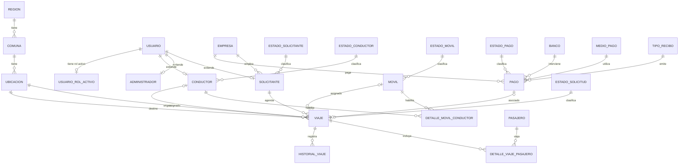

# Aplicacion de Belmonte Spa.
## Especificaciones del proyecto.

**Ultima modificacion:** 20-10-2026

## Integrantes:
* Daniel Muñoz
* Michel Sanhueza

## Indice

- [Introduccion](#introduccion): [Cómo leer esta especificación](#cómo-leer-esta-especificación) · [Actores](#actores)
- [Requisitos](#requisitos): [Casos de uso](#casos-de-uso) · [Requerimientos funcionales](#requerimientos-funcionales) · [Requisitos no funcionales](#requisitos-no-funcionales) · [Historias de usuario y backlog](#historias-de-usuario-y-backlog)
- [Máquinas de estado](#máquinas-de-estado): [Viaje](#viaje) · [Abordaje](#abordaje) · [Pago](#pago) · [Conductor y vehículo](#conductor-y-vehículo)
- [Modelo de datos](#modelo-de-datos)
- [Arquitectura](#arquitectura): [Stack y entornos](#stack-y-entornos)
- [API REST](#api-rest): [Convenciones](#convenciones) · [Recursos y roles](#recursos-y-roles) · [Consultas](#consultas) · [Flujo de una solicitud](#flujo-de-una-solicitud) · [Ubicaciones desde Google Places](#ubicaciones-desde-google-places) · [Acciones de negocio](#acciones-de-negocio) · [Autenticación](#autenticación) · [Contratos JSON](#contratos-json) · [Validaciones](#validaciones) · [Errores](#errores)
- [Backend](#backend): [Paquetes y capas](#paquetes-y-capas) · [Persistencia y transacciones](#persistencia-y-transacciones) · [Datos iniciales](#datos-iniciales) · [Configuración](#configuración) · [Notificaciones](#notificaciones) · [Pruebas](#pruebas)
- [Android](#android): [Arquitectura de la app](#arquitectura-de-la-app) · [Tecnologías y código](#tecnologías-y-código) · [Navegación y pantallas](#navegación-y-pantallas) · [Textos y tema](#textos-y-tema) · [Accesibilidad](#accesibilidad) · [Sesión y conectividad](#sesión-y-conectividad) · [Base de datos local](#base-de-datos-local) · [Push y navegación externa](#push-y-navegación-externa) · [Abordaje con código QR](#abordaje-con-código-qr) · [Compilación y distribución](#compilación-y-distribución) · [Build demo](#build-demo) · [Pruebas Android](#pruebas-android)
- [Limitaciones aceptadas](#limitaciones-aceptadas)
- [Proceso de desarrollo](#proceso-de-desarrollo): [Ramas y pull requests](#ramas-y-pull-requests) · [Integración continua](#integración-continua) · [Definición de terminado](#definición-de-terminado) · [Plan de trabajo](#plan-de-trabajo)

## Introduccion

MVP móvil de Belmonte SpA, empresa de transporte privado corporativo (traslados ejecutivos y
aeropuerto): captura de solicitudes, asignación de conductor y vehículo, abordaje de pasajeros
con código QR y navegación con Google Maps o Waze. Backend Spring Boot con MariaDB; app Android
en Kotlin con Jetpack Compose.

### Cómo leer esta especificación

- **Precedencia:** este README es la fuente de verdad. Los [mockups](mockups/wireframes-belmonte.html)
  ilustran las 46 pantallas; si discrepan, gana el README. `ERS.md` conserva la versión detallada
  anterior como referencia (si difiere, gana este README). `docs/` guarda el material de origen:
  el Anexo de Requerimiento y las instrucciones del curso.
- **Alcance:** lo descrito es obligatorio; lo que no se menciona no se implementa (p. ej. borrar
  registros, pagos en línea, mapa embebido).
- **Rangos y hora:** "de A a B" incluye ambos extremos. "Ahora" es la hora del servidor en
  `America/Santiago`; las fechas no llevan zona.
- **Códigos y etiquetas:** la API y la base usan códigos en mayúsculas (`EN_CURSO`); la app
  muestra su etiqueta en español ([Textos y tema](#textos-y-tema)).

### Actores

| ID | Actor | Rol |
|---|---|---|
| ACT-01 | Solicitante (cliente corporativo) | Agenda traslados para pasajeros de su empresa. |
| ACT-02 | Pasajero | Viaja; puede no ser el Solicitante. Registra su abordaje con el QR del vehículo, sin necesitar cuenta (CU-19). |
| ACT-03 | Administrador (recepcionista) | Asigna conductor y vehículo; gestiona flota, cuentas y pagos. |
| ACT-04 | Conductor | Ve su agenda del día, inicia y finaliza viajes y abre la ruta en Maps o Waze. |
| ACT-05 | Google Maps / Waze | Recibe las coordenadas por Intent y traza la ruta. |

El Anexo agrupa Solicitante y Pasajero; aquí se separan porque el pasajero no pertenece
necesariamente a la empresa que paga (`PASAJERO` no tiene FK a `EMPRESA`).

## Requisitos

### Casos de uso

| CU | Actor | Flujo | Excepciones |
|---|---|---|---|
| CU-01 Registrar solicitud | ACT-01 | Pasajeros, fecha y hora, origen y destino (Places) y vuelo opcional → viaje `PENDIENTE` ([Flujo de una solicitud](#flujo-de-una-solicitud)). | 400 según [Validaciones](#validaciones). |
| CU-02 Ver viajes asignados | ACT-04 | Agenda del día, actualizada desde el backend. | Sin conexión: lo ya sincronizado (RF11). |
| CU-03 Navegar a la ruta | ACT-04 | "Navegar": al origen en `ASIGNADO` y al destino en `EN_CURSO` → Intent a Maps o Waze. | Sin app de navegación: aviso. |
| CU-04 Asignar solicitudes | ACT-03 | Elige la solicitud, un conductor disponible y un vehículo habilitado → [V2](#viaje). | Sin conductores disponibles. Viaje vencido, sin pasajeros o con solapamiento: 409. |
| CU-05 Actualizar estado del traslado | ACT-03, ACT-04 | El Administrador asigna (V2); el Conductor inicia (V3) y finaliza (V4). | Sin reapertura; el único retroceso es el rechazo (CU-16). |
| CU-06 Trazar ruta | ACT-05 | Calcula la ruta con tráfico y la muestra al conductor. | Lo resuelve el sistema externo. |
| CU-07 Registrar conductor | ACT-03 | Nombre, correo único, contraseña inicial y teléfono opcional; luego desactivar o reactivar (RF25). | Correo repetido: 409. El Conductor no cambia ni recupera su contraseña: la reemplaza el Administrador. |
| CU-08 Cancelar solicitud | ACT-01 | Propia, `PENDIENTE` o `ASIGNADO` y no vencida → [V5](#viaje). | Otro estado o vencida: 409. |
| CU-09 Registrar vehículo | ACT-03 | Patente única, capacidad y serial GPS opcional; luego desactivar o reactivar. | Patente repetida: 409. |
| CU-10 Habilitar conductor para vehículo | ACT-03 | Relación M:N entre conductores y vehículos. | Una relación existente no se duplica; no se eliminan. |
| CU-11 Registrar pago | ACT-03 | Viaje no `CANCELADO` y sin pago: monto, banco, medio de pago y tipo de recibo → [P1](#pago). | Cancelado o con pago: 409. |
| CU-12 Cambiar estado del pago | ACT-03 | [P2](#pago) o [P3](#pago); anular cancela el viaje ([V6](#viaje)). | Estado terminal: 409. |
| CU-13 Recuperar contraseña | ACT-01, ACT-03 | Contraseña temporal por correo, que no reemplaza la actual y obliga a cambiarla al entrar. | Correo inexistente o de un Conductor: el mismo mensaje genérico. |
| CU-14 Iniciar sesión | ACT-01, ACT-03, ACT-04 | Correo, contraseña y token FCM → JWT de 8 horas con el rol ([Autenticación](#autenticación)). | Credenciales inválidas o Conductor inactivo: 401 genérico. Solicitante sin aprobar: 403. |
| CU-15 Cancelar viaje (Administrador) | ACT-03 | `PENDIENTE` o `ASIGNADO`, con motivo (y monto a reembolsar si está vencido) → [V7](#viaje). | Otro estado: 409. Sin motivo: 400. |
| CU-16 Rechazar asignación | ACT-04 | `ASIGNADO`, antes de iniciar, con motivo y conexión → [V8](#viaje). | Sin conexión no se ofrece. |
| CU-17 Aprobar Solicitante | ACT-03 | Aprueba o rechaza las cuentas `PENDIENTE` (registradas con el RUT de una empresa existente). | Cuenta ya revisada: 409. |
| CU-18 Registrar Administrador | ACT-03 | Nombre, correo, teléfono opcional y contraseña inicial temporal (`ALTA_TEMPORAL_HORAS`). | Correo repetido: 409. |
| CU-19 Registrar abordaje | ACT-02 | Desde el Login o el Perfil del Solicitante: escanea el QR de la puerta (o ingresa patente y código) y su documento → `fh_abordaje` ([Abordaje](#abordaje)). | QR ajeno: aviso sin enviar. Sin viaje candidato: 404 genérico (RNF08). Sin conexión: no se encola. |

### Requerimientos funcionales

| ID | Actor | Requisito |
|---|---|---|
| **RF01** | Solicitante | Registrarse (la empresa se crea o reutiliza por RUT; con un RUT existente la cuenta queda `PENDIENTE` hasta CU-17) y autenticarse. |
| **RF02** | Solicitante | Registrar una solicitud: pasajeros, fecha, hora, origen y destino con Places, y vuelo opcional. |
| **RF03** | Solicitante | Ver el historial y estado de sus solicitudes. |
| **RF04** | Administrador | Ver las solicitudes pendientes. |
| **RF05** | Administrador | Asignar un conductor activo y disponible y un vehículo habilitado, sin otro viaje a menos de 2 horas (V2). |
| **RF06** | Conductor | Autenticarse con las credenciales que crea el Administrador. |
| **RF07** | Conductor | Ver en tiempo real sus viajes del día. |
| **RF08** | Conductor | Ver el detalle de un viaje asignado. |
| **RF09** | Conductor | Pasar a En curso dentro de ± 1 hora de la hora agendada, y luego a Finalizado (V3, V4). |
| **RF10** | Sistema | Abrir Maps o Waze por Intent con las coordenadas. |
| **RF11** | Sistema | Guardar en Room los viajes consultados y encolar los cambios de estado del Conductor sin conexión. |
| **RF12** | Sistema | Push ante nueva solicitud, asignación, reasignación, rechazo, En curso, Finalizado, cancelación, cambios del pago y cuentas por aprobar. |
| **RF13** | Sistema | Registrar y actualizar el token FCM de cada usuario. |
| **RF14** | Administrador | Registrar Conductores, utilizables de inmediato. |
| **RF15** | Solicitante | Cancelar su solicitud `PENDIENTE` o `ASIGNADO` no vencida, con reembolso del 50 % (V5). |
| **RF16** | Administrador | Registrar vehículos: patente, capacidad y serial GPS opcional. |
| **RF17** | Administrador | Habilitar uno o más conductores por vehículo. |
| **RF18** | Administrador | Registrar el pago de un viaje no cancelado; nace `PENDIENTE`. |
| **RF19** | Administrador | Marcar un pago Pagado, Rechazado o Anulado; anular cancela el viaje. |
| **RF20** | Solicitante | Ver el estado de pago de sus viajes. |
| **RF21** | Solicitante, Administrador | Recuperar la contraseña con una temporal enviada por correo. |
| **RF22** | Administrador | Reasignar un viaje `ASIGNADO` con las reglas de RF05. |
| **RF23** | Administrador | Cancelar un viaje con motivo y reembolso del 100 % (o el monto que fije si está vencido) (V7). |
| **RF24** | Conductor | Rechazar con motivo un viaje asignado antes de iniciarlo (V8). |
| **RF25** | Administrador | Desactivar y reactivar conductores y vehículos sin viajes `ASIGNADO` ni `EN_CURSO`. |
| **RF26** | Administrador | Aprobar o rechazar a los Solicitantes de empresas existentes (CU-17). |
| **RF27** | Administrador | Registrar otros Administradores con contraseña inicial temporal (CU-18). |
| **RF28** | Pasajero | Registrar su abordaje sin cuenta, con el QR de la puerta (o la patente y el código escritos bajo él) y su documento (CU-19). |
| **RF29** | Conductor, Administrador | Ver el arqueo de abordaje de un viaje: cuántos pasajeros abordaron y cuáles faltan. |

### Requisitos no funcionales

- **RNF01 Seguridad:** contraseñas con BCrypt; JWT de 8 horas sin renovación; autorización por
  rol en un único `SecurityFilterChain`. La temporal de RF21 solo viaja en claro por correo.
- **RNF02 Conectividad:** Internet continuo (Anexo §3.3); no es offline-first. Sin conexión se
  consultan los viajes ya sincronizados y se encolan Iniciar/Finalizar del Conductor (RF11).
- **RNF03 Tiempo de respuesta:** consultas en menos de 2 s con 4G/Wi-Fi; un push llega en segundos.
- **RNF04 Usabilidad en terreno:** botones grandes y pocos pasos para el Conductor;
  [Accesibilidad](#accesibilidad) WCAG 2.1 AA.
- **RNF05 Compatibilidad:** Android 8.0 (API 26) o superior; el backend expone solo JSON REST.
- **RNF06 Mantenibilidad:** `Controller-Service-Repository` en el backend y
  `View-ViewModel-Repository` en Android; cada regla se cambia en un solo lugar.
- **RNF07 Servicios externos:** Google Places, FCM y un correo transaccional por SMTP, dentro de
  su cuota gratuita.
- **RNF08 Privacidad:** nombres, teléfonos y direcciones no van a logs; solo los ven el
  Solicitante, el Administrador y el Conductor asignado. El documento del pasajero nunca se
  guarda en claro.
- **RNF09 Datos académicos:** solo datos ficticios o anonimizados (Anexo §4; Leyes 21.719 y
  19.628).
- **RNF10 Entregable:** Git/GitHub y un APK release firmado, publicado en GitHub Releases.

### Historias de usuario y backlog

| HU | RF | Prio. | SP | Historia | Criterios de aceptación |
|---|---|---|---|---|---|
| HU01 | RF01 | Alta | 3 | Solicitante: registro y login | Rechaza correo repetido u obligatorio faltante; login inválido sin decir qué falló; con un RUT existente la cuenta queda por aprobar y el login responde 403. |
| HU02 | RF02 | Alta | 5 | Solicitante: nueva solicitud con Google Places | Origen y destino solo desde Places, con coordenadas; al menos un pasajero (nombre, tipo y documento), fecha y hora; vuelo opcional. |
| HU03 | RF03 | Media | 3 | Solicitante: historial y estado | Por solicitud propia: pasajero, fecha y hora, origen → destino y estado. |
| HU04 | RF04 | Alta | 3 | Administrador: pendientes | Filtro inicial "Pendientes"; "Asignar" directo si el viaje no está vencido y tiene pasajeros. |
| HU05 | RF05 | Alta | 5 | Administrador: asignar | Solo conductores activos y disponibles con vehículos habilitados; 409 por solapamiento; el viaje entra a la agenda del Conductor. |
| HU06 | RF06 | Alta | 2 | Conductor: login con credenciales del Administrador | Sin "crear cuenta"; credenciales inválidas no revelan si el correo existe. |
| HU07 | RF07 | Alta | 3 | Conductor: viajes del día en tiempo real | Solo los suyos, de hoy (más su `EN_CURSO` de un día anterior), por hora, con pasajero y estado. |
| HU08 | RF08 | Alta | 3 | Conductor: detalle del viaje | Pasajeros, vuelo, origen y destino; "Navegar" y controles de estado. |
| HU09 | RF09 | Alta | 3 | Conductor: En Curso y Finalizado | Iniciar solo en `ASIGNADO` dentro de ± 1 hora; Finalizar en `EN_CURSO`; al finalizar, conductor y vehículo quedan Disponibles. |
| HU10 | RF10 | Alta | 3 | Conductor: ruta en Google Maps o Waze | Origen en `ASIGNADO`, destino en `EN_CURSO`; sin app, aviso. |
| HU11 | RF11 | Media | 8 | Conductor: uso sin conexión | Lo cargado se consulta sin conexión; Iniciar y Finalizar se encolan como "Pendiente de sincronizar" y se envían al reconectar. |
| HU12 | RF12 | Media | 5 | Solicitante: push de estado | Push al pasar a `ASIGNADO`, `EN_CURSO` o `FINALIZADO`. |
| HU13 | RF12 | Alta | 5 | Conductor: push de asignación | Push al asignársele; al abrirlo, el viaje está en su agenda. |
| HU14 | RF13 | Alta | 3 | Todos: token de notificaciones | El login registra o reemplaza el token FCM, sin duplicar. |
| HU15 | RF14 | Alta | 3 | Administrador: alta de Conductor | Correo único; contraseña definida por el Administrador; asignable con un vehículo habilitado. |
| HU16 | RF15 | Alta | 3 | Solicitante: cancelar | Solo `PENDIENTE` o `ASIGNADO` no vencido; avisa al conductor, reembolsa el 50 % de un pago `PAGADO` y anula uno `PENDIENTE`. |
| HU17 | RF16 | Media | 3 | Administrador: alta de vehículo | Patente única; capacidad de 1 a 20; nace Disponible y activo. |
| HU18 | RF17 | Media | 2 | Administrador: habilitaciones | M:N sin duplicar. |
| HU19 | RF18 | Media | 5 | Administrador: registrar pago | Viaje no cancelado; banco, medio y tipo de recibo desde catálogos; nace `PENDIENTE`. |
| HU20 | RF19 | Media | 3 | Administrador: estado del pago | P2 y P3 manuales, P4 y P5 automáticas; anular cancela el viaje (V6). |
| HU21 | RF20 | Baja | 2 | Solicitante: estado de pago | En el detalle de la solicitud, si tiene pago. |
| HU22 | RF21 | Media | 3 | Solicitante/Administrador: recuperar contraseña | Solo esos roles; mensaje genérico; la temporal vence y obliga a cambiar la contraseña. |
| HU23 | RF22 | Media | 3 | Administrador: reasignar | Solo `ASIGNADO`, con las reglas de HU05; push al nuevo conductor, al reemplazado y al Solicitante. |
| HU24 | RF23 | Alta | 3 | Administrador: cancelar un viaje | Motivo obligatorio; reembolso del 100 %, o el monto fijado si está vencido. |
| HU25 | RF24 | Media | 2 | Conductor: rechazar una asignación | Solo `ASIGNADO`, antes de iniciar y con conexión; vuelve a `PENDIENTE` y avisa. |
| HU26 | RF25 | Media | 3 | Administrador: dar de baja | Desactivar o reactivar; 409 con viajes `ASIGNADO` o `EN_CURSO`; un inactivo no se asigna ni inicia sesión. |
| HU27 | RF26 | Media | 3 | Administrador: aprobar solicitantes | "Cuentas por aprobar"; aprobar o rechazar avisa por correo. |
| HU28 | RF27 | Baja | 2 | Administrador: registrar otro Administrador | Contraseña inicial temporal, que debe cambiar al entrar. |
| HU29 | RF28 | Alta | 5 | Pasajero: abordar con el código QR | Desde el Login o el Perfil; QR o patente y código; documento; 404 genérico sin viaje candidato; repetir da la misma hora; el documento no se guarda. |
| HU30 | RF29 | Alta | 3 | Conductor: arqueo de abordaje | En el detalle del Conductor y del Administrador, en `ASIGNADO`, `EN_CURSO` y `FINALIZADO`; la confirmación de "Iniciar viaje" avisa cuántos faltan, sin impedirlo. |

Total: 102 SP.

## Máquinas de estado

Fuente única de las transiciones. Toda transición inválida responde 409 y cada cambio queda en
`HISTORIAL_VIAJE` (triggers). Los triggers revalidan estados y capacidad; las reglas horarias las
valida solo el backend.

### Viaje

`PENDIENTE → ASIGNADO → EN_CURSO → FINALIZADO`, más `CANCELADO` desde `PENDIENTE` o `ASIGNADO`.
`CANCELADO` se suma a los 4 estados del Anexo para auditar sin borrar.

| ID | Transición | Quién | Precondiciones | Efectos |
|---|---|---|---|---|
| V1 | alta → `PENDIENTE` | Solicitante aprobado | `fh_agenda` de 2 horas a 90 días desde ahora (si no, 400). | La base genera el `folio`; push a los Administradores. |
| V2 | `PENDIENTE`/`ASIGNADO` → `ASIGNADO` | Administrador | No vencido; al menos un pasajero; conductor y vehículo activos, Disponibles y habilitados entre sí; pasajeros ≤ capacidad; ninguno con otro viaje `ASIGNADO` o `EN_CURSO` a menos de 2 horas (`abs(fh_agenda − fh_agenda del otro) < 2 h`). Al reasignar solo se valida lo que cambia. | `fh_asignacion`; no cambia el estado del conductor ni del vehículo. Si cambia el vehículo, los pasajeros vuelven a Por abordar. Push al conductor, al Solicitante y, si cambia el conductor, al reemplazado. |
| V3 | `ASIGNADO` → `EN_CURSO` | Conductor asignado | `fh_agenda − 1 h ≤ ahora ≤ fh_agenda + 1 h`; conductor y vehículo sin otro viaje `EN_CURSO`. | `fh_inicio`; conductor Ocupado y vehículo En uso; push al Solicitante. |
| V4 | `EN_CURSO` → `FINALIZADO` | Conductor asignado | — | `fh_fin`; conductor y vehículo Disponibles; push al Solicitante. |
| V5 | `PENDIENTE`/`ASIGNADO` → `CANCELADO` | Solicitante dueño | No vencido. | Sale de la agenda y push al conductor; pago `PAGADO` → reembolso del 50 %, redondeado hacia abajo (P4); `PENDIENTE` → anulado (P5). |
| V6 | `PENDIENTE`/`ASIGNADO` → `CANCELADO` | Sistema, al anular el pago (P2 o P3) | — | Como V5, sin reembolso; push al Solicitante. |
| V7 | `PENDIENTE`/`ASIGNADO` → `CANCELADO` | Administrador | `motivo`. | Como V5; pago `PAGADO` → reembolso del 100 % (vencido: el monto que fije, de 0 al total; con 0 sigue `PAGADO`); `PENDIENTE` → P5; push al Solicitante. |
| V8 | `ASIGNADO` → `PENDIENTE` | Conductor asignado | `motivo`; con conexión (no se encola). | Quita conductor, vehículo, `fh_asignacion` y las marcas de abordaje; push a los Administradores y al Solicitante. El pago no cambia. |

**Retraso** (se calcula, no es un estado; lo calculan el backend al validar y la app al mostrar,
también sin conexión). Un viaje `PENDIENTE` o `ASIGNADO` está **Atrasado** si
`fh_agenda < ahora ≤ fh_agenda + 1 h` (aún puede iniciarse) y **Vencido** si
`ahora > fh_agenda + 1 h`: no se inicia, no se asigna ni lo cancela el Solicitante; el
Administrador lo cancela con V7 y decide el reembolso.

### Abordaje

- Es una marca por pasajero en su viaje (`DETALLE_VIAJE_PASAJERO.fh_abordaje`): con fecha,
  Abordado; NULL, Por abordar. No cambia ningún otro estado.
- `POST /api/v1/abordajes` (público) recibe la patente y el `codigo_abordaje` del QR, y el
  documento. Los candidatos son los viajes de ese vehículo `ASIGNADO` dentro de la ventana de V3 o
  `EN_CURSO`; el `dni_hash` elige el viaje (si calza en varios, el de `fh_agenda` más cercana a
  ahora). Fija `fh_abordaje` = ahora si era NULL y responde la marca guardada: repetir no la cambia.
- Patente inexistente, código ajeno, sin viaje candidato o documento que no viaja: el mismo 404
  "No encontramos un viaje para este documento en este vehículo" (RNF08). No hay 409 de abordaje.
- V2 con cambio de vehículo y V8 limpian las marcas del viaje. Un pasajero agregado a un viaje
  `ASIGNADO` nace Por abordar.
- **Arqueo (RF29):** "Abordaron X de N" (N = `cantidad_pasajeros`) y la lista de los que faltan.
  Lo calcula la app desde los `pasajeros` de `ViajeDTOResponse`.
- El código impreso no caduca ([Limitaciones aceptadas](#limitaciones-aceptadas)).

### Pago

Un viaje tiene a lo más un pago.

| ID | Desde → hacia | Cómo |
|---|---|---|
| P1 | alta → `PENDIENTE` | Administrador, en un viaje no `CANCELADO`; el backend genera su `hash`. |
| P2 | `PENDIENTE` → `PAGADO`, `RECHAZADO` o `ANULADO` | Manual (Administrador); `PAGADO` fija `fecha_pago`. |
| P3 | `PAGADO` → `ANULADO` | Manual (Administrador). |
| P4 | `PAGADO` → `REEMBOLSADO` | Automático en V5 (50 %) o V7 (100 % o el monto fijado); fija `monto_reembolsado`. |
| P5 | `PENDIENTE` → `ANULADO` | Automático en V5 o V7. |

- `RECHAZADO`, `ANULADO` y `REEMBOLSADO` son terminales. Todo cambio avisa por push al Solicitante.
- Anular por P2 o P3 un viaje `PENDIENTE` o `ASIGNADO` lo cancela (V6).
- Sin re-cobro: un pago no se reemplaza (`POST /pagos` responde 409 si el viaje ya tiene uno).

### Conductor y vehículo

- **Disponible** = sin viaje `EN_CURSO`; Ocupado (conductor) o En uso (vehículo) solo de V3 a V4.
  Pueden tener varios viajes `ASIGNADO` (su agenda).
- **`activo`:** nacen activos. Se desactivan solo sin viajes `ASIGNADO` ni `EN_CURSO` (409) y se
  reactivan sin condiciones; repetir el mismo valor responde 200 sin cambios. Un inactivo no se
  asigna, y un Conductor inactivo no inicia sesión (401 genérico).

## Modelo de datos

MariaDB; el esquema lo crean las migraciones Flyway. Las PK son `BIGINT UNSIGNED`
`AUTO_INCREMENT`, salvo en las extensiones 1:1 de `USUARIO`. `?` = admite NULL; UQ = UNIQUE.

| Tabla | Columnas | Notas |
|---|---|---|
| `USUARIO` | `nombre`, `correo` UQ, `telefono?`, `password_hash`, `password_temporal_hash?`, `password_temporal_expira?`, `fecha_registro`, `token_fcm?` UQ | BCrypt. La temporal es la de RF21 o CU-18. |
| `SOLICITANTE`, `ADMINISTRADOR`, `CONDUCTOR` | PK y FK `id_usuario`. Solicitante: `empresa_id_empresa`, `estado_solicitante_id`. Conductor: `estado_conductor_id_estado`, `activo` | Un rol por usuario: `USUARIO_ROL_ACTIVO` (PK `id_usuario`, llenada por triggers) rechaza un segundo rol. |
| `EMPRESA` | `razon_social`, `rut` UQ | Se crea o reutiliza en el autorregistro. |
| `MOVIL` | `patente` UQ, `capacidad`, `gps_serial?`, `activo`, `estado_movil_id_estado_mov`, `codigo_abordaje` UQ | `codigo_abordaje`: 16 hexadecimales en mayúsculas (8 bytes de `SecureRandom`); solo lo ve el Administrador. |
| `DETALLE_MOVIL_CONDUCTOR` | PK (`id_movil`, `id_usuario`) | Habilitaciones M:N. |
| `VIAJE` | `folio` UQ, `id_solicitante`, `id_origen`, `id_destino`, `id_estado`, `movil_id_movil?`, `conductor_id_usuario?`, `pago_id?` UQ, `cantidad_pasajeros`, `fh_creacion`, `fh_agenda`, `fh_asignacion?`, `fh_inicio?`, `fh_fin?`, `numero_vuelo?`, `motivo?` | `folio` = `TR-` + correlativo desde 1001, generado por trigger e inmutable. `cantidad_pasajeros` lo mantiene un trigger y no supera la capacidad del vehículo. |
| `UBICACION` | `direccion`, `id_comuna`, `latitud`, `longitud` (UQ compuesto) | Origen y destino de los viajes. |
| `REGION`, `COMUNA` | `nombre` (UQ en su región) | Las 16 regiones y 346 comunas de Chile. |
| `PASAJERO` | `dni_hash` UQ, `nombre` | `dni_hash` = HMAC-SHA256 (`DNI_SECRET`) del documento normalizado, en Base64url (43 caracteres). |
| `DETALLE_VIAJE_PASAJERO` | PK (`id_viaje`, `id_pasajero`), `fh_abordaje?` | Pasajeros de cada viaje y su marca de abordaje. |
| `PAGO` | `hash` UQ, `monto`, `estado_pago_id`, `banco_id`, `empresa_id_empresa`, `medio_pago_id`, `tipo_recibo_id`, `fecha_pago?`, `monto_reembolsado?` | `hash`: 32 hexadecimales en minúsculas (UUID v4 sin guiones). |
| `HISTORIAL_VIAJE` | `id_viaje`, `campo_modificado`, `valor`, `fecha_cambio` | Lo escriben triggers de `VIAJE` por cada cambio de `estado`, `conductor`, `movil`, `cantidad_pasajeros`, `pago` o `motivo`. No se expone. |
| Catálogos | `ESTADO_SOLICITUD`, `ESTADO_SOLICITANTE`, `ESTADO_CONDUCTOR`, `ESTADO_MOVIL`, `ESTADO_PAGO`, `MEDIO_PAGO`, `TIPO_RECIBO` y `BANCO` (`nombre`, `cod_sbif` UQ) | Cambian solo por migración ([Datos iniciales](#datos-iniciales)). |

**Decisiones de modelo:** roles como subtipos 1:1 de `USUARIO`, más `USUARIO_ROL_ACTIVO`;
catálogos en vez de `CHECK`; `cantidad_pasajeros` desnormalizado por trigger para no contar en
cada agenda (RNF03); 3FN con `UBICACION` aparte de `VIAJE` y el par `PASAJERO` +
`DETALLE_VIAJE_PASAJERO`, que también guarda `fh_abordaje`.



## Arquitectura

### Stack y entornos

| Capa | Decisión |
|---|---|
| Base de datos | MariaDB 11.4 (InnoDB, `utf8mb4_unicode_ci`). |
| Backend | Spring Boot 4.1, Java 21 y Gradle (Groovy DSL); `Controller → Service → Repository` con Spring Data JPA y Flyway. |
| Seguridad | Spring Security como resource server con JWT HS256; un `SecurityFilterChain` con `denyAll` por defecto. Sin JWT solo `POST /auth/login`, `POST /auth/recuperar-password`, `POST /solicitantes` y `POST /abordajes`. |
| Integraciones | Firebase Admin SDK (push) y `spring-boot-starter-mail` ([Notificaciones](#notificaciones)). |
| Android | Kotlin y Jetpack Compose, MVVM con Repository ([Android](#android)). |

`database/docker-compose.yaml` levanta `mariadb` (`belmonte-mariadb`, puerto `3307`) y `mailpit`
(`belmonte-mailpit`, SMTP `1025` y web <http://localhost:8025>), ambos solo en `127.0.0.1`:
`cp .env.example .env` y `docker compose --env-file .env -f database/docker-compose.yaml up -d`.
La API lee `DB_URL`, `DB_USER` y `DB_PASSWORD` del entorno, y Flyway migra al iniciar.

| Entorno | Backend y base | Correo | Push | App |
|---|---|---|---|---|
| Desarrollo | Compose local y `./gradlew bootRun` | Mailpit | Opcional | Debug contra `10.0.2.2` |
| Demostración | Compose y backend en un computador anfitrión con IP fija, en una red controlada (solo el `8080` abierto), con `.env.demo` | Proveedor transaccional | Firebase | Release contra la IP del anfitrión |
| Sin backend | Ninguno: Room con `DatosDemo` ([Build demo](#build-demo)) | — | — | Build `demo` |

- **`database/demo.sql`** (no es migración; se recarga antes de cada demostración y de `FlujosE2ETest`):
  vacía las tablas de negocio y carga 2 Administradores, 4 Conductores y 4 vehículos (1 inactivo
  de cada uno; cada Conductor activo habilitado para un vehículo activo), 2 empresas,
  3 Solicitantes (1 `PENDIENTE`), viajes y pagos en sus 5 estados (un viaje atrasado y otro
  vencido, con `fh_agenda` relativa a `NOW()`), un `codigo_abordaje` fijo por vehículo y un viaje
  `ASIGNADO` a `NOW()` + 30 min con 3 pasajeros, 1 ya abordado. Su comentario inicial da la
  contraseña ficticia común y el Conductor de ese viaje.
- Antes de cada demostración, un `mariadb-dump` guardado fuera del repositorio.
- **Secretos** (`JWT_SECRET`, `DNI_SECRET`, SMTP y el JSON de Firebase) solo en el anfitrión:
  `.env.demo` fuera de Git y `.env.demo.example` con las variables sin valores.

## API REST

### Convenciones

- Prefijo `/api/v1/` y JSON. Las rutas usan la clave UNIQUE de negocio, nunca el `id`. Sin paginación.
- `GET /{recurso}` lista y `GET /{recurso}/{clave}` consulta. `POST` crea con `201`, o `200` si el
  par de una tabla puente o el documento de `POST /pasajeros` ya existían (y en `POST /abordajes`).
- `PUT` solo en `usuarios` (cuenta propia) y `conductores` (Administrador); reemplaza los campos
  editables. Sin `DELETE`. `viajes` y `pagos` cambian solo por [Acciones de negocio](#acciones-de-negocio).
- `GET /api/v1/catalogos` entrega bancos, medios de pago, tipos de recibo, regiones y comunas; los
  catálogos de estado son códigos dentro de las respuestas y `ubicaciones` va dentro de `viajes`.
- Tablas puente, sin `PUT`: `/api/v1/habilitaciones-movil-conductor/{patente}/{correo}` y
  `/api/v1/pasajeros-viaje/{folio}/{dni_hash}`.

### Recursos y roles

| Recurso | Clave | Roles y alcance |
|---|---|---|
| `auth` | — | Público; `logout` y `token-fcm` con JWT ([Autenticación](#autenticación)). |
| `catalogos` | — | Cualquier rol autenticado, solo `GET`. |
| `usuarios` | `correo` | Cada uno su cuenta: `GET`, y `PUT` salvo el Conductor. Sin `POST`. |
| `administradores` | `correo` | Administrador: consulta y alta (CU-18). |
| `conductores` | `correo` | Administrador: alta, consulta, `PUT` y `activo`. Conductor: su cuenta. |
| `solicitantes` | `correo` | Público: `POST` (RF01). Solicitante: su cuenta. Administrador: lectura, aprobar y rechazar. Sin `PUT`. |
| `empresas` | `rut` | Administrador, solo lectura; se crean dentro de `POST /solicitantes`. |
| `moviles` | `patente` | Administrador. |
| `habilitaciones-movil-conductor` | `{patente}/{correo}` | Administrador. |
| `pagos` | `hash` | Administrador. Solicitante: lectura de los pagos de sus viajes. |
| `pasajeros` | `dni_hash` | Solicitante: crea. Administrador: lectura. |
| `pasajeros-viaje` | `{folio}/{dni_hash}` | Solicitante: en sus viajes. Administrador: lectura. |
| `viajes` | `folio` | Solicitante: los propios, no los de su empresa. Administrador: todos. Conductor: los asignados a él. |
| `abordajes` | — | Público, solo `POST`. |

Una cuenta ajena responde 403, exista o no. También responde 403 un viaje fuera del alcance,
incluido uno que se reasignó o que el Conductor rechazó. Al Conductor, `hashPago` y
`estadoPago` le llegan en `null`.

### Consultas

- `GET /viajes` acepta `estado` y `fecha` (`AAAA-MM-DD`), combinables. Sin filtros, el Conductor
  recibe su agenda de hoy (sus `ASIGNADO`, `EN_CURSO` y `FINALIZADO` del día, más un `EN_CURSO`
  de un día anterior) y los demás roles, todo su alcance.
- `GET /solicitantes?estado=PENDIENTE` y `GET /habilitaciones-movil-conductor?patente=&correo=`.
  Un filtro mal formado responde 400; uno desconocido se ignora.
- **Orden:** `viajes` por `fhAgenda` ascendente en la agenda y con estado `PENDIENTE`, `ASIGNADO`
  o `EN_CURSO`, descendente en los demás casos, y empate por `folio`. Cuentas y pasajeros por
  `nombre`, `empresas` por `razonSocial`, `moviles` por `patente`, habilitaciones por `patente` y
  `nombreConductor`, `pagos` por `folio` descendente. El `folio` se ordena por su número
  (`TR-9999` antes que `TR-10000`) y los textos con `utf8mb4_unicode_ci`.
- `ViajeDTOResponse.pasajeros` trae `dniHash`, `nombre` y `fhAbordaje`. `POST /pasajeros` con un
  documento ya registrado responde `200` con `nombre` `null` (RNF08) y no cambia el guardado.

### Flujo de una solicitud

1. `POST /api/v1/pasajeros` por cada pasajero → su `dniHash`.
2. `POST /api/v1/viajes` → viaje `PENDIENTE` del Solicitante del JWT, con su `folio`.
3. `POST /api/v1/pasajeros-viaje` por cada pasajero; un trigger suma `cantidad_pasajeros`.

- Solo el dueño agrega pasajeros, con el viaje `PENDIENTE` o `ASIGNADO` y sin superar la capacidad
  del vehículo asignado (409). Un pasajero asociado no se quita.
- "Enviar solicitud" se bloquea hasta terminar. Si falla el paso 1 o 2, el formulario conserva los
  datos. Si falla el 3, se abre igual el detalle, que con 0 pasajeros avisa "Faltan pasajeros: el
  viaje no se puede asignar hasta agregar al menos uno"; "Agregar pasajero" repite los pasos 1 y 3.
- Si el paso 2 no responde a tiempo, la app no reintenta: muestra "No pudimos confirmar el envío.
  Revisa «Mis solicitudes» antes de enviarla de nuevo." y recarga la lista.

### Ubicaciones desde Google Places

- **Android:** Places SDK restringido a `CL`, en español y con un token de sesión por búsqueda
  (RNF07). `direccion` = nombre del establecimiento o, si no es uno, calle y número (máx. 200);
  `comuna` = `administrative_area_level_3` o `locality`; `region` = `administrative_area_level_1`;
  coordenadas con 6 decimales.
- **Backend:** normaliza `comuna` y `region` (minúsculas, sin tildes, `ñ` → `n`, sin el prefijo
  "región de la", "región del", "región de" o "región") y busca la comuna, cuyo nombre es único:
  la región no rechaza una comuna que calza. Guarda los nombres oficiales; sin coincidencia,
  400 `origen.comuna: No existe en el catálogo.`
- **Respaldo:** si falta la comuna o llega ese 400, la app ofrece un selector de región y comuna
  (de `GET /catalogos`) que solo corrige la comuna y conserva la dirección y las coordenadas.

### Acciones de negocio

Todas son `POST` con el prefijo `/api/v1/`. Las reglas están en [Máquinas de estado](#máquinas-de-estado).

| Ruta | Rol | Cuerpo | Acción |
|---|---|---|---|
| `viajes/{folio}/asignar` | Administrador | `correoConductor`, `patente` | V2: asignar o reasignar. |
| `viajes/{folio}/estado` | Conductor asignado | `estado`: `EN_CURSO` o `FINALIZADO` | V3 o V4. |
| `viajes/{folio}/cancelar` | Solicitante dueño | — | V5. |
| `viajes/{folio}/cancelar` | Administrador | `motivo`, `montoReembolso?` | V7. |
| `viajes/{folio}/rechazar` | Conductor asignado | `motivo` | V8. |
| `pagos/{hash}/estado` | Administrador | `estado`: `PAGADO`, `RECHAZADO` o `ANULADO` | P2 o P3; `ANULADO` dispara V6. |
| `conductores/{correo}/activo` | Administrador | `activo` | Desactivar o reactivar (RF25). |
| `moviles/{patente}/activo` | Administrador | `activo` | Desactivar o reactivar (RF25). |
| `solicitantes/{correo}/aprobar` | Administrador | — | Aprobar la cuenta (CU-17); correo al Solicitante; 409 si ya se revisó. |
| `solicitantes/{correo}/rechazar` | Administrador | — | Rechazar la cuenta (CU-17); correo al Solicitante; 409 si ya se revisó. |
| `abordajes` | Público | `patente`, `codigoAbordaje`, `tipoDocumento`, `dni` | CU-19; responde `200` con `fhAbordaje`. |

### Autenticación

| Ruta | JWT | Acción |
|---|---|---|
| `POST /api/v1/auth/login` | No | CU-14. |
| `POST /api/v1/auth/logout` | Sí | Deja `token_fcm` en NULL; `204`. |
| `POST /api/v1/auth/token-fcm` | Sí | Reemplaza el token FCM (RF13). |
| `POST /api/v1/auth/recuperar-password` | No | CU-13; siempre `204`. |

- **JWT:** HS256 con `JWT_SECRET`; `sub` (correo), `rol` y `exp` (`JWT_EXPIRATION_SECONDS`). Va
  como `Authorization: Bearer <token>`; no se renueva ni se revoca.
- **Login:** con la contraseña normal, anula una temporal pendiente. Con la temporal vigente,
  responde `cambioPasswordRequerido: true` y un JWT con `temporal: true` que solo permite `GET` y
  `PUT /usuarios/{correo}` propios y `POST /auth/logout` (otra ruta: 403 "Debes cambiar la
  contraseña"). Correo desconocido, contraseña incorrecta, temporal vencida, usuario sin rol o
  Conductor inactivo: el mismo 401 "Credenciales inválidas". Solicitante no aprobado: 403.
- **Temporal (solo Solicitante y Administrador):** 12 caracteres, guardada en
  `password_temporal_hash`, vence a `PASSWORD_TEMPORAL_MINUTOS` y llega por correo. No reemplaza
  la actual (ambas sirven hasta usar una); otro pedido la reemplaza y cambiar la contraseña la anula.
- **Token FCM:** único; al guardarlo se quita de cualquier otro usuario.
- **Administrador inicial:** `admin@belmontespa.cl`, creado por migración con una contraseña
  temporal de desarrollo (en el comentario de la migración) que vence a los 30 días.

### Contratos JSON

- camelCase; estados, roles y tipos como códigos en mayúsculas; `medioPago` y `tipoRecibo` son el
  `nombre` del catálogo y el banco va por su `codSbif`. Montos enteros en CLP.
- Fechas `LocalDateTime` sin zona (`2026-09-24T14:30:00`) en `America/Santiago`; solo
  `ApiError.timestamp` va en UTC con `Z`.
- Opcional ausente = `null`; texto en blanco = ausente; campos desconocidos se ignoran. Las
  respuestas incluyen los `null` y nunca llevan `id`, `password_hash` ni el documento en claro.

**Peticiones** (`?` = opcional):

| DTO | Ruta | Campos |
|---|---|---|
| `LoginDTORequest` | `POST /auth/login` | `correo`, `password`, `tokenFcm?` |
| `TokenFcmDTORequest` | `POST /auth/token-fcm` | `tokenFcm` |
| `RecuperarPasswordDTORequest` | `POST /auth/recuperar-password` | `correo` |
| `SolicitanteDTORequest` | `POST /solicitantes` | `nombre`, `correo`, `telefono?`, `password`, `razonSocial`, `rutEmpresa` |
| `ConductorDTORequest` | `POST /conductores`, `PUT /conductores/{correo}` | `nombre`, `correo`, `telefono?`, `password` (opcional en `PUT`) |
| `AdministradorDTORequest` | `POST /administradores` | `nombre`, `correo`, `telefono?`, `password` (inicial y temporal) |
| `UsuarioDTORequest` | `PUT /usuarios/{correo}` | `nombre`, `correo`, `telefono?`, `password?`, `passwordActual?` |
| `MovilDTORequest` | `POST /moviles` | `patente`, `capacidad`, `gpsSerial?` |
| `DetalleMovilConductorDTORequest` | `POST /habilitaciones-movil-conductor` | `patente`, `correoConductor` |
| `PasajeroDTORequest` | `POST /pasajeros` | `tipoDocumento` (`RUT` o `PASAPORTE`), `dni`, `nombre` |
| `DetalleViajePasajeroDTORequest` | `POST /pasajeros-viaje` | `folio`, `dniHash` |
| `ViajeDTORequest` | `POST /viajes` | `fhAgenda`, `origen` y `destino` (`{direccion, comuna, region, latitud, longitud}`), `numeroVuelo?` |
| `PagoDTORequest` | `POST /pagos` | `folio`, `monto`, `codSbif`, `medioPago`, `tipoRecibo` |
| `AsignarViajeDTORequest` | `POST /viajes/{folio}/asignar` | `correoConductor`, `patente` |
| `CambiarEstadoViajeDTORequest`, `CambiarEstadoPagoDTORequest` | `POST /viajes/{folio}/estado`, `POST /pagos/{hash}/estado` | `estado` |
| `CancelarViajeDTORequest` | `POST /viajes/{folio}/cancelar` (solo el Administrador envía cuerpo) | `motivo`, `montoReembolso?` |
| `RechazarViajeDTORequest` | `POST /viajes/{folio}/rechazar` | `motivo` |
| `ActivoDTORequest` | `POST /conductores/{correo}/activo`, `POST /moviles/{patente}/activo` | `activo` |
| `AbordajeDTORequest` | `POST /abordajes` | `patente`, `codigoAbordaje`, `tipoDocumento`, `dni` |

- **`PUT`:** el `correo` debe ser el de la ruta (400); `telefono` ausente lo borra; sin `password`
  se conserva la actual y con ella se reemplaza y se anula la temporal. En `PUT /usuarios`,
  `password` exige `passwordActual` (la temporal vigente cuenta); si falta o no coincide, 400
  `passwordActual: No coincide.` En `PUT /conductores` el Administrador no la necesita.
- La empresa de `POST /pagos` es la del Solicitante del viaje. `dni` se normaliza, se convierte en
  `dni_hash` y se descarta; `tipoDocumento` no se guarda.

**Respuestas** (`?` = puede ser `null`):

| DTO | Campos |
|---|---|
| `LoginDTOResponse` | `accessToken`, `tokenType` (`Bearer`), `expiresIn` (segundos), `cambioPasswordRequerido`, `correo`, `rol` |
| `UsuarioDTOResponse`, `AdministradorDTOResponse` | `nombre`, `correo`, `telefono?`, `fechaRegistro` |
| `ConductorDTOResponse` | Los de usuario, más `activo`, `estadoConductor`, `viajesAsignados` (cantidad en `ASIGNADO`) y `folioEnCurso?` |
| `SolicitanteDTOResponse` | Los de usuario, más `razonSocial`, `rutEmpresa` y `estadoSolicitante` |
| `EmpresaDTOResponse` | `razonSocial`, `rut` |
| `MovilDTOResponse` | `patente`, `capacidad`, `gpsSerial?`, `activo`, `estadoMovil`, `codigoAbordaje` |
| `DetalleMovilConductorDTOResponse` | `patente`, `capacidad`, `estadoMovil`, `activoMovil`, `correoConductor`, `nombreConductor`, `estadoConductor`, `activoConductor` |
| `PasajeroDTOResponse` | `dniHash`, `nombre?`, `fhAbordaje?` (solo dentro de un viaje) |
| `DetalleViajePasajeroDTOResponse` | `folio`, `dniHash`, `nombrePasajero` |
| `ViajeDTOResponse` | `folio`, `estado`, `correoSolicitante`, `nombreSolicitante`, `telefonoSolicitante?`, `razonSocial`, `origen`, `destino`, `fhCreacion`, `fhAgenda`, `fhAsignacion?`, `fhInicio?`, `fhFin?`, `numeroVuelo?`, `cantidadPasajeros`, `correoConductor?`, `nombreConductor?`, `patenteMovil?`, `hashPago?`, `estadoPago?`, `motivo?`, `pasajeros` |
| `AbordajeDTOResponse` | `fhAbordaje` (la marca guardada) |
| `PagoDTOResponse` | `hash`, `folio`, `monto`, `estadoPago`, `banco`, `codSbif`, `rutEmpresa`, `medioPago`, `tipoRecibo`, `fechaPago?`, `montoReembolsado?` |
| `CatalogosDTOResponse` | `bancos` (`{nombre, codSbif}`), `mediosPago`, `tiposRecibo`, `regiones` (`{nombre, comunas}`), todo ordenado por nombre |
| `ApiError` | `timestamp`, `status`, `error`, `message`, `path` |

### Validaciones

Las reglas se aplican después de normalizar, y el backend guarda el valor normalizado. Android
las repite antes de enviar, sin reemplazar las del backend.

| Campo | Regla | Normalización |
|---|---|---|
| `correo`, `correoConductor` | `^[^\s@]+@[^\s@]+\.[^\s@]+$`, hasta 150 caracteres. | Recortado y en minúsculas. |
| `nombre` / `razonSocial` / `direccion` / `motivo` | De 2 a 120 / de 2 a 50 / de 1 a 200 / de 5 a 200 caracteres. | Recortados. |
| `telefono` | 9 dígitos chilenos, con o sin `+56`; normalizado cumple `^\+56[0-9]{9}$`. | Sin espacios, guiones ni paréntesis: `+56955550101`. |
| `password` | De 8 a 72 caracteres (máx. 72 bytes UTF-8, por BCrypt), con al menos una letra (`\p{L}`) y un dígito. | Ninguna. |
| `passwordActual` | Solo al cambiar la contraseña propia; se compara con el hash. | Ninguna. |
| `rutEmpresa`, `dni` de tipo `RUT` | 7 u 8 dígitos y DV por módulo 11: factores 2, 3, 4, 5, 6, 7, 2… de derecha a izquierda; `11 − suma mod 11`, con 11 → `0` y 10 → `K`. Acepta puntos y guion. | `EMPRESA.rut` sin puntos, con guion y `K` mayúscula (`76543210-3`). |
| `dni` de tipo `PASAPORTE` | De 5 a 20 letras `A-Z` o dígitos. | Para el hash, todo `dni` va sin puntos, guion ni espacios y en mayúsculas. |
| `tipoDocumento` / `estado` / `activo` | `RUT` o `PASAPORTE` / uno de los valores de su DTO / booleano obligatorio. | — |
| `patente` | `^([A-Z]{2}[0-9]{4}\|[A-Z]{4}[0-9]{2})$` | En mayúsculas, sin espacios ni guion. |
| `codigoAbordaje` | `^[0-9A-F]{16}$` | En mayúsculas, sin espacios. |
| `capacidad` / `gpsSerial` / `monto` | Enteros: de 1 a 20 / mayor que 0 / mayor que 0. | — |
| `fhAgenda` | `ahora + 2 h ≤ fhAgenda ≤ ahora + 90 días`. | Se trunca al minuto. |
| `comuna`, `region` | Cotejo de [Ubicaciones desde Google Places](#ubicaciones-desde-google-places). | Nombres oficiales. |
| `latitud`, `longitud` | De −90 a 90 y de −180 a 180, hasta 6 decimales; origen distinto de destino. | — |
| `numeroVuelo` | `^[A-Z0-9]{2}[0-9]{1,4}[A-Z]?$` | En mayúsculas, sin espacios: `la 1502` → `LA1502`. |
| `codSbif`, `medioPago`, `tipoRecibo` | Existen en su catálogo. | `medioPago` y `tipoRecibo` en mayúsculas. |
| `montoReembolso` | De 0 al `monto` del pago. Obligatorio solo si el Administrador cancela un viaje vencido con pago `PAGADO`; si no, se ignora. | — |
| `tokenFcm` | Hasta 255 caracteres; obligatorio en `/auth/token-fcm`. | — |
| `folio`, `hash`, `dniHash` | `^TR-[1-9][0-9]{3,16}$`, `^[0-9a-f]{32}$` y 43 caracteres Base64url. Mal formado: 400 en el cuerpo y 404 en la ruta. | — |

**Orden de evaluación.** La primera regla que falla decide la respuesta:

1. JWT ausente, alterado o vencido: 401. JWT temporal en una ruta no permitida: 403.
2. Rol o ruta no autorizados: 403. Método inexistente en una ruta autorizada: 405.
3. Recurso de la ruta mal formado o inexistente: 404. Recurso fuera del alcance o cuenta
   ajena: 403.
4. Cuerpo ilegible: 400 "Cuerpo inválido".
5. Reglas de esta tabla, o dato que no existe en un catálogo: 400.
6. Recurso del cuerpo inexistente, o abordaje sin viaje candidato: 404.
7. Máquinas de estado y reglas de negocio: 409. Un `estado` válido pero no permitido desde el
   estado actual también es 409.

**Fechas.** "Ahora" sale de un bean `Clock` en `America/Santiago`; en Android, de un `Clock`
inyectado. Las reglas horarias usan aritmética civil (`plusHours`, `plusDays`). Las columnas
`fh*` distintas de `fhAgenda` solo registran cuándo ocurrió el evento.

### Errores

| Código | Cuándo | Cuerpo |
|---|---|---|
| `400` | Validación, JSON ilegible, filtro mal formado o dato que no existe en un catálogo. | `ApiError` |
| `401` | Sin token, o con uno alterado o vencido (`WWW-Authenticate: Bearer`). También el login fallido. | Vacío; `ApiError` en el login |
| `403` | Ruta o método no autorizados para el rol. | Vacío |
| `403` | Recurso o cuenta ajenos, Solicitante no aprobado o JWT temporal. | `ApiError` |
| `404` | Recurso inexistente; en el abordaje, también la falta de un viaje candidato. | `ApiError` |
| `405` | Método inexistente en una ruta del rol (p. ej. `PUT /moviles/{patente}`). | `ApiError` |
| `409` | Correo o patente repetidos, transición inválida, viaje vencido, capacidad superada, solapamiento o rechazo de un trigger ("La operación viola una restricción de datos"). | `ApiError` |
| `500` | Error inesperado: "Error interno"; el detalle va solo al log. | `ApiError` |

Un 400 de validación lleva en `message` una línea `campo: motivo` por campo fallido, separadas por
`\n` (anidados con punto: `origen.latitud`; motivo con mayúscula inicial, punto final y sin el
valor: `nombre: Debe tener entre 2 y 120 caracteres.`). Android muestra cada motivo bajo su
campo, o "Revisa los datos ingresados." si no puede.

## Backend

### Paquetes y capas

Monolito por capas en `backend/`, con paquete base `cl.belmontespa.transporte`. `{E}` son las 11
entidades con recurso en la API, que tienen sus 6 clases cada una: `Administrador`,
`Conductor`, `DetalleMovilConductor`, `DetalleViajePasajero`, `Empresa`, `Movil`, `Pago`,
`Pasajero`, `Solicitante`, `Usuario` y `Viaje`. `{C}` son los 10 catálogos, que tienen solo
`Model` y `Repository`.

| Paquete | Contenido |
|---|---|
| `client/` | `EmailClient`, `FirebaseClient`, `FcmSender`, `FirebaseFcmSender` y `EnvioDiferido` (envía después del commit y en otro hilo). |
| `config/` | `SecurityConfig`, `JwtProvider`, `FirebaseConfig`, `ClockConfig` (`Clock` y Jackson). |
| `controller/` | `CrudController` (CRUD y alcance "solo lo propio"), `AuthController`, `CatalogoController`, `AbordajeController`, `{E}Controller`; las acciones de negocio son métodos propios de `ViajeController`, `PagoController`, `ConductorController`, `MovilController` y `SolicitanteController`. |
| `dto/request/`, `dto/response/` | `{E}DTORequest`, `{E}DTOResponse` y los DTO de [Contratos JSON](#contratos-json); ningún controlador expone un `Model`. |
| `exception/` | `ApiExceptionHandler`. |
| `model/`, `repository/` | `{E}`, `{C}`, `Ubicacion`, `HistorialViaje`, `DetalleMovilConductorId`, `DetalleViajePasajeroId` y sus repositorios. |
| `service/` | `CrudService`, `AuthService`, `{E}Service`, `UbicacionService` (cotejo de comuna) y `AbordajeService`. `ViajeService` y `PagoService`: asignación, estados, cancelación, rechazo y pagos; `ConductorService` y `MovilService`: `activo` (y `MovilService` genera `codigo_abordaje` con `SecureRandom`); `SolicitanteService`: aprobación; `AdministradorService`: alta con contraseña temporal. |

### Persistencia y transacciones

- Hibernate solo valida (`ddl-auto=validate`); Flyway administra el esquema. `V1__esquema.sql`,
  `V2__triggers.sql` y `V3__datos_iniciales.sql` son históricas y no se modifican.
- `V4` y siguientes llevan la base al modelo de este README, incluidas `fh_abordaje` y
  `codigo_abordaje` (llenada con `HEX(RANDOM_BYTES(8))` antes de quedar `NOT NULL` y única).
- Nunca se edita una migración aplicada ni se usa `repair`; el número siguiente se acuerda entre
  los integrantes y se respalda antes de migrar una base con datos. Un trigger que evalúe
  horarios con `NOW()` se reemplaza por otro sin esa comprobación.
- Cada acción de negocio es un método `@Transactional` del `Service` que vuelve a leer estado,
  disponibilidad, capacidad y pago antes de decidir; triggers y restricciones UQ responden 409.

### Datos iniciales

| Tabla | Filas |
|---|---|
| `ESTADO_SOLICITUD` | `PENDIENTE`, `ASIGNADO`, `EN_CURSO`, `FINALIZADO`, `CANCELADO` |
| `ESTADO_SOLICITANTE` | `PENDIENTE`, `APROBADO`, `RECHAZADO` |
| `ESTADO_CONDUCTOR` / `ESTADO_MOVIL` | `DISPONIBLE`, `OCUPADO` / `DISPONIBLE`, `EN_USO` |
| `ESTADO_PAGO` | `PENDIENTE`, `PAGADO`, `RECHAZADO`, `ANULADO`, `REEMBOLSADO` |
| `MEDIO_PAGO` / `TIPO_RECIBO` | `TRANSFERENCIA`, `TARJETA_DEBITO`, `TARJETA_CREDITO`, `EFECTIVO` / `BOLETA`, `FACTURA` |
| `BANCO` (`cod_sbif`) | Banco de Chile (1), Banco Internacional (9), BancoEstado (12), Scotiabank Chile (14), Banco de Crédito e Inversiones (16), Banco BICE (28), HSBC Bank Chile (31), Banco Santander-Chile (37), Banco Itaú Chile (39), Banco Security (49), Banco Falabella (51), Banco Ripley (53), Banco Consorcio (55), Banco BTG Pactual Chile (59) |
| `REGION`, `COMUNA` | Las 16 regiones y 346 comunas, con su nombre oficial sin el prefijo "Región" (p. ej. "Metropolitana de Santiago") |
| `USUARIO`, `ADMINISTRADOR` | El Administrador inicial ([Autenticación](#autenticación)) |

Cada sesión de la base usa la zona `DB_TIME_ZONE`. Jackson escribe `LocalDateTime` sin zona
(`WRITE_DATES_AS_TIMESTAMPS=false`).

### Configuración

Todo se configura por variables de entorno; `application.properties` trae los valores de desarrollo.

| Variable | Por defecto | Uso |
|---|---|---|
| `DB_URL`, `DB_USER`, `DB_PASSWORD` | `jdbc:mariadb://localhost:3307/belmonte`, `belmonte`, `belmonte_dev` | Conexión. |
| `DB_TIME_ZONE` | `America/Santiago` | Zona horaria de cada sesión de la base. |
| `JWT_SECRET` / `JWT_EXPIRATION_SECONDS` | Valor de desarrollo / `28800` | Clave Base64 de al menos 256 bits / vigencia del JWT (8 h). |
| `DNI_SECRET` | Valor de desarrollo | Clave del HMAC de `dni_hash`. Se fija una sola vez: si cambia, los hashes guardados dejan de servir. |
| `PASSWORD_TEMPORAL_MINUTOS` / `ALTA_TEMPORAL_HORAS` | `30` / `72` | Vigencia de la temporal de RF21 / de la inicial de CU-18. |
| `SPRING_MAIL_HOST`, `SPRING_MAIL_PORT`, `SPRING_MAIL_USERNAME`, `SPRING_MAIL_PASSWORD` | Sin valor, `25`, sin valor, sin valor | SMTP. Sin host no se envía correo. |
| `MAIL_FROM` | `no-reply@belmontespa.cl` | Remitente. En la demostración, uno verificado en el proveedor. |
| `MAIL_SMTP_AUTH`, `MAIL_SMTP_STARTTLS` | `true`, `true` | En `false` solo para un relay sin credenciales. |
| `FIREBASE_CREDENTIALS_FILE` | Sin valor | JSON de la cuenta de servicio. Sin él no hay push; si el archivo no sirve, la aplicación no arranca. |
| `TEST_DB_URL`, `TEST_DB_USER`, `TEST_DB_PASSWORD` | `jdbc:mariadb://localhost:3307/belmonte_test`, `belmonte`, `belmonte_dev` | Base de las pruebas. |

### Notificaciones

- **Envío:** después del commit y en otro hilo. Sin SMTP o sin Firebase, solo se registra en el
  log que no se envió. Un envío fallido también queda solo en el log.
- **Privacidad (RNF08):** el push lleva el folio y la fecha, sin nombres ni direcciones. La
  contraseña temporal nunca va al log.

**Push** a quien tenga un token registrado ("Administradores" = todos los que tengan uno). `data.tipo`
decide qué abre la app: `VIAJE` (con `folio`) el detalle del viaje, `AGENDA` "Mis viajes" (al
conductor reemplazado) y `CUENTAS` "Cuentas por aprobar". `{fecha}` va como `24-09-2026 · 14:30`.

| Evento | Destinatario | Título | Mensaje |
|---|---|---|---|
| V2 | Conductor | Nuevo viaje asignado | Viaje `{folio}` para `{fecha}` |
| V2 | Solicitante | Viaje asignado | Tu viaje `{folio}` ya tiene conductor y vehículo |
| V2 con cambio de conductor | Conductor reemplazado | Viaje reasignado | El viaje `{folio}` fue asignado a otro conductor |
| V3, V4 | Solicitante | Viaje `{folio}` | Estado: En curso / Finalizado |
| V5, V6, V7 con conductor | Conductor | Viaje cancelado | El viaje `{folio}` fue cancelado |
| V6, V7 | Solicitante | Viaje cancelado | Tu viaje `{folio}` fue cancelado |
| V1 | Administradores | Nueva solicitud | Viaje `{folio}` para `{fecha}` |
| V8 | Administradores | Viaje rechazado | El viaje `{folio}` volvió a pendiente |
| V8 | Solicitante | Viaje sin conductor | Tu viaje `{folio}` volvió a pendiente; se asignará otro conductor |
| P2 a P5 | Solicitante | Pago del viaje `{folio}` | Estado: Pagado / Rechazado / Anulado / Reembolsado |
| Cuenta pendiente (RF01) | Administradores | Cuenta por aprobar | Hay una cuenta nueva por revisar |

**Correo.** Va en texto plano, firmado "Belmonte SpA". Solo existen estos tres correos:

| Correo | Asunto | Cuerpo |
|---|---|---|
| Recuperar contraseña | Belmonte SpA: tu contraseña temporal | "Hola {nombre}: tu contraseña temporal es {temporal} y vence el {vence}. Úsala para iniciar sesión; la app te pedirá crear una nueva. Si no la pediste, ignora este correo: tu contraseña actual sigue funcionando." |
| Cuenta aprobada | Belmonte SpA: tu cuenta fue aprobada | "Hola {nombre}: tu cuenta para {razonSocial} fue aprobada. Ya puedes iniciar sesión con tu correo y contraseña." |
| Cuenta rechazada | Belmonte SpA: tu cuenta fue rechazada | "Hola {nombre}: tu cuenta para {razonSocial} no fue aprobada. Si crees que es un error, contacta a Belmonte SpA." |

Para probar el correo en local, el backend se arranca con `SPRING_MAIL_HOST=localhost`,
`SPRING_MAIL_PORT=1025` y un usuario y clave cualesquiera; el correo se lee en Mailpit.

### Pruebas

`./gradlew test` en `backend/`. Las pruebas de integración usan MockMvc contra la MariaDB del
compose, porque los triggers aplican parte de las reglas:
- `belmonte_test` se crea una vez como `root` (`CREATE DATABASE` con `utf8mb4_unicode_ci` y
  `GRANT ALL` a `belmonte`). Flyway lo reinicia en cada ejecución (`clean` + `migrate`), con una
  guarda que solo lo permite si el nombre termina en `_test`.
- Correo a GreenMail y push a `FcmGrabador`. Cada prueba crea sus datos por la API, sin depender
  del orden; las de horario mueven `fh_agenda` por SQL.

| Pruebas | Cubren |
|---|---|
| `SeguridadIT` | JWT ausente, alterado, vencido o firmado con otra clave; JWT temporal; roles; rutas no listadas; login y validación. |
| `CuentasIT` | Autorregistro, altas, edición, recuperación, cuentas ajenas, aprobación y rechazo, alta de Administrador, Conductor inactivo. |
| `FlotaIT` | Vehículos, habilitaciones, `activo` (409 con viajes) y `codigoAbordaje` único y oculto a otros roles. |
| `PasajeroIT` | Hash del documento, pasajeros del viaje, capacidad y contador. |
| `ViajeIT` | V1–V8 en sus extremos (rango de `fhAgenda`, solapamiento, ventana de ± 1 h, vencido), alcance por rol, historial y orden. |
| `PagoIT` | P1–P5, reembolsos del 50 %, del 100 % y fijado (con 0 sigue `PAGADO`), y V6. |
| `AbordajeIT` | Ruta pública, ventana y `EN_CURSO`, el mismo 404 en todos los casos sin viaje, repetición, elección entre dos viajes, limpieza en V2 y V8, `fhAbordaje` en los tres roles. |
| `NotificacionesIT` | Los 3 correos y el push de cada evento, con su `data`. |
| `MigracionesIT`, `TransporteApplicationTests` | La cadena completa de migraciones sobre una base vacía, y el contexto. |
| Unitarias | `JwtProviderTest`, `PasajeroServiceTest`, `EmailClientTest`, `FirebaseClientTest`, `FirebaseConfigTest`, `ReiniciarEsquemaConfigTest`. |

## Android

### Arquitectura de la app

```text
Pantalla Compose ⇄ ViewModel ⇄ Repository (interfaz) ⇄ local (Room) | remota (Retrofit + caché en Room)
```

- Un módulo `app` en `android/` (Gradle Kotlin DSL) con Hilt. Las pantallas no tocan Retrofit,
  Room ni DAO, y los ViewModel dependen solo de interfaces de repositorio. Sin casos de uso.
- `di/RepositorioModule` elige con `BuildConfig.MODO_LOCAL` entre la implementación **local**
  (`data/local/repository/`, que aplica [Máquinas de estado](#máquinas-de-estado) y
  [Validaciones](#validaciones) sobre Room; la de la [Build demo](#build-demo)) y la **remota**
  (`data/remote/repository/`, donde el backend es la autoridad).
- Las lecturas de viajes son `Flow` desde Room; lo demás es `suspend` y devuelve `Resultado<T>`:
  `Exito`, `Fallo(ErrorApp)` o `Encolado` (solo Iniciar o Finalizar sin conexión).
- `ErrorApp` es uno de `Validacion` (por campo), `SinConexion`, `SesionExpirada`, `SinPermiso`,
  `NoEncontrado`, `Conflicto` (con el `message`) o `Inesperado`, igual en ambas implementaciones.
- Cada ViewModel expone un `StateFlow<…UiState>` inmutable (datos, carga, errores por campo, error
  general y `enviando`); avisos y navegación se consumen una vez. La sesión es `SIN_SESION`,
  `TEMPORAL` o `AUTENTICADA`. Enums con los códigos de la API; mapeadores en `data/mapper/`.

| Repositorio | Operaciones |
|---|---|
| `AuthRepository` | `observarSesion`, `iniciarSesion`, `registrarSolicitante`, `recuperarPassword`, `actualizarTokenFcm`, `cerrarSesion` |
| `CuentaRepository` | `obtenerPerfil`, `actualizarCuentaPropia`, `cambiarPassword`, `listarSolicitantesPendientes`, `aprobarSolicitante`, `rechazarSolicitante`, `registrarAdministrador` |
| `CatalogoRepository` | `obtenerCatalogos` |
| `ViajeRepository` | `observarViajes`, `observarViaje`, `refrescarViajes`, `refrescarViaje`, `crearSolicitud`, `agregarPasajero`, `asignar`, `cancelar`, `rechazar`, `cambiarEstado` |
| `FlotaRepository` | `listarConductores`, `obtenerConductor`, `registrarConductor`, `actualizarConductor`, `cambiarActivoConductor`, `listarMoviles`, `obtenerMovil`, `registrarMovil`, `cambiarActivoMovil`, `listarHabilitaciones`, `habilitar` |
| `PagoRepository` | `obtenerPago`, `registrarPago`, `cambiarEstadoPago` |
| `AbordajeRepository` | `registrarAbordaje` |

### Tecnologías y código

Versiones exactas en `android/gradle/libs.versions.toml` (Compose y Firebase por su BOM); se
actualizan solo con un PR `chore/`.

| Componente | Versión |
|---|---|
| JDK / Gradle (wrapper) / Android Gradle Plugin | 21 / 9.8.1 / 9.4.1 (Kotlin integrado: no se aplica `org.jetbrains.kotlin.android`) |
| Kotlin / KSP | 2.4.21 / 2.3.12 |
| Compose BOM | 2026.09.00 (`ui`, `material3`, `ui-tooling-preview`, `ui-test-junit4`, `ui-test-manifest`) |
| `androidx.activity:activity-compose` / `androidx.navigation:navigation-compose` / `androidx.lifecycle` / `androidx.core:core-ktx` | 1.13.0 / 2.10.2 / 2.11.0 / 1.19.1 |
| Hilt (`com.google.dagger`) / `androidx.hilt` | 2.60.1 / 1.4.0 (`hilt-navigation-compose`, `hilt-work`) |
| Room / WorkManager / DataStore | 2.8.5 / 2.12.0 / 1.2.1 (`datastore-preferences`) |
| Retrofit / OkHttp | 3.0.0 (`converter-kotlinx-serialization`) / 5.5.0 (`logging-interceptor` solo en debug, sin cuerpos) |
| `kotlinx-serialization-json` / `kotlinx-coroutines` | 1.11.0 / 1.11.0 |
| Firebase BoM / plugin `google-services` / Places SDK | 35.0.2 (`firebase-messaging`) / 4.5.0 / 6.0.2 |
| `com.journeyapps:zxing-android-embedded` | 4.3.0 (`ScanContract`, `ScanOptions`, `BarcodeEncoder`) |
| JUnit / `androidx.test` | 4.13.2 / `runner` 1.7.0, `ext:junit` 1.3.0, `espresso-core` 3.7.0 |

Plugins: `com.android.application`, `org.jetbrains.kotlin.plugin.compose`,
`org.jetbrains.kotlin.plugin.serialization`, `com.google.devtools.ksp`,
`com.google.dagger.hilt.android` y `com.google.gms.google-services`. La base se acepta si
sincroniza con JDK 21, pasan `lintDebug`, `testDebugUnitTest`, `assembleDebug` y `assembleDemo`,
abre en API 26 y 36 y `assembleRelease` firma con R8.

```text
android/app/src/main/java/cl/belmontespa/myapplication/
├── BelmonteApplication.kt, MainActivity.kt
├── di/            RepositorioModule y demás módulos de Hilt
├── model/         modelos de la app, Resultado y ErrorApp
├── data/          repository/ (interfaces), local/ (database, dao, entity, repository, DatosDemo),
│                  remote/ (api, dto, interceptor, repository), session/, mapper/
├── ui/            navigation/, components/, theme/, auth/, abordaje/, solicitante/, administrador/, conductor/
├── notification/
└── sync/          SincronizacionWorker
```

Cada pantalla va con su ViewModel en la carpeta de su funcionalidad (p. ej.
`ui/solicitante/NuevaSolicitudScreen.kt` y `NuevaSolicitudViewModel.kt`).

### Navegación y pantallas


Una `MainActivity` con Navigation Compose: un flujo de acceso y uno por rol, elegido por el `rol`
del login (no reemplaza la autorización del backend). Barra inferior: Solicitante, "Mis
solicitudes · Perfil"; Administrador, "Solicitudes · Conductores · Vehículos · Perfil";
Conductor, "Mis viajes · Perfil".

| Rol | Pantallas | Contenido y reglas | API |
|---|---|---|---|
| — | Inicio de aplicación | Sesión vigente: inicio del rol sin esperar a la red; si no, Login. | `GET /catalogos` |
| — | Login, Login en modo demo | Correo y contraseña; "Crear cuenta solicitante", "Recuperar contraseña" y "Abordar viaje". Con la temporal abre "Cambio obligatorio de contraseña". | `POST /auth/login` |
| — | Registro de solicitante | Nombre, correo, teléfono, contraseña, razón social y RUT; vuelve al Login con el correo y, si la empresa existía, avisa que espera aprobación. | `POST /solicitantes` |
| — | Recuperar contraseña | Correo; confirmación genérica. | `POST /auth/recuperar-password` |
| — | Abordar viaje, Escanear código QR, Confirmar abordaje, Abordaje registrado | [Abordaje con código QR](#abordaje-con-código-qr). | `POST /abordajes` |
| Solicitante | Mis solicitudes | Folio, pasajeros, fecha, origen → destino y estado; "Nueva solicitud". | `GET /viajes` |
| Solicitante | Nueva solicitud | Fecha y hora, origen y destino con Places, pasajeros (agregar, editar y quitar antes de enviar) y vuelo. | [Flujo de una solicitud](#flujo-de-una-solicitud) |
| Solicitante | Detalle de solicitud, Solicitud sin pasajeros, Agregar pasajero, Confirmar cancelación, Solicitud cancelada | Viaje, pasajeros, conductor, vehículo y pago. "Agregar pasajero" (hoja inferior) en `PENDIENTE`/`ASIGNADO`; "Cancelar solicitud", con confirmación, si además no está vencido. | `GET /viajes/{folio}`, `GET /pagos/{hash}`, `POST /pasajeros`, `POST /pasajeros-viaje`, `POST /viajes/{folio}/cancelar` |
| Solicitante | Perfil, Cambiar contraseña | Datos y empresa, "Abordar viaje" y cerrar sesión. Contraseña actual, nueva y confirmación (igual para el Administrador). | `GET /solicitantes/{correo}`, `PUT /usuarios/{correo}` |
| Administrador | Solicitudes | Filtro inicial "Pendientes" y por estado; enlace a "Cuentas por aprobar" con su cantidad; en las pendientes, "Asignar" abre directo la asignación. | `GET /viajes?estado=…`, `GET /solicitantes?estado=PENDIENTE` |
| Administrador | Cuentas por aprobar | Aprobar o rechazar. | `POST /solicitantes/{correo}/aprobar`, `POST /solicitantes/{correo}/rechazar` |
| Administrador | Detalle de solicitud, Solicitud sin pasajeros, Cancelar viaje | Viaje, solicitante y empresa, pasajeros, motivo, pago y arqueo (`ASIGNADO`, `EN_CURSO`, `FINALIZADO`). "Asignar"/"Reasignar" solo en `PENDIENTE`/`ASIGNADO` no vencido y con pasajeros (con 0: "Sin pasajeros: no se puede asignar"). "Cancelar viaje" pide motivo y, si está vencido con pago `PAGADO`, el monto (precargado con el total). | `GET /viajes/{folio}`, `POST /viajes/{folio}/cancelar` |
| Administrador | Asignar conductor y vehículo | Conductores activos con `viajesAsignados` (los `OCUPADO`, deshabilitados con su `folioEnCurso`); del elegido, sus vehículos activos, `DISPONIBLE` y con capacidad suficiente; resumen y confirmación. | `GET /conductores`, `GET /habilitaciones-movil-conductor?correo=`, `POST /viajes/{folio}/asignar` |
| Administrador | Conductores, Registrar conductor, Detalle de conductor | Lista; alta (nombre, correo, teléfono, contraseña inicial); detalle con estado, vehículos habilitados, edición, reemplazo de contraseña y desactivar o reactivar. | `GET /conductores`, `POST /conductores`, `PUT /conductores/{correo}`, `POST /conductores/{correo}/activo` |
| Administrador | Vehículos, Registrar vehículo, Detalle de vehículo | Lista; alta (patente, capacidad, serial GPS); detalle con conductores habilitados, desactivar o reactivar y el QR de abordaje para imprimir. | `GET /moviles`, `POST /moviles`, `POST /moviles/{patente}/activo` |
| Administrador | Gestionar habilitaciones | Desde el conductor o el vehículo; solo agrega. | `POST /habilitaciones-movil-conductor` |
| Administrador | Registrar pago, Detalle de pago | Monto, banco, medio de pago y tipo de recibo; el detalle tiene P2 y P3. Pagos solo desde el viaje. | `POST /pagos`, `GET /pagos/{hash}`, `POST /pagos/{hash}/estado` |
| Administrador | Perfil, Registrar administrador | Datos, cambiar contraseña, alta de Administrador y cerrar sesión. | `GET /administradores/{correo}`, `POST /administradores` |
| Conductor | Mis viajes | Agenda por hora, con selector de fecha. | `GET /viajes`, `GET /viajes?fecha=` |
| Conductor | Detalle de viaje, Antes de la ventana, Confirmar inicio, Sin conexión, Cambio en conflicto, Abrir navegación | Horario, solicitante y su teléfono, pasajeros, vuelo, origen, destino, vehículo, estado y arqueo; botones abajo. | `GET /viajes/{folio}`, `POST /viajes/{folio}/estado`, `POST /viajes/{folio}/rechazar` |
| Conductor | Perfil | Datos y cerrar sesión (la contraseña la gestiona el Administrador). | `GET /conductores/{correo}` |
| Todos | Notificación push, Sesión expirada | El push abre el destino de `data.tipo` tras comprobar sesión y rol; un 401 vuelve al Login. | — |

- **Detalle del Conductor:** "Navegar" va al origen en `ASIGNADO` y al destino en `EN_CURSO`.
  "Iniciar viaje" y "Finalizar viaje" van juntos a ancho completo en `ASIGNADO` y `EN_CURSO`,
  con solo el aplicable habilitado (con un Iniciar pendiente de sincronizar, se habilita Finalizar):
  antes de la ventana, "Disponible desde las {hora}" (`fh_agenda` − 1 h); vencido, "Vencido:
  avisa al Administrador". Ambos piden confirmación, y la de inicio avisa "Falta 1 pasajero por
  abordar." o "Faltan {n} pasajeros por abordar." sin impedirlo. "Rechazar", en `ASIGNADO`, pide
  motivo y conexión.
- **Comunes:** flecha atrás en formularios y detalles; salir con cambios pide confirmar el
  descarte. Cada pantalla tiene carga, contenido, vacío, error y sin conexión. Un envío bloquea su
  acción y un cambio se muestra confirmado solo con la respuesta del backend. Los botones que no
  aplican al estado no se muestran.
- **Retraso:** un viaje `PENDIENTE` o `ASIGNADO` lleva el chip "Atrasado" o "Vencido", calculado
  con el `Clock` del dispositivo y recalculado al volver a primer plano.
- **Estado:** los campos viven en el ViewModel (sobreviven a la rotación, que no repite envíos).
  Tras la muerte del proceso el formulario vuelve vacío con "El formulario se reinició. Ingresa de
  nuevo los datos." `SavedStateHandle` guarda solo identificadores y filtros. Tras un envío
  confirmado, el formulario sale del historial.

### Textos y tema

Material 3 sin color dinámico, claro u oscuro según el sistema. Roboto; folio, patente, horas y
etiquetas de campo en IBM Plex Mono (OFL, incluida en el APK). Solo español de Chile, con los
textos en `strings.xml`; nunca se muestran trazas ni códigos técnicos.

| Roles de color | Claro | Oscuro |
|---|---|---|
| `primary` / `onPrimary` / `primaryContainer` | `#2F6F5E` / `#FFFFFF` / `#D9EBE6` | `#4FAE95` / `#08201B` / `#1F3630` |
| `background` / `surface` / `surfaceVariant` | `#F3F2EE` / `#FFFFFF` / `#ECEAE3` | `#15171A` / `#1D2023` / `#262A2D` |
| `onSurface` / `onSurfaceVariant` | `#211F1C` / `#696864` | `#EEF0EE` / `#9EA3A1` |
| `outline` / `outlineVariant` | `#4A5560` / `#D8D6D0` | `#7C8790` / `#2C2F33` |
| `tertiary` / `tertiaryContainer` | `#37689C` / `#DDE8F2` | `#7FB0E0` / `#1F2C37` |
| `error` / `onError` / `errorContainer` | `#A3402F` / `#FFFFFF` / `#F5E1DC` | `#E08A78` / `#2A0F0A` / `#3A221D` |
| Aviso / contenedor de aviso (extendidos) | `#8A6514` / `#F6ECD2` | `#D9B45A` / `#352C17` |

| Chip | Estados | Texto / borde / fondo |
|---|---|---|
| Neutro | `PENDIENTE` (viaje y pago), Por abordar | `onSurfaceVariant` / `outline` / sin fondo |
| Información | `ASIGNADO` | `tertiary` / `tertiary` / `tertiaryContainer` |
| Lleno | `EN_CURSO`, `OCUPADO`, `EN_USO` | `onPrimary` / `primary` / `primary` |
| Tenue | `FINALIZADO`, inactivo | `onSurfaceVariant` / `outlineVariant` / `surfaceVariant` |
| Correcto | `PAGADO`, `DISPONIBLE`, Abordado | `primary` / `primary` / `primaryContainer` |
| Peligro | `CANCELADO`, `RECHAZADO` | `error` / `error` / `errorContainer` |
| Peligro, solo borde | `ANULADO`, vencido | `error` / `error` / sin fondo |
| Aviso | `REEMBOLSADO`, atrasado, "Pendiente de sincronizar", cuenta por aprobar | aviso / aviso / contenedor de aviso |

- **Etiquetas:** la app nunca muestra un código. Estados y catálogos van en español (`EN_CURSO`
  → En curso, `TARJETA_DEBITO` → Tarjeta de débito); un `activo` falso se muestra Inactivo en
  vez del estado; el Solicitante `PENDIENTE`, Por aprobar. Se calculan en la app Atrasado,
  Vencido, Pendiente de sincronizar, Abordado y Por abordar.
- **Formatos:** listas `24-09 · 14:30`; detalles y push `24-09-2026 · 14:30`; selectores
  `24-09-2026`; montos `$48.000`; RUT `76.543.210-3`; teléfono `+56 9 5555 0101`; código de
  abordaje `7F3A 9C21 B04E 58D6` (se acepta con o sin espacios).

| Situación | Texto |
|---|---|
| Sin conexión | "Sin conexión. Revisa tu red e inténtalo de nuevo."; banner del Conductor: "Sin conexión. Los cambios se enviarán al reconectar." Sin datos guardados: "No hay datos guardados. Conéctate para cargarlos." |
| Tiempo agotado / 500 | "El servidor no respondió a tiempo. Inténtalo de nuevo." / "Ocurrió un error inesperado. Inténtalo más tarde." |
| 401 en el login / con sesión | "Correo o contraseña incorrectos." / "Tu sesión terminó. Inicia sesión de nuevo." |
| 403 | "No tienes permiso para ver esto."; cuenta pendiente: "Tu cuenta espera la aprobación de un Administrador."; rechazada: "Tu cuenta no fue aprobada. Contacta a Belmonte SpA."; temporal: "Debes cambiar la contraseña." |
| 404 / 409 | "No encontramos este registro." / el `message` del backend, y se recarga. |
| Autorregistro sin respuesta | "No pudimos confirmar el registro. Tu cuenta puede existir: inicia sesión o recupera tu contraseña." |
| Otros fallos | Sincronización sin `message`: "No pudimos sincronizar el cambio." Catálogos: "No pudimos cargar los datos del formulario." con "Reintentar". Room: "No pudimos acceder a los datos locales. Inténtalo de nuevo." Sin app de navegación: "Instala Google Maps o Waze para navegar." |
| Abordaje | Indicación: "Escanea el código QR de la puerta del vehículo."; lector: "Apunta al código QR de la puerta."; QR ajeno: "Este código no es de un vehículo Belmonte."; 404: "No encontramos un viaje para tu documento en este vehículo. Consulta al conductor."; cámara negada: "Permite el uso de la cámara para escanear el código." con "Ingresar código" y "Abrir ajustes"; éxito: "Abordaje registrado a las {hora}. ¡Buen viaje!" con "Volver al inicio". |
| Arqueo | "Abordaron {x} de {n}. Faltan: {nombres}."; con todos a bordo, "Todos los pasajeros abordaron." |
| Build `demo` | En el Login: "Modo demostración: datos ficticios, sin conexión al servidor." |
| Listas vacías | "Aún no tienes solicitudes. Crea la primera con «Nueva solicitud».", "No hay solicitudes pendientes.", "No hay cuentas por aprobar.", "No tienes viajes para este día." y, sin conductores, "No hay conductores disponibles. Espera a que terminen sus viajes o registra o reactiva uno." |

### Accesibilidad

WCAG 2.1 AA, revisada con una pasada de TalkBack antes de cada entrega:
- Contraste de al menos 4,5:1 en claro y oscuro; el color nunca es el único indicador (cada chip
  y error lleva texto).
- Áreas táctiles de al menos 48 × 48 dp; Iniciar, Finalizar, Navegar y Rechazar miden 56 dp de
  alto y ocupan el ancho (RNF04). Texto en `sp`: al 200 % hay scroll y folio, patente y montos
  no se truncan.
- TalkBack: `contentDescription` en los íconos ("Volver", "Editar pasajero", "Quitar pasajero",
  "Seleccionar fecha"); un chip se lee "Estado: Asignado"; el arqueo es un solo elemento; el QR,
  "Código QR de abordaje del vehículo {patente}"; títulos con `heading()` y errores con la
  semántica `error` del campo.
- Cada gesto tiene alternativa ("Actualizar" para deslizar, "Ingresar código" para el QR); cada
  campo, etiqueta visible y el teclado de su tipo.

### Sesión y conectividad

- **API:** Retrofit con los DTO de [Contratos JSON](#contratos-json); OkHttp con 15 s de timeout
  y sin reintentos. Un interceptor agrega `Authorization: Bearer` salvo en el login, la
  recuperación, el autorregistro y `/abordajes`. `ErrorMapper` traduce HTTP y red a `ErrorApp`.
- **Sesión:** Preferences DataStore (`sesion.preferences_pb`) con `token`, `correo`, `rol`,
  `expiraEn` (ms, desde `expiresIn`) y `ultimaCuenta`; nunca contraseñas. La temporal vive solo
  en memoria y el archivo queda fuera de los respaldos. Un 401 con sesión la borra y abre el
  Login; los pendientes se envían al volver con la misma cuenta.
- **Catálogos:** `GET /catalogos` al iniciar sesión o abrir con sesión; quedan en memoria y los
  formularios esperan a tenerlos.
- **Cerrar sesión:** si el Conductor tiene pendientes, puede sincronizarlos o descartarlos; con
  conexión llama a `POST /auth/logout` (si falla, sigue); borra DataStore y, en la remota, los
  viajes y la cola (en `demo` Room se conserva); abre el Login sin historial. Entrar con una
  cuenta distinta de `ultimaCuenta` borra los viajes guardados, y con pendientes pide confirmar:
  "Hay cambios sin enviar de otra cuenta. Si continúas, se descartarán."
- **Refresco (RF07):** listas y detalles muestran Room y consultan al abrirse y al deslizar; un
  push con la app abierta recarga la pantalla de ese viaje; sin sondeo. Un 403 o 404 en
  `GET /viajes/{folio}` borra el viaje de Room y vuelve a la lista. Conductores, vehículos,
  habilitaciones, pagos, cuentas y perfil viven solo en la memoria de su pantalla.
- **Sin conexión:** se muestra lo guardado. Solo "Iniciar viaje" y "Finalizar viaje" se encolan
  en `operaciones_pendientes`, con el chip "Pendiente de sincronizar"; lo demás, incluido el
  abordaje, pide conexión. `SincronizacionWorker` (`CoroutineWorker`, trabajo único de
  WorkManager con red requerida) las envía en orden:

| Respuesta | Efecto |
|---|---|
| `2xx` | Guarda el viaje de la respuesta y borra la operación. |
| Sin red, tiempo agotado o 5xx | Sigue `PENDIENTE`; WorkManager reintenta con su backoff. |
| 401 | La cola espera a que la misma cuenta vuelva a entrar. |
| 409 | Consulta el viaje: si ya está en `estado_destino`, borra la operación; si no, `CONFLICTO`. |
| Otro 4xx | `CONFLICTO`. |

Un conflicto detiene las operaciones siguientes del viaje; el detalle muestra `mensaje_error` y
"Descartar cambio", que la borra y reconsulta. Un Iniciar que llega después de `fh_agenda` + 1 h
recibe 409 y queda en conflicto.

### Base de datos local

`belmonte_local.db`, Room versión 1: fuente de verdad en la build `demo`; en la remota, solo los
viajes consultados y la cola. Fechas de negocio como `String` ISO; instantes técnicos como `Long`
en ms.

| Tabla | Campos | Claves |
|---|---|---|
| `usuarios` | `correo`, `nombre`, `telefono?`, `rol`, `activo`, `estado_conductor?`, `estado_solicitante?`, `razon_social?`, `rut_empresa?`, `fecha_registro`, `password_sha256?` (solo `demo`) | PK `correo` |
| `moviles` | `patente`, `capacidad`, `gps_serial?`, `activo`, `estado_movil`, `codigo_abordaje` | PK `patente`; UQ `codigo_abordaje` |
| `habilitaciones` | `patente`, `correo_conductor` | PK compuesta; FK a `moviles` y `usuarios` |
| `viajes` | Los de `ViajeDTOResponse` salvo `pasajeros` (`origen_*` y `destino_*` aplanados), `folio_correlativo`, `descargado_en` | PK `folio` |
| `pasajeros` | `dni_hash`, `nombre` | PK `dni_hash` |
| `viaje_pasajeros` | `folio`, `dni_hash`, `fh_abordaje?` | PK compuesta; FK a `viajes` (en cascada) y `pasajeros` |
| `pagos` | Los de `PagoDTOResponse` | PK `hash`; UQ `folio` |
| `operaciones_pendientes` | `id` (UUID), `cuenta`, `folio`, `estado_destino`, `creado_en`, `estado_envio` (`PENDIENTE` o `CONFLICTO`), `mensaje_error?` | PK `id`; FK a `viajes` |

- Las listas son consultas a Room filtradas por la cuenta de la sesión y ordenadas como la API
  (`folio_correlativo` para el folio). Cada respuesta reemplaza sus viajes en una transacción;
  una consulta fallida no borra nada. DAO con lecturas `Flow`, escrituras `suspend` y
  `@Transaction` cuando tocan varias tablas.
- El documento nunca se guarda en claro: en `demo`, `dni_hash` es el SHA-256 en Base64url del
  documento normalizado. La base queda fuera de los respaldos y no usa
  `fallbackToDestructiveMigration`.

### Push y navegación externa

- **Push:** canal `avisos` ("Avisos de viajes"), importancia alta. `POST_NOTIFICATIONS` se pide
  tras el primer login (no en `demo`) y, si se niega, no se vuelve a pedir. El token va en el
  login; si cambia (`onNewToken`), con `POST /auth/token-fcm`, o se guarda para el próximo login.
- **Navegar (CU-03):** `ACTION_VIEW` a Google Maps (`google.navigation:q={lat},{lng}`, paquete
  `com.google.android.apps.maps`) o Waze (`https://waze.com/ul?ll={lat},{lng}&navigate=yes`,
  `com.waze`), declarados en `<queries>`. La hoja "Abrir con" lista solo las instaladas (con una,
  la abre directo). Sin mapa embebido ni permiso de ubicación. La clave de Places está
  restringida a la Places API y al paquete con los SHA-1 de debug y release.

### Abordaje con código QR

- **QR:** contiene `BELMONTE-ABORDAJE:{patente}:{codigoAbordaje}` (p. ej.
  `BELMONTE-ABORDAJE:KXJR42:7F3A9C21B04E58D6`). "Detalle de vehículo" lo genera con
  `BarcodeEncoder` (`QR_CODE`, 512 × 512) y muestra debajo la patente, el código en grupos de 4 y
  "Imprímelo y pégalo en la puerta de entrada."; la app no imprime.
- **Lectura (`ui/abordaje/`):** desde el Login o el Perfil del Solicitante, sin JWT, sin cola y
  sin tocar la sesión. "Escanear código QR" pide `CAMERA` (`android.hardware.camera.any` no
  requerido) y abre `ScanContract` con `ScanOptions` solo `QR_CODE`, sin pitido y orientación
  libre; cancelar vuelve sin aviso. En mayúsculas, el contenido debe cumplir
  `^BELMONTE-ABORDAJE:([A-Z]{2}[0-9]{4}|[A-Z]{4}[0-9]{2}):[0-9A-F]{16}$`. "Ingresar código" pide
  patente y código; ambos caminos producen `CodigoAbordaje(patente, codigo)`.
- **Confirmar abordaje:** tipo y documento, y `POST /abordajes`. "Volver al inicio" lleva al
  Login o a "Mis solicitudes". Los errores conservan el formulario (reintentar es seguro). El
  documento vive solo en la memoria del ViewModel: nunca en `SavedStateHandle`, Room, DataStore
  ni logs.
- **Arqueo:** se calcula desde `viaje_pasajeros.fh_abordaje` y se muestra en el detalle del
  Conductor y del Administrador con un chip por pasajero; se actualiza con el refresco del detalle.

### Compilación y distribución

- `compileSdk` y `targetSdk` 36, `minSdk` 26. Builds `debug`; `demo` (`initWith(debug)`, mismo
  `applicationId`, `MODO_LOCAL = true`); y `release` (R8, keystore `belmonte-release.jks` fuera
  del repositorio, con sus claves en `~/.gradle/gradle.properties`).
- `BuildConfig.API_BASE_URL`: debug, `http://10.0.2.2:8080/`; release, la propiedad Gradle
  obligatoria `belmonte.apiBaseUrl`. `network_security_config` permite HTTP solo hacia `10.0.2.2`
  y el anfitrión.
- `google-services.json` (en `app/`) y `PLACES_API_KEY` (en `local.properties`) quedan fuera de
  Git; las credenciales del backend nunca van en el APK.
- `versionCode` sube con cada APK y `versionName` sigue `MAYOR.MENOR.PARCHE`;
  `belmonte-<versionName>.apk` y su SHA-256 se publican en GitHub Releases (RNF10).

### Build `demo`

App completa sin backend, para la Prueba 2 (no reemplaza a `FlujosE2ETest`):
- Los repositorios locales (`AuthLocalRepository`, `ViajeLocalRepository`,
  `AbordajeLocalRepository`, etc.) aplican en una `@Transaction` V1–V8, P1–P5, el
  [Abordaje](#abordaje), las [Validaciones](#validaciones) y el alcance por rol, con el `Clock`
  de la app, y devuelven el mismo `ErrorApp` (p. ej. `Conflicto("El viaje está vencido")`).
- El login local compara el SHA-256 con `usuarios.password_sha256`; la sesión se guarda igual,
  con un `token` `demo-…` de 8 horas.
- `DatosDemo` (RNF09) se inserta en `RoomDatabase.Callback.onCreate`: el mismo mínimo que
  `database/demo.sql`, los catálogos de pago, las regiones Metropolitana y de Valparaíso con sus
  comunas y un `codigo_abordaje` fijo por vehículo. Su comentario inicial lista las cuentas, la
  contraseña común, los documentos ficticios y el Conductor del viaje en ventana.
- Las fechas son relativas al primer arranque: antes de cada demostración,
  `adb shell pm clear cl.belmontespa.transporte`.
- Sin push, sin correo ("Recuperar contraseña" solo confirma) y sin cola; Places sigue siendo el
  SDK real y necesita Internet. El QR se ve como Administrador y se escanea desde otro teléfono,
  una impresión o "Ingresar código"; el arqueo se ve como el Conductor en el teléfono que escaneó.
- `./gradlew assembleDemo` y `./gradlew installDemo`.

### Pruebas Android

`./gradlew testDebugUnitTest` (JVM, con fakes escritos a mano y `kotlinx-coroutines-test`; en CI)
y `./gradlew connectedDebugAndroidTest` (instrumentadas, en emuladores API 26 y 36, en local).
Las pruebas fijan el `Clock` y usan solo datos ficticios.

| Pruebas | Tipo | Cubren |
|---|---|---|
| `ValidacionesTest` | JVM | Cada regla de [Validaciones](#validaciones) con su normalización. |
| `RetrasoTest` | JVM | Ventana, Atrasado y Vencido en `fh_agenda` − 1 h, `fh_agenda` y + 1 h, un minuto antes y después. |
| `FormatosTest` | JVM | Etiquetas y formatos. |
| `CodigoAbordajeTest` | JVM | QR válido e inválido y entrada manual con o sin espacios. |
| `ErrorMapperTest` | JVM | Cada código HTTP y fallo de red; 400 de varias líneas. |
| `*ViewModelTest` | JVM con fakes | Estados de pantalla, envío sin duplicados, botones según estado y abordaje con 404. |
| `*LocalRepositoryTest` | Instrumentada (Room en memoria) | Reglas de la build `demo`: V1–V8, P1–P5, capacidad, solapamiento, alcance, login local y abordaje. |
| `DaosTest` | Instrumentada | PK, FK en cascada, `Flow` y transacciones. |
| `NavegacionTest` | Instrumentada | Flujos por rol, cambio obligatorio de contraseña, historial y abordaje desde el Login y el Perfil. |
| `SincronizacionWorkerTest` (Etapa 2) | Instrumentada (`work-testing`) | Cada fila de la tabla de la cola y "Descartar cambio". |
| `FlujosE2ETest` (Etapa 2) | Instrumentada contra el backend con `database/demo.sql` recién cargado | Flujos principales de los 4 actores, incluido el Conductor sin conexión; antes de cada entrega, no en CI. |

## Limitaciones aceptadas

Simplificaciones del MVP académico; cambiar una requiere primero un PR `docs/`.
- **Sesión:** el JWT dura 8 h y no se renueva ni se revoca: tras un logout, un cambio de
  contraseña o una desactivación sigue válido hasta su `exp`. En el teléfono se guarda sin cifrar.
- **Intentos:** login, recuperación, autorregistro y abordaje no limitan intentos (adivinar un
  `codigoAbordaje` de 16 hexadecimales es inviable).
- **Envíos repetidos:** sin idempotencia, repetir a mano un envío sin respuesta puede aplicarlo
  dos veces; por eso la app bloquea el botón y no reintenta sola.
- **Concurrencia:** dos peticiones incompatibles simultáneas pueden confirmarse ambas en casos
  raros ([Persistencia y transacciones](#persistencia-y-transacciones)).
- **Otras:** una agenda en una hora inexistente o repetida por el cambio de hora se acepta tal
  cual; un solo token FCM por usuario, que cualquier logout borra; HTTP dentro de la red de la
  demostración; el código QR impreso no caduca.

## Proceso de desarrollo

### Ramas y pull requests

- `main` protegida: sin push directo ni force push; se fusiona por pull request con *squash
  merge*, CI en verde y la aprobación del otro integrante.
- Una rama corta por HU o tarea, actualizada con `rebase`: `feature/` (`feature/HU05-asignar`),
  `fix/`, `docs/` (README, mockups o `docs/`) o `chore/` (build, CI, dependencias).
- Título del PR = mensaje del commit: verbo en presente, tercera persona y español ("Agrega…",
  "Corrige…"), hasta 72 caracteres. Descripción: HU y RF, qué cambia, cómo se probó y la checklist
  de terminado.
- La especificación va primero: un cambio de comportamiento entra antes al README (PR `docs/`), y
  un PR que lo contradice no se aprueba. Cada APK entregado lleva la etiqueta `v<versionName>`.

### Integración continua

`.github/workflows/ci.yml`, en cada `pull_request` y cada `push` a `main`:

| Job | Entorno | Pasos |
|---|---|---|
| `backend` | `ubuntu-latest`, Temurin 21 con caché de Gradle; servicio `mariadb:11.4` en `3307:3306` con `MARIADB_DATABASE=belmonte_test`, `MARIADB_USER=belmonte`, `MARIADB_PASSWORD=belmonte_dev`, `MARIADB_ROOT_PASSWORD=root_dev` | `./gradlew test`; si falla, sube `build/reports/tests`. |
| `android` | `ubuntu-latest`, Temurin 21 con caché de Gradle | Escribe `google-services.json` desde el secreto `GOOGLE_SERVICES_JSON` (Base64) y `PLACES_API_KEY` en `local.properties`; corre `./gradlew lintDebug testDebugUnitTest assembleDebug assembleDemo` y sube lint y APK (7 días). |

Fuera de CI: las instrumentadas, las E2E y el APK release (el keystore no sale de los
computadores de los integrantes).

### Definición de terminado

- [ ] Cumple sus criterios de aceptación y las reglas que cita, y funciona en la build `demo`.
- [ ] Tiene pruebas y CI en verde; si toca datos o UI de Android, las instrumentadas pasan en API 26 y 36.
- [ ] Cumple [Accesibilidad](#accesibilidad) y [Textos y tema](#textos-y-tema).
- [ ] README y mockups describen lo implementado; no agrega secretos ni datos reales (RNF09).
- [ ] El otro integrante lo aprobó y está fusionado en `main`.

### Plan de trabajo

Cada integrante hace el backend y el Android de sus funcionalidades, para explicar y modificar su
código Android en la evaluación.

| Integrante | Funcionalidades | HU | SP |
|---|---|---|---|
| A | Cuentas y sesión, Solicitante, pagos y flota; base común: tema, navegación y sesión | HU01, HU02, HU03, HU06, HU12, HU14, HU15, HU16, HU17, HU18, HU19, HU20, HU21, HU22, HU26, HU27, HU28 | 53 |
| B | Solicitudes y asignación, Conductor, cola sin conexión y abordaje QR; base común: Room y `DatosDemo` | HU04, HU05, HU07, HU08, HU09, HU10, HU11, HU13, HU23, HU24, HU25, HU29, HU30 | 49 |

Quién es A y quién B se acuerda al empezar. Un issue por HU en GitHub Projects (Por hacer, En
curso, En revisión, Terminado), con prioridad y SP como etiquetas.

- **Etapa 1, Prueba 2 (entrega el 28-10-2026 antes de las 19:00):** base común y build `demo`;
  todas las pantallas sobre Room, incluido el abordaje con QR (los estados de la Etapa 2, con
  datos de ejemplo); al menos el 75 % de las rutas del backend con sus pruebas; video de hasta
  7 minutos sin audio.
- **Etapa 2, Unidad 3:** repositorios remotos y resto del backend; push (HU12, HU13, HU14) y cola
  (HU11); `database/demo.sql`, `FlujosE2ETest`, pasada con TalkBack y APK release `v1.0.0` en
  GitHub Releases.
- Lo que no se termina pasa a la etapa siguiente; si no alcanza, se recortan primero las HU de
  prioridad Baja. La IA puede apoyar el desarrollo, pero en la Prueba 2 no se permiten apuntes ni
  IA; los comandos Git los realiza cada integrante.
