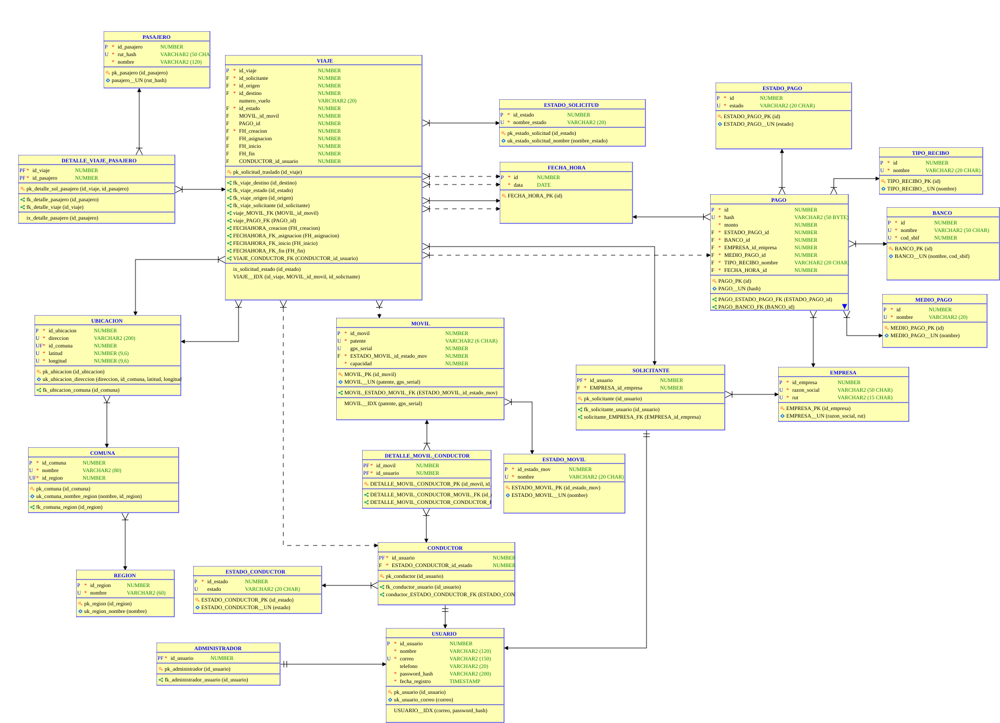

# Aplicacion de Belmonte Spa

**Ultima modificacion:** 26-09-2026

## Integrantes:
* Daniel Muñoz
* Michel Sanhueza

## Indice

## Introduccion

Belmonte SpA es una empresa del rubro de transporte privado corporativo, enfocada en
traslados ejecutivos y trayectos hacia/desde aeropuertos. Actualmente toda su gestión
operativa es manual: las solicitudes de viaje se coordinan de forma dispersa por
llamadas telefónicas, correos electrónicos y WhatsApp, transmitiendo de manera
informal datos como direcciones, números de vuelo, nombres de pasajeros, fechas y
horarios.

Este proyecto busca desarrollar un Producto Mínimo Viable (MVP) de aplicación móvil
que automatice y centralice el flujo completo de traslados en una plataforma
unificada, integrando la captura de solicitudes, la asignación de viajes a
conductores y el enlace directo con aplicaciones de navegación externa (Google Maps /
Waze) para el trazado de rutas.

### Descripcion de la problematica

La dispersión de la información en múltiples canales informales genera:
- Ineficiencias logísticas y lentitud en los tiempos de respuesta.
- Riesgo de errores en datos críticos (horarios mal informados, direcciones
  incorrectas).
- Retrasos en que los conductores reciban sus rutas asignadas.
- Lentitud en la confirmación del servicio de cara al cliente.

El objetivo del proyecto es eliminar la pérdida de información por canales
informales, lograr una confirmación de solicitudes ágil y reducir el error manual al
despachar rutas a los choferes.

### Actores involucrados

- **ACT-01 — Cliente corporativo / Solicitante:** Empresa o persona (ej. asistente,
  área de RRHH) que agenda el traslado ingresando el formulario con los datos del
  viaje (fecha, hora, origen, destino, número de vuelo si aplica) y los datos del
  pasajero.
- **ACT-02 — Pasajero:** Persona que efectivamente realiza el traslado; puede
  coincidir o no con quien lo solicitó.
- **ACT-03 — Recepcionista / Administrador:** Encargado de tomar y distribuir las
  solicitudes de traslado entre los conductores disponibles.
- **ACT-04 — Conductor:** Ejecuta el transporte en terreno; visualiza en tiempo real
  los viajes que tiene asignados para el día y utiliza la app para trazar la ruta en
  navegadores externos.
- **ACT-05 — Sistema de navegación externo (Google Maps / Waze):** Actor externo que
  recibe las coordenadas georreferenciadas de origen y destino, y genera el trazado
  de ruta óptima al ser invocado por el conductor mediante Intents del sistema
  operativo.

### Casos de uso

#### CU-01 — Registrar solicitud de traslado

| Campo | Detalle |
|---|---|
| **Actor(es)** | ACT-01 — Cliente corporativo / Solicitante |
| **Objetivo** | Registrar una solicitud de traslado mediante un formulario digital. |
| **Precondiciones** | El solicitante dispone de acceso al formulario de solicitud. |
| **Flujo principal** | 1. El solicitante ingresa al formulario.<br>2. Registra los datos del pasajero.<br>3. Registra fecha y hora del traslado.<br>4. Registra punto de origen y punto de destino.<br>5. Ingresa número de vuelo cuando corresponda.<br>6. El sistema registra la solicitud en estado Pendiente. |
| **Postcondiciones** | Solicitud almacenada y disponible para gestión. |
| **Flujos alternativos / excepciones** | Datos incompletos o inválidos. Las reglas específicas de validación no están definidas en el alcance actual. |

#### CU-02 — Visualizar viajes asignados

| Campo | Detalle |
|---|---|
| **Actor(es)** | ACT-04 — Conductor |
| **Objetivo** | Permitir al conductor consultar los viajes que tiene asignados para el día. |
| **Precondiciones** | El conductor tiene viajes asignados y conectividad con el sistema. |
| **Flujo principal** | 1. El conductor accede a la sección de viajes.<br>2. El sistema obtiene los viajes asignados.<br>3. El sistema presenta la lista de viajes correspondiente al conductor. |
| **Postcondiciones** | El conductor dispone de la información actualizada de sus viajes. |
| **Flujos alternativos / excepciones** | Sin conectividad o ausencia de viajes asignados. El comportamiento específico no está definido. |

#### CU-03 — Navegar a la ruta del viaje

| Campo | Detalle |
|---|---|
| **Actor(es)** | ACT-04 — Conductor |
| **Objetivo** | Abrir una aplicación externa de navegación utilizando el origen y destino georreferenciados del viaje. |
| **Precondiciones** | Existe un viaje asignado con coordenadas de origen y destino. |
| **Flujo principal** | 1. El conductor selecciona un viaje.<br>2. Presiona la opción de navegación.<br>3. La aplicación genera un Intent con origen y destino.<br>4. El sistema operativo entrega la solicitud a una aplicación compatible de navegación.<br>5. La aplicación externa inicia la navegación. |
| **Postcondiciones** | La aplicación de navegación externa recibe los puntos del viaje. |
| **Flujos alternativos / excepciones** | No existe una aplicación compatible o el Intent no puede ser procesado. |

#### CU-04 — Gestionar y distribuir solicitudes

| Campo | Detalle |
|---|---|
| **Actor(es)** | ACT-03 — Recepcionista / Administrador |
| **Objetivo** | Recibir, revisar y asignar solicitudes de traslado a conductores disponibles. |
| **Precondiciones** | Existen solicitudes registradas y conductores disponibles. |
| **Flujo principal** | 1. El administrador consulta las solicitudes.<br>2. Selecciona una solicitud.<br>3. Selecciona un conductor disponible.<br>4. Confirma la asignación.<br>5. El sistema actualiza el estado del traslado a Asignado. |
| **Postcondiciones** | La solicitud queda asociada a un conductor. |
| **Flujos alternativos / excepciones** | No existen conductores disponibles. No se ha definido una regla de reasignación automática. |

#### CU-05 — Actualizar estado del traslado

| Campo | Detalle |
|---|---|
| **Actor(es)** | ACT-03 — Recepcionista / Administrador; ACT-04 — Conductor |
| **Objetivo** | Gestionar el ciclo de vida operativo del traslado mediante estados. |
| **Precondiciones** | Existe una solicitud registrada. |
| **Flujo principal** | 1. El traslado inicia en estado Pendiente.<br>2. Recepcionista / Administrador asigna un conductor → Asignado.<br>3. Conductor inicia el traslado → En Curso.<br>4. Conductor finaliza el traslado → Finalizado. |
| **Postcondiciones** | El estado representa la etapa actual del traslado. |
| **Flujos alternativos / excepciones** | No se encuentran definidas reglas para retroceder estados, cancelar o reabrir un traslado. |

#### CU-06 — Trazar ruta óptima hacia el destino

| Campo | Detalle |
|---|---|
| **Actor(es)** | ACT-05 — Sistema de navegación externo |
| **Objetivo** | Calcular y mostrar una ruta utilizando las coordenadas de origen y destino entregadas por la aplicación. |
| **Precondiciones** | El sistema externo recibe coordenadas válidas de origen y destino. |
| **Flujo principal** | 1. El sistema externo recibe origen y destino.<br>2. Procesa las coordenadas.<br>3. Calcula una ruta considerando la información de tráfico disponible.<br>4. Muestra el trazado al conductor. |
| **Postcondiciones** | La ruta de navegación queda visualizada en la aplicación externa. |
| **Flujos alternativos / excepciones** | El algoritmo de cálculo, proveedor de tráfico y criterios internos pertenecen al sistema externo. |

#### CU-07 — Registrar conductor

| Campo | Detalle |
|---|---|
| **Actor(es)** | ACT-03 — Recepcionista / Administrador |
| **Objetivo** | Crear una cuenta de Conductor con credenciales de acceso, para que pueda autenticarse sin autorregistrarse. |
| **Precondiciones** | El Administrador está autenticado en el sistema. |
| **Flujo principal** | 1. El Administrador ingresa al formulario de registro de conductor.<br>2. Ingresa nombre, correo, teléfono y una contraseña inicial.<br>3. El sistema valida que el correo no exista y que no falten campos obligatorios.<br>4. El sistema guarda la contraseña como hash (nunca en texto plano).<br>5. El conductor queda disponible de inmediato para autenticarse y para ser asignado en CU-04. |
| **Postcondiciones** | Existe una cuenta de Conductor activa, lista para iniciar sesión y ser asignada a solicitudes. |
| **Flujos alternativos / excepciones** | El correo ya existe o falta un campo obligatorio: el registro se rechaza. No existe una vista de "cambiar contraseña" para el Conductor; si necesita una nueva, el Administrador la reemplaza directamente en su ficha. |

#### CU-08 — Cancelar solicitud de traslado

| Campo | Detalle |
|---|---|
| **Actor(es)** | ACT-01 — Cliente corporativo / Solicitante |
| **Objetivo** | Cancelar una solicitud de traslado propia que ya no se necesita, liberando al conductor asignado si corresponde. |
| **Precondiciones** | Existe una solicitud propia en estado Pendiente o Asignado. |
| **Flujo principal** | 1. El Solicitante abre el detalle de una solicitud propia.<br>2. Presiona el botón "Cancelar".<br>3. El sistema valida que el estado actual sea Pendiente o Asignado.<br>4. El sistema actualiza el estado a Cancelado y registra la fecha/hora de cancelación.<br>5. Si la solicitud tenía conductor asignado, se le notifica la cancelación mediante push (FCM) y el viaje desaparece de su lista "Viajes del día". |
| **Postcondiciones** | La solicitud queda en estado Cancelado; el conductor, si tenía uno asignado, queda liberado. |
| **Flujos alternativos / excepciones** | Si el estado es En Curso o Finalizado, el botón "Cancelar" no está disponible y la cancelación se rechaza. |

## Requerimientos funcionales

- **RF01:** El sistema debe permitir al Cliente corporativo/Solicitante registrarse y
  autenticarse en la aplicación.
- **RF02:** El sistema debe permitir al Cliente corporativo/Solicitante registrar una
  solicitud de traslado indicando datos del pasajero, fecha, hora, dirección de
  origen, dirección de destino (seleccionadas mediante autocompletado de Google
  Places, capturando sus coordenadas georreferenciadas) y número de vuelo (si
  aplica).
- **RF03:** El sistema debe permitir al Cliente corporativo/Solicitante visualizar el
  historial y estado de sus solicitudes de traslado.
- **RF04:** El sistema debe permitir al Recepcionista/Administrador visualizar las
  solicitudes pendientes de asignación.
- **RF05:** El sistema debe permitir al Recepcionista/Administrador asignar un
  conductor disponible a una solicitud de traslado, actualizando su estado a
  "Asignado".
- **RF06:** El sistema debe permitir al Conductor autenticarse mediante credenciales
  asignadas por el Administrador, sin permitir autorregistro.
- **RF07:** El sistema debe permitir al Conductor visualizar en tiempo real los
  viajes asignados para el día.
- **RF08:** El sistema debe permitir al Conductor visualizar el detalle de un viaje
  asignado (datos del pasajero, dirección de origen y de destino).
- **RF09:** El sistema debe permitir al Conductor actualizar el estado de un traslado
  a "En Curso" y a "Finalizado".
- **RF10:** El sistema debe integrar, mediante Intents del sistema operativo Android,
  una aplicación externa de navegación (Google Maps/Waze) para trazar la ruta hacia
  el destino a partir de las coordenadas georreferenciadas.
- **RF11:** El sistema debe persistir localmente (Room/SQLite) las solicitudes y
  viajes ya consultados, permitiendo su visualización sin conexión a internet. Los
  cambios generados sin conexión (por ejemplo, un cambio de estado registrado por el
  Conductor en terreno) deben quedar en una cola local y sincronizarse
  automáticamente con el backend vía API REST al recuperar la conectividad.
- **RF12:** El sistema debe notificar mediante mensajería push (Firebase Cloud
  Messaging) a los actores afectados cuando ocurra un cambio relevante en una
  solicitud de traslado (asignación de conductor, cambio de estado a En Curso o
  Finalizado), de modo que la información se actualice sin que el usuario tenga que
  recargar la app manualmente.
- **RF13:** El sistema debe registrar y mantener actualizado el token de notificación
  push (FCM) de cada usuario autenticado, para poder enviarle notificaciones
  dirigidas.
- **RF14:** El sistema debe permitir al Recepcionista/Administrador registrar una
  cuenta de Conductor (nombre, correo, teléfono y contraseña inicial), quedando
  disponible de inmediato para autenticarse e iniciar sesión.
- **RF15:** El sistema debe permitir al Cliente corporativo/Solicitante cancelar una
  solicitud de traslado propia mientras su estado sea "Pendiente" o "Asignado". Si la
  solicitud ya tenía un conductor asignado, el sistema debe notificarle la
  cancelación mediante push (FCM).

## Requisitos no funcionales

- **RNF01 (Seguridad):** Las contraseñas se deben almacenar únicamente como hash
  (nunca en texto plano), y la autenticación entre la app y el backend debe usar JWT
  con tiempo de expiración definido. El acceso a cada endpoint debe validarse por rol
  (Solicitante, Administrador, Conductor) según el `SecurityFilterChain` centralizado
  definido en la Arquitectura.
- **RNF02 (Disponibilidad ante conectividad intermitente):** La app debe seguir
  siendo utilizable sin conexión a internet para consultar información ya
  sincronizada (Room/SQLite), y debe reintentar automáticamente el envío de cambios
  pendientes (RF11) sin intervención manual del usuario al recuperar la conexión.
- **RNF03 (Tiempo de respuesta):** Las operaciones de consulta (listar solicitudes,
  viajes del día) deben responder en menos de 2 segundos bajo condiciones normales de
  red 4G/Wi-Fi. Una notificación push (RF12/RF13) debe reflejarse en la app en un
  plazo de segundos, no minutos, desde que ocurre el evento en el backend.
- **RNF04 (Usabilidad para uso en terreno):** Las pantallas del Conductor (Viajes del
  día, Detalle de viaje) deben priorizar botones grandes y de fácil lectura, ya que
  se usan en contexto de movimiento (antes/después de conducir), minimizando la
  cantidad de pasos para marcar "En Curso"/"Finalizado" o abrir la navegación
  externa.
- **RNF05 (Compatibilidad):** La aplicación Android debe ser compatible con Android
  8.0 (API 26) en adelante, cubriendo la mayoría de dispositivos de gama media-baja
  usados por conductores en terreno. El backend debe exponer únicamente contratos
  JSON estándar (REST), sin acoplarse a un cliente específico.
- **RNF06 (Mantenibilidad):** El backend y la app deben mantener una separación
  estricta de capas (`Controller-Service-Repository` en Spring Boot,
  `View-ViewModel-Repository` en Android/MVVM), de forma que una regla de negocio
  (ej. transición de estados) se modifique en un único lugar sin tocar la capa de
  presentación.
- **RNF07 (Dependencia de servicios externos):** El sistema depende de dos servicios
  externos con cuota gratuita limitada (Google Places API para autocompletado de
  direcciones, Firebase Cloud Messaging para notificaciones push). El uso debe
  monitorearse para no exceder el nivel gratuito durante el desarrollo y las pruebas
  del MVP.
- **RNF08 (Privacidad de datos):** Los datos personales de pasajeros y solicitantes
  (nombre, teléfono, dirección) no deben registrarse en logs de la aplicación ni del
  backend, y solo deben ser visibles para los actores que participan directamente en
  cada solicitud (el propio Solicitante, el Administrador y el Conductor asignado).

## Historias de usuario

- **HU01:** Como Cliente corporativo/Solicitante, quiero registrarme y autenticarme
  en la aplicación, para acceder de forma segura a mis solicitudes de traslado.
  (RF01)
- **HU02:** Como Cliente corporativo/Solicitante, quiero registrar una solicitud de
  traslado seleccionando origen y destino con autocompletado de Google Places, para
  coordinar el viaje con datos exactos sin depender de llamadas o WhatsApp. (RF02)
- **HU03:** Como Cliente corporativo/Solicitante, quiero ver el historial y el estado
  de mis solicitudes de traslado, para saber en todo momento si mi viaje ya fue
  asignado. (RF03)
- **HU04:** Como Recepcionista/Administrador, quiero visualizar las solicitudes
  pendientes de asignación, para distribuirlas rápidamente entre los conductores
  disponibles. (RF04)
- **HU05:** Como Recepcionista/Administrador, quiero asignar o reasignar un conductor
  disponible a una solicitud de traslado, para confirmar el viaje y mantenerlo
  cubierto ante un imprevisto. (RF05)
- **HU06:** Como Conductor, quiero autenticarme con las credenciales que me entrega
  el Administrador, para acceder a mis viajes sin tener que registrarme yo mismo.
  (RF06)
- **HU07:** Como Conductor, quiero visualizar en tiempo real los viajes que tengo
  asignados para el día, para organizar mi jornada de traslados. (RF07)
- **HU08:** Como Conductor, quiero ver el detalle de un viaje asignado (pasajero,
  origen y destino), para confirmar los datos antes de iniciar el traslado. (RF08)
- **HU09:** Como Conductor, quiero actualizar el estado de un traslado a En Curso y a
  Finalizado, para reflejar el avance real del viaje. (RF09)
- **HU10:** Como Conductor, quiero abrir la ruta del viaje directamente en Google
  Maps o Waze desde la app, para no tener que copiar direcciones manualmente y llegar
  más rápido. (RF10)
- **HU11:** Como Conductor, quiero seguir consultando mis viajes sin conexión y que
  los cambios se sincronicen automáticamente al recuperarla, para no perder
  información mientras estoy en terreno. (RF11)
- **HU12:** Como Solicitante, quiero recibir una notificación push cuando cambie el
  estado de mi traslado, para enterarme sin tener que recargar la app manualmente.
  (RF12)
- **HU13:** Como Conductor, quiero recibir una notificación push cuando se me asigna
  un nuevo viaje, para enterarme de inmediato sin estar revisando la app
  constantemente. (RF12)
- **HU14:** Como usuario autenticado (Solicitante, Administrador o Conductor), quiero
  que la app registre mi token de notificaciones al iniciar sesión, para poder
  recibir avisos dirigidos a mi cuenta. (RF13)
- **HU15:** Como Recepcionista/Administrador, quiero registrar una cuenta de
  Conductor con sus credenciales, para que pueda autenticarse sin autorregistrarse.
  (RF14)
- **HU16:** Como Solicitante, quiero cancelar una solicitud de traslado que ya no
  necesito, para liberar al conductor asignado y evitar un viaje innecesario. (RF15)

> Los criterios de aceptación, prioridad y estimación de cada historia están
> detallados en la tabla de [Backlog](#backlog).

## Backlog

| ID | Historia de usuario | Criterios de aceptación | Prioridad | Estimación (SP) |
|----|---|---|---|---|
| HU01 | Registro y login del Cliente corporativo/Solicitante | El registro se rechaza si el correo ya existe o falta algún campo obligatorio (empresa, contacto, correo, teléfono, contraseña).<br>Con credenciales válidas se accede a "Mis solicitudes"; con credenciales inválidas se muestra un error sin indicar cuál dato falló. | Alta | 3 |
| HU02 | Registrar solicitud de traslado | El campo de origen y destino usa autocompletado (Google Places API): el Solicitante escribe y elige una dirección de una lista de sugerencias, nunca texto libre. Al seleccionar una dirección, la app captura automáticamente latitud y longitud junto con el texto. No se puede enviar el formulario si origen o destino no fueron seleccionados de la lista (evita direcciones sin coordenadas). El número de vuelo es opcional; pasajero, fecha, hora, origen y destino son obligatorios.| Alta | 5 |
| HU03 | Ver historial y estado de mis solicitudes | La lista muestra pasajero, fecha/hora, ruta (origen→destino) y estado de cada solicitud propia.<br>El estado reflejado corresponde al último cambio registrado por el Administrador o el Conductor. | Media | 3 |
| HU04 | Panel de solicitudes pendientes | Solo se listan solicitudes en estado Pendiente.<br>Cada fila permite pasar directamente a la vista "Asignar conductor" de esa solicitud. | Alta | 3 |
| HU05 | Asignar conductor a una solicitud | Solo se listan conductores disponibles (sin viaje en curso).<br>Al confirmar, la solicitud pasa a estado Asignado y queda visible en "Viajes del día" del conductor elegido. | Alta | 5 |
| HU06 | Login del Conductor (sin autorregistro) | La pantalla de login del Conductor no ofrece la opción "crear cuenta".<br>Con credenciales inválidas se muestra un error sin revelar si el correo existe. | Alta | 2 |
| HU07 | Ver viajes del día | Solo se muestran los viajes del conductor autenticado, para la fecha actual, ordenados por hora.<br>Cada viaje muestra pasajero, hora y estado. | Alta | 3 |
| HU08 | Ver detalle de un viaje asignado | Muestra pasajero, número de vuelo (si aplica), origen y destino completos.<br>Incluye el botón "Navegar" y los controles de cambio de estado. | Alta | 3 |
| HU09 | Actualizar estado del viaje (En Curso / Finalizado) | "Iniciar viaje" solo está habilitado si el estado actual es Asignado.<br>"Finalizar viaje" solo está habilitado si el estado actual es En Curso.<br>Cada cambio de estado registra la fecha/hora en que ocurrió. | Alta | 3 |
| HU10 | Navegar con Google Maps/Waze | Al presionar "Navegar" se abre Google Maps o Waze con el destino precargado.<br>Si no hay ninguna app de navegación instalada, se muestra un aviso en vez de fallar silenciosamente. | Alta | 3 |
| HU11 | Persistencia local y sincronización | Las solicitudes y viajes ya cargados se pueden seguir consultando sin conexión.
Un cambio de estado hecho sin conexión (ej. "Finalizar viaje") se guarda en una cola local y se marca como "pendiente de sincronizar".
Al recuperar la conexión, la cola se envía automáticamente al backend sin intervención del usuario. | Media | 8 |
| HU12 | Recibir notificación al cambiar el estado de mi traslado | Como Solicitante, cuando mi traslado pasa a "Asignado", "En Curso" o "Finalizado", recibo una notificación push.
Al abrir la notificación (o la pantalla "Mis solicitudes"), el estado mostrado ya está actualizado sin necesidad de recargar manualmente. | Media | 5 |
| HU13 | Recibir notificación de un nuevo viaje asignado| Como Conductor, cuando el Administrador me asigna una solicitud, recibo una notificación push.
Al abrirla, el viaje aparece en "Viajes del día" con sus datos completos. | Alta | 5 |
| HU14 | Registro del token de notificaciones|Como usuario autenticado (Solicitante, Administrador o Conductor), al iniciar sesión la app registra o actualiza mi token FCM en el backend.
Si el token cambia (reinstalación, cambio de dispositivo), se reemplaza el anterior sin duplicar registros.| Alta | 3 |
| HU15 |Registrar conductor|Como Administrador, quiero crear una cuenta de Conductor con nombre, correo, teléfono y contraseña, para que pueda autenticarse sin autorregistrarse.
Criterios: el registro se rechaza si el correo ya existe o falta un campo obligatorio.
El Administrador define la contraseña directamente en el formulario (no se genera automáticamente).
La contraseña se guarda como hash (password_hash), nunca en texto plano.
Al crearse, el conductor queda disponible de inmediato en "Asignar conductor" (HU05).
No existe una vista de "cambiar contraseña" para el Conductor: si necesita una nueva, el Administrador la reemplaza directamente en su ficha.| Alta | 3 |
| HU16 |Cancelar solicitud de traslado|Como Solicitante, quiero cancelar un traslado que ya no necesito, para liberar al conductor y que no se presente a un viaje que no va a ocurrir.
Criterios: el botón "Cancelar" solo está disponible si el estado es Pendiente o Asignado.
Si el estado es En Curso o Finalizado, no se puede cancelar.
Al cancelar, el estado pasa a "Cancelado" y queda registrada la fecha/hora de cancelación.
Si la solicitud tenía conductor asignado, este recibe una notificación push de la cancelación (mismo mecanismo de RF12) y el viaje desaparece de su lista "Viajes del día".| Alta | 3 |

## Modelamiento del problema

Script DDL (Oracle XE 21c): [datamodeler/schema.sql](datamodeler/schema.sql)

| Entidad | Atributo | Tipo de dato | Clave | Descripción |
|---|---|---|---|---|
| REGION | id_region | NUMBER | PK | Identificador de la región. |
| REGION | nombre | VARCHAR2(60) | UNIQUE, NOT NULL | Nombre de la región. |
| COMUNA | id_comuna | NUMBER | PK | Identificador de la comuna. |
| COMUNA | nombre | VARCHAR2(80) | NOT NULL (UNIQUE junto a id_region) | Nombre de la comuna. |
| COMUNA | id_region | NUMBER | FK → REGION, NOT NULL | Región a la que pertenece. |
| UBICACION | id_ubicacion | NUMBER | PK | Identificador de la ubicación. |
| UBICACION | direccion | VARCHAR2(200) | NOT NULL (UNIQUE junto a id_comuna, latitud, longitud) | Dirección georreferenciada reutilizable como origen o destino (RF10). |
| UBICACION | id_comuna | NUMBER | FK → COMUNA, NOT NULL | Comuna de la dirección. |
| UBICACION | latitud | NUMBER(9,6) | NOT NULL (UNIQUE junto a direccion, id_comuna, longitud) | Coordenada geográfica (RF10). |
| UBICACION | longitud | NUMBER(9,6) | NOT NULL (UNIQUE junto a direccion, id_comuna, latitud) | Coordenada geográfica (RF10). |
| USUARIO | id_usuario | NUMBER | PK | Identificador de la cuenta. |
| USUARIO | nombre | VARCHAR2(120) | NOT NULL | Nombre del usuario. |
| USUARIO | correo | VARCHAR2(150) | UNIQUE, NOT NULL | Correo de acceso (login). |
| USUARIO | telefono | VARCHAR2(20) | — | Teléfono de contacto. |
| USUARIO | password_hash | VARCHAR2(200) | NOT NULL | Hash de la contraseña; nunca se almacena en texto plano. |
| USUARIO | fecha_registro | TIMESTAMP | NOT NULL, DEFAULT SYSTIMESTAMP | Fecha de creación de la cuenta. |
| EMPRESA | id_empresa | NUMBER | PK | Identificador de la empresa. |
| EMPRESA | razon_social | VARCHAR2(50) | NOT NULL (UNIQUE junto a rut) | Razón social de la empresa cliente. |
| EMPRESA | rut | VARCHAR2(15) | NOT NULL (UNIQUE junto a razon_social) | RUT de la empresa. |
| SOLICITANTE | id_usuario | NUMBER | PK, FK → USUARIO | Extensión 1:1 del Cliente corporativo/Solicitante (RF01). |
| SOLICITANTE | EMPRESA_id_empresa | NUMBER | FK → EMPRESA, NOT NULL | Empresa a la que pertenece el solicitante. |
| ADMINISTRADOR | id_usuario | NUMBER | PK, FK → USUARIO | Extensión 1:1 del Recepcionista/Administrador (sin atributos propios aún). |
| ESTADO_CONDUCTOR | id_estado | NUMBER | PK | Identificador del estado del conductor. |
| ESTADO_CONDUCTOR | estado | VARCHAR2(20) | UNIQUE | Nombre del estado (p. ej. disponible/ocupado); sin NOT NULL en el DDL. |
| CONDUCTOR | id_usuario | NUMBER | PK, FK → USUARIO | Extensión 1:1 del Conductor. |
| CONDUCTOR | ESTADO_CONDUCTOR_id_estado | NUMBER | FK → ESTADO_CONDUCTOR, NOT NULL | Estado actual del conductor; permite que VIAJE.CONDUCTOR_id_usuario solo referencie usuarios con este rol. |
| ESTADO_MOVIL | id_estado_mov | NUMBER | PK | Identificador del estado del móvil. |
| ESTADO_MOVIL | nombre | VARCHAR2(20) | UNIQUE, NOT NULL | Nombre del estado del vehículo (p. ej. disponible/en mantención). |
| MOVIL | id_movil | NUMBER | PK | Identificador del vehículo. |
| MOVIL | patente | VARCHAR2(6) | NOT NULL (UNIQUE junto a gps_serial) | Patente del vehículo. |
| MOVIL | gps_serial | NUMBER | — (UNIQUE junto a patente) | Identificador del dispositivo GPS instalado, si aplica. |
| MOVIL | ESTADO_MOVIL_id_estado_mov | NUMBER | FK → ESTADO_MOVIL, NOT NULL | Estado actual del vehículo. |
| MOVIL | capacidad | NUMBER | NOT NULL | Capacidad de pasajeros del vehículo. |
| DETALLE_MOVIL_CONDUCTOR | id_movil | NUMBER | PK, FK → MOVIL | Vehículo habilitado para el conductor. |
| DETALLE_MOVIL_CONDUCTOR | id_usuario | NUMBER | PK, FK → CONDUCTOR | Conductor habilitado para ese vehículo. |
| PASAJERO | id_pasajero | NUMBER | PK | Identificador del pasajero. |
| PASAJERO | rut_hash | VARCHAR2(50) | UNIQUE, NOT NULL | Hash del RUT de la persona transportada. |
| PASAJERO | nombre | VARCHAR2(120) | NOT NULL | Nombre de la persona transportada; puede no coincidir con el solicitante (casos de uso 1 y 5). |
| ESTADO_SOLICITUD | id_estado | NUMBER | PK | Identificador del estado. |
| ESTADO_SOLICITUD | nombre_estado | VARCHAR2(20) | UNIQUE, NOT NULL | PENDIENTE, ASIGNADO, EN_CURSO o FINALIZADO (RF05/RF09). |
| BANCO | id | NUMBER | PK | Identificador del banco. |
| BANCO | nombre | VARCHAR2(50) | NOT NULL (UNIQUE junto a cod_sbif) | Nombre del banco. |
| BANCO | cod_sbif | NUMBER | NOT NULL (UNIQUE junto a nombre) | Código SBIF del banco. |
| ESTADO_PAGO | id | NUMBER | PK | Identificador del estado de pago. |
| ESTADO_PAGO | estado | VARCHAR2(20) | UNIQUE, NOT NULL | Nombre del estado del pago (p. ej. pendiente/pagado/rechazado). |
| MEDIO_PAGO | id | NUMBER | PK | Identificador del medio de pago. |
| MEDIO_PAGO | nombre | VARCHAR2(20) | UNIQUE, NOT NULL | Nombre del medio de pago (p. ej. transferencia, tarjeta). |
| TIPO_RECIBO | id | NUMBER | PK | Identificador del tipo de recibo. |
| TIPO_RECIBO | nombre | VARCHAR2(20) | UNIQUE, NOT NULL | Nombre del tipo de recibo o comprobante. |
| PAGO | id | NUMBER | PK | Identificador del pago. |
| PAGO | hash | VARCHAR2(50 BYTE) | UNIQUE, NOT NULL | Hash único de la transacción de pago. |
| PAGO | monto | NUMBER | NOT NULL | Monto del pago. |
| PAGO | ESTADO_PAGO_id | NUMBER | FK → ESTADO_PAGO, NOT NULL | Estado actual del pago. |
| PAGO | BANCO_id | NUMBER | FK → BANCO, NOT NULL | Banco involucrado en el pago. |
| PAGO | EMPRESA_id_empresa | NUMBER | FK → EMPRESA, NOT NULL | Empresa que paga el viaje. |
| PAGO | MEDIO_PAGO_id | NUMBER | FK → MEDIO_PAGO, NOT NULL | Medio utilizado para pagar. |
| PAGO | TIPO_RECIBO_nombre | VARCHAR2(20) | FK → TIPO_RECIBO(nombre), NOT NULL | Tipo de recibo emitido para este pago. |
| PAGO | FECHA_HORA_id | NUMBER | FK → FECHA_HORA, NOT NULL | Fecha y hora del pago. |
| FECHA_HORA | id | NUMBER | PK | Identificador del instante de fecha/hora. |
| FECHA_HORA | data | DATE | NOT NULL | Valor de fecha y hora; entidad extraída de VIAJE/PAGO para centralizar el tipo de dato (facilita un futuro cambio de tipo). |
| VIAJE | id_viaje | NUMBER | PK | Identificador del viaje. |
| VIAJE | id_solicitante | NUMBER | FK → SOLICITANTE, NOT NULL | Quién agenda el traslado. |
| VIAJE | id_origen | NUMBER | FK → UBICACION, NOT NULL | Dirección de origen. |
| VIAJE | id_destino | NUMBER | FK → UBICACION, NOT NULL | Dirección de destino. |
| VIAJE | numero_vuelo | VARCHAR2(20) | — | Opcional; solo si aplica a un vuelo. |
| VIAJE | id_estado | NUMBER | FK → ESTADO_SOLICITUD, NOT NULL | Ciclo de vida del traslado (RF05/RF09). |
| VIAJE | MOVIL_id_movil | NUMBER | FK → MOVIL | Vehículo asignado al viaje; NULL hasta la asignación. |
| VIAJE | PAGO_id | NUMBER | FK → PAGO | Pago asociado al viaje, si existe. |
| VIAJE | FH_creacion | NUMBER | FK → FECHA_HORA, NOT NULL | Momento en que se registró la solicitud. |
| VIAJE | FH_asignacion | NUMBER | FK → FECHA_HORA | Momento en que se asignó un conductor. |
| VIAJE | FH_inicio | NUMBER | FK → FECHA_HORA | Momento en que el viaje pasó a En Curso. |
| VIAJE | FH_fin | NUMBER | FK → FECHA_HORA | Momento en que el viaje se marcó Finalizado. |
| VIAJE | CONDUCTOR_id_usuario | NUMBER | FK → CONDUCTOR | NULL hasta que el Administrador asigna un conductor (RF05). |
| DETALLE_VIAJE_PASAJERO | id_viaje | NUMBER | PK, FK → VIAJE | Traslado en el que viaja el pasajero. |
| DETALLE_VIAJE_PASAJERO | id_pasajero | NUMBER | PK, FK → PASAJERO | Pasajero que viaja en ese traslado. |

El "Sistema de navegación externo" no tiene tabla: es un actor externo sin datos
propios que persistir.

> **Nota:** `VIAJE` ya no tiene una columna para la fecha/hora *solicitada* del
> traslado (solo `FH_creacion`, `FH_asignacion`, `FH_inicio` y `FH_fin`, que
> registran momentos del ciclo de vida). RF02 exige capturar la fecha y hora del
> traslado al crear la solicitud, por lo que este dato parece faltar en el DDL
> actual. Además, `BANCO`, `EMPRESA`, `ESTADO_PAGO`, `MEDIO_PAGO`, `PAGO`,
> `TIPO_RECIBO`, `MOVIL`, `ESTADO_MOVIL`, `ESTADO_CONDUCTOR` y
> `DETALLE_MOVIL_CONDUCTOR` no tienen un RF o HU asociado en este documento; conviene
> revisar si corresponde agregar esos requerimientos o si son alcance futuro.

Normalizado a 3FN:
- `UBICACION` separada de `VIAJE`: latitud/longitud dependen funcionalmente de la
  dirección, no del viaje (dependencia transitiva).
- `PASAJERO` + `DETALLE_VIAJE_PASAJERO` separados de `VIAJE`: una columna única de
  pasajero sería un grupo repetitivo en cuanto hay más de un pasajero por viaje
  (viola 1FN).
- Los roles (`SOLICITANTE`, `ADMINISTRADOR`, `CONDUCTOR`) se modelan como extensiones
  1:1 de `USUARIO` (tabla por subtipo) en vez de un catálogo `TIPO_USUARIO` con
  `CHECK`; `ESTADO_SOLICITUD`, `ESTADO_CONDUCTOR`, `ESTADO_MOVIL`, `ESTADO_PAGO`,
  `MEDIO_PAGO` y `TIPO_RECIBO` sí pasan de `CHECK` a catálogo: no corrige una forma
  normal, pero permite agregar/renombrar valores sin alterar el DDL de las tablas que
  los usan.
- `FECHA_HORA` centraliza los valores de fecha/hora usados por `VIAJE` (creación,
  asignación, inicio, fin) y `PAGO`: tampoco corrige una forma normal, pero permite
  cambiar el tipo de dato de fecha/hora en un solo lugar.
- `COMUNA`/`REGION`: `id_comuna` es un atributo propio de `UBICACION` (no derivado de
  `direccion`, que ya no es `UNIQUE` por sí sola sino en conjunto con comuna y
  coordenadas), por lo que la referencia a `COMUNA` es una FK normal y no una
  dependencia transitiva; es una descomposición normal de jerarquía geográfica, no
  una corrección de anomalía.

### Modelo relacional



## Arquitectura

> **Decisión de implementación:** MariaDB es la base de datos oficial de la
> aplicación. El archivo `datamodeler/schema.sql` conserva el DDL generado para
> Oracle Data Modeler y sirve como referencia del modelo; no se ejecuta contra
> MariaDB. El esquema que usa la aplicación se crea con las migraciones Flyway en
> `backend/src/main/resources/db/migration`.

### Base de datos **MariaDB**

* **Integridad Transaccional (ACID):** Utiliza el motor de almacenamiento `InnoDB`,
  garantizando la consistencia y atomicidad de los datos en procesos críticos de
  logística (como la asignación de vehículos, registro de mantenimientos y estados de
  viaje).
* **Compatibilidad Total con el Ecosistema Spring:** Cuenta con dialectos oficiales
  en Hibernate (`MariaDBDialect`) y un driver JDBC oficial (`mariadb-java-client`)
  ligero y eficiente, permitiendo la generación y migración automática de tablas
  desde Java.
* **Filosofía Open Source:** Es un sistema de gestión de bases de datos 100% libre y
  comunitario (Licencia GPL v2), asegurando estabilidad sin depender de licencias
  comerciales.
* **Eficiencia de Recursos en Desarrollo:** Presenta un consumo optimizado de memoria
  y CPU en entornos de desarrollo local, permitiendo ejecutar simultáneamente el
  entorno de Android Studio, la base de datos y la API de Spring Boot sin sobrecargar
  el equipo.

#### Iniciar la base de datos local

Requiere Docker Compose. Desde la raíz del repositorio, en PowerShell:

```powershell Copy-Item .env.example .env docker compose up -d mariadb ```

La API usa `DB_URL`, `DB_USER` y `DB_PASSWORD`; sus valores locales están en
`.env.example`. Flyway aplica las migraciones al iniciar el backend. `.env` está
excluido de Git: cambia las credenciales para cualquier entorno compartido o
desplegado.

Para detener MariaDB conservando sus datos: `docker compose down`. Para borrar
también los datos locales: `docker compose down -v`. ### Backend **Spring Boot** como
el framework principal para la capa del backend debido a las siguientes ventajas
técnicas:

* **Arquitectura REST Nativa para Clientes Móviles:** Permite estructurar y exponer
  endpoints HTTP en formato JSON estandarizado. Esto facilita la integración
  transparente con la aplicación móvil Android utilizando librerías de red como
  Retrofit o Volley.
* **Seguridad Stateless mediante JWT:** A través de **Spring Security**, la
  aplicación implementa autenticación basada en tokens **JWT (JSON Web Tokens)**. Al
  ser una API sin estado (*stateless*), es el enfoque óptimo para dispositivos
  móviles. El control de acceso por rol (Solicitante, Administrador, Conductor) se
  centraliza en un único `SecurityFilterChain`, que mapea cada ruta a los roles
  permitidos y rechaza por defecto (`denyAll`) cualquier endpoint no listado
  explícitamente.
* **Diseño Modular y Separación de Capas:** Impone un patrón de diseño claro
  (`Controller` ➔ `Service` ➔ `Repository`), lo que garantiza un código limpio,
  mantenible, fácil de auditar y preparado para futuras ampliaciones de lógica de
  negocio.
* **Productividad con Spring Data JPA:** Automatiza la persistencia de datos mediante
  el mapeo objeto-relacional (ORM), eliminando la necesidad de escribir código SQL
  manual redundante para las operaciones estándar (CRUD).
* **Notificaciones push con Firebase Cloud Messaging:** Ante cambios relevantes en
  una solicitud (asignación, cambio de estado, cancelación), la capa `Service` invoca
  el SDK de Firebase Admin para notificar al actor afectado, evitando que la app
  dependa de recargar manualmente o de mantener una conexión persistente abierta.
  Cada usuario autenticado registra su token de dispositivo, que el backend actualiza
  al iniciar sesión.
*
### Frontend


Vistas propuestas para el MVP, agrupadas por actor:

**Transversal**
- **Login:** autenticación para los tres actores con app móvil (Cliente
  corporativo/Solicitante, Recepcionista/Administrador, Conductor).
- **Perfil / Cierre de sesión:** datos del usuario logueado.

**Cliente corporativo / Solicitante**
- **Registro:** creación de cuenta propia. El Conductor no se autorregistra: sus
  credenciales son asignadas por el Administrador, por lo que solo usa la vista de
  Login.
- **Registrar solicitud de traslado:** formulario con datos del pasajero, fecha,
  hora, origen, destino y n.º de vuelo (si aplica). Cubre el caso de uso 1.
- **Mis solicitudes (historial):** lista de traslados agendados con su estado actual
  (Pendiente/Asignado/En Curso/Finalizado).
- **Detalle de solicitud:** vista de una solicitud puntual con los datos ingresados,
  estado, y datos del conductor una vez asignado.

**Recepcionista / Administrador**
- **Panel de solicitudes pendientes:** listado de solicitudes sin asignar. Entrada al
  caso de uso 4.
- **Asignar conductor:** vista para elegir un conductor disponible para una solicitud
  puntual. Cubre el caso de uso 4.
- **Panel general / dashboard** *(segunda iteración)*: resumen operativo con conteo
  de viajes por estado.

**Conductor**
- **Viajes del día:** lista de viajes asignados para la fecha actual, ordenados por
  hora. Cubre el caso de uso 2.
- **Detalle de viaje asignado:** datos del pasajero, origen, destino, control para
  marcar "En Curso"/"Finalizado" y botón que dispara el Intent hacia Google
  Maps/Waze. Cubre los casos de uso 5 y 6.
- **Historial de viajes realizados** *(segunda iteración)*: viajes ya finalizados por
  el conductor.


### Frontend (Android)

**MVVM (Model-View-ViewModel)** como arquitectura del lado móvil, en línea con el
patrón de capas ya definido en el backend:

* **Separación View / ViewModel:** las pantallas en Jetpack Compose (`View`) solo
  dibujan estado y envían eventos de usuario; toda la lógica de presentación
  (validaciones de formulario, qué mostrar según el estado) vive en el `ViewModel`,
  que expone el estado observable a la UI. Esto evita lógica de negocio mezclada con
  composables, igual que el backend separa `Controller` de `Service`.
* **Repository como única fuente de verdad:** cada `ViewModel` no habla directo con
  Retrofit ni con Room; consulta a un `Repository`, que decide si los datos vienen de
  la base local (Room) o se piden al backend (Retrofit), y aplica ahí la lógica de
  sincronización offline definida en RF11.
* **Dos fuentes de datos por Repository:** un `DataSource` local (Room/SQLite) y uno
  remoto (Retrofit), ambos detrás de la misma interfaz de `Repository`, para que el
  resto de la app no dependa de saber de dónde vino el dato.
* **Inyección de dependencias con Hilt:** para armar `ViewModel → Repository →
  DataSources` sin que cada pantalla tenga que construir sus propias dependencias a
  mano, y para poder reemplazar fácilmente el `DataSource` remoto por uno falso en
  pruebas.
* **Un ViewModel por pantalla, agrupado por actor:** siguiendo la misma agrupación
  que ya existe en "Frontend" (Solicitante, Administrador, Conductor), cada pantalla
  del wireframe tiene su `ViewModel` correspondiente (ej.
  `RegistrarSolicitudViewModel`, `ViajesDelDiaViewModel`,
  `AsignarConductorViewModel`).

