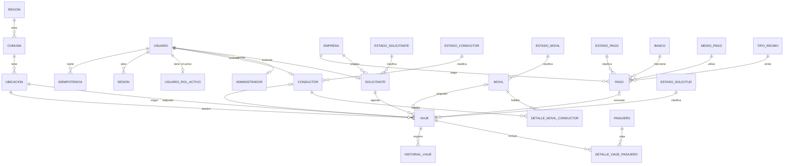

# Aplicacion de Belmonte Spa.
## Especificaciones del proyecto.

**Ultima modificacion:** 18-10-2026

## Integrantes:
* Daniel Muñoz
* Michel Sanhueza

## Indice

- [Introduccion](#introduccion)
  - [Cómo leer esta especificación](#cómo-leer-esta-especificación)
  - [Problemática y actores](#problemática-y-actores)
- [Máquinas de estado](#máquinas-de-estado)
- [Requisitos](#requisitos)
  - [Casos de uso](#casos-de-uso)
  - [Requerimientos funcionales](#requerimientos-funcionales)
  - [Requisitos no funcionales](#requisitos-no-funcionales)
  - [Historias de usuario y Backlog](#historias-de-usuario-y-backlog)
- [Modelamiento del problema](#modelamiento-del-problema)
  - [Modelo de datos](#modelo-de-datos)
  - [Decisiones de modelo](#decisiones-de-modelo)
  - [Modelo relacional](#modelo-relacional)
- [Arquitectura](#arquitectura)
  - [Stack](#stack)
  - [Servicios locales](#servicios-locales)
  - [Entornos](#entornos)
- [API REST](#api-rest)
  - [Convenciones](#convenciones)
    - [Orden de evaluación e idempotencia](#orden-de-evaluación-e-idempotencia)
  - [Recursos y roles](#recursos-y-roles)
  - [Consultas y alcance por rol](#consultas-y-alcance-por-rol)
  - [Flujo de una solicitud (CU-01 / RF02)](#flujo-de-una-solicitud-cu-01--rf02)
  - [Ubicaciones desde Google Places](#ubicaciones-desde-google-places)
  - [Acciones de negocio](#acciones-de-negocio)
  - [Autenticación](#autenticación)
  - [Contratos JSON](#contratos-json)
  - [Validaciones](#validaciones)
  - [Errores](#errores)
- [Estructura del backend](#estructura-del-backend)
  - [Paquetes y capas](#paquetes-y-capas)
  - [Persistencia MariaDB](#persistencia-mariadb)
    - [Evolución de migraciones](#evolución-de-migraciones)
    - [Concurrencia de operaciones de transporte](#concurrencia-de-operaciones-de-transporte)
  - [Configuración](#configuración)
  - [Notificaciones externas](#notificaciones-externas)
  - [Pruebas](#pruebas)
- [Frontend (Android)](#frontend-android)
  - [Arquitectura y responsabilidades](#arquitectura-y-responsabilidades)
    - [Contratos internos de Android](#contratos-internos-de-android)
  - [Tecnologías](#tecnologías)
    - [Aceptación de compatibilidad](#aceptación-de-compatibilidad)
  - [Organización del código](#organización-del-código)
  - [Navegación y pantallas](#navegación-y-pantallas)
  - [Textos y tema](#textos-y-tema)
  - [Accesibilidad](#accesibilidad)
  - [API y sesión](#api-y-sesión)
    - [Carga de catálogos](#carga-de-catálogos)
    - [Cierre de sesión local y remoto](#cierre-de-sesión-local-y-remoto)
    - [Reintentos fuera de la cola](#reintentos-fuera-de-la-cola)
  - [Persistencia y conectividad](#persistencia-y-conectividad)
  - [Base de datos local](#base-de-datos-local)
    - [Recuperación de solicitudes interrumpidas](#recuperación-de-solicitudes-interrumpidas)
  - [Notificaciones y navegación externa](#notificaciones-y-navegación-externa)
  - [Compilación, firma y distribución](#compilación-firma-y-distribución)
  - [Pruebas Android](#pruebas-android)
  - [Decisiones abiertas](#decisiones-abiertas)
- [Proceso de desarrollo](#proceso-de-desarrollo)
  - [Ramas y pull requests](#ramas-y-pull-requests)
  - [Integración continua](#integración-continua)
  - [Definición de terminado](#definición-de-terminado)
  - [Plan de sprints](#plan-de-sprints)
  - [Secuencia de implementación y coordinación](#secuencia-de-implementación-y-coordinación)

## Introduccion

Especificación de referencia del proyecto: requisitos, arquitectura, contratos y
tecnologías. No registra el avance de implementación ni certifica que el código cumpla lo
descrito; su revisión evalúa la coherencia y suficiencia de la especificación, y la
conformidad del código se revisa aparte.

Belmonte SpA hace transporte privado corporativo (traslados ejecutivos y aeropuerto). El MVP
móvil centraliza el flujo: captura de solicitudes, asignación a conductores y enlace con
navegación externa (Google Maps/Waze).

### Cómo leer esta especificación

- **Precedencia:** este README es la fuente de verdad. Los [mockups](mockups/wireframes-belmonte.html)
  ilustran las pantallas; si discrepan, gana el README. `docs/` guarda el material de origen (el
  Anexo de Requerimiento) y no se implementa directamente.
- **Rangos:** "de A a B" y "entre A y B" incluyen ambos extremos, salvo que se diga otra cosa.
- **Hora:** "ahora" es la hora del servidor en `America/Santiago` al recibir la petición; las
  fechas de negocio no llevan zona ([Contratos JSON](#contratos-json)).
- **Códigos y etiquetas:** la API y la base usan códigos en mayúsculas (`EN_CURSO`); la app
  muestra su etiqueta en español ([Textos y tema](#textos-y-tema)).
- **Obligatoriedad:** lo descrito es obligatorio. Lo que no se menciona no se implementa en el MVP
  (p. ej. borrar registros, pagos en línea, mapa embebido).

### Problemática y actores

Hoy las solicitudes se coordinan a mano (teléfono, correo, WhatsApp): datos críticos
erróneos (horarios, direcciones), respuestas lentas y retraso en que el conductor reciba su ruta.

| ID | Actor | Rol |
|---|---|---|
| ACT-01 | Cliente corporativo / Solicitante | Agenda el traslado (datos del viaje y del pasajero). |
| ACT-02 | Pasajero | Quien viaja; puede no ser el solicitante. |
| ACT-03 | Recepcionista / Administrador | Asigna solicitudes a conductores; gestiona flota (vehículos y habilitaciones) y pagos. |
| ACT-04 | Conductor | Ejecuta el traslado; ve sus viajes del día y abre la ruta en un navegador externo. |
| ACT-05 | Sistema de navegación externo (Google Maps / Waze) | Recibe las coordenadas por Intent y traza la ruta. Sin tabla: no hay datos propios que persistir. |

El Anexo de Requerimiento (§2.4) agrupa Solicitante y Pasajero; aquí se separan porque el
Pasajero no pertenece necesariamente a la empresa que paga (`PASAJERO` no tiene FK a
`EMPRESA`) y el Solicitante puede no viajar.

## Máquinas de estado

Fuente única de las transiciones; los CU, RF, HU y la API remiten aquí. Toda transición
inválida responde 409 y los triggers de `db/migration` la vuelven a validar.

### Viaje

`ESTADO_SOLICITUD`: `PENDIENTE → ASIGNADO → EN_CURSO → FINALIZADO`, más `CANCELADO` desde
`PENDIENTE` o `ASIGNADO`. Sin reapertura; el único retroceso es el rechazo del Conductor (V8,
`ASIGNADO` → `PENDIENTE`). `EN_CURSO` y `FINALIZADO` no se cancelan, reasignan ni rechazan. Cada
cambio registra su fecha/hora.

| ID | Transición | Quién | Precondiciones | Efectos |
|---|---|---|---|---|
| V1 | alta → `PENDIENTE` | Solicitante aprobado (CU-01/RF02) | `fh_agenda` de 2 horas a 90 días desde ahora ([Validaciones](#validaciones); si no, 400) | La base genera el `folio` (`TR-` y un correlativo, inmutable; ver `VIAJE.folio`); `fh_creacion`. Push a los Administradores. |
| V2 | `PENDIENTE`/`ASIGNADO` → `ASIGNADO` (asignar o reasignar) | Administrador (CU-04/RF05/RF22) | Viaje no vencido (ver Retraso; si no, 409 "El viaje está vencido"). Al menos un pasajero (`cantidad_pasajeros` ≥ 1). Conductor y vehículo activos y Disponibles (sin otro viaje `EN_CURSO`); conductor habilitado para el vehículo; pasajeros ≤ capacidad. Sin solapamiento: ni el conductor ni el vehículo tienen otro viaje `ASIGNADO` o `EN_CURSO` cuya ventana de inicio (ver V3) se cruce con la de este, es decir, con `abs(fh_agenda − fh_agenda del otro) < 2 horas` (a 2 horas exactas no se solapan). Al reasignar, la disponibilidad y el solapamiento se validan solo para lo que cambia (sin contar el propio viaje) y la habilitación para el par resultante. Sin reasignación automática. | `fh_asignacion`. No cambia el estado del conductor ni del vehículo: ambos pueden tener varios viajes `ASIGNADO`. Al reasignar puede cambiar solo el conductor, solo el vehículo o ambos; el viaje sale de la agenda de los reemplazados. Push al conductor (nuevo), al solicitante y, si cambia el conductor, al reemplazado. |
| V3 | `ASIGNADO` → `EN_CURSO` | Conductor asignado (RF09) | Dentro de la ventana de inicio: `fh_agenda − 1 hora ≤ ahora ≤ fh_agenda + 1 hora`. Conductor y vehículo Disponibles (sin otro viaje `EN_CURSO`). | `fh_inicio`; conductor → Ocupado, vehículo → En uso. Push al solicitante. |
| V4 | `EN_CURSO` → `FINALIZADO` | Conductor asignado (RF09) | — | `fh_fin`; conductor y vehículo → Disponible. Push al solicitante. |
| V5 | `PENDIENTE`/`ASIGNADO` → `CANCELADO` (cancelar) | Solicitante dueño (CU-08/RF15) | Viaje no vencido (ver Retraso). | Si había conductor: push al conductor y el viaje sale de su agenda ("Mis viajes", en su fecha). No cambia el estado de conductor ni vehículo (en `PENDIENTE`/`ASIGNADO` este viaje no los ocupa). Pago `PAGADO` → `REEMBOLSADO` con `monto_reembolsado` = 50 % del monto, redondeado hacia abajo (P4); `PENDIENTE` → `ANULADO` (P5); en otro estado el pago no cambia. No modifica `fh_fin`: el momento queda en `HISTORIAL_VIAJE`. |
| V6 | `PENDIENTE`/`ASIGNADO` → `CANCELADO` (por anulación del pago) | Sistema, al anular el Administrador el pago (P2 o P3; CU-12/RF19) | — | Mismos efectos de V5 (agenda y push al conductor) sin reembolso, y push al solicitante. |
| V7 | `PENDIENTE`/`ASIGNADO` → `CANCELADO` (por el Administrador) | Administrador (CU-15/RF23) | `motivo` obligatorio. | Guarda el `motivo`; agenda y push al conductor como en V5, y push al solicitante. Pago `PAGADO` → `REEMBOLSADO` (P4): con el viaje no vencido, `monto_reembolsado` = monto (100 %); vencido, el monto que fije el Administrador entre 0 y el monto (con 0 el pago no cambia). Pago `PENDIENTE` → `ANULADO` (P5). |
| V8 | `ASIGNADO` → `PENDIENTE` (rechazo) | Conductor asignado (CU-16/RF24) | `motivo` obligatorio; solo con conexión (no va a la cola sin conexión). | Guarda el `motivo`; deja en NULL conductor, móvil y `fh_asignacion`; el viaje sale de su agenda. Push a los Administradores y al solicitante. El pago no cambia. |

`CANCELADO` se suma a los 4 estados del Anexo (§3.2) para conservar la auditoría: la
solicitud no se borra.

**Retraso.** Se calcula a partir de `fh_agenda` y no es un estado: lo calculan el backend al
validar y la app al mostrar, incluso sin conexión. Un viaje `PENDIENTE` o `ASIGNADO` está:

- **Atrasado**, si `fh_agenda < ahora ≤ fh_agenda + 1 hora`: todavía puede iniciarse.
- **Vencido**, si `ahora > fh_agenda + 1 hora`: no se inicia (V3), no se asigna ni reasigna (V2)
  y no lo cancela el Solicitante (V5). Nada cambia solo: el Administrador lo cancela con V7 y
  decide el reembolso.

### Pago

`ESTADO_PAGO`. Relación 1:1 con el viaje: un viaje tiene a lo más un pago y un pago pertenece a un solo viaje.

| ID | Desde | Hacia | Quién / cómo |
|---|---|---|---|
| P1 | alta | `PENDIENTE` | Administrador (CU-11/RF18), para un viaje en cualquier estado distinto de `CANCELADO`; el backend genera su `hash` (único; ver `PAGO.hash`). |
| P2 | `PENDIENTE` | `PAGADO`, `RECHAZADO` o `ANULADO` | Manual, Administrador (CU-12/RF19). Al pasar a `PAGADO`, el backend fija `fecha_pago`. Push al solicitante. |
| P3 | `PAGADO` | `ANULADO` | Manual, Administrador. Push al solicitante. |
| P4 | `PAGADO` | `REEMBOLSADO` | Automático al cancelar el viaje: en V5 (Solicitante, 50 %) o en V7 (Administrador, 100 % o el monto que fije si el viaje está vencido). Fija `monto_reembolsado`; nunca manual. Push al solicitante. |
| P5 | `PENDIENTE` | `ANULADO` | Automático al cancelar el viaje en V5 o V7: no queda nada que cobrar. Nunca manual (la anulación manual es P2). Push al solicitante. |

- `RECHAZADO`, `ANULADO` y `REEMBOLSADO` son terminales.
- `ANULADO` por P2 o P3 (problema con el banco u otro motivo) cancela el viaje si está `PENDIENTE` o `ASIGNADO` (V6). P5 no dispara V6: el viaje ya está cancelado.
- Un viaje `CANCELADO` nunca queda con un pago `PENDIENTE` ni `PAGADO`, salvo el `PAGADO` de V7 vencido con reembolso 0.
- Sin re-cobro: el pago no se reemplaza ni se registra otro. Un viaje con su pago `RECHAZADO`, o
  `ANULADO` estando `EN_CURSO` o `FINALIZADO`, queda sin cobro (`POST /pagos` responde 409 porque ya tiene pago).

### Conductor y vehículo

- **Conductor** (`ESTADO_CONDUCTOR`): nace Disponible (CU-07); Ocupado solo mientras tiene un
  viaje `EN_CURSO` (de V3 a V4).
- **Vehículo** (`ESTADO_MOVIL`): nace Disponible (CU-09); En uso solo mientras tiene un viaje
  `EN_CURSO` (de V3 a V4).
- Disponible = sin viaje `EN_CURSO`. Asignar (V2) no cambia estos estados: ambos pueden tener
  varios viajes `ASIGNADO` (su agenda), pero a lo más uno `EN_CURSO`.
- **Activo** (`activo`, independiente de lo anterior): nacen activos. El Administrador los
  desactiva (baja de un conductor desvinculado o de un vehículo en taller) solo si no tienen
  viajes `ASIGNADO` ni `EN_CURSO` (409), y los puede reactivar (CU-07/CU-09/RF25). Un inactivo no
  es asignable (V2) ni aparece en "Asignar"; un Conductor inactivo no inicia sesión (mismo 401
  genérico) y al desactivarlo se revocan sus sesiones. Su JWT de acceso ya emitido vale hasta su
  `exp` (es stateless), pero sin viajes `ASIGNADO` ni `EN_CURSO` no puede ejecutar transiciones, y
  no puede renovarlo. Las habilitaciones no cambian. Desactivar o reactivar con el mismo valor
  que ya tiene responde `200` sin cambios; reactivar no tiene precondiciones.

## Requisitos

### Casos de uso

| CU | Actor | Flujo | Excepciones |
|---|---|---|---|
| CU-01 Registrar solicitud de traslado | ACT-01 | Ingresa pasajero(s), fecha/hora, origen, destino y n.º de vuelo (si aplica) → viaje `PENDIENTE` con sus pasajeros, en tres llamadas ([Flujo de una solicitud](#flujo-de-una-solicitud-cu-01--rf02)). | Datos incompletos o inválidos: 400 según [Validaciones](#validaciones). |
| CU-02 Visualizar viajes asignados | ACT-04 | Lista sus viajes asignados del día, actualizados desde el backend. | Sin conectividad: muestra los viajes ya sincronizados (RF11/HU11). Sin viajes: lista vacía. |
| CU-03 Navegar a la ruta del viaje | ACT-04 | "Navegar" en el detalle de un viaje propio: en `ASIGNADO` hacia el origen (recoger a los pasajeros) y en `EN_CURSO` hacia el destino, desde la ubicación actual → Intent con las coordenadas de ese punto → Google Maps o Waze navega ([Notificaciones y navegación externa](#notificaciones-y-navegación-externa)). En otros estados no se ofrece. | Ninguna app compatible instalada: aviso. |
| CU-04 Gestionar y distribuir solicitudes | ACT-03 | Elige una solicitud y un conductor disponible (se sugieren sus vehículos habilitados) y confirma: [V2](#viaje) `PENDIENTE` → `ASIGNADO`. | Sin conductores disponibles. Viaje vencido o sin pasajeros: no se ofrece y se rechaza (409). Conductor o vehículo con otro viaje a menos de 2 horas: 409 ([V2](#viaje)). Sin reasignación automática; la manual de un `ASIGNADO` sigue el mismo flujo (RF22). |
| CU-05 Actualizar estado del traslado | ACT-03, ACT-04 | Ciclo [V2](#viaje) `PENDIENTE` → `ASIGNADO` (el Administrador asigna), [V3](#viaje) `ASIGNADO` → `EN_CURSO` y [V4](#viaje) `EN_CURSO` → `FINALIZADO` (el Conductor inicia y finaliza). | Sin reapertura; el único retroceso es el rechazo del Conductor (CU-16, [V8](#viaje)). La cancelación es CU-08, CU-15 o la anulación del pago (CU-12). |
| CU-06 Trazar ruta óptima hacia el destino | ACT-05 | Con coordenadas válidas, calcula la ruta con el tráfico disponible y la muestra al conductor. | Algoritmo, proveedor de tráfico y criterios son del sistema externo. |
| CU-07 Registrar conductor | ACT-03 | El Administrador ingresa nombre, correo (único), contraseña inicial (se guarda como hash) y teléfono opcional; la cuenta queda activa para autenticarse y, una vez habilitada para un vehículo (CU-10), para ser asignada (CU-04). Sin autorregistro. Desde su ficha el Administrador lo desactiva o reactiva ([Conductor y vehículo](#conductor-y-vehículo), RF25). | Correo existente o campo faltante: rechazo. Desactivar con viajes `ASIGNADO` o `EN_CURSO`: 409. El Conductor no tiene "cambiar contraseña": el Administrador la reemplaza en su ficha. No se envía correo: el Administrador le comunica la contraseña en persona. |
| CU-08 Cancelar solicitud de traslado | ACT-01 | Solicitud propia en `PENDIENTE` o `ASIGNADO`: "Cancelar" en el detalle → [V5](#viaje) `PENDIENTE`/`ASIGNADO` → `CANCELADO`, con fecha/hora. | En `EN_CURSO` o `FINALIZADO`, o con el viaje vencido, no hay botón y se rechaza (409). |
| CU-09 Registrar vehículo | ACT-03 | Patente (única), capacidad y serial GPS opcional (dato de flota; el MVP no registra ubicación en vivo); queda Disponible, activo, habilitable y asignable. Desde su ficha el Administrador lo desactiva (taller) o reactiva (RF25). | Patente existente o campo faltante: rechazo. Desactivar con viajes `ASIGNADO` o `EN_CURSO`: 409. |
| CU-10 Habilitar conductor para vehículo | ACT-03 | Relaciona un conductor (CU-07) con uno o más vehículos (CU-09); M:N. | Relación existente: se ignora sin duplicar. Las habilitaciones no se eliminan en el MVP. |
| CU-11 Registrar pago de un viaje | ACT-03 | En un viaje no `CANCELADO`: monto, banco, medio de pago y tipo de recibo → pago `PENDIENTE` asociado al viaje. | Viaje `CANCELADO`: no se registra. |
| CU-12 Actualizar estado de un pago | ACT-03 | Sobre un pago `PENDIENTE` (o `PAGADO`, solo para anularlo) marca `PAGADO`, `RECHAZADO` o `ANULADO` ([P2](#pago) desde `PENDIENTE`; [P3](#pago) `PAGADO` → `ANULADO`); anular cancela el viaje `PENDIENTE` o `ASIGNADO` ([V6](#viaje)). | Estado terminal: no cambia. |
| CU-13 Recuperar contraseña | ACT-01, ACT-03 | Ingresa su correo en "Recuperar contraseña". Si es de un Solicitante o Administrador: contraseña temporal aleatoria, guardada hasheada en `password_temporal_hash` con `password_temporal_expira`, sin tocar la contraseña actual, y enviada en texto plano solo a ese correo vía `EmailClient` (único momento en claro; nunca se persiste así, RNF01). Sirve para el login (CU-14) hasta expirar y obliga a cambiar la contraseña al entrar. | Correo inexistente o de un Conductor: mismo mensaje genérico. Expirada sin uso: pedir otra. Pedidos repetidos: [límite](#autenticación) por correo, sin aviso. |
| CU-14 Iniciar sesión | ACT-01, ACT-03, ACT-04 | Cuenta autorregistrada (Solicitante, RF01), creada por el Administrador (Conductor, RF14; Administrador, RF27) o por migración Flyway (Administrador inicial). Envía correo, contraseña y el token FCM si existe (RF13). Se valida contra `USUARIO.password_hash` o contra la temporal vigente (`password_temporal_hash`, RF21), que obliga a cambiar la contraseña. El rol es la tabla (`SOLICITANTE`/`ADMINISTRADOR`/`CONDUCTOR`) donde existe el `id_usuario`, único por `USUARIO_ROL_ACTIVO`. Se guarda o reemplaza `USUARIO.token_fcm` y se emiten un JWT (`sub` = correo, `rol`, `exp`, `sid`; RNF01) y un refresh token ([Autenticación](#autenticación)); con la temporal, solo un JWT sin `sid` ni refresh token, restringido a cambiar la contraseña. El cliente adjunta el JWT en cada request y el `SecurityFilterChain` lo valida aplicando el mapeo rol→endpoint. | Correo inexistente, contraseña incorrecta, temporal expirada o Conductor inactivo: mismo error genérico. Solicitante no aprobado: 403 "Cuenta pendiente de aprobación" o "Cuenta rechazada" (CU-17). 5 fallos en 15 minutos bloquean el correo (429). |
| CU-15 Cancelar un viaje (Administrador) | ACT-03 | En el detalle de un viaje `PENDIENTE` o `ASIGNADO`: "Cancelar viaje", motivo y, si el viaje está vencido, monto a reembolsar → [V7](#viaje), con reembolso según [P4](#pago) o, si el pago está `PENDIENTE`, su anulación ([P5](#pago)). | `EN_CURSO`, `FINALIZADO` o `CANCELADO`: no hay botón y se rechaza (409). Sin motivo: 400. |
| CU-16 Rechazar una asignación | ACT-04 | En el detalle de un viaje propio `ASIGNADO`, antes de iniciarlo: "Rechazar", motivo → [V8](#viaje); el viaje vuelve a `PENDIENTE` y sale de su agenda. | Sin conexión: no se ofrece (no se encola). Sin motivo: 400. |
| CU-17 Aprobar un Solicitante | ACT-03 | Quien se registra con el RUT de una empresa existente queda `PENDIENTE` (RF01). El Administrador lo ve en "Cuentas por aprobar" y lo aprueba (puede crear solicitudes) o rechaza (no inicia sesión). | Cuenta ya revisada: 409. |
| CU-18 Registrar un Administrador | ACT-03 | Un Administrador ingresa nombre, correo, teléfono opcional y una contraseña inicial, que queda como temporal por `ALTA_TEMPORAL_HORAS` y obliga a cambiarla al entrar. No se envía correo: quien lo registra le comunica la contraseña en persona. | Correo existente o campo faltante: rechazo. |

El Conductor queda fuera de CU-13 a propósito: solo el Administrador reemplaza su contraseña
(CU-07/RF14), para que un desvinculado no recupere acceso por su cuenta.

### Requerimientos funcionales

"Sistema" = requisito sin actor que lo inicie.

| ID | Actor | Requisito |
|---|---|---|
| **RF01** | Solicitante | Registrarse (razón social y RUT de su empresa crean o reutilizan una fila en `EMPRESA`) y autenticarse (CU-14). Con un RUT nuevo la cuenta queda aprobada; con uno existente, `PENDIENTE` hasta que la apruebe un Administrador (CU-17/RF26), y se conserva la razón social registrada. |
| **RF02** | Solicitante | Registrar una solicitud: pasajero, fecha, hora, origen y destino (autocompletado de Google Places, con coordenadas) y n.º de vuelo si aplica. |
| **RF03** | Solicitante | Ver el historial y estado de sus solicitudes. |
| **RF04** | Administrador | Ver las solicitudes pendientes de asignación. |
| **RF05** | Administrador | Asignar a un viaje con al menos un pasajero un conductor activo y disponible y un vehículo activo habilitado para él, ninguno con otro viaje a menos de 2 horas: la solicitud pasa a Asignado ([V2](#viaje) `PENDIENTE` → `ASIGNADO`); conductor y vehículo pasan a Ocupado/En uso recién al iniciar ([V3](#viaje)). |
| **RF06** | Conductor | Autenticarse con credenciales asignadas por el Administrador, sin autorregistro (CU-14). |
| **RF07** | Conductor | Ver en tiempo real los viajes asignados del día. |
| **RF08** | Conductor | Ver el detalle de un viaje asignado (pasajero, origen, destino). |
| **RF09** | Conductor | Pasar un traslado a En Curso, dentro de la ventana de una hora antes a una hora después de la agendada, y a Finalizado; al finalizar, conductor y vehículo vuelven a Disponible. |
| **RF10** | Sistema | Abrir por Intents de Android una app de navegación externa (Google Maps/Waze) que trace la ruta desde las coordenadas. |
| **RF11** | Sistema | Persistir localmente (Room/SQLite) solicitudes y viajes ya consultados para verlos sin conexión; los cambios offline (p. ej. de estado) van a una cola local y se sincronizan por API REST al reconectar. |
| **RF12** | Sistema | Push (FCM) a los actores afectados ante cambios relevantes (nueva solicitud, asignación o reasignación, rechazo, En Curso, Finalizado, cancelación, cambios del pago y cuentas por aprobar), sin recarga manual. |
| **RF13** | Sistema | Registrar y mantener actualizado el token FCM de cada usuario autenticado. |
| **RF14** | Administrador | Registrar una cuenta de Conductor (nombre, correo, contraseña inicial; teléfono opcional), utilizable de inmediato. |
| **RF15** | Solicitante | Cancelar una solicitud propia en Pendiente o Asignado: el viaje sale de la agenda del conductor, si había uno, y se le avisa por push; un pago Pagado pasa a Reembolsado con devolución del 50 % del monto y uno Pendiente se anula. No se puede con el viaje vencido ([V5](#viaje) `PENDIENTE`/`ASIGNADO` → `CANCELADO`; [P4](#pago) `PAGADO` → `REEMBOLSADO`; [P5](#pago) `PENDIENTE` → `ANULADO`). |
| **RF16** | Administrador | Registrar un vehículo con patente y capacidad; serial GPS opcional, como dato de flota (el MVP no registra ubicación en vivo). |
| **RF17** | Administrador | Habilitar uno o más conductores para un vehículo. |
| **RF18** | Administrador | Registrar el pago de un viaje en cualquier estado previo a Cancelado (monto, banco, medio de pago, tipo de recibo); nace en Pendiente. |
| **RF19** | Administrador | Marcar un pago Pagado, Rechazado o Anulado (p. ej. problema con el banco); Anulado cancela el viaje en Pendiente o Asignado. Reembolsado lo fija el sistema (RF15/RF23). |
| **RF20** | Solicitante | Ver el estado de pago de sus viajes en el detalle de la solicitud. |
| **RF21** | Solicitante, Administrador | Recuperar la contraseña con su correo (CU-13): temporal enviada al correo, con expiración, que no reemplaza la actual y obliga a cambiarla al entrar. El Conductor no tiene este autoservicio (solo RF14). |
| **RF22** | Administrador | Reasignar una solicitud Asignado (conductor, vehículo o ambos) con las reglas de RF05; sigue Asignado, el viaje sale de la agenda de los reemplazados y se avisa por push al nuevo conductor, al conductor reemplazado y al solicitante (RF12). |
| **RF23** | Administrador | Cancelar un viaje Pendiente o Asignado con motivo: un pago Pagado se reembolsa al 100 %, o en el monto que decida si el viaje está vencido, y uno Pendiente se anula ([V7](#viaje), [P4](#pago), [P5](#pago)). |
| **RF24** | Conductor | Rechazar con motivo un viaje Asignado antes de iniciarlo: vuelve a Pendiente y se avisa a los Administradores y al solicitante ([V8](#viaje)). |
| **RF25** | Administrador | Desactivar y reactivar conductores y vehículos sin viajes Asignado ni En Curso ([Conductor y vehículo](#conductor-y-vehículo)). |
| **RF26** | Administrador | Aprobar o rechazar a los Solicitantes que se registran en una empresa existente (CU-17). |
| **RF27** | Administrador | Registrar otra cuenta de Administrador con contraseña inicial temporal (CU-18). |

### Requisitos no funcionales

- **RNF01 Seguridad:** contraseñas solo como hash; app↔backend con JWT de acceso de 1 hora y refresh token
  rotativo y revocable (CU-14); límites de intentos en las rutas públicas; autorización por rol en un `SecurityFilterChain` centralizado. Única excepción al
  "nunca en texto plano": la contraseña temporal de RF21, enviada una vez por correo y nunca
  guardada en claro.
- **RNF02 Conectividad:** Internet continuo (Anexo §3.3); no es offline-first y crear o
  recibir una solicitud nueva exige conexión. Tolera cortes breves para datos ya
  sincronizados (Room/SQLite) y para los cambios de estado del Conductor (En Curso/Finalizado)
  de un viaje ya asignado, que se encolan y reintentan al reconectar (RF11).
- **RNF03 Tiempo de respuesta:** consultas (solicitudes, viajes del día) < 2 s con 4G/Wi-Fi;
  un push (RF12/RF13) se refleja en segundos, no minutos.
- **RNF04 Usabilidad en terreno:** pantallas del Conductor con botones grandes y legibles y
  mínimos pasos para En Curso/Finalizado o abrir la navegación; toda la app cumple
  [Accesibilidad](#accesibilidad) (WCAG 2.1 AA).
- **RNF05 Compatibilidad:** Android 8.0 (API 26) o superior. El backend expone solo contratos
  JSON REST, sin acoplarse a un cliente.
- **RNF06 Mantenibilidad:** capas estrictas (`Controller-Service-Repository` en Spring Boot,
  `View-ViewModel-Repository` en Android): una regla de negocio se cambia en un solo lugar.
- **RNF07 Servicios externos:** tres dependencias con cuota gratuita limitada (Google Places
  API, Firebase Cloud Messaging y un proveedor de correo transaccional por SMTP, para RF21/CU-13
  y CU-17); el uso se monitorea para no exceder el nivel gratuito.
- **RNF08 Privacidad:** nombre, teléfono y dirección de pasajeros y solicitantes no van a
  logs, y solo los ven el Solicitante, el Administrador y el Conductor asignado de cada
  solicitud.
- **RNF09 Datos académicos:** solo datos ficticios, sintéticos, agregados o públicos
  anonimizados (Anexo §4; Ley N.º 21.719 y Ley N.º 19.628); los antecedentes se comparten por
  canales institucionales con acceso restringido.
- **RNF10 Entregable:** colaboración y documentación en Git/GitHub; el ejecutable final es un
  APK firmado en modo release (Anexo, "Alcance tecnológico comprometido"), publicado en GitHub
  Releases ([Compilación, firma y distribución](#compilación-firma-y-distribución)).

### Historias de usuario y Backlog

Los efectos de estado se citan por el ID de su transición en [Máquinas de estado](#máquinas-de-estado) (V1–V8 viaje, P1–P5 pago) y forman parte del criterio.

| HU | RF | Prio. | SP | Historia | Criterios de aceptación |
|---|---|---|---|---|---|
| HU01 | RF01 | Alta | 3 | Solicitante: registro y login | Rechazo si el correo existe o falta un obligatorio (empresa, nombre de contacto, correo, contraseña); teléfono opcional. Login válido → "Mis solicitudes"; inválido → error sin indicar qué falló. La empresa (razón social + RUT) se crea o reutiliza en `EMPRESA`, sin duplicar; con un RUT existente la cuenta queda pendiente de aprobación (HU27) y el login responde 403 hasta entonces. |
| HU02 | RF02 | Alta | 5 | Solicitante: nueva solicitud con Google Places | Origen y destino solo desde las sugerencias (nunca texto libre), capturando latitud y longitud; sin eso no se envía. Obligatorios: al menos un pasajero (nombre y documento, RUT o pasaporte, con su `tipoDocumento`), fecha, hora, origen y destino; vuelo opcional. La app los exige antes de enviar y registra viaje y pasajeros en llamadas separadas. |
| HU03 | RF03 | Media | 3 | Solicitante: historial y estado | Por solicitud propia: pasajero, fecha/hora, origen→destino y estado (el del último cambio). |
| HU04 | RF04 | Alta | 3 | Administrador: pendientes | Filtro inicial "Pendientes" (solo `PENDIENTE`); cada fila abre el detalle y, si el viaje no está vencido y tiene pasajeros, su botón "Asignar" abre directo "Asignar conductor" (HU05). |
| HU05 | RF05 | Alta | 5 | Administrador: asignar | Solo conductores activos y disponibles (sin viaje en curso). Conductor o vehículo con otro viaje `ASIGNADO` o `EN_CURSO` a menos de 2 horas: 409 con el motivo. Al confirmar, [V2](#viaje) `PENDIENTE` → `ASIGNADO` con un vehículo habilitado para él, y el viaje aparece en la agenda del conductor ("Mis viajes", en su fecha). |
| HU06 | RF06 | Alta | 2 | Conductor: login con credenciales del Administrador | Sin "crear cuenta"; credenciales inválidas no revelan si el correo existe. |
| HU07 | RF07 | Alta | 3 | Conductor: viajes del día en tiempo real | Solo los suyos, de la fecha actual (más su viaje `EN_CURSO` de una fecha anterior, si lo tiene), por hora; con pasajero, hora y estado. |
| HU08 | RF08 | Alta | 3 | Conductor: detalle del viaje | Pasajero, vuelo (si aplica), origen y destino completos; "Navegar" y controles de estado. |
| HU09 | RF09 | Alta | 3 | Conductor: En Curso y Finalizado | "Iniciar viaje" ([V3](#viaje)) solo en `ASIGNADO` y dentro de la ventana de `fh_agenda` ± 1 hora, "Finalizar viaje" ([V4](#viaje)) solo en `EN_CURSO`; cada cambio registra fecha/hora; al finalizar, conductor y vehículo → Disponible. |
| HU10 | RF10 | Alta | 3 | Conductor: ruta en Google Maps o Waze | "Navegar" los abre con el origen precargado en `ASIGNADO` y con el destino en `EN_CURSO`; en otros estados no aparece. Sin app instalada, aviso en vez de fallar en silencio. |
| HU11 | RF11 | Media | 8 | Conductor: uso sin conexión | Lo ya cargado se consulta offline; un cambio de estado offline va a una cola local marcado "pendiente de sincronizar" y se envía solo al reconectar. |
| HU12 | RF12 | Media | 5 | Solicitante: push de estado | Push al pasar a `ASIGNADO`, `EN_CURSO` o `FINALIZADO`; al abrirlo o abrir "Mis solicitudes", el estado ya está actualizado. |
| HU13 | RF12 | Alta | 5 | Conductor: push de asignación | Push al asignársele; al abrirlo, el viaje está en su agenda ("Mis viajes", en su fecha) con datos completos. |
| HU14 | RF13 | Alta | 3 | Todos: token de notificaciones | El login registra o actualiza el token FCM; si cambia (reinstalación, otro dispositivo), reemplaza al anterior sin duplicar. |
| HU15 | RF14 | Alta | 3 | Administrador: alta de Conductor | Rechazo si el correo existe o falta un obligatorio; teléfono opcional. El Administrador define la contraseña (no se genera sola), guardada como hash. Aparece en "Asignar conductor" (HU05) mientras esté activo; para asignarle un viaje necesita al menos un vehículo habilitado (HU18). Sin "cambiar contraseña" para el Conductor: la reemplaza el Administrador en su ficha. |
| HU16 | RF15 | Alta | 3 | Solicitante: cancelar | "Cancelar" solo en `PENDIENTE` o `ASIGNADO` y con el viaje no vencido; [V5](#viaje) `PENDIENTE`/`ASIGNADO` → `CANCELADO` registra fecha/hora, avisa al conductor (RF12), saca el viaje de su agenda, reembolsa el 50 % de un pago `PAGADO` ([P4](#pago)) y anula uno `PENDIENTE` ([P5](#pago)); otro estado no cambia. |
| HU17 | RF16 | Media | 3 | Administrador: alta de vehículo | Patente obligatoria y única; capacidad de 1 a 20; GPS serial opcional, como dato de flota; nace Disponible y activo. |
| HU18 | RF17 | Media | 2 | Administrador: habilitaciones | Solo conductores registrados (HU15); M:N; una relación existente no se duplica. |
| HU19 | RF18 | Media | 5 | Administrador: registrar pago | Viaje en cualquier estado salvo `CANCELADO`; hash único; banco, medio de pago y tipo de recibo desde catálogos; nace `PENDIENTE`. |
| HU20 | RF19 | Media | 3 | Administrador: estado del pago | Transiciones [P2](#pago) `PENDIENTE` → `PAGADO`/`RECHAZADO`/`ANULADO`, [P3](#pago) `PAGADO` → `ANULADO`, [P4](#pago) `PAGADO` → `REEMBOLSADO` y [P5](#pago) `PENDIENTE` → `ANULADO` (solo automáticas, al cancelar el viaje: HU16 y HU24); `RECHAZADO`, `ANULADO` y `REEMBOLSADO` terminales. Anular cancela el viaje `PENDIENTE` o `ASIGNADO` ([V6](#viaje)) con los efectos de HU16 (agenda y push al conductor). |
| HU21 | RF20 | Baja | 2 | Solicitante: estado de pago | En "Detalle de solicitud" (HU03), solo si el viaje tiene pago. |
| HU22 | RF21 | Media | 3 | Solicitante/Administrador: recuperar contraseña | Solo esos roles; cualquier otro correo recibe el mismo mensaje genérico. La temporal no reemplaza la actual y expira; usarla obliga a cambiar la contraseña; sin uso, se pide otra. |
| HU23 | RF22 | Media | 3 | Administrador: reasignar | [V2](#viaje) `ASIGNADO` → `ASIGNADO`, solo en `ASIGNADO`. Cambia conductor, vehículo o ambos con las reglas de HU05; sigue `ASIGNADO`; el viaje sale de la agenda de los reemplazados; push al nuevo conductor, al reemplazado y al solicitante (RF12); queda en `HISTORIAL_VIAJE`. |
| HU24 | RF23 | Alta | 3 | Administrador: cancelar un viaje | Solo en `PENDIENTE` o `ASIGNADO`; motivo obligatorio. [V7](#viaje): push al conductor y al solicitante; pago `PAGADO` reembolsado al 100 % o, con el viaje vencido, en el monto que se indique (0 lo deja `PAGADO`); pago `PENDIENTE` anulado ([P5](#pago)). |
| HU25 | RF24 | Media | 2 | Conductor: rechazar una asignación | Solo `ASIGNADO`, antes de iniciar y con conexión; motivo obligatorio. [V8](#viaje): vuelve a `PENDIENTE`, sale de su agenda y avisa a los Administradores y al solicitante. |
| HU26 | RF25 | Media | 3 | Administrador: dar de baja | Desactivar o reactivar un conductor o un vehículo desde su ficha; 409 con viajes `ASIGNADO` o `EN_CURSO`. Inactivo: no aparece en "Asignar"; un Conductor inactivo no inicia sesión. |
| HU27 | RF26 | Media | 3 | Administrador: aprobar solicitantes | "Cuentas por aprobar" lista los `PENDIENTE` con su empresa; aprobar o rechazar avisa por correo al Solicitante. |
| HU28 | RF27 | Baja | 2 | Administrador: registrar otro Administrador | Nombre, correo y contraseña inicial; teléfono opcional. Al entrar debe cambiar la contraseña. |

## Modelamiento del problema

### Modelo de datos

MariaDB; el esquema lo crean las migraciones Flyway de `backend/src/main/resources/db/migration`.
Las PK simples usan `AUTO_INCREMENT`. `Nulo` es explícito en cada atributo; `UQ` = UNIQUE.

| Entidad | Atributo | Tipo | Nulo | Clave | Descripción |
|---|---|---|---|---|---|
| REGION | id_region | BIGINT UNSIGNED | NOT NULL | PK, AUTO_INCREMENT |  |
| REGION | nombre | VARCHAR(60) | NOT NULL | UQ |  |
| COMUNA | id_comuna | BIGINT UNSIGNED | NOT NULL | PK, AUTO_INCREMENT |  |
| COMUNA | nombre | VARCHAR(80) | NOT NULL | UQ compuesto (nombre, id_region) |  |
| COMUNA | id_region | BIGINT UNSIGNED | NOT NULL | FK → REGION |  |
| UBICACION | id_ubicacion | BIGINT UNSIGNED | NOT NULL | PK, AUTO_INCREMENT |  |
| UBICACION | direccion | VARCHAR(200) | NOT NULL | UQ compuesto (direccion, id_comuna, latitud, longitud) | Dirección georreferenciada reutilizable como origen o destino (RF10). |
| UBICACION | id_comuna | BIGINT UNSIGNED | NOT NULL | FK → COMUNA |  |
| UBICACION | latitud | DECIMAL(9,6) | NOT NULL | UQ compuesto (direccion, id_comuna, latitud, longitud) |  |
| UBICACION | longitud | DECIMAL(9,6) | NOT NULL | UQ compuesto (direccion, id_comuna, latitud, longitud) |  |
| USUARIO | id_usuario | BIGINT UNSIGNED | NOT NULL | PK, AUTO_INCREMENT |  |
| USUARIO | nombre | VARCHAR(120) | NOT NULL | — |  |
| USUARIO | correo | VARCHAR(150) | NOT NULL | UQ | Login. |
| USUARIO | telefono | VARCHAR(20) | NULL | — | Opcional, para todos los roles. |
| USUARIO | password_hash | VARCHAR(200) | NOT NULL | — | Contraseña normal (BCrypt). Nunca texto plano; recuperar la contraseña no la reemplaza. Un Administrador que nace con contraseña temporal (el inicial y los de CU-18) recibe aquí el BCrypt de 32 bytes aleatorios que nunca se revelan: inutilizable hasta que cambie su contraseña. |
| USUARIO | password_temporal_hash | VARCHAR(200) | NULL | — | Contraseña temporal pendiente (RF21), BCrypt; NULL si no hay. Siempre NULL para CONDUCTOR. |
| USUARIO | password_temporal_expira | DATETIME | NULL | — | Vencimiento de `password_temporal_hash`; NULL junto con ella (RF21). Siempre NULL para CONDUCTOR. |
| USUARIO | fecha_registro | DATETIME | NOT NULL | DEFAULT CURRENT_TIMESTAMP |  |
| USUARIO | token_fcm | VARCHAR(255) | NULL | UQ | Token push del último dispositivo del usuario; NULL hasta el primer login desde la app o tras cerrar sesión. Se reemplaza en el login o con `POST /auth/token-fcm` y, al guardarlo, se quita de cualquier otro usuario (RF13). |
| USUARIO_ROL_ACTIVO | id_usuario | BIGINT UNSIGNED | NOT NULL | PK, FK → USUARIO | Exclusividad de rol: triggers `BEFORE INSERT` en `SOLICITANTE`/`ADMINISTRADOR`/`CONDUCTOR` insertan aquí primero; la PK rechaza un segundo rol. Sin columnas propias. |
| SESION | id_sesion | BIGINT UNSIGNED | NOT NULL | PK, AUTO_INCREMENT | Una por login con la contraseña normal o por renovación ([Autenticación](#autenticación)). |
| SESION | id_usuario | BIGINT UNSIGNED | NOT NULL | FK → USUARIO |  |
| SESION | refresh_hash | CHAR(64) | NOT NULL | UQ | SHA-256 hexadecimal del refresh token; el token nunca se guarda. |
| SESION | fh_creacion | DATETIME | NOT NULL | DEFAULT CURRENT_TIMESTAMP |  |
| SESION | fh_expira | DATETIME | NOT NULL | — | `fh_creacion` + `JWT_REFRESH_DIAS`. |
| SESION | fh_revocada | DATETIME | NULL | — | Rotación, logout, cambio de contraseña o reuso; NULL mientras está vigente. |
| IDEMPOTENCIA | clave | CHAR(36) | NOT NULL | PK compuesta (clave, id_usuario) | `Idempotency-Key` recibida ([Convenciones](#convenciones)). |
| IDEMPOTENCIA | id_usuario | BIGINT UNSIGNED | NOT NULL | PK compuesta, FK → USUARIO | Quien hizo la petición: la misma clave de otro usuario es otra fila. |
| IDEMPOTENCIA | metodo_ruta | VARCHAR(200) | NOT NULL | — | Método y ruta de la petición original (`POST /api/v1/viajes/TR-1042/estado`). |
| IDEMPOTENCIA | cuerpo_hash | CHAR(64) | NOT NULL | — | SHA-256 hexadecimal del cuerpo recibido; distingue una repetición de otra petición con la misma clave. |
| IDEMPOTENCIA | status | SMALLINT | NOT NULL | — | Código `2xx` devuelto (un valor provisional interno mientras la petición está en curso, que nunca se confirma ni se devuelve). |
| IDEMPOTENCIA | respuesta | MEDIUMTEXT | NOT NULL | — | Cuerpo JSON devuelto, que se repite tal cual (provisional interno mientras la petición está en curso, como `status`). |
| IDEMPOTENCIA | fh_creacion | DATETIME | NOT NULL | DEFAULT CURRENT_TIMESTAMP | Se borra pasadas `IDEMPOTENCIA_HORAS`. |
| BLOQUEO_NEGOCIO | nombre | VARCHAR(20) | NOT NULL | PK | Una única fila `TRANSPORTE`, creada por migración; coordina las escrituras operativas del MVP mediante bloqueo transaccional. No se expone por API. |
| EMPRESA | id_empresa | BIGINT UNSIGNED | NOT NULL | PK, AUTO_INCREMENT |  |
| EMPRESA | razon_social | VARCHAR(50) | NOT NULL | — |  |
| EMPRESA | rut | VARCHAR(15) | NOT NULL | UQ | Identificador legal único. |
| SOLICITANTE | id_usuario | BIGINT UNSIGNED | NOT NULL | PK, FK → USUARIO | Extensión 1:1 (RF01). |
| SOLICITANTE | empresa_id_empresa | BIGINT UNSIGNED | NOT NULL | FK → EMPRESA |  |
| SOLICITANTE | estado_solicitante_id | BIGINT UNSIGNED | NOT NULL | FK → ESTADO_SOLICITANTE | `APROBADO` si creó la empresa; `PENDIENTE` si se unió a una existente, hasta que un Administrador lo apruebe o rechace (CU-17/RF26). |
| ESTADO_SOLICITANTE | id | BIGINT UNSIGNED | NOT NULL | PK, AUTO_INCREMENT |  |
| ESTADO_SOLICITANTE | nombre | VARCHAR(20) | NOT NULL | UQ | PENDIENTE, APROBADO o RECHAZADO. |
| ADMINISTRADOR | id_usuario | BIGINT UNSIGNED | NOT NULL | PK, FK → USUARIO | Extensión 1:1, sin atributos propios. El inicial se crea por migración Flyway de carga inicial; los demás, con `POST /administradores` (CU-18/RF27). Sin autorregistro. |
| ESTADO_CONDUCTOR | id_estado | BIGINT UNSIGNED | NOT NULL | PK, AUTO_INCREMENT |  |
| ESTADO_CONDUCTOR | estado | VARCHAR(20) | NOT NULL | UQ | `DISPONIBLE` u `OCUPADO` (ver [Conductor y vehículo](#conductor-y-vehículo)). |
| CONDUCTOR | id_usuario | BIGINT UNSIGNED | NOT NULL | PK, FK → USUARIO | Extensión 1:1. |
| CONDUCTOR | estado_conductor_id_estado | BIGINT UNSIGNED | NOT NULL | FK → ESTADO_CONDUCTOR | Estado operativo del Conductor: nace Disponible (CU-07); Ocupado solo con un viaje `EN_CURSO` (ver [Conductor y vehículo](#conductor-y-vehículo)). |
| CONDUCTOR | activo | BOOLEAN | NOT NULL | DEFAULT TRUE | Baja de un desvinculado (RF25): inactivo no inicia sesión ni es asignable. |
| ESTADO_MOVIL | id_estado_mov | BIGINT UNSIGNED | NOT NULL | PK, AUTO_INCREMENT |  |
| ESTADO_MOVIL | nombre | VARCHAR(20) | NOT NULL | UQ | `DISPONIBLE` o `EN_USO` (ver [Conductor y vehículo](#conductor-y-vehículo)). |
| MOVIL | id_movil | BIGINT UNSIGNED | NOT NULL | PK, AUTO_INCREMENT |  |
| MOVIL | patente | VARCHAR(6) | NOT NULL | UQ |  |
| MOVIL | gps_serial | INT | NULL | — | Opcional (RF16). |
| MOVIL | estado_movil_id_estado_mov | BIGINT UNSIGNED | NOT NULL | FK → ESTADO_MOVIL |  |
| MOVIL | capacidad | INT | NOT NULL | — | Pasajeros. |
| MOVIL | activo | BOOLEAN | NOT NULL | DEFAULT TRUE | Baja de un vehículo en taller o retirado (RF25): inactivo no es asignable. |
| DETALLE_MOVIL_CONDUCTOR | id_movil | BIGINT UNSIGNED | NOT NULL | PK, FK → MOVIL | Habilitación vehículo↔conductor. |
| DETALLE_MOVIL_CONDUCTOR | id_usuario | BIGINT UNSIGNED | NOT NULL | PK, FK → CONDUCTOR |  |
| PASAJERO | id_pasajero | BIGINT UNSIGNED | NOT NULL | PK, AUTO_INCREMENT |  |
| PASAJERO | dni_hash | VARCHAR(50) | NOT NULL | UQ | Hash del documento de identidad: RUT chileno o pasaporte extranjero. Es el HMAC-SHA256 del documento normalizado (sin puntos, guion ni espacios, en mayúsculas), en Base64url sin relleno (43 caracteres). El cliente envía el documento en `dni` y el backend calcula el hash; nunca se guarda en claro. |
| PASAJERO | nombre | VARCHAR(120) | NOT NULL | — | Puede no coincidir con el solicitante (CU-01). |
| ESTADO_SOLICITUD | id_estado | BIGINT UNSIGNED | NOT NULL | PK, AUTO_INCREMENT |  |
| ESTADO_SOLICITUD | nombre_estado | VARCHAR(20) | NOT NULL | UQ | `PENDIENTE`, `ASIGNADO`, `EN_CURSO`, `FINALIZADO` (RF05/RF09) y `CANCELADO` (RF15/CU-08). |
| BANCO | id | BIGINT UNSIGNED | NOT NULL | PK, AUTO_INCREMENT |  |
| BANCO | nombre | VARCHAR(50) | NOT NULL | — | Los 14 bancos de [Datos iniciales](#datos-iniciales). |
| BANCO | cod_sbif | INT | NOT NULL | UQ | Código SBIF; identificador externo único. |
| ESTADO_PAGO | id | BIGINT UNSIGNED | NOT NULL | PK, AUTO_INCREMENT |  |
| ESTADO_PAGO | estado | VARCHAR(20) | NOT NULL | UQ | `PENDIENTE`, `PAGADO`, `RECHAZADO`, `ANULADO` o `REEMBOLSADO` (RF18/RF19). `ANULADO` manual (P2/P3) cancela el viaje si está Pendiente o Asignado (RF19, V6); también es automático (P5) cuando se cancela el viaje con el pago Pendiente. `REEMBOLSADO` es automático (P4) cuando el Solicitante (RF15, V5) o el Administrador (RF23, V7) cancela con el pago Pagado. |
| MEDIO_PAGO | id | BIGINT UNSIGNED | NOT NULL | PK, AUTO_INCREMENT |  |
| MEDIO_PAGO | nombre | VARCHAR(20) | NOT NULL | UQ | `TRANSFERENCIA`, `TARJETA_DEBITO`, `TARJETA_CREDITO` o `EFECTIVO`. |
| TIPO_RECIBO | id | BIGINT UNSIGNED | NOT NULL | PK, AUTO_INCREMENT |  |
| TIPO_RECIBO | nombre | VARCHAR(20) | NOT NULL | UQ | `BOLETA` o `FACTURA`. |
| PAGO | id | BIGINT UNSIGNED | NOT NULL | PK, AUTO_INCREMENT |  |
| PAGO | hash | VARCHAR(50) | NOT NULL | UQ | Generado por el backend al crear el pago, sin pasarela externa: 32 caracteres hexadecimales en minúsculas, aleatorios (UUID v4 sin guiones). Es la clave de ruta y no se muestra al usuario: la app identifica el pago por el folio de su viaje. |
| PAGO | monto | INT | NOT NULL | — | Monto cobrado. |
| PAGO | estado_pago_id | BIGINT UNSIGNED | NOT NULL | FK → ESTADO_PAGO |  |
| PAGO | banco_id | BIGINT UNSIGNED | NOT NULL | FK → BANCO |  |
| PAGO | empresa_id_empresa | BIGINT UNSIGNED | NOT NULL | FK → EMPRESA | Empresa que paga. |
| PAGO | medio_pago_id | BIGINT UNSIGNED | NOT NULL | FK → MEDIO_PAGO |  |
| PAGO | tipo_recibo_id | BIGINT UNSIGNED | NOT NULL | FK → TIPO_RECIBO |  |
| PAGO | fecha_pago | DATETIME | NULL | — | Fecha de cobro: NULL hasta que el pago pasa a Pagado (P2), cuando la fija el backend. |
| PAGO | monto_reembolsado | INT | NULL | — | Monto devuelto al pasar a Reembolsado (P4): 50 % redondeado hacia abajo en V5; el monto completo o el que fije el Administrador en V7. NULL en otro estado. |
| VIAJE | id_viaje | BIGINT UNSIGNED | NOT NULL | PK, AUTO_INCREMENT |  |
| VIAJE | folio | VARCHAR(20) | NOT NULL | UQ | Identificador público y clave de ruta en la API: `TR-` seguido de un correlativo decimal sin ceros a la izquierda que parte en 1001 (`TR-1001`, `TR-1002`…). Lo genera la base al insertar (trigger de `V2` con una secuencia): crece, nunca se reutiliza y puede tener huecos si una inserción se revierte. Inmutable. |
| VIAJE | id_solicitante | BIGINT UNSIGNED | NOT NULL | FK → SOLICITANTE |  |
| VIAJE | id_origen | BIGINT UNSIGNED | NOT NULL | FK → UBICACION |  |
| VIAJE | id_destino | BIGINT UNSIGNED | NOT NULL | FK → UBICACION |  |
| VIAJE | id_estado | BIGINT UNSIGNED | NOT NULL | FK → ESTADO_SOLICITUD |  |
| VIAJE | movil_id_movil | BIGINT UNSIGNED | NULL | FK → MOVIL | NULL hasta la asignación. |
| VIAJE | pago_id | BIGINT UNSIGNED | NULL | FK → PAGO, UQ | NULL si no hay pago. Único: un pago pertenece a un solo viaje (1:1). |
| VIAJE | cantidad_pasajeros | INT | NOT NULL | DEFAULT 0 | Mantenido por trigger desde `DETALLE_VIAJE_PASAJERO` (nunca lo escribe el cliente); no puede superar la capacidad del móvil asignado. |
| VIAJE | fh_creacion | DATETIME | NOT NULL | DEFAULT CURRENT_TIMESTAMP | Registro de la solicitud. Inmutable. |
| VIAJE | fh_agenda | DATETIME | NOT NULL | — | Fecha y hora agendada del traslado (RF02), ingresada por el Solicitante. |
| VIAJE | fh_asignacion | DATETIME | NULL | — |  |
| VIAJE | fh_inicio | DATETIME | NULL | — | Paso a En Curso. |
| VIAJE | fh_fin | DATETIME | NULL | — | Paso a Finalizado. |
| VIAJE | conductor_id_usuario | BIGINT UNSIGNED | NULL | FK → CONDUCTOR | NULL hasta la asignación (RF05). Por ser FK a `CONDUCTOR`, solo referencia usuarios con ese rol. |
| VIAJE | numero_vuelo | VARCHAR(20) | NULL | — | Opcional. |
| VIAJE | motivo | VARCHAR(200) | NULL | — | Motivo de la cancelación por el Administrador (V7) o del rechazo del Conductor (V8); el trigger lo registra en `HISTORIAL_VIAJE`. |
| DETALLE_VIAJE_PASAJERO | id_viaje | BIGINT UNSIGNED | NOT NULL | PK, FK → VIAJE |  |
| DETALLE_VIAJE_PASAJERO | id_pasajero | BIGINT UNSIGNED | NOT NULL | PK, FK → PASAJERO |  |
| HISTORIAL_VIAJE | id_historial | BIGINT UNSIGNED | NOT NULL | PK, AUTO_INCREMENT |  |
| HISTORIAL_VIAJE | id_viaje | BIGINT UNSIGNED | NOT NULL | FK → VIAJE |  |
| HISTORIAL_VIAJE | campo_modificado | VARCHAR(30) | NOT NULL | — | Uno de: `estado`, `conductor`, `movil`, `cantidad_pasajeros`, `pago`, `motivo` (ver [Decisiones de modelo](#decisiones-de-modelo)). |
| HISTORIAL_VIAJE | valor | VARCHAR(200) | NOT NULL | — | Valor nuevo como texto: el código del estado, el correo del conductor, la patente, el número, el `hash` del pago o el motivo. Un conductor o móvil que queda en NULL (V8) se registra como texto vacío (`''`). |
| HISTORIAL_VIAJE | fecha_cambio | DATETIME | NOT NULL | DEFAULT CURRENT_TIMESTAMP |  |

El actor ACT-05 no tiene tabla: no hay datos propios que persistir.

### Decisiones de modelo

- **`CANCELADO`** extiende los 4 estados del Anexo (§3.2): auditoría sin borrar la solicitud ni
  reutilizar otro estado (RF15/CU-08).
- **`HISTORIAL_VIAJE`**: una fila por columna cambiada en cada `UPDATE` de `VIAJE`, solo para
  `id_estado` (`estado`), `conductor_id_usuario` (`conductor`), `movil_id_movil` (`movil`),
  `cantidad_pasajeros`, `pago_id` (`pago`) y `motivo`; una reasignación del conductor y del
  vehículo genera dos filas. La escriben los triggers de `VIAJE`, no la aplicación. El `INSERT`
  (V1) y las columnas `fh_*` no generan fila: la `fecha_cambio` de la fila de `estado` registra el
  momento. `folio` y `fh_creacion` son inmutables. No se expone por la API.
- **Roles como tabla por subtipo** (extensiones 1:1 de `USUARIO`) en vez de `TIPO_USUARIO` con
  `CHECK`; `USUARIO_ROL_ACTIVO` impone la exclusividad que el subtipo no garantiza.
- **Catálogos en vez de `CHECK`** (`ESTADO_SOLICITUD`, `ESTADO_SOLICITANTE`, `ESTADO_CONDUCTOR`,
  `ESTADO_MOVIL`, `ESTADO_PAGO`, `MEDIO_PAGO`, `TIPO_RECIBO`): agregar o renombrar un valor no altera el DDL.
- **`VIAJE.cantidad_pasajeros`**: denormalización deliberada mantenida por trigger; evita un
  `COUNT(*)` en cada consulta de "viajes del día" (RNF03).
- **`IDEMPOTENCIA`** guarda la respuesta y no solo la clave: un reintento cuya respuesta se perdió
  recibe lo mismo que habría recibido, en vez de un 409 por una transición que ya ocurrió.
  Las filas son temporales y no forman parte de la auditoría.
- **3FN:** `UBICACION` separada de `VIAJE` (las coordenadas dependen de la dirección);
  `PASAJERO` + `DETALLE_VIAJE_PASAJERO` evitan el grupo repetitivo; `id_comuna` es atributo
  propio de `UBICACION`, así que `COMUNA`/`REGION` es una jerarquía geográfica normal.

### Modelo relacional

Solo relaciones; las columnas están en [Modelo de datos](#modelo-de-datos).



## Arquitectura

### Stack

| Capa | Decisión |
|---|---|
| Base de datos | **MariaDB** (oficial): `InnoDB` (ACID), soporte directo en Spring (`MariaDBDialect`, `mariadb-java-client`), GPL v2, bajo consumo en desarrollo local. |
| Backend | **Spring Boot 4.1**, Java 21, Gradle; API REST JSON para Android (Retrofit); `Controller` ➔ `Service` ➔ `Repository`; Spring Data JPA; Flyway. |
| Seguridad | JWT stateless (Spring Security *resource server*, HS256). Un único `SecurityFilterChain` con `denyAll` por defecto; sin JWT solo `/api/v1/auth/login`, `/refresh` y `/recuperar-password`, y `POST /api/v1/solicitantes` (autorregistro, RF01). |
| Integraciones | Push con Firebase Admin SDK (FCM) desde la capa `Service`; correo con `spring-boot-starter-mail` a un SMTP configurable. Ambos después del commit, en otro hilo y sin afectar la operación ([Notificaciones externas](#notificaciones-externas)). |
| Android | Kotlin + Jetpack Compose, MVVM con Repository ([Frontend (Android)](#frontend-android)). |

### Servicios locales

Docker Compose en `database/docker-compose.yaml`:

| Servicio | Contenedor | Puertos | Uso |
|---|---|---|---|
| `mariadb` | `belmonte-mariadb` | `3307` | Base de datos de la API. Escucha solo en `127.0.0.1`. |
| `mailpit` | `belmonte-mailpit` | `1025` (SMTP), `8025` (web) | SMTP de desarrollo: recibe los correos del backend (RF21 y CU-17) y los muestra en <http://localhost:8025> sin entregarlos. Escucha solo en `127.0.0.1` porque no tiene contraseña. |

Desde la raíz del repositorio:

```bash
docker compose -f database/docker-compose.yaml up -d
# valores propios (puertos, credenciales): .env fuera de Git, pasado explícitamente porque
# el compose está en database/ y no encuentra solo el .env de la raíz
cp .env.example .env            # en PowerShell: Copy-Item .env.example .env
docker compose --env-file .env -f database/docker-compose.yaml up -d
docker compose -f database/docker-compose.yaml down      # conserva los datos; down -v los borra
```

El `.env` solo lo lee Docker Compose. La API recibe `DB_URL`, `DB_USER` y `DB_PASSWORD`
(valores locales en `.env.example`) del entorno o de la configuración del IDE, y Flyway migra
al iniciar. Las credenciales se cambian en cualquier entorno compartido.

### Entornos

No hay entorno publicado: el sistema se entrega como demostración en un computador anfitrión.

| Entorno | Dónde | Backend y base | Correo | Push | App |
|---|---|---|---|---|---|
| Desarrollo | Equipo de cada integrante | Compose local y `./gradlew bootRun` | Mailpit | Opcional (sin `FIREBASE_CREDENTIALS_FILE` queda desactivado) | Debug contra `10.0.2.2` (emulador) |
| Demostración | Un computador anfitrión en una red controlada (sala o hotspot) | El mismo compose y el backend con las variables de `.env.demo` | Proveedor transaccional ([Notificaciones externas](#notificaciones-externas)) | Firebase real | APK release contra la IP del anfitrión |

- **Anfitrión:** IP fija en la red de la demo; el puerto `8080` se abre solo en esa red. MariaDB
  y Mailpit siguen escuchando solo en `127.0.0.1`.
- **Datos de demostración:** antes de cada presentación se carga `database/demo.sql` (RNF09).
  Ese script no es una migración de Flyway y nunca corre en las pruebas del backend; solo lo usa
  `FlujosE2ETest` ([Pruebas Android](#pruebas-android)), que lo recarga antes de cada corrida. Vacía las tablas de
  negocio (conserva catálogos, regiones y comunas), así que se puede volver a ejecutar, y carga
  como mínimo:
  - 2 Administradores, 4 Conductores (1 inactivo) y 4 vehículos (1 inactivo), con cada
    Conductor activo habilitado para al menos un vehículo activo;
  - 2 empresas y 3 Solicitantes (1 `PENDIENTE` de aprobación);
  - viajes en los 5 estados, uno atrasado y uno vencido, con `fh_agenda` relativa a `NOW()`, y
    pagos en los 5 estados.

  Todas las cuentas usan la misma contraseña ficticia, escrita en un comentario al inicio del
  script (sin contraseña temporal pendiente).
- **Respaldo:** `mariadb-dump` de la base antes de cada demostración, guardado fuera del
  repositorio.
- **Sin TLS solo en la demo:** el backend responde por HTTP dentro de la red de la demostración.
  Es una limitación aceptada: el JWT viaja sin cifrar dentro de esa red. Publicar el sistema
  exige HTTPS detrás de un proxy y quitar las excepciones de HTTP de la app.
- **Secretos:** `JWT_SECRET`, `DNI_SECRET`, las credenciales SMTP y el JSON de Firebase viven
  solo en el anfitrión. `.env.demo` y el JSON quedan fuera de Git y legibles solo por su usuario;
  `.env.demo.example` documenta las variables sin valores. La demostración nunca usa los valores
  de desarrollo.

## API REST

### Convenciones

- Prefijo `/api/v1/`, JSON. El `id` interno nunca se expone: las rutas usan la columna `UNIQUE`
  de negocio.

  | Método | Ruta | Acción |
  |---|---|---|
  | `GET` | `/api/v1/{recurso}` | Listar |
  | `GET` | `/api/v1/{recurso}/{valor_unique_key}` | Consultar uno |
  | `POST` | `/api/v1/{recurso}` | Crear (`201` con el recurso; `POST /pasajeros` responde `200` si el documento ya existía) |
  | `PUT` | `/api/v1/{recurso}/{valor_unique_key}` | Solo `usuarios` (la cuenta propia) y `conductores` (el Administrador) (`200`), p. ej. el Administrador reemplazando la contraseña de un Conductor (CU-07) |

- **Sin `DELETE`:** ninguna fila se destruye por API; a lo más cambia de estado (p. ej. un viaje
  pasa a `CANCELADO`), y el cambio queda en `HISTORIAL_VIAJE`.
- **`viajes` y `pagos` no se mutan por `PUT`:** conductor, móvil y estado de `VIAJE`, y el estado
  de `PAGO`, cambian solo por [Acciones de negocio](#acciones-de-negocio) (`200`);
  `cantidad_pasajeros` la mantiene un trigger al asociar pasajeros (`POST /pasajeros-viaje`). Los
  triggers validan y auditan todos estos cambios.
- **No son recursos:** los 10 catálogos, que cambian solo por migración y no tienen CRUD. Los 5
  de captura (bancos, medios de pago, tipos de recibo, regiones y comunas) se leen juntos con
  `GET /api/v1/catalogos`; los 5 de estado (`ESTADO_SOLICITUD`, `ESTADO_PAGO`,
  `ESTADO_CONDUCTOR`, `ESTADO_MOVIL`, `ESTADO_SOLICITANTE`) son códigos fijos del contrato y van
  solo dentro de las respuestas. Tampoco `ubicaciones`, que se crea y consulta solo como parte de
  `viajes`.
- **`Idempotency-Key`:** encabezado opcional (UUID) en todo `POST` autenticado que crea algo o
  cambia un estado, salvo las rutas `/auth/*`. También queda excluido el autorregistro público
  `POST /solicitantes`, que no tiene un usuario autenticado con el que asociar la clave.
  Repetir una petición protegida con la misma clave no la aplica dos
  veces: el backend guarda en `IDEMPOTENCIA` cada respuesta `2xx` junto con la clave y el usuario.
  - Misma clave, mismo usuario, método, ruta y cuerpo, dentro de `IDEMPOTENCIA_HORAS` (24): devuelve
    el código y el cuerpo guardados, sin aplicar nada, con la cabecera `Idempotent-Replayed: true`.
  - Misma clave con otra ruta u otro cuerpo: 409 "Clave de idempotencia ya usada con otra
    petición". Clave que no es un UUID: 400.
  - Los errores no se guardan: no cambiaron nada, así que repetir la petición los recalcula.
  - La fila de la clave se inserta al comienzo de la transacción del cambio: una segunda petición
    concurrente con la misma clave espera a la primera y, si esta confirmó, recibe la respuesta
    guardada.
  - La vigencia es `ahora < fh_creacion + IDEMPOTENCIA_HORAS`; al alcanzar el límite, la fila
    deja de ser reutilizable aunque aún exista. La limpieza diaria solo libera almacenamiento.
    Una petición con clave vencida se trata como nueva, retirando la fila vencida bajo bloqueo
    transaccional; no tiene garantía de repetición y vuelve a validar todas las reglas.
- **Tablas puente:** clave de negocio de dos columnas, se crean como unidad y no tienen `PUT`:
  `/api/v1/habilitaciones-movil-conductor/{patente}/{correo}` y
  `/api/v1/pasajeros-viaje/{folio}/{dni_hash}`.

#### Orden de evaluación e idempotencia

En una petición autenticada con clave se sigue el
[orden de evaluación de toda petición](#validaciones), agrupado así:

1. Pasos 1 a 5: JWT, rol, forma UUID de la clave (400 si falla) y existencia y acceso vigente al
   recurso de la ruta. Perder acceso a un viaje responde 403 aunque exista una respuesta
   guardada de una operación anterior; nunca se devuelve información fuera del alcance del
   usuario.
2. Paso 6: buscar la clave para ese usuario y comprobar su vigencia. Si sigue vigente, comparar
   método, ruta y hash de los bytes UTF-8 del cuerpo (sin cuerpo equivale a bytes vacíos). Si
   difieren, responder 409; si coinciden, devolver la respuesta original sin reevaluar horario,
   estado ni efectos de negocio. El cliente conserva los mismos bytes en los reintentos.
3. Pasos 7 a 10, si no hay una respuesta vigente: validar cuerpo, campos y recursos del cuerpo, y
   ejecutar las reglas de negocio en la transacción correspondiente. El registro de
   idempotencia y el cambio confirman juntos; un rollback no deja clave consumida ni avisos
   externos.

La repetición no vuelve a emitir push ni correo. Una respuesta repetida puede describir un
estado anterior al actual, así que Android no la escribe en su caché: si trae
`Idempotent-Replayed: true`, la usa solo para confirmar la operación y después guarda el
resultado de consultar el recurso (`GET /viajes/{folio}`). Una respuesta no repetida se guarda
tal cual.

El autorregistro ignora `Idempotency-Key` y no participa en esta tabla. Si su respuesta se
pierde, la app informa que el registro puede haberse completado y ofrece iniciar sesión o
recuperar contraseña ([Textos y tema](#textos-y-tema)); no repite automáticamente el registro. Un nuevo intento manual puede
responder 409 por correo existente y no se interpreta como una cuenta creada por ese intento.

### Recursos y roles

| Recurso | Clave de ruta | Roles | Alcance |
|---|---|---|---|
| `auth` | — | Público; `logout` y `token-fcm` con JWT de cualquier rol | Login (CU-14), renovación y cierre de sesión, token FCM (RF13) y recuperación de contraseña (CU-13/RF21). |
| `catalogos` | — | Solicitante, Administrador, Conductor (lectura) | Solo `GET /api/v1/catalogos`: bancos, medios de pago, tipos de recibo, regiones y comunas. |
| `usuarios` | `correo` | Solicitante, Administrador, Conductor | Cada uno solo su cuenta (RNF08): `GET` y, salvo el Conductor, `PUT` (datos y contraseña propios). Sin `POST`: cada cuenta se crea por su rol (`solicitantes`, `conductores`, `administradores`). El Conductor solo consulta; su cuenta y contraseña las edita el Administrador (`PUT /conductores`). |
| `administradores` | `correo` | Administrador | Consulta y alta (`POST`, CU-18/RF27); el inicial se crea por migración. |
| `conductores` | `correo` | Administrador (crea, edita y activa o desactiva; CU-07/RF25); Conductor | El Conductor solo su cuenta. |
| `solicitantes` | `correo` | Público (`POST`, autorregistro RF01); Solicitante (su cuenta, lectura); Administrador (lectura, aprobar y rechazar; CU-17/RF26) | El Solicitante solo su cuenta; sus datos y contraseña se editan con `PUT /usuarios/{correo}` y su empresa no cambia. Sin `PUT`. |
| `empresas` | `rut` | Administrador (lectura) | Se crean o reutilizan dentro de `POST /solicitantes` (autorregistro público, RF01), no por esta ruta. |
| `moviles` | `patente` | Administrador | Gestión de flota y bajas (CU-09, CU-10, RF25). |
| `habilitaciones-movil-conductor` | `{patente}/{correo}` | Administrador | Habilitar conductores para un vehículo (CU-10). |
| `pagos` | `hash` | Administrador (gestión, CU-11/CU-12); Solicitante (lectura) | El Solicitante solo los pagos de sus viajes (RF20). |
| `pasajeros` | `dni_hash` | Solicitante (los registra, CU-01); Administrador (lectura) | Solicitante y Conductor ven los pasajeros de sus viajes dentro de `viajes` (`ViajeDTOResponse`). |
| `pasajeros-viaje` | `{folio}/{dni_hash}` | Solicitante (asocia pasajeros a su viaje, CU-01); Administrador (lectura) | El Solicitante solo en viajes propios; la lectura de pasajeros va en `viajes`. |
| `viajes` | `folio` | Solicitante (propios, RF02/RF03); Administrador (todos, CU-04); Conductor (asignados, RF07/RF08) | Ver [Consultas y alcance por rol](#consultas-y-alcance-por-rol). |

Sin token, o con uno alterado o vencido: 401. Rol o método que esta matriz no autoriza en la ruta, o
ruta fuera de ella: 403; método inexistente en una ruta que el rol sí puede usar: 405 (ver [Errores](#errores)).

### Consultas y alcance por rol

- `GET /usuarios` devuelve solo la cuenta propia, y lo mismo `GET /conductores` del Conductor y
  `GET /solicitantes` del Solicitante (una lista de un elemento). En `usuarios`, `conductores`
  (Conductor) y `solicitantes` (Solicitante), pedir la cuenta de otra persona responde 403 exista
  o no, para no revelar qué correos están registrados.
- **Alcance de `viajes`** (listas, `GET /viajes/{folio}` y acciones): Administrador, todos
  (CU-04); Solicitante, los de `VIAJE.id_solicitante` propio (RF03), no los de otros empleados
  de su empresa; Conductor, los de `VIAJE.conductor_id_usuario` propio en cualquier estado (RF07).
  Un viaje reasignado a otro conductor o rechazado (V8) deja de ser del Conductor anterior. Fuera
  del alcance: 403. Para el Conductor, `hashPago` y `estadoPago` van en `null` (los pagos no son
  de su rol).
- `GET /viajes`, parámetros combinables, para todos los roles dentro de su alcance:
  - `estado`: uno de los 5 de `ESTADO_SOLICITUD`; `?estado=PENDIENTE` es la lista de pendientes
    del Administrador (RF04).
  - `fecha` (`AAAA-MM-DD`): viajes con `fhAgenda` ese día.
  - Sin parámetros, el Conductor recibe su agenda de hoy y los demás roles, todo su alcance.
  - La agenda del Conductor (sin `estado`, de hoy o de la `fecha` pedida) trae sus viajes
    `ASIGNADO`, `EN_CURSO` y `FINALIZADO` de ese día; uno `CANCELADO` ([V5](#viaje) a
    [V7](#viaje)) o rechazado ([V8](#viaje)) sale de ella. La agenda de hoy incluye además su
    viaje `EN_CURSO` de una fecha anterior, si lo tiene (p. ej. uno iniciado antes de la
    medianoche), para que pueda finalizarlo.
- `GET /solicitantes` (Administrador): todos o, con `?estado=PENDIENTE`, las cuentas por aprobar
  (CU-17).
- `GET /habilitaciones-movil-conductor`: todas, o filtradas por `?patente=` (conductores de un
  vehículo) y/o `?correo=` (vehículos de un conductor).
- Un parámetro mal formado o con un valor fuera de su lista responde 400; uno desconocido se
  ignora.
- `ViajeDTOResponse` incluye `pasajeros` (`dniHash`, `nombre`): cada rol ve los pasajeros de los
  viajes que ya puede consultar (RF03, RF08, HU07), sin leer `pasajeros` ni `pasajeros-viaje`.
- `GET /pagos` del Solicitante: solo los de sus viajes (RF20).
- `POST /pagos` (CU-11/RF18): 409 si el viaje está cancelado o ya tiene pago; 400 si el banco
  (`codSbif`), el medio de pago o el tipo de recibo no existen en su catálogo.
- `POST /pasajeros` recibe el documento en `dni`, con su tipo en `tipoDocumento`, y el backend calcula el `dni_hash` (ver
  [Configuración](#configuración)). Documento nuevo: `201` con `dniHash` y `nombre`. Documento ya
  existente: `200` con su `dniHash` y `nombre` en `null`, sin duplicarlo ni exponer el `nombre`
  guardado (RNF08); el `nombre` enviado se ignora y el guardado no cambia.
- **Sin paginación:** cada lista responde completa según sus filtros, porque la caché Room
  reemplaza la consulta guardada con la respuesta completa ([Base de datos local](#base-de-datos-local)).
- **Orden fijo:**
  - `viajes`, por `fhAgenda` ascendente (lo próximo primero) en la agenda del Conductor y con
    `estado` `PENDIENTE`, `ASIGNADO` o `EN_CURSO`; descendente (lo reciente primero) sin `estado`
    o con `FINALIZADO` o `CANCELADO`. El empate se desata por `folio`, en el mismo sentido.
  - `usuarios`, `conductores`, `solicitantes` y `pasajeros`, por `nombre`; `empresas`, por
    `razonSocial`; `moviles`, por `patente`; `habilitaciones-movil-conductor`, por `patente` y
    `nombreConductor`; `pagos`, por `folio` descendente.
  - El orden por `folio` es numérico, por su correlativo, no alfabético: `TR-9999` va antes que
    `TR-10000`. Los textos se ordenan con la intercalación de la base (`utf8mb4_unicode_ci`: sin
    distinguir mayúsculas ni tildes).
- **Asociaciones repetidas:** "uno o más" conductores por vehículo (RF17/CU-10) se registra con un
  `POST /habilitaciones-movil-conductor` por par. Un par nuevo responde `201`; uno existente,
  `200` con el mismo cuerpo, sin duplicar. Igual con `POST /pasajeros-viaje`.
- **`GET /api/v1/catalogos`:** para cualquier rol autenticado; responde `CatalogosDTOResponse`
  ([Contratos JSON](#contratos-json)) con bancos, medios de pago, tipos de recibo, regiones y
  comunas. La app lo pide tras el login y lo mantiene en memoria durante la sesión, para los
  selects de "Registrar pago" y el selector de comuna de
  [Ubicaciones desde Google Places](#ubicaciones-desde-google-places).
  Al restaurar una sesión sin catálogos en memoria, también los solicita según
  [Carga de catálogos](#carga-de-catálogos).

Consultas por pantalla ([Navegación y pantallas](#navegación-y-pantallas)); al abrir una
notificación, su destino según `data.tipo` (`VIAJE`: `GET /viajes/{folio}`; ver
[Notificaciones y navegación externa](#notificaciones-y-navegación-externa)); al cerrar sesión desde un Perfil, `POST /auth/logout`
  si hay conexión, sin impedir el cierre local cuando falla:

| Pantalla | Llamadas |
|---|---|
| Inicio de aplicación | Lee la sesión guardada y abre el inicio del rol sin esperar a la red; con sesión normal restaurada y catálogos ausentes, inicia `GET /catalogos` compartido entre pantallas. |
| Login | `POST /auth/login`; luego `GET /catalogos` o, con `cambioPasswordRequerido`, "Cambiar contraseña". |
| Registro de solicitante | `POST /solicitantes`. |
| Recuperar contraseña | `POST /auth/recuperar-password`. |
| Mis solicitudes | `GET /viajes`. |
| Nueva solicitud | Places ([Ubicaciones desde Google Places](#ubicaciones-desde-google-places)), luego el [Flujo de una solicitud](#flujo-de-una-solicitud-cu-01--rf02). |
| Detalle de solicitud (Solicitante) | `GET /viajes/{folio}` y, si trae `hashPago`, `GET /pagos/{hash}`; agregar pasajero, `POST /pasajeros` y `POST /pasajeros-viaje`; cancelar, `POST /viajes/{folio}/cancelar`. |
| Perfil (Solicitante) | `GET /solicitantes/{correo}`. |
| Cambiar contraseña | `PUT /usuarios/{correo}` con los datos actuales, `passwordActual` y la nueva `password` (Solicitante y Administrador). |
| Solicitudes (Administrador) | `GET /viajes?estado=PENDIENTE` y `GET /solicitantes?estado=PENDIENTE` (la cantidad del enlace a "Cuentas por aprobar") al abrir; cada filtro, `GET /viajes?estado=…`; "Todas", `GET /viajes`. |
| Detalle de solicitud (Administrador) | `GET /viajes/{folio}` y, si trae `hashPago`, `GET /pagos/{hash}`; cancelar, `POST /viajes/{folio}/cancelar` con `motivo` (y `montoReembolso` si está vencido). |
| Cuentas por aprobar | `GET /solicitantes?estado=PENDIENTE`; `POST /solicitantes/{correo}/aprobar` o `/rechazar`. |
| Asignar conductor y vehículo | `GET /conductores` (se elige uno `DISPONIBLE`, con `viajesAsignados` y `folioEnCurso` como contexto); `GET /habilitaciones-movil-conductor?correo=` del elegido (vehículos con `capacidad` y `estadoMovil`); confirmar, `POST /viajes/{folio}/asignar`. |
| Conductores | `GET /conductores`. |
| Registrar conductor | `POST /conductores`. |
| Detalle de conductor | `GET /conductores/{correo}` y `GET /habilitaciones-movil-conductor?correo=`; editar o reemplazar la contraseña, `PUT /conductores/{correo}`; desactivar o reactivar, `POST /conductores/{correo}/activo`. |
| Vehículos | `GET /moviles`. |
| Registrar vehículo | `POST /moviles`. |
| Detalle de vehículo | `GET /moviles/{patente}` y `GET /habilitaciones-movil-conductor?patente=`; desactivar o reactivar, `POST /moviles/{patente}/activo`. |
| Gestionar habilitaciones | Desde el vehículo, `GET /conductores` y `GET /habilitaciones-movil-conductor?patente=`; desde el conductor, `GET /moviles` y `?correo=`. Un `POST /habilitaciones-movil-conductor` por cada par nuevo. |
| Registrar pago | `GET /catalogos` (ya en memoria); `POST /pagos`. |
| Detalle de pago | `GET /pagos/{hash}`; cambiar estado, `POST /pagos/{hash}/estado`. |
| Perfil (Administrador) | `GET /administradores/{correo}`. |
| Registrar administrador | `POST /administradores`. |
| Mis viajes | `GET /viajes` (hoy) o `GET /viajes?fecha=AAAA-MM-DD`. |
| Detalle de viaje | `GET /viajes/{folio}`; iniciar y finalizar, `POST /viajes/{folio}/estado` (o la cola sin conexión, RF11); rechazar, `POST /viajes/{folio}/rechazar` (solo con conexión). |
| Perfil (Conductor) | `GET /conductores/{correo}`. |

### Flujo de una solicitud (CU-01 / RF02)

Tres llamadas del Solicitante autenticado, porque viaje, pasajero y asociación son recursos distintos:

| Paso | Llamada | Cuerpo | Resultado |
|---|---|---|---|
| 1 | `POST /api/v1/pasajeros` | `tipoDocumento`, `dni`, `nombre` | Pasajero con su `dniHash` (si el documento ya existe, solo su `dniHash`). Uno por pasajero. |
| 2 | `POST /api/v1/viajes` | `fhAgenda` (de 2 horas a 90 días desde ahora), `origen` y `destino` (`direccion`, `comuna`, `region`, `latitud`, `longitud`), `numeroVuelo` opcional | Viaje `PENDIENTE` a nombre del Solicitante del JWT; devuelve su `folio`. |
| 3 | `POST /api/v1/pasajeros-viaje` | `folio`, `dniHash` | Asocia el pasajero; repetir una asociación existente no la duplica. |

Los pasos 1 y 2 son independientes; el 3 necesita el `dniHash` del 1 y el `folio` del 2. Solo el
Solicitante dueño agrega pasajeros, y solo con el viaje `PENDIENTE` o `ASIGNADO` (409 si no). Con
vehículo asignado no se admiten más pasajeros que su capacidad (409). Cada asociación suma 1 a
`VIAJE.cantidad_pasajeros` por trigger. Un pasajero asociado no se quita (no hay `DELETE`).

Orden en la app al pulsar "Enviar solicitud", cada llamada con su `Idempotency-Key`
([Convenciones](#convenciones)):

1. Un `POST /pasajeros` por pasajero. Si alguno falla, no se crea el viaje y el formulario
   muestra el error.
2. `POST /viajes`. Un rechazo definitivo (400, 403, 404 o 409 de un envío nuevo) vuelve al
   formulario, que muestra el error y permite corregir y enviar de nuevo con otra clave. Un
   resultado incierto (sin respuesta, tiempo agotado o 5xx salvo 503) no crea otro viaje: se
   resuelve con la misma clave y el mismo cuerpo según la
   [Recuperación de solicitudes interrumpidas](#recuperación-de-solicitudes-interrumpidas).
3. Un `POST /pasajeros-viaje` por pasajero. Si una asociación falla tras sus reintentos
   automáticos, la app abre igual el detalle del viaje ya creado: con 0 pasajeros muestra
   "Faltan pasajeros: el viaje no se puede asignar hasta agregar al menos uno", y ofrece
   "Continuar envío" para las asociaciones que faltan. "Agregar pasajero" (pasos 1 y 3 para un
   pasajero) vuelve a estar disponible en `PENDIENTE` o `ASIGNADO` cuando esa recuperación
   termina o se descarta.

Al pulsar "Enviar solicitud", antes del paso 1, la app guarda el cuerpo exacto y la clave de
creación en el registro local de [Recuperación de solicitudes interrumpidas](#recuperación-de-solicitudes-interrumpidas),
y luego cada `dniHash` a medida que lo recibe.
Los reintentos siguen [Reintentos fuera de la cola](#reintentos-fuera-de-la-cola); cerrar el
proceso no autoriza a crear otro viaje con una clave distinta si el resultado es incierto.

### Ubicaciones desde Google Places

`origen` y `destino` salen siempre de una sugerencia de Google Places, nunca de texto libre (HU02).

**En Android (Places SDK for Android):**

- Autocompletado restringido a Chile (`CL`) y en español, con un token de sesión por búsqueda
  para que las sugerencias y el detalle se cobren como una sola sesión (RNF07).
- Al elegir una sugerencia se piden solo el nombre, la dirección formateada, los componentes de
  dirección y las coordenadas del lugar.

| Campo de `origen`/`destino` | Origen en Places |
|---|---|
| `direccion` | Nombre del lugar si es un establecimiento (p. ej. un aeropuerto u hotel); si no, calle y número de la dirección formateada. Se corta a 200 caracteres. |
| `comuna` | Componente `administrative_area_level_3`; si falta, `locality`. |
| `region` | Componente `administrative_area_level_1`. |
| `latitud`, `longitud` | Coordenadas del lugar, redondeadas a 6 decimales. |

**En el backend (cotejo con el catálogo):**

1. Normaliza `comuna` y `region`: minúsculas, sin tildes ni diéresis, `ñ` como `n`, espacios
   simples y sin los prefijos "región de la", "región del", "región de" ni "región".
2. Busca la comuna por nombre normalizado. El catálogo no repite nombres de comuna, así que la
   región solo desempataría si se repitieran: una región escrita distinto (p. ej. "Región del
   Libertador Gral. Bernardo O'Higgins") no rechaza una comuna que calza.
3. Sin coincidencia responde 400 con `origen.comuna: no existe en el catálogo` (o
   `destino.comuna`).
4. Guarda y devuelve los nombres oficiales del catálogo, no los de Places.

**Respaldo en la app:** si Places no trae comuna o el backend responde ese 400, la app muestra un
selector de región y comuna con los datos de `GET /catalogos`, conserva la dirección y las
coordenadas de Places y reenvía. El selector solo corrige la comuna; no permite escribir la
dirección.

**Catálogo geográfico:** la cadena de migraciones de datos iniciales carga las 16 regiones y las 346 comunas de
Chile con su nombre oficial, sin el prefijo "Región" (p. ej. "Metropolitana de Santiago",
"Pudahuel"). Cambia solo por migración.

### Acciones de negocio

Métodos adicionales de `ViajeController`, `PagoController`, `ConductorController`,
`MovilController` y `SolicitanteController`, fuera de `CrudController`; reciben el DTO de su
fila ([Contratos JSON](#contratos-json)) y devuelven la respuesta del recurso. Reglas y efectos en
[Máquinas de estado](#máquinas-de-estado).

| Método | Ruta | Rol | Cuerpo | Acción |
|---|---|---|---|---|
| `POST` | `/api/v1/viajes/{folio}/asignar` | Administrador | `correoConductor`, `patente` | [V2](#viaje): asignar o reasignar (CU-04/RF05/RF22); viaje `PENDIENTE` o `ASIGNADO`. |
| `POST` | `/api/v1/viajes/{folio}/estado` | Conductor asignado | `estado`: `EN_CURSO` o `FINALIZADO` | [V3](#viaje) `ASIGNADO` → `EN_CURSO` o [V4](#viaje) `EN_CURSO` → `FINALIZADO` (CU-05/RF09). |
| `POST` | `/api/v1/viajes/{folio}/cancelar` | Solicitante dueño | — | [V5](#viaje) `PENDIENTE`/`ASIGNADO` → `CANCELADO` (CU-08/RF15), con [P4](#pago) al 50 % si el pago está `PAGADO` o [P5](#pago) si está `PENDIENTE`. |
| `POST` | `/api/v1/viajes/{folio}/cancelar` | Administrador | `motivo`; `montoReembolso` si el viaje está vencido y el pago `PAGADO` | [V7](#viaje) (CU-15/RF23), con [P4](#pago) al 100 % o en el monto indicado si el pago está `PAGADO`, o [P5](#pago) si está `PENDIENTE`. |
| `POST` | `/api/v1/viajes/{folio}/rechazar` | Conductor asignado | `motivo` | [V8](#viaje) `ASIGNADO` → `PENDIENTE` (CU-16/RF24). |
| `POST` | `/api/v1/pagos/{hash}/estado` | Administrador | `estado`: `PAGADO`, `RECHAZADO` o `ANULADO` | [P2](#pago) o [P3](#pago) (CU-12/RF19); `ANULADO` dispara [V6](#viaje). `REEMBOLSADO` (P4) no pasa por esta ruta. |
| `POST` | `/api/v1/conductores/{correo}/activo` | Administrador | `activo` | Desactivar o reactivar un Conductor (RF25); 409 con viajes `ASIGNADO` o `EN_CURSO`. |
| `POST` | `/api/v1/moviles/{patente}/activo` | Administrador | `activo` | Desactivar o reactivar un vehículo (RF25); misma regla. |
| `POST` | `/api/v1/solicitantes/{correo}/aprobar` | Administrador | — | `PENDIENTE` → `APROBADO` (CU-17/RF26); correo al Solicitante. 409 si ya fue revisado. |
| `POST` | `/api/v1/solicitantes/{correo}/rechazar` | Administrador | — | `PENDIENTE` → `RECHAZADO` (CU-17/RF26); correo al Solicitante. 409 si ya fue revisado. |

### Autenticación

| Método | Ruta | JWT | Acción |
|---|---|---|---|
| `POST` | `/api/v1/auth/login` | No | Autenticar con correo y contraseña y abrir una sesión (CU-14). |
| `POST` | `/api/v1/auth/refresh` | No | Renovar el acceso con el refresh token, que rota. |
| `POST` | `/api/v1/auth/logout` | Sí | Cerrar la sesión del JWT y borrar el token FCM. |
| `POST` | `/api/v1/auth/token-fcm` | Sí | Reemplazar el token FCM del usuario (RF13). |
| `POST` | `/api/v1/auth/recuperar-password` | No | Pedir una contraseña temporal por correo (CU-13/RF21). |

Las atiende `AuthController` con `LoginDTORequest`/`LoginDTOResponse`, `RefreshDTORequest`,
`TokenFcmDTORequest` y `RecuperarPasswordDTORequest` ([Contratos JSON](#contratos-json)).

- **Login:** recibe `correo`, `password` y, opcional, `tokenFcm`. La contraseña puede ser la
  normal (`password_hash`) o la temporal vigente (`password_temporal_hash`, RF21):
  - Con la normal: responde `accessToken` y `refreshToken`, y anula una temporal pendiente.
  - Con la temporal: responde solo `accessToken` (`refreshToken` en `null`) y
    `cambioPasswordRequerido: true`; la app abre "Cambiar contraseña" antes que cualquier otra
    pantalla. Ese JWT no lleva `sid` y solo autoriza `GET` y `PUT /usuarios/{correo}` de la
    cuenta propia y `POST /auth/logout`; cualquier otra ruta responde 403 "Debes cambiar la
    contraseña". Tras cambiarla, la app inicia sesión con la nueva.

  Todo fallo (correo desconocido, contraseña incorrecta, temporal vencida, usuario sin rol o
  Conductor inactivo) da
  el mismo 401 "Credenciales inválidas".
- **JWT de acceso:** HS256 con `JWT_SECRET`; `sub` (correo), `rol`, `exp`
  (`JWT_EXPIRATION_SECONDS`, 3600 s por defecto) y `sid` (la sesión; ausente si se entró con la
  temporal). Va en cada petición como `Authorization: Bearer <token>`. Es stateless: no se
  revoca y vale hasta su `exp`.
- **Sesiones y refresh token:** cada login con la contraseña normal crea una fila en `SESION`.
  El refresh token es un valor aleatorio de 256 bits en Base64url (43 caracteres); se entrega una
  sola vez y solo se guarda su SHA-256.
  - `POST /auth/refresh` con un refresh vigente revoca su sesión y abre otra (rotación): nuevo
    `accessToken` y nuevo `refreshToken`, que vence a los `JWT_REFRESH_DIAS` (30) de emitido.
    Responde como el login.
  - Refresh desconocido, vencido o revocado: 401 "Sesión inválida". Presentar uno ya revocado se
    trata como robo y revoca todas las sesiones del usuario.
  - `POST /auth/logout` revoca la sesión `sid` (sin `sid`, no revoca nada), deja
    `USUARIO.token_fcm` en NULL y responde `204`.
  - `POST /auth/token-fcm` responde `204`.
  - Cambiar la contraseña propia revoca las demás sesiones del usuario (la `sid` actual sigue);
    el Administrador que reemplaza la de un Conductor revoca todas las del Conductor (CU-07).
- **Contraseñas:** BCrypt.
- **Recuperar contraseña:** solo Solicitante y Administrador (el Conductor recurre al
  Administrador, CU-07/RF14). Siempre `204`, exista o no el correo. Genera una temporal de 12
  caracteres, la guarda hasheada en `password_temporal_hash` con vencimiento a los
  `PASSWORD_TEMPORAL_MINUTOS` (30) y la envía por correo; nunca va a los logs. **No reemplaza la
  contraseña actual:** ambas sirven hasta que se use una, y un nuevo pedido reemplaza la temporal
  anterior. Cambiar la contraseña con `PUT /api/v1/usuarios/{correo}` (con `passwordActual`, que
  puede ser la temporal) deja la temporal en NULL.
- **Token FCM (RF13):** `USUARIO.token_fcm` guarda el del último dispositivo del usuario. Se fija
  en el login (`tokenFcm`) o con `POST /auth/token-fcm` si cambia durante la sesión, y se borra
  con `logout`. Es único: al guardarlo se quita de cualquier otro usuario, para que una cuenta
  anterior en el mismo teléfono no reciba sus push.
  **Límite multidispositivo del MVP:** se mantiene un solo token por usuario, no uno por sesión.
  Cualquier logout recibido por el servidor lo borra, incluso si proviene de una sesión de
  otro dispositivo. Se acepta esta limitación: las sesiones de los demás dispositivos siguen
  su vigencia y sus consultas funcionan, pero el push se recupera mediante un nuevo login o
  un cambio del token en ese dispositivo (`onNewToken`). No se implementa una tabla de dispositivos ni se
  registra el token repetidamente en cada consulta para competir entre dispositivos.
- **Administrador inicial:** la cadena de migraciones crea `admin@belmontespa.cl` con una contraseña
  temporal de desarrollo (en el comentario de la migración) en `password_temporal_hash`, que vence
  a los 30 días, y un `password_hash` inutilizable: al entrar debe cambiarla. Se reemplaza en
  cualquier entorno compartido.

**Límites de intentos.** Contadores en memoria de la instancia (se pierden al reiniciar), por
correo normalizado y por IP del cliente (la del socket; no se confía en `X-Forwarded-For`), en
ventanas deslizantes: "en 15 minutos" son los 15 minutos anteriores a cada petición.

| Ruta | Límite | Al excederlo |
|---|---|---|
| `POST /auth/login` | 5 fallos en 15 minutos por correo, exista o no; un login exitoso reinicia el contador. | El correo queda bloqueado 15 minutos: 429 con `Retry-After`, aun con la contraseña correcta. |
| `POST /auth/recuperar-password` | 1 pedido cada 5 minutos y 5 por hora por correo. | `204` sin enviar correo, igual que con un correo inexistente. |
| `POST /auth/login`, `/auth/refresh`, `/auth/recuperar-password` y `POST /solicitantes` | 20 peticiones por minuto por IP, sumadas. | 429 con `Retry-After`. |

### Contratos JSON

Cuerpos de petición y respuesta de cada DTO. Convenciones comunes:

- Nombres en camelCase. Los valores de estado, rol y tipo son códigos en mayúsculas
  (`PENDIENTE`, `EN_USO`, `ADMINISTRADOR`, `RUT`); los de `medioPago` y `tipoRecibo` son el
  `nombre` de su catálogo.
- Fechas de negocio como fecha y hora local sin zona, ISO 8601 (`2026-09-24T14:30:00`),
  interpretadas en `America/Santiago`; el parámetro `fecha` es `AAAA-MM-DD`. El único instante
  con zona es `ApiError.timestamp` (UTC, sufijo `Z`).
- Coordenadas como número decimal; montos como entero en pesos chilenos (CLP).
- Un opcional ausente equivale a `null`, y un texto vacío o solo con espacios equivale a ausente.
  Los campos desconocidos se ignoran.
- Las respuestas incluyen los opcionales con `null` y nunca llevan `id` interno,
  `password_hash` ni el documento del pasajero en claro.
- Las reglas de cada campo están en [Validaciones](#validaciones).

**Peticiones** (`?` = opcional):

| DTO | Rutas | Campos |
|---|---|---|
| `LoginDTORequest` | `POST /auth/login` | `correo`, `password`, `tokenFcm?` |
| `RefreshDTORequest` | `POST /auth/refresh` | `refreshToken` |
| `TokenFcmDTORequest` | `POST /auth/token-fcm` | `tokenFcm` |
| `RecuperarPasswordDTORequest` | `POST /auth/recuperar-password` | `correo` |
| `SolicitanteDTORequest` | `POST /solicitantes` | `nombre`, `correo`, `telefono?`, `password`, `razonSocial`, `rutEmpresa` |
| `ConductorDTORequest` | `POST /conductores`, `PUT /conductores/{correo}` | `nombre`, `correo`, `telefono?`, `password` (opcional en `PUT`) |
| `AdministradorDTORequest` | `POST /administradores` | `nombre`, `correo`, `telefono?`, `password` (inicial y temporal, CU-18) |
| `UsuarioDTORequest` | `PUT /usuarios/{correo}` | `nombre`, `correo`, `telefono?`, `password?`, `passwordActual?` (obligatoria si viene `password`) |
| `MovilDTORequest` | `POST /moviles` | `patente`, `capacidad`, `gpsSerial?` |
| `DetalleMovilConductorDTORequest` | `POST /habilitaciones-movil-conductor` | `patente`, `correoConductor` |
| `PasajeroDTORequest` | `POST /pasajeros` | `tipoDocumento` (`RUT` o `PASAPORTE`), `dni`, `nombre` |
| `DetalleViajePasajeroDTORequest` | `POST /pasajeros-viaje` | `folio`, `dniHash` |
| `ViajeDTORequest` | `POST /viajes` | `fhAgenda`, `origen`, `destino`, `numeroVuelo?`; `origen` y `destino` son objetos `{direccion, comuna, region, latitud, longitud}` |
| `PagoDTORequest` | `POST /pagos` | `folio`, `monto`, `codSbif`, `medioPago`, `tipoRecibo` |
| `AsignarViajeDTORequest` | `POST /viajes/{folio}/asignar` | `correoConductor`, `patente` |
| `CambiarEstadoViajeDTORequest` | `POST /viajes/{folio}/estado` | `estado` (`EN_CURSO` o `FINALIZADO`) |
| `CambiarEstadoPagoDTORequest` | `POST /pagos/{hash}/estado` | `estado` (`PAGADO`, `RECHAZADO` o `ANULADO`) |
| `CancelarViajeDTORequest` | `POST /viajes/{folio}/cancelar` (Administrador; el Solicitante no envía cuerpo) | `motivo`, `montoReembolso?` |
| `RechazarViajeDTORequest` | `POST /viajes/{folio}/rechazar` | `motivo` |
| `ActivoDTORequest` | `POST /conductores/{correo}/activo`, `POST /moviles/{patente}/activo` | `activo` (booleano) |

- **`PUT`** (`UsuarioDTORequest` o `ConductorDTORequest`) reemplaza todos los campos editables: `nombre`, `telefono`
  (ausente o `null` lo borra) y, si viene, `password`. `correo` debe coincidir con el de la ruta:
  no se cambia (400 si difiere). Sin `password` se conserva la actual; con ella se reemplaza y la
  temporal pendiente queda en NULL (RF21). Solo hay `PUT` en `usuarios` (la cuenta propia) y
  `conductores` (el Administrador).
- **Contraseña propia:** en `PUT /usuarios` con `password`, el dueño de la cuenta envía
  `passwordActual` (obligatoria; una temporal vigente cuenta como actual). Si falta o no coincide:
  400 `passwordActual: no coincide`, sin más detalle. En `PUT /conductores` el Administrador
  reemplaza la contraseña del Conductor sin `passwordActual` (CU-07).
- **`PagoDTORequest`**: la empresa que paga (`PAGO.empresa_id_empresa`) es la del Solicitante
  del viaje; no viene en el cuerpo. El banco se identifica por `codSbif`.
- **`PasajeroDTORequest`**: `dni` es el único campo que lleva el documento en claro; el backend
  lo normaliza, calcula el `dni_hash` y lo descarta. `tipoDocumento` solo decide la validación
  y no se guarda.

**Respuestas** (`?` = puede ser `null`):

| DTO | Campos |
|---|---|
| `LoginDTOResponse` (login y `POST /auth/refresh`) | `accessToken`, `tokenType` (`Bearer`), `expiresIn` (segundos), `refreshToken?` (`null` si se entró con la temporal), `refreshExpiresIn?` (segundos), `cambioPasswordRequerido` (booleano), `correo`, `rol` (`SOLICITANTE`, `ADMINISTRADOR` o `CONDUCTOR`) |
| `UsuarioDTOResponse`, `AdministradorDTOResponse` | `nombre`, `correo`, `telefono?`, `fechaRegistro` |
| `ConductorDTOResponse` | Los de `UsuarioDTOResponse`, `activo`, `estadoConductor` (`DISPONIBLE` u `OCUPADO`), `viajesAsignados` (cantidad de sus viajes `ASIGNADO`) y `folioEnCurso?` (su viaje `EN_CURSO`, si tiene) |
| `SolicitanteDTOResponse` | Los de `UsuarioDTOResponse`, `razonSocial`, `rutEmpresa` y `estadoSolicitante` (`PENDIENTE`, `APROBADO` o `RECHAZADO`) |
| `EmpresaDTOResponse` | `razonSocial`, `rut` |
| `MovilDTOResponse` | `patente`, `capacidad`, `gpsSerial?`, `activo`, `estadoMovil` (`DISPONIBLE` o `EN_USO`) |
| `DetalleMovilConductorDTOResponse` | `patente`, `capacidad`, `estadoMovil`, `activoMovil`, `correoConductor`, `nombreConductor`, `estadoConductor`, `activoConductor` |
| `PasajeroDTOResponse` | `dniHash`, `nombre?` (`null` solo en `POST /pasajeros` cuando el documento ya existía, RNF08) |
| `DetalleViajePasajeroDTOResponse` | `folio`, `dniHash`, `nombrePasajero` |
| `ViajeDTOResponse` | `folio`, `estado`, `correoSolicitante`, `nombreSolicitante`, `telefonoSolicitante?`, `razonSocial` (empresa del Solicitante; RNF08), `origen` y `destino` (mismo objeto que en la petición), `fhCreacion`, `fhAgenda`, `fhAsignacion?`, `fhInicio?`, `fhFin?`, `numeroVuelo?`, `cantidadPasajeros`, `correoConductor?`, `nombreConductor?`, `patenteMovil?`, `hashPago?`, `estadoPago?` (ambos `null` para el Conductor), `motivo?` (de V7 o V8), `pasajeros` (lista de `PasajeroDTOResponse`, con `nombre`) |
| `PagoDTOResponse` | `hash`, `folio`, `monto`, `estadoPago` (`PENDIENTE`, `PAGADO`, `RECHAZADO`, `ANULADO` o `REEMBOLSADO`), `banco`, `codSbif`, `rutEmpresa`, `medioPago`, `tipoRecibo`, `fechaPago?`, `montoReembolsado?` |
| `CatalogosDTOResponse` | `bancos` (lista de `{nombre, codSbif}`), `mediosPago` y `tiposRecibo` (listas de nombres), `regiones` (lista de `{nombre, comunas}`, con `comunas` como lista de nombres); todo por `nombre` |
| `ApiError` | `timestamp`, `status`, `error`, `message`, `path` ([Errores](#errores)) |

Ejemplo, paso 2 del [Flujo de una solicitud](#flujo-de-una-solicitud-cu-01--rf02).
`POST /api/v1/viajes`:

```json
{"fhAgenda": "2026-09-24T14:30:00",
 "origen": {"direccion": "Aeropuerto Arturo Merino Benítez", "comuna": "Pudahuel",
            "region": "Metropolitana de Santiago", "latitud": -33.392975, "longitud": -70.785803},
 "destino": {"direccion": "Av. Apoquindo 5400", "comuna": "Las Condes",
             "region": "Metropolitana de Santiago", "latitud": -33.411520, "longitud": -70.575384},
 "numeroVuelo": "LA1502"}
```

Respuesta `201` (`origen` y `destino` iguales a los enviados, omitidos aquí):

```json
{"folio": "TR-1042", "estado": "PENDIENTE", "correoSolicitante": "crios@andesconsult.cl",
 "nombreSolicitante": "Constanza Ríos", "telefonoSolicitante": "+56955550101",
 "razonSocial": "Andes Consultores SpA",
 "fhCreacion": "2026-09-20T10:05:12", "fhAgenda": "2026-09-24T14:30:00",
 "fhAsignacion": null, "fhInicio": null, "fhFin": null, "numeroVuelo": "LA1502",
 "cantidadPasajeros": 0, "correoConductor": null, "nombreConductor": null,
 "patenteMovil": null, "hashPago": null, "estadoPago": null, "motivo": null, "pasajeros": []}
```

### Validaciones

Reglas de cada campo, comunes a todos los DTO que lo usan. Se aplican tras normalizar; el
backend guarda y devuelve el valor normalizado. Un fallo responde 400 con `message` en forma
`campo: motivo` (anidados como `origen.latitud`), con todos los campos fallidos juntos.

| Campo | Regla | Normalización |
|---|---|---|
| `correo`, `correoConductor` | Obligatorio; `^[^\s@]+@[^\s@]+\.[^\s@]+$` (una `@` y un punto en el dominio); hasta 150 caracteres. | Sin espacios en los extremos y en minúsculas; el login compara así, sin distinguir mayúsculas. |
| `nombre` (usuario y pasajero) | De 2 a 120 caracteres. | Sin espacios en los extremos. |
| `razonSocial` | De 2 a 50 caracteres. | Sin espacios en los extremos. |
| `telefono` | Opcional; 9 dígitos chilenos, con o sin el prefijo `+56`; normalizado debe cumplir `^\+56[0-9]{9}$`. | Sin espacios, guiones ni paréntesis y con prefijo: `+56955550101`. |
| `passwordActual` | Obligatoria solo al cambiar la contraseña propia (ver `PUT` en [Contratos JSON](#contratos-json)); se compara con el hash guardado. | Ninguna: no se recortan espacios. |
| `password` | De 8 a 72 caracteres (hasta 72 bytes en UTF-8, límite de BCrypt), con al menos una letra (`\p{L}`, incluye `ñ` y tildes) y un dígito (`[0-9]`). Rige en el autorregistro, el alta de Conductor y de Administrador, y todo `PUT` que la cambie. La temporal de RF21 (12 caracteres) se genera cumpliéndola. | Ninguna: no se recortan espacios. |
| `rutEmpresa`, `dni` con `tipoDocumento` `RUT` | Cuerpo de 7 u 8 dígitos y dígito verificador válido (módulo 11: dígitos de derecha a izquierda por 2, 3, 4, 5, 6, 7, 2…; `11 − suma mod 11`, donde 11 → `0` y 10 → `K`). Se aceptan puntos y guion. | `EMPRESA.rut`: sin puntos, con guion y `K` mayúscula (`76543210-K`). `dni`: la de `PASAJERO.dni_hash`. |
| `dni` con `tipoDocumento` `PASAPORTE` | De 5 a 20 letras `A-Z` o dígitos, tras normalizar. | La de `PASAJERO.dni_hash` (sin espacios ni guiones, en mayúsculas). |
| `tipoDocumento` | `RUT` o `PASAPORTE`. | — |
| `patente` | Formato antiguo `AA1234` o actual `BBBB12`: `^([A-Z]{2}[0-9]{4}\|[A-Z]{4}[0-9]{2})$`. | En mayúsculas, sin espacios ni guion. |
| `capacidad` | Entero de 1 a 20. | — |
| `gpsSerial` | Opcional; entero mayor que 0. | — |
| `fhAgenda` | `ahora + 2 horas ≤ fhAgenda ≤ ahora + 90 días`, en hora de Chile al recibir la petición. | Se truncan los segundos (`14:30:45` → `14:30:00`) antes de validar. |
| `direccion` | De 1 a 200 caracteres. | Sin espacios en los extremos. |
| `comuna`, `region` | Se cotejan con el catálogo según [Ubicaciones desde Google Places](#ubicaciones-desde-google-places); sin coincidencia, 400. | La del cotejo; se guardan y devuelven los nombres oficiales. |
| `latitud`, `longitud` | Entre −90 y 90, y entre −180 y 180; hasta 6 decimales. `origen` y `destino` no pueden tener las mismas coordenadas. | — |
| `numeroVuelo` | Opcional; código de aerolínea de 2 caracteres, 1 a 4 dígitos y una letra opcional: `^[A-Z0-9]{2}[0-9]{1,4}[A-Z]?$`. | En mayúsculas y sin espacios: `la 1502` → `LA1502`. |
| `monto` | Entero mayor que 0 (CLP). | — |
| `codSbif`, `medioPago`, `tipoRecibo` | Deben existir en su catálogo. | `medioPago` y `tipoRecibo` en mayúsculas. |
| `estado` | Uno de los valores de su DTO. | — |
| `motivo` | De 5 a 200 caracteres. | Sin espacios en los extremos. |
| `montoReembolso` | Entero de 0 al `monto` del pago. Obligatorio solo cuando el Administrador cancela un viaje vencido con pago `PAGADO`; en otro caso se ignora. | — |
| `activo` | Booleano obligatorio. | — |
| `refreshToken` | 43 caracteres Base64url. | — |
| `tokenFcm` | Opcional en el login, obligatorio en `/auth/token-fcm`; hasta 255 caracteres. | — |
| `folio`, `hash`, `dniHash` | `folio`: `^TR-[1-9][0-9]{3,16}$`; `hash`: `^[0-9a-f]{32}$`; `dniHash`: 43 caracteres Base64url. En el cuerpo, un valor mal formado es 400; en la ruta, 404, igual que uno inexistente. | — |

Orden de evaluación de toda petición (la primera regla que falla decide la respuesta):

1. Límite de intentos de una ruta pública excedido: 429.
2. JWT ausente, alterado o vencido: 401. JWT de una contraseña temporal en una ruta no
   permitida: 403 "Debes cambiar la contraseña".
3. Rol o ruta que la matriz no autoriza: 403; método inexistente en una ruta autorizada: 405.
4. `Idempotency-Key` mal formada: 400.
5. Recurso de la ruta (`folio`, `hash`, `patente`, `correo`, `dniHash`) mal formado o
   inexistente: 404; fuera del alcance del usuario: 403. En cuentas ajenas, 403 exista o no
   ([Consultas y alcance por rol](#consultas-y-alcance-por-rol)).
6. `Idempotency-Key` vigente del mismo usuario: la misma petición devuelve la respuesta
   guardada; otra ruta u otro cuerpo, 409 ([Orden de evaluación e idempotencia](#orden-de-evaluación-e-idempotencia)).
7. Cuerpo ilegible: 400 "Cuerpo inválido".
8. Reglas de esta tabla, o dato inexistente en su catálogo o geografía: 400.
9. Recurso del cuerpo inexistente (`folio`, `patente`, `correo`, `dniHash`): 404.
10. Reglas de negocio y [Máquinas de estado](#máquinas-de-estado): 409. Un `estado` válido
    pero no permitido desde el estado actual es 409, no 400.

Android aplica las mismas reglas antes de enviar (HU02), sin reemplazar las del backend.

### Errores

Los errores de la aplicación responden `ApiError`:

```json
{"timestamp": "2026-10-16T18:30:00Z", "status": 409, "error": "Conflict",
 "message": "El correo ya está registrado", "path": "/api/v1/conductores"}
```

| Código | Cuándo | Cuerpo |
|---|---|---|
| `400` | Validación del cuerpo ([Validaciones](#validaciones); `message` lista `campo: motivo`), JSON ilegible ("Cuerpo inválido"), parámetro o `Idempotency-Key` mal formados (p. ej. `fecha`) o dato inexistente en su catálogo o geografía. | `ApiError` |
| `401` | Sin token, o token alterado o vencido (cabecera `WWW-Authenticate: Bearer`); también el login fallido y un refresh inválido. | Vacío; el login fallido lleva `ApiError` |
| `403` | La matriz no autoriza ese método en esa ruta para el rol, o la ruta no figura en ella (cabecera `WWW-Authenticate`); también un recurso o cuenta ajena, el login de un Solicitante no aprobado, o una ruta no permitida con el JWT de una contraseña temporal ("Debes cambiar la contraseña"). | Vacío en los dos primeros casos; `ApiError` en los demás |
| `404` | El recurso no existe. | `ApiError` |
| `405` | La matriz autoriza al rol en esa ruta pero el método no existe (p. ej. `PUT /moviles/{patente}` del Administrador, que tiene `moviles` completo). | `ApiError` |
| `409` | Regla de negocio o restricción: correo o patente repetidos, transición inválida, viaje vencido, capacidad superada, solapamiento de viajes, `Idempotency-Key` ya usada con otra petición, o rechazo de un trigger ("La operación viola una restricción de datos"). | `ApiError` |
| `429` | Límite de intentos excedido ([Autenticación](#autenticación)); cabecera `Retry-After` en segundos. | `ApiError` |
| `500` | Error inesperado; mensaje genérico ("Error interno"), detalle solo en el log. | `ApiError` |
| `503` | Tiempo agotado de bloqueo o deadlock de una operación de transporte, con rollback completo: "Operación ocupada, inténtalo de nuevo". | `ApiError` |

## Estructura del backend

### Paquetes y capas

Monolito por capas: cada capa existe una sola vez y reúne todas las entidades. Gradle (Groovy DSL,
wrapper `gradlew`/`gradlew.bat`); paquete base `cl.belmontespa.transporte`.

```text
backend/
├── .gitattributes, .gitignore, settings.gradle, build.gradle
├── gradlew, gradlew.bat, gradle/wrapper/gradle-wrapper.properties
└── src/
    ├── main/java/cl/belmontespa/transporte/
    │   ├── TransporteApplication.java
    │   ├── client/       EmailClient, FirebaseClient, FcmSender, FirebaseFcmSender, EnvioDiferido
    │   ├── config/       JwtProvider, SecurityConfig, FirebaseConfig
    │   ├── controller/   CrudController, AuthController, CatalogoController, {E}Controller
    │   ├── dto/request/  {E}DTORequest, LoginDTORequest, RefreshDTORequest, TokenFcmDTORequest, RecuperarPasswordDTORequest,
    │   │                 AsignarViajeDTORequest, CambiarEstadoViajeDTORequest, CambiarEstadoPagoDTORequest,
    │   │                 CancelarViajeDTORequest, RechazarViajeDTORequest, ActivoDTORequest
    │   ├── dto/response/ {E}DTOResponse, LoginDTOResponse, CatalogosDTOResponse, ApiError
    │   ├── exception/    ApiExceptionHandler
    │   ├── model/        {E}, {C}, Ubicacion, HistorialViaje, Sesion, Idempotencia, BloqueoNegocio,
    │   │                 DetalleMovilConductorId, DetalleViajePasajeroId
    │   ├── repository/   {E}Repository, {C}Repository, UbicacionRepository, HistorialViajeRepository,
    │   │                 SesionRepository, IdempotenciaRepository, BloqueoNegocioRepository
    │   └── service/      CrudService, AuthService, {E}Service, UbicacionService, IdempotenciaService
    ├── main/resources/   application.properties,
    │                     db/migration/ V1__esquema.sql, V2__triggers.sql, V3__datos_iniciales.sql (históricas),
    │                                   V4__… y siguientes (incrementales)
    ├── test/java/cl/belmontespa/transporte/
    │   ├── SeguridadIT, CuentasIT, FlotaIT, PasajeroIT, ViajeIT, PagoIT, NotificacionesIT,
    │   │   IdempotenciaIT, ConcurrenciaIT, MigracionesIT,
    │   │   TransporteApplicationTests
    │   ├── client/       EmailClientTest, FirebaseClientTest
    │   ├── config/       JwtProviderTest, FirebaseConfigTest
    │   ├── service/      PasajeroServiceTest
    │   └── support/      IntegrationTest, Api, ReiniciarEsquemaConfig, ReiniciarEsquemaConfigTest,
    │                     NotificacionesTestConfig, FcmGrabador
    └── test/resources/   application-test.properties
```

- **`{E}`**: las 11 entidades con recurso en la API (`Administrador`, `Conductor`,
  `DetalleMovilConductor`, `DetalleViajePasajero`, `Empresa`, `Movil`, `Pago`, `Pasajero`,
  `Solicitante`, `Usuario`, `Viaje`): `Model`, `Repository`, `Service`, `Controller`,
  `DTORequest` y `DTOResponse` cada una. Las M:N usan clases ID compuestas.
- **`{C}`**: los 10 catálogos (`Banco`, `Comuna`, `EstadoConductor`, `EstadoMovil`, `EstadoPago`,
  `EstadoSolicitante`, `EstadoSolicitud`, `MedioPago`, `Region`, `TipoRecibo`): solo `Model` y `Repository`, se
  modifican solo en la base; se validan con `existsById` (p. ej. `PagoService` con `banco_id`).
  `CatalogoController` lee bancos, medios de pago, tipos de recibo, regiones y comunas para
  `GET /catalogos`, sin escritura.
- **`Ubicacion`**: sin `Controller` ni DTO (clave compuesta, no sirve como ruta); `UbicacionService`
  solo desde `ViajeService`, y hace el cotejo de comuna de
  [Ubicaciones desde Google Places](#ubicaciones-desde-google-places). **`HistorialViaje`**: solo `Model` y `Repository`, lo llenan los
  triggers; exponerlo permitiría falsear o borrar el historial. **`BloqueoNegocio`**: solo
  `Model` y `Repository`; `BloqueoNegocioRepository` bloquea la fila `TRANSPORTE` con
  `@Lock(PESSIMISTIC_WRITE)` (`SELECT … FOR UPDATE`) según
  [Concurrencia de operaciones de transporte](#concurrencia-de-operaciones-de-transporte).
- **DTO**: `DTORequest` solo con campos escribibles por el cliente (nunca `id` ni
  `password_hash`); `DTOResponse` con la clave de negocio en vez del `id` y nunca
  `password_hash`. Ningún `Controller` recibe ni devuelve un `Model`.
- **Servicios y controladores**: `CrudService`/`CrudController` concentran el CRUD genérico y los
  puntos de extensión del alcance "solo lo propio"; `AuthService`/`AuthController`, login,
  sesiones, token FCM y recuperación (los límites de intentos, en un filtro previo); `ViajeService`/`PagoService` y sus controladores, asignación, estados,
  cancelación, rechazo y pagos; `ConductorService` y `MovilService`, además, `activo`;
  `SolicitanteService`, la aprobación y el rechazo; `AdministradorService`, el alta con contraseña
  temporal. `IdempotenciaService` envuelve solo los POST autenticados de negocio que reciben
  `Idempotency-Key` (sin autorregistro ni `/auth/*`) y borra a
  diario las claves vencidas (`@Scheduled`). `ApiExceptionHandler` centraliza las respuestas de error.
- **`config`**: `SecurityConfig` (cadena de seguridad), `JwtProvider` (emite y valida el JWT,
  CU-14), `FirebaseConfig` (envío FCM solo con credenciales).
- **`client`**: `EmailClient` (SMTP, RF21 y CU-17) y `FirebaseClient` (FCM, RF12/RF13, sobre
  `FcmSender`); `EnvioDiferido` los ejecuta después del commit y fuera de la transacción.

### Persistencia MariaDB

Conexión por `DB_URL`, `DB_USER` y `DB_PASSWORD` (valores de desarrollo como respaldo). Hibernate
solo valida (`ddl-auto=validate`); Flyway administra el esquema al iniciar:

| Migración | Contenido |
|---|---|
| `V1__esquema.sql` | Esquema base histórico; se conserva una vez aplicado. |
| `V2__triggers.sql` | Triggers base históricos; se conservan una vez aplicados. |
| `V3__datos_iniciales.sql` | Carga inicial histórica; se conserva una vez aplicada. |
| `V4` y siguientes | Cambios incrementales que llevan el esquema, triggers y datos iniciales al modelo y reglas de esta especificación; incluyen `BLOQUEO_NEGOCIO`. Cada versión tiene número único y descripción de su cambio. |

#### Evolución de migraciones

- No se reescriben V1–V3 ni otras migraciones ya aplicadas, ni se utiliza `repair` para ocultar
  diferencias de checksum. No se reinician bases con datos como requisito normal de actualización.
- Los integrantes coordinan el siguiente número disponible antes de crear una migración;
  no se aceptan dos archivos con la misma versión. El primero de esta evolución es V4 si
  ese número sigue libre al abrir la tarea.
- Los cambios de columnas, tablas, catálogos, secuencia de folio y triggers se incorporan por
  versiones nuevas. Los triggers se reemplazan mediante migraciones, conservando sus reglas
  defensivas y la auditoría; no mediante cambios manuales posteriores al arranque.
- Los folios existentes siguen siendo referencias estables. Si hay folios anteriores al
  formato `TR-`, la tarea de migración debe definir y aprobar su conversión y referencias
  antes de ejecutarla; nunca se renumeran silenciosamente datos ya entregados a clientes.
- En instalación nueva se ejecuta toda la cadena. En una base existente se ejecutan solo las
  pendientes. Ambas rutas deben terminar en el mismo esquema y catálogos de referencia.
- Probar una base vacía y otra con la versión anterior y datos ficticios: preservar cuentas,
  relaciones, pagos e historial. Respaldar la base antes de actualizarla; cambios destructivos
  requieren una decisión expresa, no se infieren de esta especificación.
- Las tablas de datos iniciales de este documento describen el resultado acumulado de las
  migraciones, no una autorización para modificar el archivo histórico V3.

#### Concurrencia de operaciones de transporte

Para el volumen del MVP se serializan las escrituras operativas con una fila de coordinación
en MariaDB: `BLOQUEO_NEGOCIO.nombre = 'TRANSPORTE'`.

- Toda creación o modificación de viajes, asociaciones de pasajeros, pagos, habilitaciones
  y activación de conductores o vehículos adquiere `SELECT ... FOR UPDATE` sobre esa fila
  (`BloqueoNegocioRepository`) antes de leer las precondiciones y antes de tomar otros bloqueos operativos. Se conserva
  hasta commit o rollback, en la misma transacción del cambio.
- Después de adquirir el bloqueo se vuelven a leer estado, disponibilidad, agenda, capacidad
  y pago desde la base; no se decide con entidades leídas antes del bloqueo.
- Así, dos asignaciones incompatibles, cancelación contra inicio o alta de pasajero contra
  asignación se evalúan por turno. La primera válida confirma; la segunda se valida sobre el
  resultado nuevo y recibe 409 cuando ya no cumple sus precondiciones. No se garantiza cuál
  petición será la primera. Asignaciones compatibles pueden confirmar ambas.
- Si hay `Idempotency-Key`, primero se reserva su fila y después se adquiere el bloqueo
  operativo; nunca se adquieren en orden inverso. Las peticiones sin clave adquieren solo el
  operativo. Las claves se reservan con valores internos provisionales para los campos
  `status` y `respuesta`, sustituidos antes de confirmar; esos valores nunca se devuelven ni
  se confirman si falla la operación.
- La espera de un bloqueo (el operativo o la fila de una clave reservada por otra petición) dura
  a lo más `DB_LOCK_TIMEOUT_SEGUNDOS` (5), aplicado a cada sesión de la base como
  `innodb_lock_wait_timeout` y siempre menor que los 15 segundos de espera de la app
  ([API y sesión](#api-y-sesión)). Un tiempo agotado de bloqueo o deadlock revierte todo y
  responde 503 con `ApiError` y "Operación ocupada, inténtalo de nuevo". No se envían
  notificaciones ni se consume la clave.
- Esta garantía aplica a las operaciones por API; las escrituras directas de mantenimiento
  requieren el mismo protocolo o un entorno detenido y controlado. Los triggers no sustituyen
  la coordinación de transacciones concurrentes.

Las pruebas lanzan dos peticiones concurrentes con conexiones independientes y comprueban
estados finales, historial, capacidad y ausencia de ocupación doble, sin asumir un ganador fijo.

#### Datos iniciales

Valores exactos al completar toda la cadena de migraciones; los códigos son los de la API
([Contratos JSON](#contratos-json)):

| Tabla | Filas |
|---|---|
| `ESTADO_SOLICITUD` | `PENDIENTE`, `ASIGNADO`, `EN_CURSO`, `FINALIZADO`, `CANCELADO` |
| `ESTADO_SOLICITANTE` | `PENDIENTE`, `APROBADO`, `RECHAZADO` |
| `ESTADO_CONDUCTOR` | `DISPONIBLE`, `OCUPADO` |
| `ESTADO_MOVIL` | `DISPONIBLE`, `EN_USO` |
| `ESTADO_PAGO` | `PENDIENTE`, `PAGADO`, `RECHAZADO`, `ANULADO`, `REEMBOLSADO` |
| `MEDIO_PAGO` | `TRANSFERENCIA`, `TARJETA_DEBITO`, `TARJETA_CREDITO`, `EFECTIVO` |
| `TIPO_RECIBO` | `BOLETA`, `FACTURA` |
| `BANCO` (`nombre`, `cod_sbif`) | Banco de Chile (1), Banco Internacional (9), BancoEstado (12), Scotiabank Chile (14), Banco de Crédito e Inversiones (16), Banco BICE (28), HSBC Bank Chile (31), Banco Santander-Chile (37), Banco Itaú Chile (39), Banco Security (49), Banco Falabella (51), Banco Ripley (53), Banco Consorcio (55), Banco BTG Pactual Chile (59) |
| `REGION`, `COMUNA` | Las 16 regiones y 346 comunas ([Ubicaciones desde Google Places](#ubicaciones-desde-google-places)) |
| `USUARIO`, `ADMINISTRADOR` | El Administrador inicial ([Autenticación](#autenticación)) |
| `BLOQUEO_NEGOCIO` | `TRANSPORTE` ([Concurrencia de operaciones de transporte](#concurrencia-de-operaciones-de-transporte)) |

Cada sesión de la base usa la hora de Chile (`DB_TIME_ZONE`, por defecto `America/Santiago`)
para que `NOW()`/`CURRENT_TIMESTAMP` coincidan con los `LocalDateTime` de la aplicación; el
servidor necesita las zonas horarias cargadas (la imagen oficial de MariaDB las trae). La
aplicación toma "ahora" de un bean `Clock` en `America/Santiago` (nunca de la zona del sistema) y
Jackson serializa `LocalDateTime` en ISO 8601 sin zona (`WRITE_DATES_AS_TIMESTAMPS=false`).

### Configuración

Todo por variables de entorno; `application.properties` trae valores de desarrollo como respaldo.

| Variable | Por defecto | Descripción |
|---|---|---|
| `DB_URL` | `jdbc:mariadb://localhost:3307/belmonte` | Conexión a MariaDB. |
| `DB_USER`, `DB_PASSWORD` | `belmonte`, `belmonte_dev` | Credenciales de la base. |
| `DB_TIME_ZONE` | `America/Santiago` | Zona horaria de cada sesión. |
| `DB_LOCK_TIMEOUT_SEGUNDOS` | `5` | Espera máxima de un bloqueo, como `innodb_lock_wait_timeout` de cada sesión; menor que los 15 segundos de la app ([Concurrencia de operaciones de transporte](#concurrencia-de-operaciones-de-transporte)). |
| `JWT_SECRET` | valor de desarrollo | Clave Base64 de al menos 256 bits para firmar el JWT. |
| `JWT_EXPIRATION_SECONDS` | `3600` | Vigencia del JWT de acceso. |
| `JWT_REFRESH_DIAS` | `30` | Vigencia del refresh token (sesión). |
| `DNI_SECRET` | valor de desarrollo | Clave del HMAC-SHA256 de `PASAJERO.dni_hash`. |
| `PASSWORD_TEMPORAL_MINUTOS` | `30` | Vigencia de la contraseña temporal (RF21). |
| `ALTA_TEMPORAL_HORAS` | `72` | Vigencia de la contraseña inicial de un Administrador nuevo (CU-18). |
| `IDEMPOTENCIA_HORAS` | `24` | Tiempo que se guarda una `Idempotency-Key` con su respuesta. |
| `SPRING_MAIL_HOST` | sin valor | Servidor SMTP; sin él el correo queda desactivado. |
| `SPRING_MAIL_PORT` | `25` (valor de Spring) | Puerto SMTP. |
| `SPRING_MAIL_USERNAME`, `SPRING_MAIL_PASSWORD` | sin valor | Credenciales SMTP. |
| `MAIL_FROM` | `no-reply@belmontespa.cl` | Remitente. |
| `MAIL_SMTP_AUTH`, `MAIL_SMTP_STARTTLS` | `true`, `true` | En `false` solo para un relay interno sin credenciales. |
| `FIREBASE_CREDENTIALS_FILE` | sin valor | JSON de la cuenta de servicio de Firebase; sin él el push queda desactivado. |
| `TEST_DB_URL`, `TEST_DB_USER`, `TEST_DB_PASSWORD` | `jdbc:mariadb://localhost:3307/belmonte_test`, `belmonte`, `belmonte_dev` | Base de las pruebas de integración. |
| `TEST_DB_MIGRACIONES_URL` | `jdbc:mariadb://localhost:3307/belmonte_migraciones_test` | Base propia de `MigracionesIT`, con las mismas credenciales de prueba. |

Fuera de desarrollo se definen `JWT_SECRET`, `DNI_SECRET` y las credenciales de la base.
`DNI_SECRET` se fija una vez: cambiarlo invalida los `dni_hash` guardados. El JSON de Firebase
nunca va al repositorio.

### Notificaciones externas

Correo y push siguen las mismas reglas:

- **Sin configurar** (falta `SPRING_MAIL_HOST` o `FIREBASE_CREDENTIALS_FILE`): la aplicación
  arranca y solo registra que no envió nada. Un archivo de Firebase inexistente o que no sea una
  cuenta de servicio impide arrancar.
- **Después del commit y en otro hilo:** una transacción revertida no genera aviso, y un envío
  fallido solo queda en el log, sin afectar la respuesta.
- **Sin datos personales:** los push llevan folio y fecha agendada, no nombres ni direcciones
  (RNF08). La contraseña temporal nunca se escribe en el log.

**Push (RF12/RF13).** Solo a quien tiene un token FCM registrado (en el login o con
`POST /auth/token-fcm`); "Administradores" son todos los que tengan uno. Cada mensaje FCM lleva
`notification` (título y mensaje de la tabla) y `data`:

| `data.tipo` | Otros campos | Al pulsarlo, la app abre | Eventos |
|---|---|---|---|
| `VIAJE` | `folio` | El detalle de ese viaje para el rol | Todos los de un viaje, salvo el del conductor reemplazado |
| `AGENDA` | — | "Mis viajes" | Reasignar a otro conductor (el reemplazado ya no tiene acceso al viaje) |
| `CUENTAS` | — | "Cuentas por aprobar" | Cuenta pendiente de aprobación |

En los mensajes, `{fecha}` es `fh_agenda` en formato `24-09-2026 · 14:30` y los estados se
escriben con su etiqueta ([Textos y tema](#textos-y-tema)), p. ej. "Estado: En curso".

| Evento | Destinatario | Título | Mensaje |
|---|---|---|---|
| Asignar o reasignar | Conductor | Nuevo viaje asignado | Viaje `{folio}` para `{fecha}` |
| Asignar o reasignar | Solicitante | Viaje asignado | Tu viaje `{folio}` ya tiene conductor y vehículo |
| Reasignar a otro conductor | Conductor reemplazado | Viaje reasignado | El viaje `{folio}` fue asignado a otro conductor |
| Pasar a En Curso o Finalizado | Solicitante | Viaje `{folio}` | Estado: `EN_CURSO` o `FINALIZADO` |
| Cancelar un viaje con conductor (por el Solicitante, el Administrador o la anulación de su pago) | Conductor | Viaje cancelado | El viaje `{folio}` fue cancelado |
| Nueva solicitud (V1) | Administradores | Nueva solicitud | Viaje `{folio}` para `{fecha}` |
| Rechazo del Conductor (V8) | Administradores | Viaje rechazado | El viaje `{folio}` volvió a pendiente |
| Rechazo del Conductor (V8) | Solicitante | Viaje sin conductor | Tu viaje `{folio}` volvió a pendiente; se asignará otro conductor |
| Cancelar por el Administrador o por anulación del pago (V7, V6) | Solicitante | Viaje cancelado | Tu viaje `{folio}` fue cancelado |
| Cambio del pago (P2 a P5) | Solicitante | Pago del viaje `{folio}` | Estado: `PAGADO`, `RECHAZADO`, `ANULADO` o `REEMBOLSADO` |
| Cuenta pendiente de aprobación (RF01) | Administradores | Cuenta por aprobar | Hay una cuenta nueva por revisar |

**Correo.** Texto plano:

| Correo | Asunto | Cuerpo |
|---|---|---|
| Recuperar contraseña (RF21) | Belmonte SpA: tu contraseña temporal | "Hola {nombre}: tu contraseña temporal es {temporal} y vence el {vence}. Úsala para iniciar sesión; la app te pedirá crear una nueva. Si no la pediste, ignora este correo: tu contraseña actual sigue funcionando." |
| Cuenta aprobada (CU-17/RF26) | Belmonte SpA: tu cuenta fue aprobada | "Hola {nombre}: tu cuenta para {razonSocial} fue aprobada. Ya puedes iniciar sesión con tu correo y contraseña." |
| Cuenta rechazada (CU-17/RF26) | Belmonte SpA: tu cuenta fue rechazada | "Hola {nombre}: tu cuenta para {razonSocial} no fue aprobada. Si crees que es un error, contacta a Belmonte SpA." |

`{vence}` va en formato `24-09-2026 · 14:30`. Todos firman "Belmonte SpA" en una línea final.
No hay otros correos: el alta de Conductores y Administradores no envía ninguno. La cuenta
pendiente no puede iniciar sesión, así que la revisión le llega solo por correo.

**Correo en la demostración.** Un proveedor transaccional con plan gratuito (p. ej. Brevo),
por SMTP con las variables `SPRING_MAIL_*` (RNF07). Sin dominio propio, `MAIL_FROM` es un
remitente verificado en el proveedor (una dirección institucional del equipo);
`no-reply@belmontespa.cl` es solo el valor por defecto de desarrollo. Se vigila el cupo diario
del plan.

**Probar el correo con Mailpit.** Con el servicio `mailpit` arriba, desde `backend/` (usuario y
clave cualesquiera, pero definidos, porque la API autentica por defecto); luego "Recuperar
contraseña" y leer el correo en <http://localhost:8025>:

```bash
SPRING_MAIL_HOST=localhost SPRING_MAIL_PORT=1025 \
SPRING_MAIL_USERNAME=dev SPRING_MAIL_PASSWORD=dev ./gradlew bootRun
```

### Pruebas

```bash
cd backend
./gradlew test          # en Windows: gradlew.bat test
```

Las pruebas de integración levantan la aplicación completa detrás de MockMvc contra la MariaDB
real del compose, porque los triggers de las migraciones llevan parte de las reglas de negocio.
Requieren el contenedor `mariadb` y los esquemas `belmonte_test` y `belmonte_migraciones_test`
(este, solo de `MigracionesIT`), creados una vez:

```bash
mariadb -h127.0.0.1 -P3307 -uroot -proot_dev -e "CREATE DATABASE IF NOT EXISTS belmonte_test CHARACTER SET utf8mb4 COLLATE utf8mb4_unicode_ci; CREATE DATABASE IF NOT EXISTS belmonte_migraciones_test CHARACTER SET utf8mb4 COLLATE utf8mb4_unicode_ci; GRANT ALL ON belmonte_test.* TO 'belmonte'@'%'; GRANT ALL ON belmonte_migraciones_test.* TO 'belmonte'@'%';"
```

- El esquema se reinicia en cada ejecución (Flyway `clean` + `migrate`) con una guarda que solo
  lo permite si su nombre termina en `_test`: las pruebas no pueden borrar `belmonte`.
  `MigracionesIT` aplica la misma guarda a su propio esquema.
- Sin avisos reales: correo a un SMTP en memoria (GreenMail) y push a un grabador que reemplaza a Firebase.
- Cada prueba crea sus datos por la API real; no dependen del orden. Excepciones, por SQL directo
  y solo en estas pruebas:
  - Ventana de inicio y retraso: como V1 no admite un `fhAgenda` a menos de 2 horas, crean el
    viaje por la API y luego mueven su `fh_agenda`.
  - `IdempotenciaIT`: mueve `IDEMPOTENCIA.fh_creacion` para vencer una clave.
  - `ConcurrenciaIT`: retiene la fila `BLOQUEO_NEGOCIO` desde otra conexión para forzar el 503.
  - `MigracionesIT`: migra su esquema hasta la versión anterior (Flyway `target`), carga datos
    ficticios y luego completa la cadena.

| Pruebas | Cubren |
|---|---|
| `SeguridadIT` | JWT (ausente, alterado, vencido, otra clave), roles, ruta no listada, login y validación; sesiones (refresh, rotación, reuso, logout) y límites de intentos. |
| `CuentasIT` | Autorregistro, alta y edición de cuentas, recuperación de contraseña (con el JWT temporal solo se cambia la contraseña) y 403 en cuentas ajenas; aprobación y rechazo de Solicitantes (403 en el login mientras tanto, 409 si ya se revisó); alta de Administrador con contraseña temporal; Conductor desactivado (401 en el login, sesiones revocadas) y reactivado. |
| `FlotaIT` | Vehículos y habilitación de conductores; desactivar y reactivar vehículos y conductores (409 con viajes `ASIGNADO` o `EN_CURSO`; un inactivo no es asignable). |
| `PasajeroIT` | Hash del documento, pasajeros de un viaje, capacidad y contador (trigger). |
| `ViajeIT` | Creación y rango de `fhAgenda` (V1); alcance por rol (Conductor sin datos de pago, agenda con el `EN_CURSO` de ayer); ciclo Pendiente → Finalizado; asignación y reasignación con al menos un pasajero, activos, sin solapamiento y sin vencer (V2); ventana de inicio ± 1 hora (V3); cancelación del Solicitante solo sin vencer (V5), del Administrador con motivo (V7) y rechazo del Conductor (V8); historial (trigger); consultas por rol; reintento con la misma `Idempotency-Key` (respuesta repetida sin aplicar dos veces) y con otro cuerpo (409). |
| `PagoIT` | Registro, estados (con `folio` en la respuesta) y cancelación del viaje al anular el pago; reembolso del 50 % en V5 y del 100 % o el monto fijado en V7 (con 0 sigue `PAGADO`), con su `montoReembolsado`; pago `PENDIENTE` anulado al cancelar (P5). |
| `NotificacionesIT` | Correo de recuperación (con la clave se inicia sesión), correos de aprobación y rechazo de cuentas, y push de cada evento con su `data` (`tipo` y `folio`). |
| Unitarias | `JwtProviderTest`, `PasajeroServiceTest`, `EmailClientTest`, `FirebaseClientTest`, `FirebaseConfigTest` y la guarda del esquema. |
| `IdempotenciaIT` | Repetición antes y después de vencer la ventana, independientemente de la limpieza diaria; mismos bytes y respuesta, otro cuerpo 409, autorización vigente antes de repetir, ausencia de efectos duplicados y exclusión de autorregistro/auth. |
| `ConcurrenciaIT` | Dos asignaciones incompatibles, cancelación contra inicio y pasajero contra asignación; transacciones independientes con bloqueo coordinado, resultado válido cualquiera sea el ganador y 503 sin efectos parciales cuando se agota la espera. |
| `MigracionesIT` | Cadena completa en base vacía y actualización de una base con la versión anterior y datos ficticios; mismo esquema final, relaciones e historial conservados, sin modificar migraciones aplicadas. |

## Frontend (Android)

### Arquitectura y responsabilidades

Android Studio, **Kotlin y Jetpack Compose**, Gradle con Kotlin DSL. **MVVM con Repository y
fuentes locales y remotas**, en un único módulo `app` organizado por responsabilidades:

```text
Pantalla Compose ⇄ ViewModel ⇄ Repository ⇄ { Room / SQLite (local) , Retrofit / API REST (remoto) }
```

- **View / Screen** dibuja y envía acciones al **ViewModel**, que valida entradas de presentación,
  llama al **Repository** y expone el estado. El Repository coordina el **Local DataSource** (Room
  y DAO) y el **Remote DataSource** (Retrofit), actualiza la caché y gestiona las operaciones
  pendientes. **Modelos y mapeadores** separan contratos JSON, entidades locales y datos de la app.
  **Hilt** inyecta dependencias.
- Las pantallas no acceden a Retrofit, Room ni los DAO; los ViewModel dependen de los repositorios.
- El backend es la autoridad sobre permisos, asignaciones, disponibilidad y transiciones; las
  validaciones Android son de experiencia de usuario y no reemplazan las del servidor.
- Sin capa de casos de uso: los ViewModel llaman directamente a los repositorios.

#### Contratos internos de Android

Las interfaces viven en `data/repository/`, sus implementaciones coordinan las fuentes de
datos y los modelos de aplicación viven en `model/`. Ninguna interfaz expone entidades Room,
`Response` de Retrofit, excepciones HTTP ni `NavController`.

| Repositorio | Operaciones de contrato | Persistencia / resultado |
|---|---|---|
| `AuthRepository` | `observarSesion`, `iniciarSesion`, `registrarSolicitante`, `recuperarPassword`, `renovarSesion`, `actualizarTokenFcm`, `cerrarSesion` | Sesión normal cifrada; temporal solo en memoria. Observar devuelve `Flow<EstadoSesion>`; acciones, `Resultado<T>`. |
| `CuentaRepository` | `obtenerPerfil`, `actualizarCuentaPropia`, `cambiarPassword`, `listarSolicitantesPendientes`, `aprobarSolicitante`, `rechazarSolicitante`, `registrarAdministrador` | Memoria por cuenta; acciones autorizadas por rol, según API. |
| `CatalogoRepository` | `observarCatalogos`, `cargarCatalogos`, `limpiarCatalogos` | Memoria por sesión, una carga concurrente compartida; estados observables. |
| `ViajeRepository` | `observarViajes`, `observarViaje`, `refrescarViajes`, `refrescarViaje`, `crearSolicitud`, `recuperarSolicitud`, `descartarRecuperacion`, `agregarPasajero`, `asignar`, `cancelar`, `rechazar`, `cambiarEstado` | Consultas `Flow<EstadoDatos<T>>` desde Room; mutaciones `Resultado<T>`. Coordina recuperación y cola sin que el ViewModel escriba en DAO. |
| `FlotaRepository` | `listarConductores`, `obtenerConductor`, `registrarConductor`, `actualizarConductor`, `cambiarActivoConductor`, `listarMoviles`, `obtenerMovil`, `registrarMovil`, `cambiarActivoMovil`, `listarHabilitaciones`, `habilitar` | Caché en memoria según el alcance definido; acciones `Resultado<T>`. |
| `PagoRepository` | `obtenerPago`, `registrarPago`, `cambiarEstadoPago` | Detalle en memoria durante la pantalla; actualiza el resumen del viaje tras confirmar y refrescar. |
| `SincronizacionRepository` | `observarPendientes`, `encolarCambio`, `procesarPendientes`, `descartarDesde`, `pausarCuenta`, `reanudarCuenta` | Room; consumido por `ViajeRepository` y Worker. `descartarDesde` afecta la operación elegida y las posteriores del mismo viaje. |

Reglas comunes de las firmas y modelos:

- Toda operación sobre un recurso recibe su clave pública tipada: folio, correo, patente o
  hash como `String`; consulta de viajes con `ConsultaViajes(estado: EstadoViaje?, fecha:
  LocalDate?)`. La cuenta se toma de la sesión, nunca de un campo editable de pantalla.
- Los parámetros de escritura son modelos inmutables específicos, con los campos y tipos
  del contrato JSON correspondiente. La creación compuesta recibe `NuevaSolicitud`, con
  datos del viaje y lista de pasajeros, y devuelve el folio o el resultado de recuperación.
- `Resultado<T>` tiene `Exito(valor: T)`, `Encolado(operacionId: String)` y
  `Fallo(error: ErrorApp)`. Solo los cambios de estado permitidos del Conductor pueden
  devolver `Encolado`; no es una confirmación remota. Acciones sin cuerpo usan `Unit`.
- `ErrorApp` diferencia `Validacion` (errores por campo), `SinConexion`, `TiempoAgotado`,
  `SesionRequerida`, `SinPermiso`, `NoEncontrado`, `Conflicto`, `LimiteIntentos` (con espera),
  `Ocupado` (503, sin cambios aplicados), `Incierto` (un POST enviado sin resultado confirmado:
  tiempo agotado, conexión cortada o 5xx salvo 503), `Contrato` (código desconocido o respuesta
  ilegible) e `Inesperado`. Incluye `httpStatus: Int?`, `codigo: String?` y `mensaje: String`; nunca
  contiene contraseñas ni un cuerpo HTTP completo. Los textos siguen "Textos y tema".
- `EstadoDatos<T>` contiene `datos: T?`, `actualizando: Boolean`, `error: ErrorApp?` y
  `sinConexion: Boolean`. Los datos guardados pueden coexistir con actualización o error;
  una actualización fallida no sustituye datos existentes por una lista vacía.
- Estados y roles son enums en la aplicación con los códigos de la API; DTO y entidades
  locales se convierten mediante mapeadores. Un código desconocido genera error de contrato
  y deshabilita mutaciones sobre ese recurso; no se interpreta como `PENDIENTE` por defecto.
- Lecturas observables no hacen peticiones por cada recomposición. El ViewModel solicita
  explícitamente refresco al abrir o actualizar; el repositorio comparte las cargas iguales.
  Las escrituras son funciones suspendidas. La cancelación de corrutinas se propaga y no se
  convierte en un error visible; un POST ya enviado puede requerir reconciliación.

**Estado de pantalla:** cada ViewModel expone un `StateFlow<...UiState>` inmutable. Su estado
incluye datos, carga inicial, actualización, errores de campos, error general, `enviando`,
estado de conexión y acciones pendientes cuando corresponda. Vacío solo significa una
consulta confirmada sin elementos, no una consulta nunca realizada. Al enviar se bloquea
la acción hasta obtener resultado; avisos y navegación se consumen una vez y no se repiten
por recomposición. La UI no interpreta texto HTTP para decidir estados de negocio.

**Estado de sesión:** `SIN_SESION`, `TEMPORAL`, `AUTENTICADA`, `RENOVANDO` y
`REAUTENTICACION_REQUERIDA`. La última conserva datos y pendientes de la cuenta, pero no
permite nuevos envíos protegidos. Volver a entrar con la misma cuenta permite reanudarlos;
entrar con otra exige confirmar primero el descarte y limpieza de los datos anteriores.
Solo el logout explícito ejecuta la limpieza completa de "Cierre de sesión local y remoto".
Un fallo de descifrado también exige login; nunca se trata una sesión ilegible como válida.

Las respuestas llevan asociada la cuenta y la generación local de sesión que inició la
petición: si esa cuenta salió o cambió, no pueden modificar la sesión ni sus cachés. Un
refresh confirmado guarda access y refresh token juntos antes de liberar las peticiones
que esperaban su renovación. Hilt proporciona una instancia compartida de gestión de sesión,
cliente HTTP, base local, repositorios y `Clock` por proceso; los ViewModel son por pantalla.

### Tecnologías

| Ámbito | Tecnologías |
|---|---|
| Desarrollo y build | Android Studio (desarrollo, depuración, emuladores, compilación); Kotlin; Gradle Kotlin DSL y catálogo de versiones; KSP (anotaciones de Room y herramientas que lo requieran). |
| UI y estado | Jetpack Compose; Material 3 (tema y componentes); Navigation Compose (flujos por rol); AndroidX ViewModel; Kotlin Coroutines y Flow / StateFlow. |
| Datos | Room / SQLite (caché de viajes y solicitudes, cola de cambios pendientes); Retrofit con convertidor JSON de Kotlin Serialization (DTO); OkHttp (transporte HTTP e incorporación del JWT); WorkManager (sincronización persistente de pendientes); DataStore (preferencias y metadatos pequeños); Android Keystore (claves que cifran la sesión persistida). |
| Integración | Hilt; Firebase Cloud Messaging (recepción y token del dispositivo); Google Places SDK for Android (origen y destino con coordenadas); Intents de Android (Google Maps o Waze). |
| Pruebas | JUnit, AndroidX Test, Espresso y Compose UI Test. |

**Versiones de partida.** Exactas en `android/gradle/libs.versions.toml` (sin `+` ni rangos);
Compose y Firebase por su BOM, que fija las versiones de sus librerías:

| Componente | Versión | Notas |
|---|---|---|
| JDK | 21 | Para Gradle, como el backend. |
| Gradle (wrapper) | 9.8.1 | |
| Android Gradle Plugin | 9.4.1 | Kotlin integrado: no se aplica `org.jetbrains.kotlin.android`. Plugins: `com.android.application`, `org.jetbrains.kotlin.plugin.compose`, `org.jetbrains.kotlin.plugin.serialization`, `com.google.devtools.ksp`, `com.google.dagger.hilt.android`, `com.google.gms.google-services`. |
| Kotlin | 2.4.21 | También para los plugins `compose` y `serialization`. |
| KSP | 2.3.12 | Room y Hilt. |
| Compose BOM | 2026.09.00 | `ui`, `material3`, `ui-tooling-preview`, `ui-test-junit4`, `ui-test-junit4-accessibility`, `ui-test-manifest`. |
| `androidx.activity:activity-compose` | 1.13.0 | |
| `androidx.navigation:navigation-compose` | 2.10.2 | |
| `androidx.lifecycle` | 2.11.0 | `lifecycle-runtime-compose`, `lifecycle-viewmodel-compose`. |
| `androidx.core:core-ktx` | 1.19.1 | |
| Hilt (`com.google.dagger`) | 2.60.1 | `hilt-android`, `hilt-compiler`, `hilt-android-testing`. |
| `androidx.hilt` | 1.4.0 | `hilt-navigation-compose`, `hilt-work`. |
| Room | 2.8.5 | `room-runtime`, `room-ktx`, `room-compiler`, `room-testing`. |
| WorkManager | 2.12.0 | `work-runtime-ktx`, `work-testing`. |
| DataStore | 1.2.1 | `datastore-preferences`. |
| Retrofit | 3.0.0 | Con `converter-kotlinx-serialization`. |
| OkHttp | 5.5.0 | `okhttp`, `logging-interceptor` (solo debug, sin cuerpos), `mockwebserver3`. |
| `kotlinx-serialization-json` | 1.11.0 | |
| `kotlinx-coroutines` | 1.11.0 | `-android`, `-test`. |
| Firebase BoM | 35.0.2 | `firebase-messaging`. |
| Plugin `google-services` | 4.5.0 | |
| Places SDK (`com.google.android.libraries.places:places`) | 6.0.2 | |
| JUnit | 4.13.2 | |
| `androidx.test` | `runner` 1.7.0, `ext:junit` 1.3.0, `espresso-core` 3.7.0 | |
| Turbine (`app.cash.turbine`) | 1.2.1 | |

Las versiones se actualizan solo con un PR `chore/` que pase CI, nunca dentro de otro cambio; en
el último sprint, solo por correcciones de seguridad ([Proceso de desarrollo](#proceso-de-desarrollo)).

#### Aceptación de compatibilidad

La matriz de versiones anterior es un requisito de configuración. Para aceptar la tarea de
infraestructura se debe verificar conjuntamente:

- Resolución de todas las dependencias y sincronización de Gradle con JDK 21.
- Generación de código de Room y Hilt mediante KSP.
- Ejecución satisfactoria de `lintDebug`, `testDebugUnitTest` y `assembleDebug`.
- Instalación y apertura de la app en emuladores API 26 y API 36.
- Generación de release mediante `assembleRelease`, con R8 y firma configurados según
  [Compilación, firma y distribución](#compilación-firma-y-distribución).

La existencia individual de las versiones no acredita su compatibilidad conjunta. Si el
conjunto falla, se propone y aprueba una corrección de esta especificación antes de cambiar
las versiones del código; la IA no las sustituye por su cuenta. Las comprobaciones anteriores
son condiciones de aceptación, no un registro de avance.

### Organización del código

Android y backend comparten el paquete base `cl.belmontespa.transporte`, pero cada uno tiene su
propio árbol, build y dependencias; no comparten clases ni se acoplan. El proyecto Android vive en
`android/`, junto a `backend/`: `settings.gradle.kts`, `build.gradle.kts`, `gradle/libs.versions.toml`,
el wrapper y el módulo `app` (`app/src/main/java/` con el árbol siguiente, `app/src/test` y
`app/src/androidTest`).

```text
cl/belmontespa/transporte/
├── BelmonteApplication.kt, MainActivity.kt
├── di/, model/
├── data/
│   ├── remote/     api/, dto/, interceptor/
│   ├── local/      database/, dao/, entity/
│   └── mapper/, repository/, session/
├── ui/             navigation/, components/, theme/, auth/, solicitante/, administrador/, conductor/
├── notification/
└── sync/
```

Cada pantalla y su ViewModel van en su funcionalidad. `model` contiene los modelos de la app; las
entidades Room y los DTO remotos quedan separados en `data`.

### Navegación y pantallas


Una actividad (`MainActivity`) con Navigation Compose: flujo de autenticación + un flujo por rol.
Cada pantalla tiene un ViewModel que expone su estado (datos, carga, resultados, errores) por
`StateFlow`, observado por Compose según el ciclo de vida. El rol lo entrega el backend tras el
login (sin selector de rol) y decide el flujo; la navegación por rol no sustituye la
autorización del backend.

| Acceso | Contenido | Destino |
|---|---|---|
| Inicio de aplicación | Comprueba la sesión guardada. | Login o inicio del rol. |
| Login | Correo, contraseña, "Iniciar sesión", "Crear cuenta solicitante", "Recuperar contraseña". | Inicio del rol (o "Cambiar contraseña" si entró con la temporal), registro o recuperación. |
| Registro de solicitante | Nombre, correo, teléfono, contraseña, razón social y RUT de empresa. | Login con el correo precargado; si la empresa ya existía, aviso de que la cuenta espera aprobación (CU-17). |
| Recuperar contraseña | Correo y explicación de la temporal (Solicitante y Administrador). | Confirmación genérica y login. |

El Conductor no tiene autorregistro ni recuperación por autoservicio.

| Rol | Barra inferior | Pantallas | Reglas |
|---|---|---|---|
| Solicitante | Mis solicitudes · Perfil | Mis solicitudes (inicio): folio, pasajero(s), fecha, hora, origen, destino, estado y "Nueva solicitud". Nueva solicitud: fecha y hora, origen y destino con Places (con selector de comuna si no calza; ver [Ubicaciones desde Google Places](#ubicaciones-desde-google-places)), uno o más pasajeros con nombre y documento (agregar, editar, quitar antes de enviar), vuelo opcional. Detalle de solicitud: viaje, pasajeros, estado, conductor, vehículo y estado de pago si existe; con 0 pasajeros, el aviso "Faltan pasajeros: el viaje no se puede asignar hasta agregar al menos uno"; en `PENDIENTE`/`ASIGNADO`, "Agregar pasajero" (nombre, tipo de documento y documento, en una hoja inferior), salvo con una creación interrumpida de ese viaje, que primero ofrece "Continuar envío". "Mis solicitudes" y "Nueva solicitud" muestran el aviso de una creación interrumpida ([Recuperación de solicitudes interrumpidas](#recuperación-de-solicitudes-interrumpidas)). Perfil: datos y empresa, cambio de contraseña, cerrar sesión. Cambiar contraseña: actual, nueva y confirmación (también Administrador). | Enviar abre el detalle; volver lleva a "Mis solicitudes". "Cancelar solicitud" solo en `PENDIENTE`/`ASIGNADO` y con el viaje no vencido (CU-08), con confirmación; luego se queda en el detalle con el nuevo estado. "Agregar pasajero" recarga el detalle al confirmarse; si supera la capacidad del vehículo asignado, muestra el 409. No se quitan pasajeros de un viaje enviado. |
| Administrador | Solicitudes · Conductores · Vehículos · Perfil | Solicitudes (inicio): lista con filtro inicial "Pendientes" y filtros por estado. Cuentas por aprobar (enlace en Solicitudes con su cantidad): aprobar o rechazar (CU-17). Detalle de solicitud: viaje, solicitante y empresa, pasajeros, asignación, motivo y pago; "Asignar"/"Reasignar" solo en `PENDIENTE`/`ASIGNADO` no vencido y con pasajeros (con 0, el texto "Sin pasajeros: no se puede asignar"; vencido, no aparece), registrar/consultar pago y "Cancelar viaje" en `PENDIENTE`/`ASIGNADO` (motivo y, si está vencido con el pago `PAGADO`, monto a reembolsar, precargado con el total; CU-15). Asignar conductor y vehículo: lista los conductores activos (los `OCUPADO`, deshabilitados, con su `folioEnCurso`) y, del elegido, los vehículos habilitados activos, `DISPONIBLE` y con `capacidad` ≥ pasajeros; resumen y confirmación. Conductores → Registrar conductor (nombre, correo, teléfono, contraseña inicial) y Detalle de conductor (datos, estado, activo, vehículos habilitados, edición, reemplazo de contraseña, desactivar o reactivar). Vehículos → Registrar vehículo (patente, capacidad, serial GPS opcional) y Detalle de vehículo (datos, estado, activo, conductores habilitados, desactivar o reactivar). Gestionar habilitaciones: solo agregar; no se eliminan en el MVP. Registrar pago: monto, banco, medio de pago, tipo de recibo. Detalle de pago: datos, estado y transiciones manuales [P2](#pago) (desde `PENDIENTE`) y [P3](#pago) (`PAGADO` → `ANULADO`). Perfil / Cambiar contraseña / Registrar administrador (desde Perfil; CU-18). | Pagos solo desde el viaje (sin sección propia en el MVP). Sin asignación automática ni dashboard. Lista de solicitudes → detalle → asignación o pago; en las pendientes, "Asignar" abre directo la asignación (HU04); listas de conductores y vehículos → su detalle y registro; habilitaciones desde el detalle del conductor o del vehículo. |
| Conductor | Mis viajes · Perfil | Mis viajes (inicio): agenda del día por hora (pasajero, hora y estado; HU07), con selector de fecha. Detalle de viaje: folio, horario, solicitante y su teléfono, pasajeros, vuelo, origen, destino, vehículo y estado. Perfil: datos y cerrar sesión (la contraseña la gestiona el Administrador). | En el detalle: "Navegar al origen" en `ASIGNADO` y "Navegar al destino" en `EN_CURSO` (en otros estados no aparece; ver [Notificaciones y navegación externa](#notificaciones-y-navegación-externa)); "Iniciar viaje" en `ASIGNADO`, habilitado solo dentro de la ventana de ± 1 hora (antes, deshabilitado con "Disponible desde las {hora}", con `{hora}` = `fh_agenda` − 1 hora; vencido, deshabilitado con "Vencido: avisa al Administrador"), y "Finalizar viaje" en `EN_CURSO`, ambos con confirmación; "Rechazar" en `ASIGNADO` antes de iniciar, con motivo y solo con conexión (CU-16); sin conexión, "Pendiente de sincronizar" hasta que el servidor confirme; si la operación queda en conflicto, el detalle muestra el `message` y "Descartar cambio" ([Base de datos local](#base-de-datos-local)). El selector de fecha no agrega pantalla de historial. |

Reglas comunes:

- Pantallas principales con barra inferior; formularios y detalles con flecha atrás. Salir de un
  formulario con cambios pide confirmar el descarte.
- Iniciar sesión elimina el flujo de acceso del historial; cerrar sesión llama a
  `POST /auth/logout` si hay conexión y elimina el flujo autenticado y la sesión local incluso
  si la llamada falla, según [Cierre de sesión local y remoto](#cierre-de-sesión-local-y-remoto).
- Sesión que no se puede renovar: reautenticar antes de seguir con operaciones protegidas.
- Los avisos de sesión, sincronización, recuperación y catálogos usan los textos de
  [Textos y tema](#textos-y-tema) y aparecen en los mockups ("Sesión por renovar", "Solicitud
  sin terminar", "Revisión requerida", "Registrar pago sin catálogos", "Viaje no disponible").
- Pulsar una notificación abre su destino según `data.tipo` ([Notificaciones y navegación externa](#notificaciones-y-navegación-externa)) tras comprobar sesión y rol; sin sesión, pide login y luego lo abre.
- Cada pantalla contempla carga, contenido, lista vacía, error y sin conexión, según corresponda.
- Durante un envío la acción se bloquea (sin pulsaciones duplicadas).
- Un cambio de estado se muestra confirmado solo tras la respuesta del backend.
- Un viaje `PENDIENTE` o `ASIGNADO` muestra el chip "Atrasado" o "Vencido", en las listas y en
  el detalle, según la regla de retraso de [V3](#viaje), calculado en la app con `fh_agenda` y la
  hora del dispositivo.
- Los botones que no aplican al estado del viaje no se muestran. Excepción: en el detalle del
  Conductor, "Iniciar viaje" y "Finalizar viaje" van uno debajo del otro, a ancho completo, en `ASIGNADO` y `EN_CURSO`, con solo el
  aplicable habilitado (con un Iniciar pendiente de sincronizar, se habilita Finalizar).

### Textos y tema

**Tema Material 3**, sin color dinámico (la marca no cambia con el fondo de pantalla); claro u
oscuro según el sistema. Roles tomados de la paleta de los [mockups](mockups/wireframes-belmonte.html):

| Rol | Claro | Oscuro |
|---|---|---|
| `primary` | `#2F6F5E` | `#4FAE95` |
| `onPrimary` | `#FFFFFF` | `#08201B` |
| `primaryContainer` | `#D9EBE6` | `#1F3630` |
| `background` | `#F3F2EE` | `#15171A` |
| `surface` | `#FFFFFF` | `#1D2023` |
| `surfaceVariant` | `#ECEAE3` | `#262A2D` |
| `onSurface` | `#211F1C` | `#EEF0EE` |
| `onSurfaceVariant` | `#696864` | `#9EA3A1` |
| `outline` | `#4A5560` | `#7C8790` |
| `outlineVariant` | `#D8D6D0` | `#2C2F33` |
| `tertiary` (información) | `#37689C` | `#7FB0E0` |
| `tertiaryContainer` | `#DDE8F2` | `#1F2C37` |
| `error` | `#A3402F` | `#E08A78` |
| `onError` | `#FFFFFF` | `#2A0F0A` |
| `errorContainer` | `#F5E1DC` | `#3A221D` |
| Aviso (color extendido) | `#8A6514` | `#D9B45A` |
| Contenedor de aviso (color extendido) | `#F6ECD2` | `#352C17` |

Chips de estado (texto / borde / fondo):

| Estilo | Estados | Colores |
|---|---|---|
| Neutro | `PENDIENTE` (viaje y pago) | `onSurfaceVariant` / `outline` / sin fondo |
| Información | `ASIGNADO` | `tertiary` / `tertiary` / `tertiaryContainer` |
| Lleno | `EN_CURSO`, `OCUPADO`, `EN_USO` | `onPrimary` / `primary` / `primary` |
| Tenue | `FINALIZADO`, inactivo | `onSurfaceVariant` / `outlineVariant` / `surfaceVariant` |
| Correcto | `PAGADO`, `DISPONIBLE` | `primary` / `primary` / `primaryContainer` |
| Peligro | `CANCELADO`, `RECHAZADO` | `error` / `error` / `errorContainer` |
| Peligro, solo borde | `ANULADO`, vencido | `error` / `error` / sin fondo |
| Aviso | `REEMBOLSADO`, atrasado, "Pendiente de sincronizar", cuenta por aprobar | aviso / aviso / contenedor de aviso |

Tipografía Roboto; folio, patente, horas y etiquetas de campo en IBM Plex Mono (licencia OFL,
incluida en el APK).

**Idioma:** solo español de Chile, con todos los textos en `strings.xml`.

**Etiquetas.** La app nunca muestra un código; muestra su etiqueta:

| Códigos | Etiquetas |
|---|---|
| Viaje: `PENDIENTE`, `ASIGNADO`, `EN_CURSO`, `FINALIZADO`, `CANCELADO` | Pendiente, Asignado, En curso, Finalizado, Cancelado |
| Pago: `PENDIENTE`, `PAGADO`, `RECHAZADO`, `ANULADO`, `REEMBOLSADO` | Pendiente, Pagado, Rechazado, Anulado, Reembolsado |
| Conductor: `DISPONIBLE`, `OCUPADO`; vehículo: `DISPONIBLE`, `EN_USO`; `activo` falso | Disponible, Ocupado; Disponible, En uso; Inactivo (reemplaza al estado) |
| Solicitante: `PENDIENTE`, `APROBADO`, `RECHAZADO` | Por aprobar, Aprobado, Rechazado |
| `TRANSFERENCIA`, `TARJETA_DEBITO`, `TARJETA_CREDITO`, `EFECTIVO` | Transferencia, Tarjeta de débito, Tarjeta de crédito, Efectivo |
| `BOLETA`, `FACTURA` | Boleta, Factura |
| `RUT`, `PASAPORTE` | RUT, Pasaporte |
| Retraso y cola (calculados en la app) | Atrasado, Vencido, Pendiente de sincronizar |

**Formatos de presentación** (la API mantiene los de [Contratos JSON](#contratos-json)):

| Dato | Formato | Ejemplo |
|---|---|---|
| Fecha y hora en listas | `dd-MM · HH:mm` (24 horas) | `24-09 · 14:30` |
| Fecha y hora en detalles y push | `dd-MM-yyyy · HH:mm` | `24-09-2026 · 14:30` |
| Fecha sola (selectores) | `dd-MM-yyyy` | `24-09-2026` |
| Monto | `$` y punto de miles, sin decimales | `$48.000` |
| RUT | Con puntos y guion | `76.543.210-K` |
| Teléfono | `+56 9 XXXX XXXX` | `+56 9 5555 0101` |
| Patente, folio | Tal cual, en IBM Plex Mono | `KXJR42`, `TR-1042` |

**Mensajes de error.** Textos en `strings.xml` (español); nunca se muestran trazas ni códigos
técnicos.

| Causa | Texto |
|---|---|
| Sin conexión | "Sin conexión. Revisa tu red e inténtalo de nuevo." En el Conductor, el banner: "Sin conexión. Los cambios se enviarán al reconectar." |
| Sin conexión y sin datos guardados | "No hay datos guardados. Conéctate para cargarlos." |
| Tiempo agotado en una consulta | "El servidor no respondió a tiempo. Inténtalo de nuevo." |
| `POST` sin resultado confirmado (`Incierto`) | "No pudimos confirmar el resultado. Reintenta para comprobarlo." con "Reintentar", que repite la misma clave y el mismo cuerpo ([Reintentos fuera de la cola](#reintentos-fuera-de-la-cola)). |
| 400 | Bajo cada campo, su motivo del `message`; si no es de un campo: "Revisa los datos ingresados." |
| 401 en el login | "Correo o contraseña incorrectos." |
| Sesión que no se puede renovar | "Tu sesión terminó. Inicia sesión de nuevo." |
| 403 sin permiso o recurso ajeno | "No tienes permiso para ver esto." |
| 403 cuenta pendiente | "Tu cuenta espera la aprobación de un Administrador." |
| 403 cuenta rechazada | "Tu cuenta no fue aprobada. Contacta a Belmonte SpA." |
| 403 con contraseña temporal | "Debes cambiar la contraseña." y se abre "Cambiar contraseña". |
| 404 | "No encontramos este registro." |
| 409 | El `message` del backend (p. ej. "El correo ya está registrado"); luego se recargan los datos. |
| 429 | "Demasiados intentos. Espera {n} minutos." (`n` desde `Retry-After`, redondeado hacia arriba) |
| 500 | "Ocurrió un error inesperado. Inténtalo más tarde." |
| 503 (`Ocupado`) | "El sistema está ocupado. Inténtalo de nuevo." No se aplicó ningún cambio, así que reenviar con la misma clave es seguro. |
| Sin app de navegación | "Instala Google Maps o Waze para navegar." |

**Avisos de sesión, sincronización y recuperación:**

| Situación | Texto |
|---|---|
| Creación de solicitud interrumpida ("Mis solicitudes", "Nueva solicitud") | "Una solicitud no terminó de enviarse." con "Continuar envío" y "Descartar" ([Recuperación de solicitudes interrumpidas](#recuperación-de-solicitudes-interrumpidas)). |
| Recuperación en `REVISION_REQUERIDA` | "No pudimos confirmar el resultado. Contacta al Administrador antes de crear otra solicitud." con el folio si se conoce y "Descartar registro". |
| Autorregistro sin respuesta | "No pudimos confirmar el registro. Tu cuenta puede existir: inicia sesión o recupera tu contraseña." |
| Reautenticación requerida | "Tu sesión terminó. Inicia sesión de nuevo." y, con pendientes, "Tus cambios pendientes se enviarán al volver a entrar." |
| Login con otra cuenta habiendo pendientes | "Hay cambios sin enviar de otra cuenta. Si continúas, se descartarán." con "Cancelar" y "Descartar y continuar". |
| Retirada de acceso a un viaje | "El viaje ya no está disponible para tu cuenta. Los cambios pendientes no se enviaron." |
| Fallo de sincronización sin `message` del servidor | "No pudimos sincronizar el cambio." |
| Catálogos sin cargar | "No pudimos cargar los datos del formulario." con "Reintentar". |

**Listas vacías:**

| Pantalla | Texto |
|---|---|
| Mis solicitudes | "Aún no tienes solicitudes. Crea la primera con «Nueva solicitud»." |
| Solicitudes (Administrador) | Con "Pendientes": "No hay solicitudes pendientes."; con otro filtro: "No hay solicitudes en este estado." |
| Cuentas por aprobar | "No hay cuentas por aprobar." |
| Asignar conductor y vehículo | Conductores, si ninguno activo está `DISPONIBLE`: "No hay conductores disponibles. Espera a que terminen sus viajes o registra o reactiva uno." (CU-04). Vehículos del elegido: "Sin vehículos habilitados disponibles. Revisa las habilitaciones del conductor." |
| Conductores | "Aún no hay conductores. Registra el primero." |
| Vehículos | "Aún no hay vehículos. Registra el primero." |
| Detalle de conductor / de vehículo | "Sin vehículos habilitados." / "Sin conductores habilitados." |
| Mis viajes | "No tienes viajes para este día." |

### Accesibilidad

Obligatoria en todas las pantallas; se verifica con `PantallasTest` y una pasada manual con
TalkBack ([Pruebas Android](#pruebas-android), [Definición de terminado](#definición-de-terminado)).

- **Contraste (WCAG 2.1 AA):** texto de al menos 4,5:1 contra su fondo (3:1 desde 18 sp, o
  desde 14 sp en negrita); bordes, íconos y controles que transmiten información, al menos 3:1.
  Los separadores decorativos (`outlineVariant`) quedan exentos. Los roles de
  [Textos y tema](#textos-y-tema) cumplen en claro y oscuro, incluidos los chips.
- **El color nunca es el único indicador:** cada chip lleva su etiqueta, y cada error, su texto.
- **Áreas táctiles** de al menos 48 × 48 dp. En el detalle del Conductor, "Iniciar viaje",
  "Finalizar viaje", "Navegar" y "Rechazar" miden 56 dp de alto y ocupan el ancho disponible
  (RNF04).
- **Texto en `sp`**, con la escala de fuente del sistema hasta 200 %: ningún contenedor de texto
  tiene alto fijo, las pantallas hacen scroll y las etiquetas parten línea en vez de cortarse.
  Folio, patente y montos nunca se truncan.
- **TalkBack:**
  - Todo botón con solo ícono tiene `contentDescription` ("Volver", "Editar pasajero", "Quitar
    pasajero", "Seleccionar fecha"); los íconos decorativos, `null`.
  - Un chip se anuncia como "Estado: Asignado" (o "Pago: Pagado"); Atrasado y Vencido, igual.
  - Cada fila de lista es un solo elemento (`mergeDescendants`) que se anuncia como folio,
    pasajero, fecha y hora, ruta y estado.
  - Los títulos de sección (`PASAJEROS`, `PAGO`…) son `heading()`.
  - Los errores de campo van en la semántica `error` del campo; los banners y avisos son regiones
    en vivo (`LiveRegionMode.Polite`).
  - El orden de foco sigue el orden visual; al abrir un diálogo u hoja, el foco va a su título.
- **Gestos con alternativa:** "deslizar para actualizar" ofrece también la acción de accesibilidad
  "Actualizar".
- **Orientación** vertical y horizontal, sin diseños propios para la horizontal: el contenido hace
  scroll.
- **Movimiento:** con "Quitar animaciones" del sistema, las transiciones son instantáneas.
- **Formularios:** cada campo tiene etiqueta visible (no solo texto de ejemplo), teclado según su
  tipo (correo, teléfono, número, contraseña) y acción del teclado "Siguiente" o, en el último,
  "Listo".
- **Pruebas:** `PantallasTest` activa `enableAccessibilityChecks()` (dependencia
  `ui-test-junit4-accessibility`), que revisa contraste, tamaño táctil, etiquetas y orden de foco en
  cada acción; da resultados válidos solo desde API 34: se activa en el emulador API 36, y en
  API 26 la misma prueba verifica los estados sin esas comprobaciones.

### API y sesión

- Endpoints `/api/v1/` vía Retrofit, con DTO de petición y respuesta alineados con los contratos
  del backend.
- El login envía `correo`, `password` y, si está disponible, `tokenFcm`; el JWT va en las
  peticiones protegidas como `Authorization: Bearer <token>`.
- Sin contraseñas en Room, DataStore ni logs. La sesión persistida se cifra con una clave de
  Android Keystore; DataStore no se considera cifrado por sí mismo.
- `accessToken` y `refreshToken` se guardan cifrados como la sesión. Ante un 401 en una petición
  protegida, OkHttp renueva una sola vez con `POST /auth/refresh` (sin renovaciones simultáneas)
  y repite la petición; si la renovación falla, exige reautenticación y pausa la cola sin
  borrar datos, en lugar de ejecutar un logout explícito. Con
  `cambioPasswordRequerido` no hay refresh: tras cambiar la contraseña, la app inicia sesión con
  la nueva. La sesión de una contraseña temporal no se persiste.
- Si se pierde la respuesta de `POST /auth/refresh` (tiempo agotado), no se reintenta con el
  mismo refresh token: el servidor lo trataría como reuso y revocaría todas las sesiones. La
  sesión pasa a `REAUTENTICACION_REQUERIDA` y se pide login, conservando los pendientes.
- Con una sesión guardada, "Inicio de aplicación" abre el inicio del rol guardado sin esperar a
  la red; inicia la carga de catálogos si faltan en memoria y los tokens se renuevan en el
  primer 401.
- Tiempos de OkHttp: 15 segundos de conexión, lectura y escritura.
- Cada `POST` que crea algo o cambia un estado (fuera de `/auth/*`) lleva `Idempotency-Key`: un
  UUID generado al confirmar la acción y reutilizado en los reintentos automáticos de ese mismo
  envío (p. ej. tras un tiempo agotado); la cola sin conexión usa su `operacion_id`. Una acción
  nueva del usuario genera otra clave. Se excluye el autorregistro `POST /solicitantes`:
  no lleva clave ni se reintenta automáticamente; ante un resultado incierto ofrece Login
  o Recuperar contraseña, según "Convenciones".
- Los errores HTTP se traducen a mensajes comprensibles, con tratamiento distinto para
  autenticación, permisos, validación, conflictos de negocio y conectividad.

#### Carga de catálogos

- Se solicita `GET /catalogos` después de un login normal y al restaurar una sesión guardada
  si los catálogos no están en memoria. No se solicita con una sesión temporal restringida.
- La carga se comparte entre pantallas: para una cuenta no hay solicitudes de catálogos
  simultáneas duplicadas. Los valores se mantienen en memoria durante la sesión.
- Un formulario que los necesita muestra carga y mantiene deshabilitados los selectores
  correspondientes y el envío hasta recibirlos.
- Si la carga falla, muestra el error y "Reintentar"; no inventa opciones ni envía nombres
  sin validar. La apertura del inicio del rol no espera a esta carga.
- Al cerrar sesión se eliminan de memoria. Un reinicio del proceso exige cargarlos de nuevo.

#### Cierre de sesión local y remoto

1. Si hay operaciones de sincronización o una creación recuperable pendientes, se permite
   resolverlas con conexión o confirmar su descarte. Cancelar el diálogo conserva la sesión.
2. Al confirmar el cierre, se bloquean nuevos envíos de la cuenta, se detiene su sincronización
   y se cancelan las peticiones activas, salvo el intento de logout. Una respuesta tardía no
   puede restaurar la sesión ni escribir datos de una cuenta que ya salió.
3. Con conexión, se intenta `POST /auth/logout` con el JWT disponible. Ante un 401 (p. ej. el
   JWT venció tras una hora sin uso) sigue la regla general: una renovación coordinada y una
   repetición, para que el servidor revoque la sesión y borre el token FCM. No hay reintentos
   por red ni 5xx. Si la renovación falla, la sesión es temporal (sin refresh) o no hay
   conexión, el cierre es solo local.
4. Aunque falle o agote el tiempo, se eliminan tokens, identidad de sesión, catálogos, cachés en
   memoria, datos locales, registros de recuperación y notificaciones de esa cuenta. Se abre
   Login eliminando el flujo autenticado del historial.
5. No se conservan credenciales ni trabajos para intentar el logout más tarde.

El cierre local no certifica revocación remota: si el servidor no recibió la petición o no se
pudo renovar la sesión para enviarla, el refresh token puede seguir vigente hasta expirar o revocarse por otro mecanismo. Según el
contrato de [Autenticación](#autenticación), el JWT de acceso sigue siendo válido hasta su
expiración aunque se confirme el logout remoto.

#### Reintentos fuera de la cola

Esta política corresponde a peticiones normales de las pantallas y a la recuperación de
solicitudes; no reemplaza la política de WorkManager.

| Resultado | Política |
|---|---|
| Error de conexión, tiempo agotado o 5xx | Hasta dos reintentos automáticos adicionales: después de 1 segundo y después de otros 3 segundos. |
| 429 | Sin reintento automático; mostrar la espera de `Retry-After` y permitir reintento manual después. |
| 401 en una petición protegida | Una renovación coordinada de sesión y una repetición de la petición. Si falla, pedir login. |
| 400, 403, 404 o 409 | Sin reintento automático. |

- Login, autorregistro (`POST /solicitantes`), recuperación de contraseña y refresh no se
  reintentan automáticamente. El logout tampoco se reintenta por red ni 5xx; ante un 401 sigue
  la fila 401 ([Cierre de sesión local y remoto](#cierre-de-sesión-local-y-remoto)).
- Cada reintento de un POST conserva la misma `Idempotency-Key` y el cuerpo exacto del primer
  envío. La repetición por 401 tampoco genera otra clave ni reinicia el presupuesto de
  reintentos de red o 5xx.
- Un POST cuyo resultado sea incierto (`Incierto`) no ofrece un envío nuevo con otra clave. Se
  informa "No pudimos confirmar el resultado. Reintenta para comprobarlo." ([Textos y tema](#textos-y-tema))
  y cualquier repetición conserva cuerpo y clave dentro
  de la ventana de idempotencia. Para crear solicitudes, el registro local permite recuperar
  ese envío tras reiniciar el proceso.
- Los envíos parciales de una solicitud conservan las respuestas ya confirmadas; no repiten
  como acciones nuevas pasos que ya terminaron correctamente.

### Persistencia y conectividad

- Crear solicitudes y obtener información nueva requiere conexión; la app no es offline-first.
- **Refresco ("tiempo real", RF07):** las listas y detalles de viajes muestran de inmediato lo
  guardado en Room y consultan al backend al abrirse y al deslizar hacia abajo para actualizar.
  Las demás pantallas siguen el alcance de caché de la tabla siguiente. Un push
  recibido con la app en primer plano se muestra igual como notificación y recarga la pantalla
  visible si es la de ese viaje o su lista. No hay sondeo periódico.
- **Sin conexión:** se muestra lo guardado con el banner de [Textos y tema](#textos-y-tema); de
  las acciones de negocio, solo "Iniciar viaje" y "Finalizar viaje" del Conductor se encolan,
  y las demás se deshabilitan hasta reconectar. Cerrar sesión localmente, descartar pendientes
  y navegar en la app siguen disponibles; abrir Maps o Waze no envía una operación al backend.
- Room guarda esos cambios de estado marcados como pendientes de sincronización.
  WorkManager los envía cuando hay conexión y sesión válida, en orden por viaje, como trabajo
  único con red como requisito y backoff exponencial desde 30 segundos. Un cambio local
  pendiente nunca se muestra como confirmado por el servidor.
- Resultado de cada envío de la cola:

  | Respuesta | Efecto |
  |---|---|
  | `2xx` | Se confirma: se actualiza el viaje con la respuesta y se borra la operación. Con `Idempotent-Replayed: true` se borra la operación sin escribir esa respuesta y se guarda el resultado de `GET /viajes/{folio}` ([Orden de evaluación e idempotencia](#orden-de-evaluación-e-idempotencia)). |
  | Sin red, tiempo agotado o 429 | Vuelve a `PENDIENTE` y se reintenta, sin tope. |
  | 5xx | Se incrementa `fallos_5xx`; la quinta respuesta 5xx acumulada deja la operación en `CONFLICTO`. |
  | 401 | Se renueva la sesión y se reintenta; si no se puede, la cola se pausa hasta un login con la misma cuenta. |
  | 400, 403, 404 o 409 | `CONFLICTO` de inmediato, sin reintentos. Ante un 403 o 404, consultar el viaje para comprobar si se perdió acceso y aplicar la retirada de datos descrita abajo. |
- Caché y cola se asocian a la cuenta, para que otro usuario no vea ni envíe sus datos. Al cerrar
  sesión con cambios pendientes se avisa y se permite sincronizarlos o descartarlos antes de
  borrar los datos locales.

**Alcance de la caché:**

| Información | Persistencia | Sin conexión |
|---|---|---|
| Listas y detalles de viajes, pasajeros y resumen del pago del viaje | Room | Consultables si se descargaron previamente. No incluye el detalle completo del pago. |
| Detalle completo del pago | Memoria mientras permanezca la pantalla | Puede seguir visible si ya se cargó, sin acciones; no se restaura después de reiniciar. |
| Conductores, vehículos, habilitaciones y cuentas por aprobar | Memoria durante la sesión | Se muestra lo ya cargado, con aviso y acciones deshabilitadas. Sin datos cargados, se informa que se necesita conexión. |
| Perfil completo | Memoria durante la sesión | Se muestra si ya se cargó; de lo contrario, necesita conexión. |
| Correo y rol de la cuenta | Almacenamiento cifrado de sesión | Permiten abrir el flujo del rol; no sustituyen al perfil completo ni autorizan peticiones por sí solos. |
| Catálogos | Memoria durante la sesión | No se recuperan tras reiniciar sin red; los formularios que los requieren siguen las reglas de carga de catálogos. |

**Retirada de acceso a un viaje:**

- Desaparecer de una lista no prueba una revocación: el viaje puede haber quedado fuera de
  sus filtros. No se purgan datos basándose únicamente en esa ausencia o en un push.
- Si `GET /viajes/{folio}` responde 403 o 404, se impide abrir su detalle y se detienen los
  envíos de ese viaje. Un fallo de red de esa consulta no confirma pérdida de acceso.
- Si había operaciones pendientes, se informa "El viaje ya no está disponible para tu
  cuenta. Los cambios pendientes no se enviaron". Se prepara ese aviso antes de retirar
  los datos; si se detecta en segundo plano se entrega como aviso genérico al volver a la app,
  sin conservar datos del pasajero para mostrarlo.
- Se eliminan operaciones pendientes, asociaciones de consultas, pasajeros y viaje de esa
  cuenta en una transacción. No afecta a la caché de otra cuenta. El detalle abierto vuelve
  a la lista mostrando el aviso de indisponibilidad.
- La retirada confirmada es una excepción al descarte manual de conflictos: no se conserva
  la información del viaje para ofrecer "Descartar cambio" después de perder el acceso.

### Base de datos local

`belmonte_local.db`, **Room sobre SQLite**, versión **1**. Guarda viajes y solicitudes consultados,
sus pasajeros, los cambios de estado pendientes del Conductor y el registro de recuperación
de solicitudes interrumpidas; MariaDB sigue siendo la fuente
autorizada de reglas y estados confirmados. No replica todas las tablas del backend: el MVP no
gestiona flota, cuentas ni pagos sin conexión.

Tipos **Kotlin** (`String`, `Int`, `Double`, `Long`, `Boolean`; `?` = admite `null`). Las fechas de negocio
son `String` ISO 8601 interpretadas en `America/Santiago`, según el contrato del backend; los
instantes técnicos son `Long` en milisegundos desde Unix.

**`viajes_cache`**

| Campo | Tipo Kotlin | Nulo | Regla |
|---|---|---|---|
| `cuenta` | `String` | no | Correo de la cuenta autenticada, según el backend. |
| `folio` | `String` | no | Identificador público del viaje. |
| `estado_confirmado` | `String` | no | Último estado recibido del servidor. |
| `correo_solicitante` | `String` | no | Solicitante del viaje. |
| `nombre_solicitante` | `String` | no | Solicitante del viaje. |
| `telefono_solicitante` | `String?` | sí | Solicitante del viaje; NULL si no lo registró. |
| `razon_social` | `String` | no | Empresa del Solicitante. |
| `fh_agenda` | `String` | no | Fecha y hora programada. |
| `fh_creacion` | `String` | no | Fecha y hora de creación. |
| `fh_asignacion` | `String?` | sí | Fechas informadas por el servidor. |
| `fh_inicio` | `String?` | sí | Fechas informadas por el servidor. |
| `fh_fin` | `String?` | sí | Fechas informadas por el servidor. |
| `numero_vuelo` | `String?` | sí | Número de vuelo. |
| `cantidad_pasajeros` | `Int` | no | Cantidad confirmada por el servidor. |
| `origen_direccion` | `String` | no | Dirección de origen. |
| `origen_comuna` | `String` | no | Dirección de origen. |
| `origen_region` | `String` | no | Dirección de origen. |
| `origen_latitud` | `Double` | no | Coordenadas de origen. |
| `origen_longitud` | `Double` | no | Coordenadas de origen. |
| `destino_direccion` | `String` | no | Dirección de destino. |
| `destino_comuna` | `String` | no | Dirección de destino. |
| `destino_region` | `String` | no | Dirección de destino. |
| `destino_latitud` | `Double` | no | Coordenadas de destino. |
| `destino_longitud` | `Double` | no | Coordenadas de destino. |
| `correo_conductor` | `String?` | sí | Conductor asignado. |
| `nombre_conductor` | `String?` | sí | Conductor asignado. |
| `patente_movil` | `String?` | sí | Vehículo asignado. |
| `hash_pago` | `String?` | sí | Resumen del pago asociado. |
| `estado_pago` | `String?` | sí | Resumen del pago asociado. |
| `motivo` | `String?` | sí | Motivo de la cancelación por el Administrador (V7) o del rechazo (V8). |
| `descargado_en` | `Long` | no | Instante de actualización de la caché. |

PK compuesta **`cuenta + folio`**. Las ubicaciones se guardan en la fila como instantánea para consulta; no hay catálogo local de direcciones.

**`pasajeros_viaje_cache`**

| Campo | Tipo Kotlin | Nulo | Regla |
|---|---|---|---|
| `cuenta` | `String` | no | Cuenta propietaria de la caché. |
| `folio` | `String` | no | Viaje al que pertenece. |
| `dni_hash` | `String` | no | Identificador entregado por el backend. |
| `nombre` | `String` | no | Nombre del pasajero. |

PK compuesta **`cuenta + folio + dni_hash`**; `cuenta + folio` referencia a `viajes_cache` y eliminar un viaje de la caché elimina sus pasajeros. Se llena con `pasajeros` de `ViajeDTOResponse`. El RUT o pasaporte original no se persiste.

**`operaciones_pendientes`**

| Campo | Tipo Kotlin | Nulo | Regla |
|---|---|---|---|
| `operacion_id` | `String` | no | UUID generado localmente; clave primaria. |
| `cuenta` | `String` | no | Cuenta que realizó la acción. |
| `folio` | `String` | no | Viaje afectado. |
| `secuencia` | `Int` | no | Orden de las operaciones dentro del viaje. |
| `estado_origen` | `String` | no | Estado desde el cual se solicitó el cambio. |
| `estado_destino` | `String` | no | `EN_CURSO` o `FINALIZADO`. |
| `estado_envio` | `String` | no | `PENDIENTE`, `ENVIANDO` o `CONFLICTO`. |
| `creado_en` | `Long` | no | Instante de creación local. |
| `intentos` | `Int` | no | Total de envíos HTTP de la operación; empieza en 0. No cuenta peticiones de refresh. |
| `fallos_5xx` | `Int` | no | Respuestas 5xx acumuladas de esta operación; empieza en 0. No lo reinician fallos de red, 429, login ni reinicios del proceso. |
| `ejecucion_id` | `String?` | sí | ID del WorkRequest propietario de `ENVIANDO`; NULL cuando no hay envío en curso. |
| `ultimo_intento_en` | `Long?` | sí | Último intento. |
| `primer_envio_en` | `Long?` | sí | Instante del primer envío efectivo, guardado antes de enviarlo y conservado en reintentos. |
| `codigo_error` | `String?` | sí | Código técnico sin datos personales. |
| `http_status` | `Int?` | sí | Último código HTTP recibido; NULL si no hubo respuesta HTTP. |
| `mensaje_error` | `String?` | sí | Mensaje persistente para mostrar el error al usuario. |

PK `operacion_id`; UQ **`cuenta + folio + secuencia`**; `cuenta + folio` referencia al viaje de la misma cuenta en `viajes_cache`.

Los tres campos de error comienzan en NULL. Al registrar un fallo se actualizan juntos y
permanecen después de reiniciar. `mensaje_error` contiene el `message` válido del servidor o
el texto de [Textos y tema](#textos-y-tema) que corresponda al fallo; si no hay uno específico,
"No pudimos sincronizar el cambio." No se guardan cuerpos completos de
respuesta, documentos ni otros datos personales en estos campos. Al confirmar o descartar
la operación se eliminan con ella.

`consultas_cache` y `consulta_viaje_cache` distinguen una lista vacía de una nunca descargada.

**`consultas_cache`**

| Campo | Tipo Kotlin | Nulo | Regla |
|---|---|---|---|
| `cuenta` | `String` | no | Cuenta que realizó la consulta. |
| `clave_consulta` | `String` | no | Identifica la consulta y sus filtros. |
| `sincronizada_en` | `Long` | no | Instante de la última respuesta completa guardada. |

PK compuesta **`cuenta + clave_consulta`**.

**`consulta_viaje_cache`**

| Campo | Tipo Kotlin | Nulo | Regla |
|---|---|---|---|
| `cuenta` | `String` | no | Cuenta propietaria de los datos. |
| `clave_consulta` | `String` | no | Consulta a la que pertenece el resultado. |
| `folio` | `String` | no | Viaje devuelto por la consulta. |

PK compuesta **`cuenta + clave_consulta + folio`**; `cuenta + clave_consulta` referencia a `consultas_cache` y `cuenta + folio` a `viajes_cache`. Ejemplos de consulta: agenda del Conductor de una fecha, solicitudes propias o pendientes del Administrador.

Reglas de la cola (`operaciones_pendientes`):

- Se puede encolar Iniciar y luego Finalizar un mismo viaje, en ese orden.
- Dos pulsaciones de la misma acción no crean dos operaciones.
- El estado local pendiente no sobrescribe `estado_confirmado`.
- Un conflicto detiene las operaciones posteriores de ese viaje. El detalle del viaje muestra el
  `mensaje_error` persistido y "Descartar cambio", que borra esa operación y las posteriores del
  viaje y vuelve a consultar el viaje. La excepción es una retirada de acceso confirmada,
  que purga los datos según [Persistencia y conectividad](#persistencia-y-conectividad).
- Abrir la app no devuelve indiscriminadamente `ENVIANDO` a `PENDIENTE`: un Worker puede
  seguir activo. Se consulta WorkManager por `ejecucion_id`; mientras esté `RUNNING` o se
  esté resolviendo su estado, no se reclama esa operación. Solo se recupera cuando se
  confirma que la ejecución anterior ya no corre; se limpia su propietario y se conserva
  la clave de idempotencia. El Worker es el único que realiza envíos de esta cola.
  Al comenzar una nueva invocación del mismo WorkRequest, este puede recuperar sus propias
  filas tras asegurar que no existe un envío anterior activo; la UI nunca lo hace mientras
  observa el WorkRequest en `RUNNING`.
- El trabajo se encadena por cuenta con nombre `sincronizacion-` seguido del SHA-256 del
  correo normalizado, mediante política `APPEND_OR_REPLACE`, para evitar ejecuciones
  simultáneas y no perder una activación al terminar otro trabajo. Se programa al encolar
  y al restaurar o reautenticar una cuenta con pendientes; la restricción de red y el
  backoff gobiernan los reintentos. El Worker reclama y marca propietario en una transacción.
- `intentos` aumenta antes de cada envío efectivo. `fallos_5xx` aumenta solo al recibir un
  5xx; al llegar a 5 se detiene esa operación, no las de otros viajes. Ambos contadores
  pertenecen a la operación y desaparecen al confirmarla o descartarla. Un 429 respeta
  `Retry-After`, sin adelantar el siguiente intento respecto a esa espera.
- La ventana de inicio (V3) la evalúa el servidor al recibir la operación: un Iniciar encolado
  que llega después de `fh_agenda` + 1 hora responde 409 y queda en `CONFLICTO`, y la app indica
  avisar al Administrador.
- Una sesión que no se puede renovar pausa el envío hasta autenticarse con la misma cuenta.
- Al confirmar una operación, la actualización del viaje y el borrado de la operación van en una
  transacción. Una respuesta repetida (`Idempotent-Replayed: true`) no actualiza el viaje: se
  borra la operación y el viaje se actualiza con el `GET /viajes/{folio}` siguiente.
- Cada envío lleva `operacion_id` como `Idempotency-Key` ([Convenciones](#convenciones)). Si se
  perdió la respuesta del servidor, se reintenta con la misma clave: el servidor devuelve la
  respuesta original sin volver a aplicar el cambio, y la operación se confirma con ella.
- Pasadas `IDEMPOTENCIA_HORAS` (24) desde el primer envío, no hay garantía de repetición,
  aunque la fila siga físicamente en el servidor. Se consulta el estado actual antes de
  volver a enviar; un cambio ya aplicado puede responder 409 al reevaluarse como nuevo y
  queda en `CONFLICTO`. La respuesta depende del estado vigente, no de la tarea de limpieza.

Reglas de persistencia local:

- Cada registro pertenece a la cuenta que lo descargó.
- Una respuesta completa reemplaza las asociaciones de su consulta en una transacción. **Una
  consulta fallida no vacía la caché.** Que un viaje deje de aparecer en una lista no borra el
  viaje ni sus operaciones pendientes; un 403 o 404 en su consulta individual sí aplica la
  retirada de acceso especificada en [Persistencia y conectividad](#persistencia-y-conectividad).
- Viajes y pasajeros se actualizan juntos en una transacción.
- Los DAO exponen consultas observables con `Flow` y escriben con funciones suspendidas; solo la
  capa de datos accede a los DAO.
- Sin contraseñas, JWT ni claves externas en Room.
- La base va en almacenamiento privado y se excluye de las copias de seguridad.
- Cerrar sesión borra los datos de la cuenta después de resolver o descartar sus pendientes.
- Sin migración destructiva automática: los cambios de esquema preservan datos y cola.

#### Recuperación de solicitudes interrumpidas

El envío de una solicitud no pertenece a `operaciones_pendientes`, que es exclusivamente la
cola de cambios de estado del Conductor. La recuperación se inicia con conexión y la misma
cuenta, desde un aviso al abrir "Mis solicitudes" o "Nueva solicitud"; no se ejecuta como
creación offline ni se envía en segundo plano por WorkManager.

Se definen dos tablas adicionales en el esquema local versión 1. Todos sus datos pertenecen
a una cuenta y se excluyen de las copias de seguridad junto con la base.

**`creaciones_solicitud`**

| Campo | Tipo Kotlin | Nulo | Regla |
|---|---|---|---|
| `creacion_id` | `String` | no | UUID local; clave primaria. |
| `cuenta` | `String` | no | Correo normalizado del Solicitante propietario. |
| `fase` | `String` | no | `PREPARANDO`, `CREANDO`, `ASOCIANDO` o `REVISION_REQUERIDA`. |
| `cuerpo_viaje` | `String` | no | JSON exacto de `ViajeDTORequest`, sin documento de pasajero ni credenciales. |
| `clave_creacion` | `String` | no | UUID único utilizado como `Idempotency-Key` de `POST /viajes`. |
| `folio` | `String?` | sí | Viaje creado; NULL hasta guardar la respuesta de creación. |
| `creado_en` | `Long` | no | Instante de creación del registro local. |
| `primer_envio_en` | `Long?` | sí | Se guarda antes del primer intento de `POST /viajes`; no cambia en reintentos. |

UQ `clave_creacion` y UQ `cuenta`. Se permite como máximo una creación recuperable por cuenta: antes de
enviar otra, se debe resolver o descartar la anterior. `folio` no es FK a `viajes_cache`:
el registro debe poder existir antes de descargar el viaje.

**`creacion_pasajeros`**

| Campo | Tipo Kotlin | Nulo | Regla |
|---|---|---|---|
| `creacion_id` | `String` | no | FK a `creaciones_solicitud`; borrado en cascada al retirar el registro local. |
| `posicion` | `Int` | no | Orden del pasajero en el formulario, desde 0. |
| `nombre` | `String` | no | Nombre del pasajero, para mostrar a quién falta completar al recuperar. |
| `dni_hash` | `String?` | sí | Respuesta confirmada de `POST /pasajeros`; NULL mientras falta preparar ese pasajero. |
| `clave_asociacion` | `String` | no | UUID único de `POST /pasajeros-viaje` para ese pasajero. |
| `asociacion_confirmada` | `Boolean` | no | Inicialmente `false`; pasa a `true` al guardar un 2xx de la asociación. |
| `primer_envio_en` | `Long?` | sí | Primer intento de asociación; se guarda antes de enviar y no cambia en reintentos. |

PK compuesta `creacion_id + posicion`; UQ `clave_asociacion`. No se persisten el RUT,
pasaporte ni la contraseña. El tipo de documento y el documento de un pasajero todavía sin
`dni_hash` se mantienen solo en el formulario en memoria.

Protocolo de recuperación:

1. Al confirmar "Enviar solicitud" se guarda en una transacción la creación en `PREPARANDO`,
   el cuerpo del viaje, su clave y las filas de pasajeros. Las respuestas de preparación
   guardan de inmediato cada `dni_hash`. No se envía `POST /viajes` hasta tenerlos todos.
2. Si el proceso termina en `PREPARANDO`, se conservan los hashes ya obtenidos y se pide de
   nuevo el documento de los pasajeros que falten, mostrando su `nombre`; no se puede
   recuperar su documento desde Room. Repetir su alta no duplica el pasajero por las reglas de `POST /pasajeros`.
3. Antes del paso de creación se guardan la fase `CREANDO` y `primer_envio_en`; después se
   envía el cuerpo persistido con `clave_creacion`. Un 2xx guarda el folio y pasa a
   `ASOCIANDO`. No se cambia el cuerpo de un envío que podría haberse aplicado.
4. Si el proceso termina antes de guardar el folio, con conexión se repite ese POST con el
   mismo cuerpo y clave dentro de la ventana de idempotencia; su respuesta permite recuperar
   el folio sin crear otro viaje. La política normal de reintentos aplica a cada recuperación.
5. Con folio, se envían las asociaciones no confirmadas, en orden, con sus claves originales.
   Cada respuesta confirmada actualiza su fila. Si ya estaba aplicada, la respuesta repetida
   confirma el mismo paso. No se repiten como nuevas las asociaciones confirmadas.
6. Si se agotan los reintentos de una asociación, se abre el detalle como indica el flujo
   CU-01 y se ofrece "Continuar envío" para las restantes. Mientras exista el registro,
   "Agregar pasajero" no se ofrece en ese viaje: no reinicia esa creación ni reemplaza sus
   claves, y primero se resuelve o descarta la recuperación. Los errores 400, 403, 404 o 409 se muestran y no provocan reintentos
   automáticos.
7. Al completarse todas las asociaciones se consulta el viaje, se actualiza su caché y se
   elimina el registro local con sus pasajeros. Si la consulta falla, la recuperación sigue
   disponible y no repite las asociaciones confirmadas.
8. Si el resultado de la creación o de una asociación sigue incierto al cumplirse
   `IDEMPOTENCIA_HORAS` desde su primer intento local, se pasa a `REVISION_REQUERIDA` y no
   se repite automáticamente esa operación. Se informa "No pudimos confirmar el resultado.
   Contacta al Administrador antes de crear otra solicitud"; se muestra el folio si se conoce.
   El límite se aplica de forma conservadora desde el primer envío local, sin asumir que la
   limpieza diaria del servidor amplía la ventana garantizada.
9. Descartar pide confirmación y elimina únicamente el registro de recuperación. Si existe
   folio se informa que el viaje sigue registrado y se abre su detalle; si no se conoce, se
   advierte que puede existir y que debe revisarse antes de volver a crearlo. Nunca se cancela
   ni borra un viaje en el servidor como efecto de descartar este registro.

**Rechazo definitivo de la creación:** si `POST /viajes` devuelve 400, 403, 404 o 409 para
un envío nuevo (sin un intento anterior de resultado incierto), la transacción no creó el
viaje. Se permite volver al formulario, corregirlo y confirmar una nueva creación con otra
clave, conservando los hashes de pasajeros preparados. Un 409 de clave ya utilizada con
otro cuerpo no prueba ausencia de viaje: se trata como incertidumbre y exige recuperar el
envío original o revisión. Si hubo un intento previo incierto, otro error posterior tampoco
autoriza a crear con clave distinta sin resolver primero ese intento. Un timeout, 5xx o
interrupción no se considera prueba de rechazo definitivo.

En cualquier fase, finalizar o descartar una recuperación no deshace pasajeros ya creados
ni asociaciones confirmadas. El cierre de sesión permite resolver o descartar también estos
registros según [Cierre de sesión local y remoto](#cierre-de-sesión-local-y-remoto).

### Notificaciones y navegación externa

- FCM notifica los eventos de la tabla de push de [Notificaciones externas](#notificaciones-externas).
  Al pulsar una, la app abre el destino según `data.tipo` (`VIAJE`: el detalle del `folio`,
  consultado al backend; `AGENDA`: "Mis viajes"; `CUENTAS`: "Cuentas por aprobar").
- Un solo canal, `avisos` ("Avisos de viajes"), con importancia alta. En Android 13 o superior el
  permiso `POST_NOTIFICATIONS` se pide tras el primer login exitoso; si se niega, la app funciona
  sin push y no vuelve a pedirlo.
- La app obtiene el token FCM y lo envía en el login; si cambia durante la sesión
  (`onNewToken`), lo envía con `POST /auth/token-fcm`, y sin sesión lo guarda para el próximo
  login. Un logout recibido correctamente lo borra en el servidor; si no se pudo comunicar
  el cierre, se aplica el límite de [Cierre de sesión local y remoto](#cierre-de-sesión-local-y-remoto).
- Google Places selecciona direcciones y obtiene coordenadas; la clave del SDK tiene
  restricciones de aplicación y de API.
- **Navegar** (CU-03): el punto es el origen del viaje en `ASIGNADO` y el destino en `EN_CURSO`;
  la navegación parte de la ubicación actual del teléfono, que la app no lee.

  | App | Intent (`ACTION_VIEW`) | Paquete |
  |---|---|---|
  | Google Maps | `google.navigation:q={lat},{lng}` | `com.google.android.apps.maps` |
  | Waze | `https://waze.com/ul?ll={lat},{lng}&navigate=yes` | `com.waze` |

  La hoja "Abrir con" lista solo las apps instaladas (el manifiesto las declara en `<queries>`);
  con una sola, la abre directo, y sin ninguna muestra el aviso de [Textos y tema](#textos-y-tema).
  El MVP no incluye motor de rutas, mapa embebido ni permiso de ubicación.

### Compilación, firma y distribución

- JDK 21 para Gradle; `compileSdk` y `targetSdk` 36, `minSdk` 26 (Android 8.0, RNF05); las
  dependencias deben soportar ese mínimo.
- **URL del backend** en `BuildConfig.API_BASE_URL`, por tipo de build: debug,
  `http://10.0.2.2:8080/` (emulador estándar hacia el anfitrión); release, la propiedad Gradle
  `belmonte.apiBaseUrl` con la IP del anfitrión de la demostración, obligatoria para compilar
  release.
- **HTTP:** `network_security_config` lo permite solo hacia `10.0.2.2` y hacia el host de la
  demostración ([Entornos](#entornos)); cualquier otro destino exige HTTPS.
- **Claves de servicios:**
  - `google-services.json` va en `app/`, fuera de Git; cada integrante lo descarga de la consola
    de Firebase.
  - La clave de Places va en `local.properties` (`PLACES_API_KEY`), fuera de Git, y se inyecta
    por `BuildConfig`. Está restringida a la Places API y al paquete `cl.belmontespa.transporte`
    con los SHA-1 de los certificados de debug y de release.
  - Las credenciales de servicios del backend (Firebase Admin, SMTP, `JWT_SECRET`) nunca van en
    el APK.
- **Firma de release:** keystore `belmonte-release.jks` fuera del repositorio; su ruta, alias y
  contraseñas van en `~/.gradle/gradle.properties` o en variables de entorno. El equipo respalda
  el keystore: sin él no se puede actualizar la app ya instalada. R8 activo en release.
- **Versionado:** `versionCode` sube en cada APK entregado; `versionName` sigue
  `MAYOR.MENOR.PARCHE`; el archivo se llama `belmonte-<versionName>.apk`.
- **Distribución (RNF10):** el APK firmado y su SHA-256 se publican en GitHub Releases del
  repositorio; se instala permitiendo fuentes externas en el dispositivo.

### Pruebas Android

```bash
cd android
./gradlew testDebugUnitTest            # JVM: rápidas, corren en CI
./gradlew connectedDebugAndroidTest    # instrumentadas: emulador encendido, en local
```

- **JVM** (`app/src/test`): lógica, contratos HTTP, repositorios y ViewModel. Corren en cada PR
  ([Integración continua](#integración-continua)).
- **Instrumentadas** (`app/src/androidTest`): Room, WorkManager, navegación y pantallas. Se corren
  en local en emuladores API 26 (el `minSdk`) y API 36 antes de abrir un PR que toque datos o UI
  ([Definición de terminado](#definición-de-terminado)).
- Dobles escritos a mano (fakes de repositorios y fuentes de datos), sin framework de mocks.
  HTTP con `MockWebServer`; `Flow` con Turbine y `kotlinx-coroutines-test`.
- La app toma "ahora" de un `Clock` inyectado; las pruebas lo fijan para que la ventana de
  inicio, el retraso y los formatos no dependan de la hora real.
- Room en memoria; WorkManager con `work-testing`; Hilt con `@HiltAndroidTest` y
  `HiltTestApplication` como aplicación de prueba.
- Solo datos ficticios (RNF09), con los mismos ejemplos de los mockups.

| Pruebas | Tipo | Cubren |
|---|---|---|
| `ValidacionesTest` | JVM | Cada regla de [Validaciones](#validaciones) replicada en la app: RUT (módulo 11), pasaporte, patente, teléfono, correo, `password` y rango de `fhAgenda`, con normalización. |
| `RetrasoTest` | JVM | Ventana de inicio, Atrasado y Vencido en los extremos exactos (`fh_agenda` − 1 hora, `fh_agenda` y `fh_agenda` + 1 hora, un minuto antes y después). |
| `FormatosTest` | JVM | Etiquetas y formatos de [Textos y tema](#textos-y-tema). |
| `ErrorMapperTest` | JVM | Cada código HTTP y causa de red → su texto de "Mensajes de error". |
| `ApiContratoTest` | JVM + `MockWebServer` | Cada DTO contra los ejemplos de [Contratos JSON](#contratos-json): fechas sin zona, `null` y ausente, campos desconocidos ignorados; cabeceras `Authorization` e `Idempotency-Key`. |
| `SesionTest` | JVM + `MockWebServer` | Una sola renovación ante varios 401 simultáneos, paso a `REAUTENTICACION_REQUERIDA` si falla (conservando datos y pendientes), sesión temporal sin refresh ni persistencia, refresh perdido sin reintento; logout con JWT vencido que renueva una vez y revoca, logout sin red o con fallo remoto que elimina la sesión local, y respuestas tardías que no restauran datos de la cuenta cerrada. |
| `*RepositoryTest` | JVM con fakes | Viajes desde Room primero; alcance de caché persistente frente a memoria; respuesta completa que reemplaza la consulta; consulta fallida que no vacía la caché; datos separados por cuenta; retirada tras 403/404 individual, sin purgar por ausencia en una lista o por fallo de red. |
| `CatalogosTest` | JVM con fakes | Carga tras login y restauración de sesión, sin solicitudes simultáneas duplicadas; selectores y envío bloqueados hasta obtener los datos; fallo con reintento manual; limpieza al salir. |
| `ReintentosTest` | JVM + `MockWebServer` | Máximo de tres intentos de red/5xx por operación normal, esperas de 1 y 3 segundos con tiempo virtual, 429 sin reintento automático y con espera, 401 con una renovación coordinada; mismo cuerpo y clave en POST; exclusión de login, autorregistro, recuperación de contraseña y refresh, y logout sin reintentos por red ni 5xx. |
| `*ViewModelTest` | JVM con fakes | Estados de carga, contenido, lista vacía, error y sin conexión; envío sin duplicados; botones según estado (Iniciar deshabilitado con su motivo, Asignar oculto con el viaje vencido o sin pasajeros). |
| `SincronizacionWorkerTest` | Instrumentada | Tabla de resultados de la cola, orden por viaje, recuperación de `ENVIANDO` solo sin ejecución anterior activa, propietario por WorkRequest, contadores total/5xx separados y respeto de Retry-After; respuesta repetida que confirma sin escribir la caché; error persistido, descarte y detención al retirar acceso o cerrar sesión. |
| `DaosTest` | Instrumentada | PK y UQ, borrado en cascada de pasajeros, consultas `Flow`, transacciones de confirmación y purga por cuenta; tablas y restricciones del registro de recuperación. |
| `RecuperacionSolicitudTest` | JVM con fakes + instrumentada para Room | Interrupción antes de preparar todos los pasajeros, después de crear el viaje y antes de guardar el folio, y entre asociaciones; cuerpo y claves originales, respuestas repetidas sin duplicados, expiración que exige revisión y descarte que no cancela el viaje. Nunca persiste documentos ni contraseñas. |
| `MigracionesRoomTest` | Instrumentada | Cada versión del esquema migra desde la 1 con `MigrationTestHelper`, sin perder caché ni cola. |
| `NavegacionTest` | Instrumentada | Flujo por rol, cambio obligatorio de contraseña, historial tras login y logout, apertura por `data.tipo`. |
| `PantallasTest` | Instrumentada | Cada pantalla en los estados de los [mockups](mockups/wireframes-belmonte.html), con las verificaciones de [Accesibilidad](#accesibilidad) (estas, solo desde API 34). |
| `FlujosE2ETest` | Instrumentada contra el backend real (`10.0.2.2:8080` con `database/demo.sql` recién cargado) | Solicitante: crea, agrega un pasajero y cancela. Administrador: aprueba una cuenta, asigna, registra y marca un pago. Conductor: inicia y finaliza (también sin conexión) y rechaza. Se corren antes de cada entrega, no en CI. |

### Decisiones abiertas

Ninguna. Estas decisiones están cerradas y no se reabren al implementar:

Las ocho decisiones sobre errores persistentes, alcance de caché, carga de catálogos,
logout sin red, retirada de acceso, reintentos normales, recuperación de solicitudes y
aceptación de compatibilidad se rigen por los apartados anteriores. No se dejan a elección
de quien implemente. El límite de recuperación por idempotencia y la revisión requerida
después de su ventana están definidos en
[Recuperación de solicitudes interrumpidas](#recuperación-de-solicitudes-interrumpidas).

También son obligatorias las decisiones de evolución incremental de migraciones, exclusión
del autorregistro de la idempotencia, vencimiento evaluado por petición, autorización antes
de repetir una respuesta, bloqueo transaccional de transporte, propiedad de las operaciones
`ENVIANDO`, contador separado de 5xx y límite multidispositivo de FCM. No se sustituyen por
propuestas no incorporadas al README. Una necesidad nueva que las cambie
requiere un PR documental previo.

## Proceso de desarrollo

Equipo de dos integrantes, en GitHub, con 4 sprints de 2 semanas.

### Ramas y pull requests

- **`main` protegida:** siempre compila, pasa CI y se puede demostrar. No admite push directo ni
  force push; se fusiona solo por pull request con *squash merge*, y la rama se borra al fusionar.
- **Una rama corta por HU o tarea**, creada desde `main` y actualizada con `rebase`; dura menos de
  un sprint (idealmente pocos días):

  | Prefijo | Uso | Ejemplo |
  |---|---|---|
  | `feature/` | Una HU | `feature/HU05-asignar` |
  | `fix/` | Corrección | `fix/folio-orden-numerico` |
  | `docs/` | README, mockups o `docs/` | `docs/accesibilidad` |
  | `chore/` | Build, CI, dependencias | `chore/actualiza-compose-bom` |

- **Pull request:**
  - Título = mensaje del commit fusionado: verbo en presente, tercera persona y español
    ("Agrega…", "Corrige…", "Especifica…"), hasta 72 caracteres.
  - Descripción: HU y RF que cubre, qué cambia, cómo se probó y la checklist de la
    [Definición de terminado](#definición-de-terminado).
  - Lo revisa y aprueba el otro integrante; con CI en rojo o un cambio pedido sin resolver, no se
    fusiona.
- **La especificación va primero:** un cambio de comportamiento entra antes al README (PR `docs/`) y
  después al código. Un PR de código que contradice el README no se aprueba.
- **Versiones entregadas:** cada APK entregado lleva en `main` la etiqueta `v<versionName>`
  (`v1.0.0`), que es la que se publica en GitHub Releases
  ([Compilación, firma y distribución](#compilación-firma-y-distribución)).

### Integración continua

GitHub Actions, `.github/workflows/ci.yml`, en cada `pull_request` y cada `push` a `main`:

| Job | Entorno | Pasos |
|---|---|---|
| `backend` | `ubuntu-latest`, Temurin 21 con caché de Gradle; servicio `mariadb:11.4` en `3307:3306` con `MARIADB_DATABASE=belmonte_test`, `MARIADB_USER=belmonte`, `MARIADB_PASSWORD=belmonte_dev`, `MARIADB_ROOT_PASSWORD=root_dev` (valores de desarrollo, como el compose) y el healthcheck del compose | Crea `belmonte_migraciones_test` con root, como el comando de [Pruebas](#pruebas); luego `./gradlew test` en `backend/` con los `TEST_DB_*` por defecto; si falla, sube `build/reports/tests` como artefacto. |
| `android` | `ubuntu-latest`, Temurin 21 con caché de Gradle | Escribe `app/google-services.json` desde el secreto `GOOGLE_SERVICES_JSON` (Base64) y `PLACES_API_KEY` en `local.properties`; luego `./gradlew lintDebug testDebugUnitTest assembleDebug` en `android/`. Sube el reporte de lint y el APK debug como artefactos (7 días). |

- Secretos del repositorio: solo `GOOGLE_SERVICES_JSON` y `PLACES_API_KEY` (la misma clave de `local.properties`).
  El backend no necesita ninguno: sus pruebas usan valores de desarrollo, GreenMail y el grabador
  de push.
- Quedan fuera de CI y se corren en local: las pruebas instrumentadas, las E2E y el APK release
  (necesita el keystore, que nunca sale de los computadores de los integrantes).
- La protección de `main` exige los dos jobs en verde y una aprobación.

### Definición de terminado

Una HU o tarea está terminada cuando:

- [ ] Cumple todos sus criterios de aceptación y las reglas del README que cita.
- [ ] Tiene sus pruebas según [Pruebas](#pruebas) (backend) y [Pruebas Android](#pruebas-android), y CI
  está en verde.
- [ ] Si toca datos o UI de Android, las instrumentadas pasan en local en API 26 y API 36.
- [ ] Cumple [Accesibilidad](#accesibilidad) y los textos de [Textos y tema](#textos-y-tema).
- [ ] El README y los mockups describen lo implementado (si algo cambió, el PR `docs/` ya está
  fusionado).
- [ ] No agrega secretos, claves ni datos personales reales (RNF09).
- [ ] El otro integrante aprobó el PR y está fusionado en `main`.

### Plan de sprints

- **Ceremonias:** planificación el día 1 de cada sprint (se reparten las HU y se crean sus
  ramas); revisión el día 10, con demostración de lo fusionado en `main` sobre el entorno de
  desarrollo, y luego retrospectiva.
- **Tablero:** GitHub Projects con las columnas Por hacer, En curso, En revisión y Terminado. Hay
  un issue por HU, con su prioridad y sus SP como etiquetas, y un issue por tarea técnica.
- **Ajustes:** lo que no se termina pasa al sprint siguiente; si el último sprint no alcanza, se
  recortan primero las HU de prioridad Baja.

| Sprint | Objetivo | HU | SP | Tareas técnicas |
|---|---|---|---|---|
| 1 | Base y cuentas | HU01, HU06, HU15, HU17, HU18, HU22, HU26, HU27, HU28 | 24 | CI y protección de `main`; migraciones históricas conservadas y evolución V4+; seguridad (sesiones, refresh, límites de intentos, `Idempotency-Key`); `GET /catalogos`; esqueleto de `android/` (tema, navegación por rol, sesión cifrada, Retrofit con sus interceptores). |
| 2 | Solicitud, asignación y pagos | HU02, HU03, HU04, HU05, HU19, HU20 | 24 | Places y cotejo de comunas; esquema Room versión 1 con sus siete tablas; caché de consultas y recuperación de solicitudes interrumpidas; concurrencia de asignaciones y pagos. |
| 3 | Conductor y notificaciones | HU07, HU08, HU09, HU10, HU12, HU13, HU14 | 25 | FCM en backend y app (canal, permiso, `data.tipo`); Intents de navegación. |
| 4 | Cancelaciones, sin conexión y entrega | HU11, HU16, HU21, HU23, HU24, HU25 | 21 | Cola con WorkManager; `database/demo.sql` y `.env.demo.example`; `FlujosE2ETest`; pasada con TalkBack; APK release firmado de la entrega, `v1.0.0` y publicación en GitHub Releases. |

Total: 94 SP. HU16 y HU24, de prioridad Alta, van en el sprint 4 porque sus efectos dependen de
los pagos (sprint 2) y de los push (sprint 3); el sprint 4 es más liviano para dejar tiempo a la
entrega.

### Secuencia de implementación y coordinación

Este orden desglosa los sprints en entregables verificables. No es un inventario de lo ya
implementado. Un integrante lidera backend y otro Android; ambos revisan los PR del otro.
Los responsables concretos se acuerdan en la planificación sin cambiar los contratos.

**Preparación compartida, antes de las tareas de código:**

1. Integrar el README aprobado en `main` (por un PR `docs/`) e identificar su commit de referencia
   en los issues y PR. Una conversación o un mockup anterior no modifica esa referencia.
2. Inventariar el código existente por requisito y clasificarlo en reutilizar, adaptar o
   sustituir. No reescribir componentes que cumplen ni cambiar el README para justificar
   diferencias. No borrar la carpeta Android local como parte automática de este inventario.
3. Preparar ejemplos JSON y datos ficticios comunes a los tests de ambos lados. Los cambios
   necesarios de contrato se resuelven por PR documental antes de consumirlos.
4. Crear un issue por tarea con dependencias, HU/RF/V/P aplicables y condiciones de aceptación.
   Las tareas técnicas no añaden SP a las HU de forma implícita: se dimensionan en planificación.

| ID | Sprint | Entregable | Dependencias | Verificación para continuar |
|---|---|---|---|---|
| I01 | 1 | Esqueleto Android en `android/`, paquete base, catálogo de versiones, Hilt y configuración por entorno. | Preparación | Aceptación de compatibilidad: sincronización, generación KSP, lint, tests, debug, instalación API 26/36 y release local. |
| I02 | 1 | Evolución de esquema MariaDB, catálogos, sesiones, idempotencia y fila de coordinación. | Preparación | `MigracionesIT`: instalación vacía y actualización con datos ficticios conservados; Hibernate valida. No modifica checksums históricos. |
| I03 | 1 | Modelos, DTO, validaciones, errores y contratos de prueba compartidos. | Preparación | Ejemplos JSON y casos límite pasan en backend y JVM Android; no se exponen entidades de persistencia. |
| I04 | 1 | Seguridad y cuentas backend: login/refresh/logout, temporal, límites, aprobaciones, altas y catálogos. | I02, I03 | `SeguridadIT`, `CuentasIT` y `FlotaIT`; matriz de roles y autorregistro sin idempotencia verificados. |
| I05 | 1 | API y sesión Android, repositorios de cuentas/catálogos, tema, navegación y pantallas de las HU del sprint. | I01, I03; integración con I04 | `SesionTest`, `CatalogosTest`, contratos y navegación; una cuenta de prueba entra desde la app al backend real. |
| I06 | 1 | Workflow CI de ambos proyectos y proceso de revisión/protección. | I01 y base backend compilable | Ambos jobs se ejecutan y pasan; un fallo bloquea el PR. CI y esqueleto se preparan juntos para no exigir compilar un directorio inexistente. |
| I07 | 2 | Room versión 1: siete tablas, DAO, mapeadores y repositorios de viajes/recuperación. | I01, I03 | `DaosTest`, restricciones, transacciones, observación, separación por cuenta y política de caché. |
| I08 | 2 | API de solicitudes, pasajeros, asignación y pagos; bloqueo e idempotencia integrados. | I02, I04 | `PasajeroIT`, `ViajeIT`, `PagoIT`, `IdempotenciaIT`, `ConcurrenciaIT`; carreras de asignación y respuestas repetidas sin efectos duplicados. |
| I09 | 2 | Places, solicitud, recuperación, listas/detalles, asignación y pagos en Android. | I05, I07; integración con I08 | HU del sprint; `ReintentosTest`, `RecuperacionSolicitudTest`; cerrar proceso entre llamadas no duplica el viaje. |
| I10 | 3 | Agenda, transiciones de Conductor y avisos backend. | I08 | Ventanas exactas, agenda al cruzar medianoche, disponibilidad y `NotificacionesIT`. |
| I11 | 3 | Agenda y detalle Android, navegación externa, permiso/canal FCM y apertura por tipo. | I09; integración con I10 | HU del sprint, reloj fijo, sin app de navegación, permiso denegado y notificación con/sin sesión. |
| I12 | 4 | Cancelación, reasignación y rechazo con efectos de pago y avisos en ambos lados. | I08, I10, I11 | V5–V8 y P2–P5, límites de reembolso y casos por rol. |
| I13 | 4 | Worker y cola del Conductor, reautenticación, conflictos y retirada de acceso. | I07, I10, I11 | `SincronizacionWorkerTest`: propiedad de envío, cierre/reinicio, contadores y ausencia de duplicados; sin limpiar pendientes por pedir login. |
| I14 | 4 | Demostración, accesibilidad, E2E, firma y publicación. | I12, I13 | Demo reproducible, TalkBack, pruebas API 26/36, release con R8 y firma, APK y SHA-256. La publicación la realiza el equipo. |

La creación recuperable de solicitudes se entrega con I09, no se posterga a I13: son flujos
distintos. Backend y Android avanzan en paralelo contra contratos y fakes; la aceptación
integrada de cada sprint exige ejecutar el flujo contra el backend real.

**Formato obligatorio de cada tarea para implementación asistida por IA:** objetivo,
referencia del README, requisitos aplicables, dependencias, componentes afectados,
comportamiento esperado, exclusiones, pruebas y condición de terminado. La tarea no autoriza
a cambiar contratos, versiones, alcance o reglas por conveniencia de implementación.

Ejemplo: "Implementar los DAO del esquema local versión 1, incluidas las siete tablas y sus
restricciones. Depende de I01 e I03. No agregar pantallas ni modificar endpoints. Verificar
unicidad, relaciones, transacciones y separación por cuenta con DaosTest en API 26 y 36".

Antes de aceptar una tarea, revisar el diff, ejecutar sus pruebas y las comprobaciones de CI
que correspondan. No se continúa una integración dependiente con una prueba fallida ni se
declara completo un flujo solo porque sus pantallas se muestran. Los comandos Git, commits,
push y operaciones de integración los realiza el usuario o el integrante responsable;
la asistencia de IA proporciona cambios revisables y las instrucciones necesarias.
