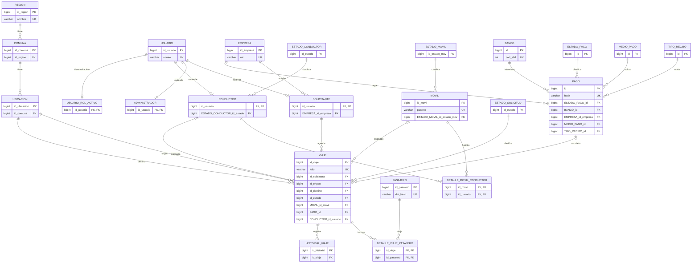

# Aplicacion de Belmonte Spa

**Ultima modificacion:** 26-09-2026

## Integrantes:
* Daniel Muñoz
* Michel Sanhueza

## Indice

- [Integrantes](#integrantes)
- [Introduccion](#introduccion)
  - [Descripcion de la problematica](#descripcion-de-la-problematica)
  - [Actores involucrados](#actores-involucrados)
  - [Casos de uso](#casos-de-uso)
- [Requerimientos funcionales](#requerimientos-funcionales)
- [Requisitos no funcionales](#requisitos-no-funcionales)
- [Historias de usuario](#historias-de-usuario)
- [Backlog](#backlog)
- [Modelamiento del problema](#modelamiento-del-problema)
  - [Modelo relacional](#modelo-relacional)
- [Arquitectura](#arquitectura)
  - [Base de datos MariaDB](#base-de-datos-mariadb)
  - [Backend](#backend)
  - [Frontend](#frontend)
  - [Frontend (Android)](#frontend-android)

## Introduccion

Belmonte SpA es una empresa del rubro de transporte privado corporativo, enfocada en
traslados ejecutivos y trayectos hacia/desde aeropuertos. Actualmente toda su gestión
operativa es manual: las solicitudes de viaje se coordinan de forma dispersa por
llamadas telefónicas, correos electrónicos y WhatsApp, transmitiendo de manera
informal datos como direcciones, números de vuelo, nombres de pasajeros, fechas y
horarios.

Este proyecto busca desarrollar un Producto Mínimo Viable (MVP) de aplicación móvil
que automatice y centralice el flujo completo de traslados en una plataforma
unificada, integrando la captura de solicitudes, la asignación de viajes a
conductores y el enlace directo con aplicaciones de navegación externa (Google Maps /
Waze) para el trazado de rutas.

### Descripcion de la problematica

La dispersión de la información en múltiples canales informales genera:
- Ineficiencias logísticas y lentitud en los tiempos de respuesta.
- Riesgo de errores en datos críticos (horarios mal informados, direcciones
  incorrectas).
- Retrasos en que los conductores reciban sus rutas asignadas.
- Lentitud en la confirmación del servicio de cara al cliente.

El objetivo del proyecto es eliminar la pérdida de información por canales
informales, lograr una confirmación de solicitudes ágil y reducir el error manual al
despachar rutas a los choferes.

### Actores involucrados

- **ACT-01 — Cliente corporativo / Solicitante:** Empresa o persona (ej. asistente,
  área de RRHH) que agenda el traslado ingresando el formulario con los datos del
  viaje (fecha, hora, origen, destino, número de vuelo si aplica) y los datos del
  pasajero.
- **ACT-02 — Pasajero:** Persona que efectivamente realiza el traslado; puede
  coincidir o no con quien lo solicitó.
- **ACT-03 — Recepcionista / Administrador:** Encargado de tomar y distribuir las
  solicitudes de traslado entre los conductores disponibles; también gestiona la
  flota (registrar vehículos y habilitar conductores para operarlos) y los pagos de
  los viajes.
- **ACT-04 — Conductor:** Ejecuta el transporte en terreno; visualiza en tiempo real
  los viajes que tiene asignados para el día y utiliza la app para trazar la ruta en
  navegadores externos.
- **ACT-05 — Sistema de navegación externo (Google Maps / Waze):** Actor externo que
  recibe las coordenadas georreferenciadas de origen y destino, y genera el trazado
  de ruta óptima al ser invocado por el conductor mediante Intents del sistema
  operativo.

> **Nota:** El Anexo de Requerimiento (§2.4) agrupa "Solicitantes / Pasajeros" en un
> solo actor. Este proyecto los separa en `ACT-01` y `ACT-02` por dos razones: (a) el
> Pasajero no tiene por qué estar asociado a la empresa que paga el traslado — en el
> modelo de datos, `PASAJERO` no tiene FK a `EMPRESA`, a diferencia de `SOLICITANTE` —,
> y (b) el Solicitante puede no ser quien viaja (p. ej. un asistente agenda el
> traslado de un ejecutivo o de una visita).

### Casos de uso

#### CU-01 — Registrar solicitud de traslado

| Campo | Detalle |
|---|---|
| **Actor(es)** | ACT-01 — Cliente corporativo / Solicitante |
| **Objetivo** | Registrar una solicitud de traslado mediante un formulario digital. |
| **Precondiciones** | El solicitante dispone de acceso al formulario de solicitud. |
| **Flujo principal** | 1. El solicitante ingresa al formulario.<br>2. Registra los datos del pasajero.<br>3. Registra fecha y hora del traslado.<br>4. Registra punto de origen y punto de destino.<br>5. Ingresa número de vuelo cuando corresponda.<br>6. El sistema registra la solicitud en estado Pendiente. |
| **Postcondiciones** | Solicitud almacenada y disponible para gestión. |
| **Flujos alternativos / excepciones** | Datos incompletos o inválidos. Las reglas específicas de validación no están definidas en el alcance actual. |

#### CU-02 — Visualizar viajes asignados

| Campo | Detalle |
|---|---|
| **Actor(es)** | ACT-04 — Conductor |
| **Objetivo** | Permitir al conductor consultar los viajes que tiene asignados para el día. |
| **Precondiciones** | El conductor tiene viajes asignados y conectividad con el sistema. |
| **Flujo principal** | 1. El conductor accede a la sección de viajes.<br>2. El sistema obtiene los viajes asignados.<br>3. El sistema presenta la lista de viajes correspondiente al conductor. |
| **Postcondiciones** | El conductor dispone de la información actualizada de sus viajes. |
| **Flujos alternativos / excepciones** | Sin conectividad o ausencia de viajes asignados. El comportamiento específico no está definido. |

#### CU-03 — Navegar a la ruta del viaje

| Campo | Detalle |
|---|---|
| **Actor(es)** | ACT-04 — Conductor |
| **Objetivo** | Abrir una aplicación externa de navegación utilizando el origen y destino georreferenciados del viaje. |
| **Precondiciones** | Existe un viaje asignado con coordenadas de origen y destino. |
| **Flujo principal** | 1. El conductor selecciona un viaje.<br>2. Presiona la opción de navegación.<br>3. La aplicación genera un Intent con origen y destino.<br>4. El sistema operativo entrega la solicitud a una aplicación compatible de navegación.<br>5. La aplicación externa inicia la navegación. |
| **Postcondiciones** | La aplicación de navegación externa recibe los puntos del viaje. |
| **Flujos alternativos / excepciones** | No existe una aplicación compatible o el Intent no puede ser procesado. |

#### CU-04 — Gestionar y distribuir solicitudes

| Campo | Detalle |
|---|---|
| **Actor(es)** | ACT-03 — Recepcionista / Administrador |
| **Objetivo** | Recibir, revisar y asignar solicitudes de traslado a conductores disponibles. |
| **Precondiciones** | Existen solicitudes registradas y conductores disponibles. |
| **Flujo principal** | 1. El administrador consulta las solicitudes.<br>2. Selecciona una solicitud.<br>3. Selecciona un conductor disponible (el sistema sugiere los vehículos habilitados para ese conductor).<br>4. Confirma la asignación.<br>5. El sistema actualiza el estado del traslado a Asignado y marca al conductor y al vehículo como Ocupado/En uso. |
| **Postcondiciones** | La solicitud queda asociada a un conductor y a un vehículo habilitado para él. |
| **Flujos alternativos / excepciones** | No existen conductores disponibles. No se ha definido una regla de reasignación automática. |

#### CU-05 — Actualizar estado del traslado

| Campo | Detalle |
|---|---|
| **Actor(es)** | ACT-03 — Recepcionista / Administrador; ACT-04 — Conductor |
| **Objetivo** | Gestionar el ciclo de vida operativo del traslado mediante estados. |
| **Precondiciones** | Existe una solicitud registrada. |
| **Flujo principal** | 1. El traslado inicia en estado Pendiente.<br>2. Recepcionista / Administrador asigna un conductor → Asignado.<br>3. Conductor inicia el traslado → En Curso.<br>4. Conductor finaliza el traslado → Finalizado.<br>5. Al finalizar, el conductor y el vehículo asignados vuelven a estado Disponible. |
| **Postcondiciones** | El estado representa la etapa actual del traslado. |
| **Flujos alternativos / excepciones** | No se encuentran definidas reglas para retroceder estados, cancelar o reabrir un traslado. |

#### CU-06 — Trazar ruta óptima hacia el destino

| Campo | Detalle |
|---|---|
| **Actor(es)** | ACT-05 — Sistema de navegación externo |
| **Objetivo** | Calcular y mostrar una ruta utilizando las coordenadas de origen y destino entregadas por la aplicación. |
| **Precondiciones** | El sistema externo recibe coordenadas válidas de origen y destino. |
| **Flujo principal** | 1. El sistema externo recibe origen y destino.<br>2. Procesa las coordenadas.<br>3. Calcula una ruta considerando la información de tráfico disponible.<br>4. Muestra el trazado al conductor. |
| **Postcondiciones** | La ruta de navegación queda visualizada en la aplicación externa. |
| **Flujos alternativos / excepciones** | El algoritmo de cálculo, proveedor de tráfico y criterios internos pertenecen al sistema externo. |

#### CU-07 — Registrar conductor

| Campo | Detalle |
|---|---|
| **Actor(es)** | ACT-03 — Recepcionista / Administrador |
| **Objetivo** | Crear una cuenta de Conductor con credenciales de acceso, para que pueda autenticarse sin autorregistrarse. |
| **Precondiciones** | El Administrador está autenticado en el sistema. |
| **Flujo principal** | 1. El Administrador ingresa al formulario de registro de conductor.<br>2. Ingresa nombre, correo, teléfono y una contraseña inicial.<br>3. El sistema valida que el correo no exista y que no falten campos obligatorios.<br>4. El sistema guarda la contraseña como hash (nunca en texto plano).<br>5. El conductor queda disponible de inmediato para autenticarse y para ser asignado en CU-04. |
| **Postcondiciones** | Existe una cuenta de Conductor activa, lista para iniciar sesión y ser asignada a solicitudes. |
| **Flujos alternativos / excepciones** | El correo ya existe o falta un campo obligatorio: el registro se rechaza. No existe una vista de "cambiar contraseña" para el Conductor; si necesita una nueva, el Administrador la reemplaza directamente en su ficha. |

#### CU-08 — Cancelar solicitud de traslado

| Campo | Detalle |
|---|---|
| **Actor(es)** | ACT-01 — Cliente corporativo / Solicitante |
| **Objetivo** | Cancelar una solicitud de traslado propia que ya no se necesita, liberando al conductor asignado si corresponde. |
| **Precondiciones** | Existe una solicitud propia en estado Pendiente o Asignado. |
| **Flujo principal** | 1. El Solicitante abre el detalle de una solicitud propia.<br>2. Presiona el botón "Cancelar".<br>3. El sistema valida que el estado actual sea Pendiente o Asignado.<br>4. El sistema actualiza el estado a Cancelado y registra la fecha/hora de cancelación.<br>5. Si la solicitud tenía conductor y vehículo asignados, ambos vuelven a estado Disponible y se notifica la cancelación al conductor mediante push (FCM); el viaje desaparece de su lista "Viajes del día".<br>6. Si la solicitud tenía un pago asociado, el sistema lo anula. |
| **Postcondiciones** | La solicitud queda en estado Cancelado; el conductor y el vehículo, si tenían uno asignado, quedan liberados; el pago asociado, si existía, queda Anulado. |
| **Flujos alternativos / excepciones** | Si el estado es En Curso o Finalizado, el botón "Cancelar" no está disponible y la cancelación se rechaza. |

#### CU-09 — Registrar vehículo

| Campo | Detalle |
|---|---|
| **Actor(es)** | ACT-03 — Recepcionista / Administrador |
| **Objetivo** | Registrar un vehículo de la flota para poder asignarlo a traslados. |
| **Precondiciones** | El Administrador está autenticado en el sistema. |
| **Flujo principal** | 1. El Administrador ingresa al formulario de registro de vehículo.<br>2. Ingresa patente y capacidad de pasajeros.<br>3. Ingresa el serial de GPS si el vehículo cuenta con uno propio (opcional, ya que el smartphone del conductor también reporta ubicación).<br>4. El sistema valida que la patente no exista.<br>5. El vehículo queda registrado en estado Disponible. |
| **Postcondiciones** | Existe un vehículo activo, disponible para ser habilitado a un conductor y asignado a traslados. |
| **Flujos alternativos / excepciones** | La patente ya existe o falta un campo obligatorio: el registro se rechaza. |

#### CU-10 — Habilitar conductor para vehículo

| Campo | Detalle |
|---|---|
| **Actor(es)** | ACT-03 — Recepcionista / Administrador |
| **Objetivo** | Habilitar a un conductor para operar un vehículo específico. |
| **Precondiciones** | El conductor (CU-07) y el vehículo (CU-09) ya están registrados. |
| **Flujo principal** | 1. El Administrador selecciona un conductor.<br>2. Selecciona uno o más vehículos a habilitar para ese conductor.<br>3. El sistema registra la relación conductor-vehículo. |
| **Postcondiciones** | El conductor queda habilitado para operar el/los vehículo(s) seleccionado(s); la relación es M:N (un vehículo puede tener varios conductores habilitados y viceversa). |
| **Flujos alternativos / excepciones** | La relación ya existe: el sistema la ignora sin duplicarla. |

#### CU-11 — Registrar pago de un viaje

| Campo | Detalle |
|---|---|
| **Actor(es)** | ACT-03 — Recepcionista / Administrador |
| **Objetivo** | Registrar el pago asociado a un viaje. |
| **Precondiciones** | Existe un viaje en un estado distinto de Cancelado. |
| **Flujo principal** | 1. El Administrador abre el viaje a facturar.<br>2. Ingresa monto, banco, medio de pago y tipo de recibo.<br>3. El sistema genera el pago en estado Pendiente y lo asocia al viaje. |
| **Postcondiciones** | El viaje queda con un pago asociado en estado Pendiente. |
| **Flujos alternativos / excepciones** | El viaje está Cancelado: no se puede registrar un pago nuevo. |

#### CU-12 — Actualizar estado de un pago

| Campo | Detalle |
|---|---|
| **Actor(es)** | ACT-03 — Recepcionista / Administrador |
| **Objetivo** | Reflejar si un pago fue efectivamente cobrado, rechazado o anulado. |
| **Precondiciones** | Existe un pago en estado Pendiente. |
| **Flujo principal** | 1. El Administrador selecciona un pago.<br>2. Marca el pago como Pagado o Rechazado. La transición a Anulado ocurre automáticamente al cancelarse el viaje asociado (ver CU-08) y no requiere esta acción manual. |
| **Postcondiciones** | El pago queda en su nuevo estado (Pagado, Rechazado o Anulado). |
| **Flujos alternativos / excepciones** | El pago ya está en estado terminal (Rechazado o Anulado): no se permite cambiarlo. |

#### CU-13 — Recuperar contraseña

| Campo | Detalle |
|---|---|
| **Actor(es)** | ACT-01 — Cliente corporativo/Solicitante; ACT-03 — Recepcionista/Administrador |
| **Objetivo** | Recuperar el acceso a la cuenta sin depender de otra persona, cuando se olvida la contraseña. |
| **Precondiciones** | El usuario tiene una cuenta de Solicitante o Administrador con correo registrado. |
| **Flujo principal** | 1. El usuario ingresa su correo en "olvidé mi contraseña".<br>2. El sistema valida que el correo corresponda a una cuenta de Solicitante o Administrador.<br>3. El sistema genera una contraseña temporal aleatoria, la hashea y la guarda como `password_hash`, y fija `password_temporal_expira`.<br>4. El sistema envía la contraseña en texto plano solo al correo registrado (único momento en que existe en texto plano; nunca se persiste así — ver RNF01).<br>5. El usuario inicia sesión con la contraseña temporal antes de que expire (CU-14). |
| **Postcondiciones** | El usuario puede autenticarse con la contraseña temporal hasta que expire. |
| **Flujos alternativos / excepciones** | El correo no existe, o pertenece a un Conductor: el sistema responde el mismo mensaje genérico, sin revelar el motivo. La contraseña temporal expira sin usarse: debe solicitar una nueva recuperación. |

> **Nota:** el Conductor queda fuera de este mecanismo a propósito — su contraseña
> solo la reemplaza el Administrador (CU-07/RF14), para que una desvinculación no le
> deje una vía de autoservicio para recuperar acceso por su cuenta.

#### CU-14 — Iniciar sesión

| Campo | Detalle |
|---|---|
| **Actor(es)** | ACT-01 — Cliente corporativo/Solicitante; ACT-03 — Recepcionista/Administrador; ACT-04 — Conductor |
| **Objetivo** | Autenticar a un usuario y emitir el JWT que el resto del sistema usa para autorizar sus acciones por rol. |
| **Precondiciones** | El usuario ya tiene una cuenta (autorregistrada si es Solicitante — RF01; creada por el Administrador si es Conductor — RF14; o por migración Flyway si es Administrador). |
| **Flujo principal** | 1. El usuario ingresa correo y contraseña.<br>2. El sistema valida la contraseña contra `USUARIO.password_hash`, rechazando si `password_temporal_expira` no es nulo y ya pasó (RF21).<br>3. El sistema determina el rol consultando en cuál de `SOLICITANTE`/`ADMINISTRADOR`/`CONDUCTOR` existe ese `id_usuario` (único por rol, garantizado por `USUARIO_ROL_ACTIVO`).<br>4. El sistema emite un JWT con `sub` = correo, `rol` = el rol encontrado, y `exp` = expiración (RNF01).<br>5. El sistema retorna el JWT, que el cliente adjunta en cada request posterior. |
| **Postcondiciones** | El usuario queda autenticado; el JWT emitido es la credencial que el `SecurityFilterChain` valida en cada request y usa para aplicar el mapeo rol→endpoint (sección Backend). |
| **Flujos alternativos / excepciones** | Correo inexistente o contraseña incorrecta: error genérico sin indicar cuál dato falló. Contraseña temporal expirada (RF21): mismo error genérico, debe pedir una recuperación nueva. |

## Requerimientos funcionales

- **RF01:** El sistema debe permitir al Cliente corporativo/Solicitante registrarse
  (incluyendo los datos de su empresa — razón social y RUT, que crean o reutilizan
  una fila en `EMPRESA`) y autenticarse en la aplicación (ver CU-14).
- **RF02:** El sistema debe permitir al Cliente corporativo/Solicitante registrar una
  solicitud de traslado indicando datos del pasajero, fecha, hora, dirección de
  origen, dirección de destino (seleccionadas mediante autocompletado de Google
  Places, capturando sus coordenadas georreferenciadas) y número de vuelo (si
  aplica).
- **RF03:** El sistema debe permitir al Cliente corporativo/Solicitante visualizar el
  historial y estado de sus solicitudes de traslado.
- **RF04:** El sistema debe permitir al Recepcionista/Administrador visualizar las
  solicitudes pendientes de asignación.
- **RF05:** El sistema debe permitir al Recepcionista/Administrador asignar un
  conductor disponible (junto con un vehículo habilitado para ese conductor) a una
  solicitud de traslado, actualizando su estado a "Asignado" y marcando al conductor
  y al vehículo como "Ocupado"/"En uso".
- **RF06:** El sistema debe permitir al Conductor autenticarse mediante credenciales
  asignadas por el Administrador, sin permitir autorregistro (ver CU-14).
- **RF07:** El sistema debe permitir al Conductor visualizar en tiempo real los
  viajes asignados para el día.
- **RF08:** El sistema debe permitir al Conductor visualizar el detalle de un viaje
  asignado (datos del pasajero, dirección de origen y de destino).
- **RF09:** El sistema debe permitir al Conductor actualizar el estado de un traslado
  a "En Curso" y a "Finalizado"; al finalizar, el sistema debe marcar al conductor y
  al vehículo asignados como "Disponible" nuevamente.
- **RF10:** El sistema debe integrar, mediante Intents del sistema operativo Android,
  una aplicación externa de navegación (Google Maps/Waze) para trazar la ruta hacia
  el destino a partir de las coordenadas georreferenciadas.
- **RF11:** El sistema debe persistir localmente (Room/SQLite) las solicitudes y
  viajes ya consultados, permitiendo su visualización sin conexión a internet. Los
  cambios generados sin conexión (por ejemplo, un cambio de estado registrado por el
  Conductor en terreno) deben quedar en una cola local y sincronizarse
  automáticamente con el backend vía API REST al recuperar la conectividad.
- **RF12:** El sistema debe notificar mediante mensajería push (Firebase Cloud
  Messaging) a los actores afectados cuando ocurra un cambio relevante en una
  solicitud de traslado (asignación de conductor, cambio de estado a En Curso o
  Finalizado), de modo que la información se actualice sin que el usuario tenga que
  recargar la app manualmente.
- **RF13:** El sistema debe registrar y mantener actualizado el token de notificación
  push (FCM) de cada usuario autenticado, para poder enviarle notificaciones
  dirigidas.
- **RF14:** El sistema debe permitir al Recepcionista/Administrador registrar una
  cuenta de Conductor (nombre, correo, teléfono y contraseña inicial), quedando
  disponible de inmediato para autenticarse e iniciar sesión.
- **RF15:** El sistema debe permitir al Cliente corporativo/Solicitante cancelar una
  solicitud de traslado propia mientras su estado sea "Pendiente" o "Asignado". Si la
  solicitud ya tenía un conductor y un vehículo asignados, el sistema debe liberarlos
  (marcarlos como "Disponible"), anular el pago asociado si existía, y notificarle la
  cancelación al conductor mediante push (FCM).
- **RF16:** El sistema debe permitir al Recepcionista/Administrador registrar un
  vehículo (móvil) de la flota indicando patente y capacidad de pasajeros. El serial
  del dispositivo GPS es opcional, ya que la ubicación también se puede obtener del
  GPS del smartphone del conductor.
- **RF17:** El sistema debe permitir al Recepcionista/Administrador habilitar a uno o
  más conductores para operar un vehículo específico.
- **RF18:** El sistema debe permitir al Recepcionista/Administrador registrar el pago
  de un viaje en cualquier estado previo a "Cancelado", indicando monto, banco, medio
  de pago y tipo de recibo; el pago queda asociado al viaje en estado inicial
  "Pendiente".
- **RF19:** El sistema debe permitir al Recepcionista/Administrador actualizar el
  estado de un pago a "Pagado" o "Rechazado". Si el viaje asociado se cancela (RF15),
  el sistema debe anular automáticamente el pago.
- **RF20:** El sistema debe permitir al Cliente corporativo/Solicitante visualizar el
  estado de pago de sus viajes junto con el resto del detalle de la solicitud.
- **RF21:** El sistema debe permitir al Solicitante y al Administrador recuperar su
  contraseña indicando su correo (CU-13); genera una contraseña temporal, la envía al
  correo registrado, y esa contraseña deja de ser válida tras un plazo determinado. El
  Conductor no cuenta con este mecanismo de autoservicio: su contraseña solo la
  reemplaza el Administrador (RF14), para que un conductor desvinculado no recupere
  acceso por sí mismo.

## Requisitos no funcionales

- **RNF01 (Seguridad):** Las contraseñas se deben almacenar únicamente como hash
  (nunca en texto plano), y la autenticación entre la app y el backend debe usar JWT
  con tiempo de expiración definido (ver CU-14). El acceso a cada endpoint debe
  validarse por rol (Solicitante, Administrador, Conductor) según el
  `SecurityFilterChain` centralizado definido en la Arquitectura. La única excepción
  de tránsito a "nunca en texto plano" es el envío puntual de una contraseña temporal
  por correo al recuperarla (RF21): se genera, se hashea para `password_hash`, se
  envía una vez, y no queda guardada en texto plano en ningún lugar.
- **RNF02 (Conectividad continua con tolerancia a cortes breves):** El modo normal de
  operación requiere conectividad a Internet continua, según el Anexo de
  Requerimiento (§3.3); no es un diseño offline-first ni permite operar sin red por
  períodos largos — registrar o recibir una nueva solicitud de traslado requiere
  conexión. Sobre esa base, la app tolera cortes breves de señal para datos ya
  sincronizados (Room/SQLite) y para cambios de estado de un viaje ya asignado, que
  quedan en una cola local y se reintentan automáticamente al recuperar la conexión
  (RF11) — el mismo patrón que usan apps de despacho en tiempo real (p. ej. Uber: el
  matching de una carrera nueva exige conexión en vivo, pero un viaje ya asignado
  tolera cortes breves).
- **RNF03 (Tiempo de respuesta):** Las operaciones de consulta (listar solicitudes,
  viajes del día) deben responder en menos de 2 segundos bajo condiciones normales de
  red 4G/Wi-Fi. Una notificación push (RF12/RF13) debe reflejarse en la app en un
  plazo de segundos, no minutos, desde que ocurre el evento en el backend.
- **RNF04 (Usabilidad para uso en terreno):** Las pantallas del Conductor (Viajes del
  día, Detalle de viaje) deben priorizar botones grandes y de fácil lectura, ya que
  se usan en contexto de movimiento (antes/después de conducir), minimizando la
  cantidad de pasos para marcar "En Curso"/"Finalizado" o abrir la navegación
  externa.
- **RNF05 (Compatibilidad):** La aplicación Android debe ser compatible con Android
  8.0 (API 26) en adelante, cubriendo la mayoría de dispositivos de gama media-baja
  usados por conductores en terreno. El backend debe exponer únicamente contratos
  JSON estándar (REST), sin acoplarse a un cliente específico.
- **RNF06 (Mantenibilidad):** El backend y la app deben mantener una separación
  estricta de capas (`Controller-Service-Repository` en Spring Boot,
  `View-ViewModel-Repository` en Android/MVVM), de forma que una regla de negocio
  (ej. transición de estados) se modifique en un único lugar sin tocar la capa de
  presentación.
- **RNF07 (Dependencia de servicios externos):** El sistema depende de dos servicios
  externos con cuota gratuita limitada (Google Places API para autocompletado de
  direcciones, Firebase Cloud Messaging para notificaciones push). El uso debe
  monitorearse para no exceder el nivel gratuito durante el desarrollo y las pruebas
  del MVP.
- **RNF08 (Privacidad de datos):** Los datos personales de pasajeros y solicitantes
  (nombre, teléfono, dirección) no deben registrarse en logs de la aplicación ni del
  backend, y solo deben ser visibles para los actores que participan directamente en
  cada solicitud (el propio Solicitante, el Administrador y el Conductor asignado).
- **RNF09 (Protección de datos académicos):** El desarrollo debe usar exclusivamente
  datos ficticios, sintéticos, agregados o públicos anonimizados (sin nombres, RUT,
  correos, teléfonos ni credenciales reales), según el Anexo de Requerimiento (§4) y
  la Ley N.º 21.719 y la Ley N.º 19.628 de protección de datos personales. Los
  antecedentes del proyecto se comparten solo por canales institucionales, con
  acceso restringido a quienes participan en la gestión académica.
- **RNF10 (Entregable):** El proyecto se colabora y documenta vía Git/GitHub, y el
  ejecutable final se entrega como un APK firmado en modo release (no un build de
  debug), según el Anexo de Requerimiento ("Alcance tecnológico comprometido").

## Historias de usuario

- **HU01:** Como Cliente corporativo/Solicitante, quiero registrarme y autenticarme
  en la aplicación, para acceder de forma segura a mis solicitudes de traslado.
  (RF01)
- **HU02:** Como Cliente corporativo/Solicitante, quiero registrar una solicitud de
  traslado seleccionando origen y destino con autocompletado de Google Places, para
  coordinar el viaje con datos exactos sin depender de llamadas o WhatsApp. (RF02)
- **HU03:** Como Cliente corporativo/Solicitante, quiero ver el historial y el estado
  de mis solicitudes de traslado, para saber en todo momento si mi viaje ya fue
  asignado. (RF03)
- **HU04:** Como Recepcionista/Administrador, quiero visualizar las solicitudes
  pendientes de asignación, para distribuirlas rápidamente entre los conductores
  disponibles. (RF04)
- **HU05:** Como Recepcionista/Administrador, quiero asignar o reasignar un conductor
  disponible a una solicitud de traslado, para confirmar el viaje y mantenerlo
  cubierto ante un imprevisto. (RF05)
- **HU06:** Como Conductor, quiero autenticarme con las credenciales que me entrega
  el Administrador, para acceder a mis viajes sin tener que registrarme yo mismo.
  (RF06)
- **HU07:** Como Conductor, quiero visualizar en tiempo real los viajes que tengo
  asignados para el día, para organizar mi jornada de traslados. (RF07)
- **HU08:** Como Conductor, quiero ver el detalle de un viaje asignado (pasajero,
  origen y destino), para confirmar los datos antes de iniciar el traslado. (RF08)
- **HU09:** Como Conductor, quiero actualizar el estado de un traslado a En Curso y a
  Finalizado, para reflejar el avance real del viaje. (RF09)
- **HU10:** Como Conductor, quiero abrir la ruta del viaje directamente en Google
  Maps o Waze desde la app, para no tener que copiar direcciones manualmente y llegar
  más rápido. (RF10)
- **HU11:** Como Conductor, quiero seguir consultando mis viajes sin conexión y que
  los cambios se sincronicen automáticamente al recuperarla, para no perder
  información mientras estoy en terreno. (RF11)
- **HU12:** Como Solicitante, quiero recibir una notificación push cuando cambie el
  estado de mi traslado, para enterarme sin tener que recargar la app manualmente.
  (RF12)
- **HU13:** Como Conductor, quiero recibir una notificación push cuando se me asigna
  un nuevo viaje, para enterarme de inmediato sin estar revisando la app
  constantemente. (RF12)
- **HU14:** Como usuario autenticado (Solicitante, Administrador o Conductor), quiero
  que la app registre mi token de notificaciones al iniciar sesión, para poder
  recibir avisos dirigidos a mi cuenta. (RF13)
- **HU15:** Como Recepcionista/Administrador, quiero registrar una cuenta de
  Conductor con sus credenciales, para que pueda autenticarse sin autorregistrarse.
  (RF14)
- **HU16:** Como Solicitante, quiero cancelar una solicitud de traslado que ya no
  necesito, para liberar al conductor asignado y evitar un viaje innecesario. (RF15)
- **HU17:** Como Administrador, quiero registrar un vehículo con su patente y
  capacidad, para poder asignarlo a traslados. (RF16)
- **HU18:** Como Administrador, quiero habilitar conductores para un vehículo
  específico, para controlar quién puede operarlo. (RF17)
- **HU19:** Como Administrador, quiero registrar el pago de un viaje en cualquier
  momento antes de que se cancele, para no depender de que termine el servicio.
  (RF18)
- **HU20:** Como Administrador, quiero actualizar el estado de un pago, o que se
  anule automáticamente si se cancela el viaje, para mantener la facturación al día.
  (RF19)
- **HU21:** Como Solicitante, quiero ver el estado de pago de mis viajes, para saber
  si ya fueron cobrados. (RF20)
- **HU22:** Como Solicitante o Administrador, quiero recuperar mi contraseña si la
  olvido, para volver a acceder sin depender de otra persona. (RF21)

> Los criterios de aceptación, prioridad y estimación de cada historia están
> detallados en la tabla de [Backlog](#backlog).

## Backlog

| ID | Historia de usuario | Criterios de aceptación | Prioridad | Estimación (SP) |
|----|---|---|---|---|
| HU01 | Registro y login del Cliente corporativo/Solicitante | El registro se rechaza si el correo ya existe o falta algún campo obligatorio (empresa, contacto, correo, teléfono, contraseña).<br>Con credenciales válidas se accede a "Mis solicitudes"; con credenciales inválidas se muestra un error sin indicar cuál dato falló.<br>El campo "empresa" (razón social + RUT) crea o reutiliza una fila en `EMPRESA`; solicitantes de la misma empresa comparten esa fila, no se duplica. | Alta | 3 |
| HU02 | Registrar solicitud de traslado | El campo de origen y destino usa autocompletado (Google Places API): el Solicitante escribe y elige una dirección de una lista de sugerencias, nunca texto libre. Al seleccionar una dirección, la app captura automáticamente latitud y longitud junto con el texto. No se puede enviar el formulario si origen o destino no fueron seleccionados de la lista (evita direcciones sin coordenadas). El número de vuelo es opcional; pasajero, fecha, hora, origen y destino son obligatorios.| Alta | 5 |
| HU03 | Ver historial y estado de mis solicitudes | La lista muestra pasajero, fecha/hora, ruta (origen→destino) y estado de cada solicitud propia.<br>El estado reflejado corresponde al último cambio registrado por el Administrador o el Conductor. | Media | 3 |
| HU04 | Panel de solicitudes pendientes | Solo se listan solicitudes en estado Pendiente.<br>Cada fila permite pasar directamente a la vista "Asignar conductor" de esa solicitud. | Alta | 3 |
| HU05 | Asignar conductor a una solicitud | Solo se listan conductores disponibles (sin viaje en curso).<br>Al confirmar, la solicitud pasa a estado Asignado y queda visible en "Viajes del día" del conductor elegido.<br>Al confirmar, también se asigna un vehículo habilitado para ese conductor; conductor y vehículo pasan a estado "Ocupado"/"En uso". | Alta | 5 |
| HU06 | Login del Conductor (sin autorregistro) | La pantalla de login del Conductor no ofrece la opción "crear cuenta".<br>Con credenciales inválidas se muestra un error sin revelar si el correo existe. | Alta | 2 |
| HU07 | Ver viajes del día | Solo se muestran los viajes del conductor autenticado, para la fecha actual, ordenados por hora.<br>Cada viaje muestra pasajero, hora y estado. | Alta | 3 |
| HU08 | Ver detalle de un viaje asignado | Muestra pasajero, número de vuelo (si aplica), origen y destino completos.<br>Incluye el botón "Navegar" y los controles de cambio de estado. | Alta | 3 |
| HU09 | Actualizar estado del viaje (En Curso / Finalizado) | "Iniciar viaje" solo está habilitado si el estado actual es Asignado.<br>"Finalizar viaje" solo está habilitado si el estado actual es En Curso.<br>Cada cambio de estado registra la fecha/hora en que ocurrió.<br>Al finalizar, el conductor y el vehículo asignados vuelven a estado "Disponible". | Alta | 3 |
| HU10 | Navegar con Google Maps/Waze | Al presionar "Navegar" se abre Google Maps o Waze con el destino precargado.<br>Si no hay ninguna app de navegación instalada, se muestra un aviso en vez de fallar silenciosamente. | Alta | 3 |
| HU11 | Persistencia local y sincronización | Las solicitudes y viajes ya cargados se pueden seguir consultando sin conexión.
Un cambio de estado hecho sin conexión (ej. "Finalizar viaje") se guarda en una cola local y se marca como "pendiente de sincronizar".
Al recuperar la conexión, la cola se envía automáticamente al backend sin intervención del usuario. | Media | 8 |
| HU12 | Recibir notificación al cambiar el estado de mi traslado | Como Solicitante, cuando mi traslado pasa a "Asignado", "En Curso" o "Finalizado", recibo una notificación push.
Al abrir la notificación (o la pantalla "Mis solicitudes"), el estado mostrado ya está actualizado sin necesidad de recargar manualmente. | Media | 5 |
| HU13 | Recibir notificación de un nuevo viaje asignado| Como Conductor, cuando el Administrador me asigna una solicitud, recibo una notificación push.
Al abrirla, el viaje aparece en "Viajes del día" con sus datos completos. | Alta | 5 |
| HU14 | Registro del token de notificaciones|Como usuario autenticado (Solicitante, Administrador o Conductor), al iniciar sesión la app registra o actualiza mi token FCM en el backend.
Si el token cambia (reinstalación, cambio de dispositivo), se reemplaza el anterior sin duplicar registros.| Alta | 3 |
| HU15 |Registrar conductor|Como Administrador, quiero crear una cuenta de Conductor con nombre, correo, teléfono y contraseña, para que pueda autenticarse sin autorregistrarse.
Criterios: el registro se rechaza si el correo ya existe o falta un campo obligatorio.
El Administrador define la contraseña directamente en el formulario (no se genera automáticamente).
La contraseña se guarda como hash (password_hash), nunca en texto plano.
Al crearse, el conductor queda disponible de inmediato en "Asignar conductor" (HU05).
No existe una vista de "cambiar contraseña" para el Conductor: si necesita una nueva, el Administrador la reemplaza directamente en su ficha.| Alta | 3 |
| HU16 |Cancelar solicitud de traslado|Como Solicitante, quiero cancelar un traslado que ya no necesito, para liberar al conductor y que no se presente a un viaje que no va a ocurrir.
Criterios: el botón "Cancelar" solo está disponible si el estado es Pendiente o Asignado.
Si el estado es En Curso o Finalizado, no se puede cancelar.
Al cancelar, el estado pasa a "Cancelado" y queda registrada la fecha/hora de cancelación.
Si la solicitud tenía conductor y vehículo asignados, ambos vuelven a estado "Disponible", se notifica la cancelación al conductor mediante push (mismo mecanismo de RF12) y el viaje desaparece de su lista "Viajes del día".
Si la solicitud tenía un pago asociado, este queda en estado "Anulado".| Alta | 3 |
| HU17 | Registrar vehículo | La patente es obligatoria y única; la capacidad debe ser mayor a 0.<br>El GPS serial es opcional: el vehículo puede operar sin dispositivo propio, usando el GPS del smartphone del conductor.<br>El vehículo queda registrado en estado inicial "Disponible". | Media | 3 |
| HU18 | Habilitar conductor para vehículo | Solo se pueden habilitar conductores ya registrados (HU15).<br>Un vehículo puede tener más de un conductor habilitado, y un conductor puede estar habilitado para más de un vehículo (relación M:N).<br>Habilitar una relación ya existente no la duplica. | Media | 2 |
| HU19 | Registrar pago de un viaje | Se puede registrar un pago para un viaje en cualquier estado distinto de Cancelado.<br>El hash del pago es único.<br>Banco, medio de pago y tipo de recibo se eligen de catálogos existentes.<br>El pago queda en estado inicial "Pendiente". | Media | 5 |
| HU20 | Actualizar estado de pago | Transiciones válidas: Pendiente→Pagado, Pendiente→Rechazado, (Pendiente\|Pagado)→Anulado.<br>"Anulado" es un estado terminal.<br>La anulación por cancelación del viaje (HU16) es automática, no requiere acción manual del Administrador. | Media | 3 |
| HU21 | Ver estado de pago de mis viajes | El estado de pago se muestra en "Detalle de solicitud" (HU03) solo si el viaje tiene un pago asociado. | Baja | 2 |
| HU22 | Recuperar contraseña | Solo para Solicitante y Administrador (no Conductor).<br>El correo debe ser de una cuenta de Solicitante o Administrador; si no, se responde el mismo mensaje genérico sin revelar el motivo.<br>La contraseña temporal generada expira tras un plazo determinado; si no se usa a tiempo, hay que solicitar una recuperación nueva. | Media | 3 |

## Modelamiento del problema

Motor de base de datos: **MariaDB** (ver migraciones Flyway en
`backend/src/main/resources/db/migration`).

| Entidad | Atributo | Tipo de dato | Clave | Descripción |
|---|---|---|---|---|
| REGION | id_region | BIGINT UNSIGNED | PK, AUTO_INCREMENT | Identificador de la región. |
| REGION | nombre | VARCHAR(60) | UNIQUE, NOT NULL | Nombre de la región. |
| COMUNA | id_comuna | BIGINT UNSIGNED | PK, AUTO_INCREMENT | Identificador de la comuna. |
| COMUNA | nombre | VARCHAR(80) | NOT NULL (UNIQUE junto a id_region) | Nombre de la comuna. |
| COMUNA | id_region | BIGINT UNSIGNED | FK → REGION, NOT NULL | Región a la que pertenece. |
| UBICACION | id_ubicacion | BIGINT UNSIGNED | PK, AUTO_INCREMENT | Identificador de la ubicación. |
| UBICACION | direccion | VARCHAR(200) | NOT NULL (UNIQUE junto a id_comuna, latitud, longitud) | Dirección georreferenciada reutilizable como origen o destino (RF10). |
| UBICACION | id_comuna | BIGINT UNSIGNED | FK → COMUNA, NOT NULL | Comuna de la dirección. |
| UBICACION | latitud | DECIMAL(9,6) | NOT NULL (UNIQUE junto a direccion, id_comuna, longitud) | Coordenada geográfica (RF10). |
| UBICACION | longitud | DECIMAL(9,6) | NOT NULL (UNIQUE junto a direccion, id_comuna, latitud) | Coordenada geográfica (RF10). |
| USUARIO | id_usuario | BIGINT UNSIGNED | PK, AUTO_INCREMENT | Identificador de la cuenta. |
| USUARIO | nombre | VARCHAR(120) | NOT NULL | Nombre del usuario. |
| USUARIO | correo | VARCHAR(150) | UNIQUE, NOT NULL | Correo de acceso (login). |
| USUARIO | telefono | VARCHAR(20) | — | Teléfono de contacto. |
| USUARIO | password_hash | VARCHAR(200) | NOT NULL | Hash de la contraseña; nunca se almacena en texto plano. |
| USUARIO | password_temporal_expira | DATETIME | — | NULL si `password_hash` es una contraseña normal; con valor, `password_hash` es una contraseña temporal de recuperación válida solo hasta este instante (RF21). Siempre NULL para CONDUCTOR. |
| USUARIO | fecha_registro | DATETIME | NOT NULL, DEFAULT CURRENT_TIMESTAMP | Fecha de creación de la cuenta. |
| USUARIO_ROL_ACTIVO | id_usuario | BIGINT UNSIGNED | PK, FK → USUARIO | Garantiza que un usuario tenga un solo rol activo a la vez: triggers `BEFORE INSERT` en `SOLICITANTE`/`ADMINISTRADOR`/`CONDUCTOR` insertan aquí antes de permitir su propio insert; la `PRIMARY KEY` rechaza un segundo rol para el mismo `id_usuario`. Sin columnas propias. |
| EMPRESA | id_empresa | BIGINT UNSIGNED | PK, AUTO_INCREMENT | Identificador de la empresa. |
| EMPRESA | razon_social | VARCHAR(50) | NOT NULL | Razón social de la empresa cliente. |
| EMPRESA | rut | VARCHAR(15) | UNIQUE, NOT NULL | RUT de la empresa (identificador legal único; ya no depende de `razon_social`). |
| SOLICITANTE | id_usuario | BIGINT UNSIGNED | PK, FK → USUARIO | Extensión 1:1 del Cliente corporativo/Solicitante (RF01). |
| SOLICITANTE | empresa_id_empresa | BIGINT UNSIGNED | FK → EMPRESA, NOT NULL | Empresa a la que pertenece el solicitante. |
| ADMINISTRADOR | id_usuario | BIGINT UNSIGNED | PK, FK → USUARIO | Extensión 1:1 del Recepcionista/Administrador (sin atributos propios aún). Se crea mediante una migración Flyway de carga inicial (`backend/src/main/resources/db/migration`); no existe autorregistro de administradores ni un endpoint para crearlos. |
| ESTADO_CONDUCTOR | id_estado | BIGINT UNSIGNED | PK, AUTO_INCREMENT | Identificador del estado del conductor. |
| ESTADO_CONDUCTOR | estado | VARCHAR(20) | UNIQUE | Nombre del estado (p. ej. disponible/ocupado); sin NOT NULL en el DDL. |
| CONDUCTOR | id_usuario | BIGINT UNSIGNED | PK, FK → USUARIO | Extensión 1:1 del Conductor. |
| CONDUCTOR | estado_conductor_id_estado | BIGINT UNSIGNED | FK → ESTADO_CONDUCTOR, NOT NULL | Estado actual del conductor; permite que VIAJE.CONDUCTOR_id_usuario solo referencie usuarios con este rol. |
| ESTADO_MOVIL | id_estado_mov | BIGINT UNSIGNED | PK, AUTO_INCREMENT | Identificador del estado del móvil. |
| ESTADO_MOVIL | nombre | VARCHAR(20) | UNIQUE, NOT NULL | Nombre del estado del vehículo (p. ej. disponible/en mantención). |
| MOVIL | id_movil | BIGINT UNSIGNED | PK, AUTO_INCREMENT | Identificador del vehículo. |
| MOVIL | patente | VARCHAR(6) | UNIQUE, NOT NULL | Patente del vehículo. |
| MOVIL | gps_serial | INT | — | Identificador del dispositivo GPS instalado; opcional, ya que la ubicación también se obtiene del GPS del smartphone del conductor (RF16). |
| MOVIL | estado_movil_id_estado_mov | BIGINT UNSIGNED | FK → ESTADO_MOVIL, NOT NULL | Estado actual del vehículo. |
| MOVIL | capacidad | INT | NOT NULL | Capacidad de pasajeros del vehículo. |
| DETALLE_MOVIL_CONDUCTOR | id_movil | BIGINT UNSIGNED | PK, FK → MOVIL | Vehículo habilitado para el conductor. |
| DETALLE_MOVIL_CONDUCTOR | id_usuario | BIGINT UNSIGNED | PK, FK → CONDUCTOR | Conductor habilitado para ese vehículo. |
| PASAJERO | id_pasajero | BIGINT UNSIGNED | PK, AUTO_INCREMENT | Identificador del pasajero. |
| PASAJERO | dni_hash | VARCHAR(50) | UNIQUE, NOT NULL | Hash del documento de identidad de la persona transportada — RUT chileno o pasaporte extranjero. |
| PASAJERO | nombre | VARCHAR(120) | NOT NULL | Nombre de la persona transportada; puede no coincidir con el solicitante (CU-01). |
| ESTADO_SOLICITUD | id_estado | BIGINT UNSIGNED | PK, AUTO_INCREMENT | Identificador del estado. |
| ESTADO_SOLICITUD | nombre_estado | VARCHAR(20) | UNIQUE, NOT NULL | PENDIENTE, ASIGNADO, EN_CURSO, FINALIZADO (RF05/RF09) y CANCELADO (RF15/CU-08). |
| BANCO | id | BIGINT UNSIGNED | PK, AUTO_INCREMENT | Identificador del banco. |
| BANCO | nombre | VARCHAR(50) | NOT NULL | Nombre del banco. |
| BANCO | cod_sbif | INT | UNIQUE, NOT NULL | Código SBIF del banco (identificador externo único; ya no depende de `nombre`). |
| ESTADO_PAGO | id | BIGINT UNSIGNED | PK, AUTO_INCREMENT | Identificador del estado de pago. |
| ESTADO_PAGO | estado | VARCHAR(20) | UNIQUE, NOT NULL | Pendiente, Pagado, Rechazado o Anulado (RF18/RF19). |
| MEDIO_PAGO | id | BIGINT UNSIGNED | PK, AUTO_INCREMENT | Identificador del medio de pago. |
| MEDIO_PAGO | nombre | VARCHAR(20) | UNIQUE, NOT NULL | Nombre del medio de pago (p. ej. transferencia, tarjeta). |
| TIPO_RECIBO | id | BIGINT UNSIGNED | PK, AUTO_INCREMENT | Identificador del tipo de recibo. |
| TIPO_RECIBO | nombre | VARCHAR(20) | UNIQUE, NOT NULL | Nombre del tipo de recibo o comprobante. |
| PAGO | id | BIGINT UNSIGNED | PK, AUTO_INCREMENT | Identificador del pago. |
| PAGO | hash | VARCHAR(50) | UNIQUE, NOT NULL | Hash único de la transacción de pago, generado internamente por el backend al crear el pago (no proviene de una pasarela de pago externa). |
| PAGO | monto | INT | NOT NULL | Monto del pago. |
| PAGO | estado_pago_id | BIGINT UNSIGNED | FK → ESTADO_PAGO, NOT NULL | Estado actual del pago. |
| PAGO | banco_id | BIGINT UNSIGNED | FK → BANCO, NOT NULL | Banco involucrado en el pago. |
| PAGO | empresa_id_empresa | BIGINT UNSIGNED | FK → EMPRESA, NOT NULL | Empresa que paga el viaje. |
| PAGO | medio_pago_id | BIGINT UNSIGNED | FK → MEDIO_PAGO, NOT NULL | Medio utilizado para pagar. |
| PAGO | tipo_recibo_id | BIGINT UNSIGNED | FK → TIPO_RECIBO, NOT NULL | Tipo de recibo emitido para este pago. |
| PAGO | fecha_pago | DATETIME | NOT NULL | Fecha y hora del pago. |
| VIAJE | id_viaje | BIGINT UNSIGNED | PK, AUTO_INCREMENT | Identificador del viaje. |
| VIAJE | folio | VARCHAR(20) | UNIQUE, NOT NULL | Identificador público del viaje, usado como clave de ruta en la API en vez de `id_viaje`; lo genera el backend al crearse el viaje y es inmutable después. |
| VIAJE | id_solicitante | BIGINT UNSIGNED | FK → SOLICITANTE, NOT NULL | Quién agenda el traslado. |
| VIAJE | id_origen | BIGINT UNSIGNED | FK → UBICACION, NOT NULL | Dirección de origen. |
| VIAJE | id_destino | BIGINT UNSIGNED | FK → UBICACION, NOT NULL | Dirección de destino. |
| VIAJE | id_estado | BIGINT UNSIGNED | FK → ESTADO_SOLICITUD, NOT NULL | Ciclo de vida del traslado (RF05/RF09). |
| VIAJE | movil_id_movil | BIGINT UNSIGNED | FK → MOVIL | Vehículo asignado al viaje; NULL hasta la asignación. |
| VIAJE | pago_id | BIGINT UNSIGNED | FK → PAGO | Pago asociado al viaje, si existe. |
| VIAJE | cantidad_pasajeros | INT | NOT NULL, DEFAULT 0 | Conteo mantenido automáticamente desde `DETALLE_VIAJE_PASAJERO` (nunca lo escribe el cliente); no puede superar la capacidad del móvil asignado. |
| VIAJE | fh_creacion | DATETIME | NOT NULL, DEFAULT CURRENT_TIMESTAMP | Momento en que se registró la solicitud; inmutable después de creado el viaje. |
| VIAJE | fh_agenda | DATETIME | NOT NULL | Fecha y hora solicitada/agendada del traslado (RF02), ingresada por el Solicitante; distinta de `fh_creacion`. |
| VIAJE | fh_asignacion | DATETIME | — | Momento en que se asignó un conductor. |
| VIAJE | fh_inicio | DATETIME | — | Momento en que el viaje pasó a En Curso. |
| VIAJE | fh_fin | DATETIME | — | Momento en que el viaje se marcó Finalizado. |
| VIAJE | conductor_id_usuario | BIGINT UNSIGNED | FK → CONDUCTOR | NULL hasta que el Administrador asigna un conductor (RF05). |
| VIAJE | numero_vuelo | VARCHAR(20) | — | Opcional; solo si aplica a un vuelo. |
| DETALLE_VIAJE_PASAJERO | id_viaje | BIGINT UNSIGNED | PK, FK → VIAJE | Traslado en el que viaja el pasajero. |
| DETALLE_VIAJE_PASAJERO | id_pasajero | BIGINT UNSIGNED | PK, FK → PASAJERO | Pasajero que viaja en ese traslado. |
| HISTORIAL_VIAJE | id_historial | BIGINT UNSIGNED | PK, AUTO_INCREMENT | Identificador de la fila de historial. |
| HISTORIAL_VIAJE | id_viaje | BIGINT UNSIGNED | FK → VIAJE, NOT NULL | Viaje al que pertenece el cambio. |
| HISTORIAL_VIAJE | campo_modificado | VARCHAR(30) | NOT NULL | Nombre del campo de `VIAJE` que cambió (conductor, móvil, estado, cantidad de pasajeros, etc.). |
| HISTORIAL_VIAJE | valor | VARCHAR(200) | NOT NULL | Valor nuevo de ese campo, como texto. |
| HISTORIAL_VIAJE | fecha_cambio | DATETIME | NOT NULL, DEFAULT CURRENT_TIMESTAMP | Momento del cambio. Una fila por cada campo que cambia en cada `UPDATE` de `VIAJE`; la escriben los triggers de `VIAJE`, no la capa de aplicación — no tiene Controller/Service ni se expone por la API. `folio` y `fh_creacion` son inmutables y nunca generan fila aquí. |

El "Sistema de navegación externo" no tiene tabla: es un actor externo sin datos
propios que persistir.

> **Nota:** `CANCELADO` se añade a `ESTADO_SOLICITUD` más allá de los 4 estados del
> Anexo de Requerimiento (§3.2: Pendiente, Asignado, En Curso, Finalizado). Se agrega
> específicamente para generar auditoría: queda un registro con fecha/hora del evento
> sin eliminar la solicitud ni perder trazabilidad, en vez de reutilizar un estado
> existente o borrar la fila (RF15/CU-08).

> **Nota:** `HISTORIAL_VIAJE` se agrega por el mismo motivo, pero para los cambios de
> un viaje a lo largo de todo su ciclo de vida, no solo su cancelación: conductor,
> móvil, estado y cantidad de pasajeros pueden cambiar varias veces (p. ej. una
> reasignación, HU05), y sin este historial se perdería el rastro de los valores
> anteriores. `folio` y `fh_creacion` quedan inmutables a propósito, así que nunca
> generan una fila aquí.

> **Nota:** las PK usan `AUTO_INCREMENT`: MariaDB asigna el siguiente valor
> automáticamente al insertar, sin necesitar una secuencia ni un trigger aparte.

Normalizado a 3FN:
- `UBICACION` separada de `VIAJE`: latitud/longitud dependen funcionalmente de la
  dirección, no del viaje (dependencia transitiva).
- `PASAJERO` + `DETALLE_VIAJE_PASAJERO` separados de `VIAJE`: una columna única de
  pasajero sería un grupo repetitivo en cuanto hay más de un pasajero por viaje
  (viola 1FN).
- Los roles (`SOLICITANTE`, `ADMINISTRADOR`, `CONDUCTOR`) se modelan como extensiones
  1:1 de `USUARIO` (tabla por subtipo) en vez de un catálogo `TIPO_USUARIO` con
  `CHECK`; `ESTADO_SOLICITUD`, `ESTADO_CONDUCTOR`, `ESTADO_MOVIL`, `ESTADO_PAGO`,
  `MEDIO_PAGO` y `TIPO_RECIBO` sí pasan de `CHECK` a catálogo: no corrige una forma
  normal, pero permite agregar/renombrar valores sin alterar el DDL de las tablas que
  los usan. La tabla-por-subtipo, por sí sola, no impide que un mismo `id_usuario`
  tenga fila en más de un rol a la vez; `USUARIO_ROL_ACTIVO` existe exactamente para
  eso — no es una corrección de forma normal, es una restricción de exclusividad.
- `VIAJE.cantidad_pasajeros` es una denormalización deliberada: duplica lo que ya
  cuenta `DETALLE_VIAJE_PASAJERO`. Es aceptable porque la mantiene un trigger, no el
  cliente, así que nunca queda desincronizada, y evita un `COUNT(*)` en cada consulta
  de "viajes del día" (RNF03).
- `COMUNA`/`REGION`: `id_comuna` es un atributo propio de `UBICACION` (no derivado de
  `direccion`, que ya no es `UNIQUE` por sí sola sino en conjunto con comuna y
  coordenadas), por lo que la referencia a `COMUNA` es una FK normal y no una
  dependencia transitiva; es una descomposición normal de jerarquía geográfica, no
  una corrección de anomalía.

### Modelo relacional



Solo se listan columnas PK/FK/UK en el diagrama; el resto de los atributos de cada
entidad está detallado en la tabla de la sección anterior.

## Arquitectura

> **Decisión de implementación:** MariaDB es la base de datos oficial de la
> aplicación. El esquema que usa la aplicación se crea con las migraciones Flyway en
> `backend/src/main/resources/db/migration`.

### Base de datos **MariaDB**

* **Integridad Transaccional (ACID):** Utiliza el motor de almacenamiento `InnoDB`,
  garantizando la consistencia y atomicidad de los datos en procesos críticos de
  logística (como la asignación de vehículos, registro de mantenimientos y estados de
  viaje).
* **Compatibilidad Total con el Ecosistema Spring:** Cuenta con dialectos oficiales
  en Hibernate (`MariaDBDialect`) y un driver JDBC oficial (`mariadb-java-client`)
  ligero y eficiente, permitiendo la generación y migración automática de tablas
  desde Java.
* **Filosofía Open Source:** Es un sistema de gestión de bases de datos 100% libre y
  comunitario (Licencia GPL v2), asegurando estabilidad sin depender de licencias
  comerciales.
* **Eficiencia de Recursos en Desarrollo:** Presenta un consumo optimizado de memoria
  y CPU en entornos de desarrollo local, permitiendo ejecutar simultáneamente el
  entorno de Android Studio, la base de datos y la API de Spring Boot sin sobrecargar
  el equipo.

#### Iniciar la base de datos local

Requiere Docker Compose. Desde la raíz del repositorio, en PowerShell:

```powershell
Copy-Item .env.example .env
docker compose up -d mariadb
```

La API usa `DB_URL`, `DB_USER` y `DB_PASSWORD`; sus valores locales están en
`.env.example`. Flyway aplica las migraciones al iniciar el backend. `.env` está
excluido de Git: cambia las credenciales para cualquier entorno compartido o
desplegado.

Para detener MariaDB conservando sus datos: `docker compose down`. Para borrar
también los datos locales: `docker compose down -v`.

### Backend

**Spring Boot** como el framework principal para la capa del backend debido a las
siguientes ventajas técnicas:

* **Arquitectura REST Nativa para Clientes Móviles:** Permite estructurar y exponer
  endpoints HTTP en formato JSON estandarizado. Esto facilita la integración
  transparente con la aplicación móvil Android utilizando librerías de red como
  Retrofit o Volley.
* **Seguridad Stateless mediante JWT:** A través de **Spring Security**, la
  aplicación implementa autenticación basada en tokens **JWT (JSON Web Tokens)**. Al
  ser una API sin estado (*stateless*), es el enfoque óptimo para dispositivos
  móviles. El control de acceso por rol (Solicitante, Administrador, Conductor) se
  centraliza en un único `SecurityFilterChain`, que mapea cada ruta a los roles
  permitidos y rechaza por defecto (`denyAll`) cualquier endpoint no listado
  explícitamente.
* **Diseño Modular y Separación de Capas:** Impone un patrón de diseño claro
  (`Controller` ➔ `Service` ➔ `Repository`), lo que garantiza un código limpio,
  mantenible, fácil de auditar y preparado para futuras ampliaciones de lógica de
  negocio.
* **Productividad con Spring Data JPA:** Automatiza la persistencia de datos mediante
  el mapeo objeto-relacional (ORM), eliminando la necesidad de escribir código SQL
  manual redundante para las operaciones estándar (CRUD).
* **Notificaciones push con Firebase Cloud Messaging:** Ante cambios relevantes en
  una solicitud (asignación, cambio de estado, cancelación), la capa `Service` invoca
  el SDK de Firebase Admin para notificar al actor afectado, evitando que la app
  dependa de recargar manualmente o de mantener una conexión persistente abierta.
  Cada usuario autenticado registra su token de dispositivo, que el backend actualiza
  al iniciar sesión.

#### Mapeo de roles por endpoint

El `SecurityFilterChain` (bullet anterior) necesita saber qué rol puede tocar cada
recurso. Basado en las responsabilidades ya descritas en los casos de uso:

| Recurso | Roles con acceso | Alcance |
|---|---|---|
| `usuarios` | Solicitante, Administrador, Conductor | Cada uno solo sobre su propia cuenta (RNF08). |
| `administradores` | Administrador | Gestión de cuentas de Administrador. |
| `conductores` | Administrador (crea/edita, CU-07); Conductor | El Conductor solo sobre su propia cuenta. |
| `solicitantes` | Solicitante (su propia cuenta); Administrador (lectura) | — |
| `empresas` | Solicitante (crea/reutiliza al registrarse, RF01); Administrador (lectura) | — |
| `moviles` | Administrador | Gestión de flota (CU-09, CU-10). |
| `pagos` | Administrador (gestión, CU-11/CU-12); Solicitante (lectura) | El Solicitante solo los pagos de sus propios viajes (RF20). |
| `pasajeros` | Solicitante (los registra, CU-01); Administrador (lectura) | — |
| `viajes` | Solicitante (los propios, RF02/RF03); Administrador (todos, CU-04); Conductor (los propios asignados, RF07/RF08) | — |

Los 9 catálogos (`bancos`, `comunas`, `estados-conductor`, `estados-movil`,
`estados-pago`, `estados-solicitud`, `medios-pago`, `regiones`, `tipos-recibo`) no
entran en esta tabla porque ningún rol los toca vía API — se modifican solo desde la
base de datos (ver "CRUD REST").

### Frontend


Vistas propuestas para el MVP, agrupadas por actor:

**Transversal**
- **Login:** autenticación para los tres actores con app móvil (Cliente
  corporativo/Solicitante, Recepcionista/Administrador, Conductor).
- **Perfil / Cierre de sesión:** datos del usuario logueado.

**Cliente corporativo / Solicitante**
- **Registro:** creación de cuenta propia. El Conductor no se autorregistra: sus
  credenciales son asignadas por el Administrador, por lo que solo usa la vista de
  Login.
- **Registrar solicitud de traslado:** formulario con datos del pasajero, fecha,
  hora, origen, destino y n.º de vuelo (si aplica). Cubre CU-01.
- **Mis solicitudes (historial):** lista de traslados agendados con su estado actual
  (Pendiente/Asignado/En Curso/Finalizado).
- **Detalle de solicitud:** vista de una solicitud puntual con los datos ingresados,
  estado, y datos del conductor una vez asignado.

**Recepcionista / Administrador**
- **Panel de solicitudes pendientes:** listado de solicitudes sin asignar. Entrada a
  CU-04.
- **Asignar conductor:** vista para elegir un conductor disponible para una solicitud
  puntual. Cubre CU-04.
- **Panel general / dashboard** *(segunda iteración)*: resumen operativo con conteo
  de viajes por estado.
- **Sistema de distribución de solicitudes** *(mejora futura, no evaluada para el
  MVP)*: automatizar la asignación de conductor (hoy manual, RF05/CU-04) y dejar al
  Administrador enfocado en administración de usuarios y el dashboard. No tiene RF ni
  HU que lo respalde en el anexo de requerimiento ni en este documento; evaluar recién
  si se amplía el alcance más allá del MVP académico.

**Conductor**
- **Viajes del día:** lista de viajes asignados para la fecha actual, ordenados por
  hora. Cubre CU-02.
- **Detalle de viaje asignado:** datos del pasajero, origen, destino, control para
  marcar "En Curso"/"Finalizado" y botón que dispara el Intent hacia Google
  Maps/Waze. Cubre CU-03 y CU-05.
- **Historial de viajes realizados** *(segunda iteración)*: viajes ya finalizados por
  el conductor.


### Frontend (Android)

**MVVM (Model-View-ViewModel)** como arquitectura del lado móvil, en línea con el
patrón de capas ya definido en el backend:

* **Separación View / ViewModel:** las pantallas en Jetpack Compose (`View`) solo
  dibujan estado y envían eventos de usuario; toda la lógica de presentación
  (validaciones de formulario, qué mostrar según el estado) vive en el `ViewModel`,
  que expone el estado observable a la UI. Esto evita lógica de negocio mezclada con
  composables, igual que el backend separa `Controller` de `Service`.
* **Repository como única fuente de verdad:** cada `ViewModel` no habla directo con
  Retrofit ni con Room; consulta a un `Repository`, que decide si los datos vienen de
  la base local (Room) o se piden al backend (Retrofit), y aplica ahí la lógica de
  sincronización offline definida en RF11.
* **Dos fuentes de datos por Repository:** un `DataSource` local (Room/SQLite) y uno
  remoto (Retrofit), ambos detrás de la misma interfaz de `Repository`, para que el
  resto de la app no dependa de saber de dónde vino el dato.
* **Inyección de dependencias con Hilt:** para armar `ViewModel → Repository →
  DataSources` sin que cada pantalla tenga que construir sus propias dependencias a
  mano, y para poder reemplazar fácilmente el `DataSource` remoto por uno falso en
  pruebas.
* **Un ViewModel por pantalla, agrupado por actor:** siguiendo la misma agrupación
  que ya existe en "Frontend" (Solicitante, Administrador, Conductor), cada pantalla
  del wireframe tiene su `ViewModel` correspondiente (ej.
  `RegistrarSolicitudViewModel`, `ViajesDelDiaViewModel`,
  `AsignarConductorViewModel`).

# Estructura del backend

## Propósito

El backend de Belmonte está organizado como un monolito Spring Boot con separación clásica por capas. Cada capa existe una sola vez y reúne las clases de todas las entidades del sistema. La aplicación expone una API REST JSON y persiste datos en MariaDB mediante Spring Data JPA y migraciones Flyway. El sistema de build es **Gradle** (Groovy DSL), con wrapper `gradlew`/`gradlew.bat`.

Paquete base Java: `cl.belmontespa.transporte`.

## Árbol de carpetas

```text
backend/
├── .gitattributes
├── .gitignore
├── gradle/wrapper/gradle-wrapper.properties
├── gradlew
├── gradlew.bat
├── settings.gradle
├── build.gradle                   # Dependencias y configuración Gradle
├── ESTRUCTURA_BACKEND.md          # Este documento
└── src/
    ├── main/
    │   ├── java/cl/belmontespa/transporte/
    │   │   ├── TransporteApplication.java
    │   │   ├── client/
    │   │   │   └── FirebaseClient.java
    │   │   ├── config/
    │   │   │   └── SecurityConfig.java
    │   │   ├── controller/
    │   │   │   ├── CrudController.java
    │   │   │   ├── AdministradorController.java
    │   │   │   ├── ConductorController.java
    │   │   │   ├── DetalleMovilConductorController.java
    │   │   │   ├── DetalleViajePasajeroController.java
    │   │   │   ├── EmpresaController.java
    │   │   │   ├── MovilController.java
    │   │   │   ├── PagoController.java
    │   │   │   ├── PasajeroController.java
    │   │   │   ├── SolicitanteController.java
    │   │   │   ├── UsuarioController.java
    │   │   │   └── ViajeController.java
    │   │   ├── dto/
    │   │   │   └── response/ApiError.java
    │   │   ├── exception/
    │   │   │   └── ApiExceptionHandler.java
    │   │   ├── model/
    │   │   │   ├── Administrador.java
    │   │   │   ├── Banco.java
    │   │   │   ├── Comuna.java
    │   │   │   ├── Conductor.java
    │   │   │   ├── DetalleMovilConductor.java
    │   │   │   ├── DetalleMovilConductorId.java
    │   │   │   ├── DetalleViajePasajero.java
    │   │   │   ├── DetalleViajePasajeroId.java
    │   │   │   ├── Empresa.java
    │   │   │   ├── EstadoConductor.java
    │   │   │   ├── EstadoMovil.java
    │   │   │   ├── EstadoPago.java
    │   │   │   ├── EstadoSolicitud.java
    │   │   │   ├── HistorialViaje.java
    │   │   │   ├── MedioPago.java
    │   │   │   ├── Movil.java
    │   │   │   ├── Pago.java
    │   │   │   ├── Pasajero.java
    │   │   │   ├── Region.java
    │   │   │   ├── Solicitante.java
    │   │   │   ├── TipoRecibo.java
    │   │   │   ├── Ubicacion.java
    │   │   │   ├── Usuario.java
    │   │   │   └── Viaje.java
    │   │   ├── repository/
    │   │   │   ├── AdministradorRepository.java
    │   │   │   ├── BancoRepository.java
    │   │   │   ├── ComunaRepository.java
    │   │   │   ├── ConductorRepository.java
    │   │   │   ├── DetalleMovilConductorRepository.java
    │   │   │   ├── DetalleViajePasajeroRepository.java
    │   │   │   ├── EmpresaRepository.java
    │   │   │   ├── EstadoConductorRepository.java
    │   │   │   ├── EstadoMovilRepository.java
    │   │   │   ├── EstadoPagoRepository.java
    │   │   │   ├── EstadoSolicitudRepository.java
    │   │   │   ├── HistorialViajeRepository.java
    │   │   │   ├── MedioPagoRepository.java
    │   │   │   ├── MovilRepository.java
    │   │   │   ├── PagoRepository.java
    │   │   │   ├── PasajeroRepository.java
    │   │   │   ├── RegionRepository.java
    │   │   │   ├── SolicitanteRepository.java
    │   │   │   ├── TipoReciboRepository.java
    │   │   │   ├── UbicacionRepository.java
    │   │   │   ├── UsuarioRepository.java
    │   │   │   └── ViajeRepository.java
    │   │   └── service/
    │   │       ├── AdministradorService.java
    │   │       ├── ConductorService.java
    │   │       ├── CrudService.java
    │   │       ├── DetalleMovilConductorService.java
    │   │       ├── DetalleViajePasajeroService.java
    │   │       ├── EmpresaService.java
    │   │       ├── MovilService.java
    │   │       ├── PagoService.java
    │   │       ├── PasajeroService.java
    │   │       ├── SolicitanteService.java
    │   │       ├── UbicacionService.java
    │   │       ├── UsuarioService.java
    │   │       └── ViajeService.java
    │   └── resources/
    │       ├── application.properties
    │       └── db/migration/
    │           ├── V1__crear_esquema_inicial.sql
    │           └── V2__completar_modelo_belmonte.sql
    └── test/java/cl/belmontespa/transporte/
        └── TransporteApplicationTests.java
```

> En el árbol anterior, `repository/` y `service/` contienen una clase por entidad, además de sus clases base. Las dos tablas de relación M:N también tienen sus repositorios y servicios propios. Tres excepciones a ese patrón:
> - Los 9 catálogos (`Banco`, `Comuna`, `EstadoConductor`, `EstadoMovil`, `EstadoPago`, `EstadoSolicitud`, `MedioPago`, `Region`, `TipoRecibo`) tienen `Model`/`Repository`, pero **no** `Controller` ni `Service` propios: no se exponen ni se modifican vía API, solo desde la base de datos directamente. Cuando otra entidad necesita validar que un valor de catálogo existe (p. ej. `PagoService` validando `BANCO_id`), lo hace con un `SELECT` (`existsById`) contra el `Repository` del catálogo.
> - `Ubicacion` tiene `Model`/`Repository`/`Service`, pero **no** `Controller`: su única clave de negocio es compuesta (dirección + comuna + coordenadas), no sirve como clave de ruta, así que no tiene recurso propio; `UbicacionService` se usa internamente desde `ViajeService` al registrar o consultar un viaje.
> - `HistorialViaje` tiene `Model`/`Repository`, pero **no** `Controller` ni `Service`: lo llenan los triggers de `VIAJE` directamente en la base de datos (ver `datamodeler/schema.sql`), no la capa de aplicación. Es intencional: si se expusiera con `POST`/`PUT`/`DELETE`, se podría falsear o borrar el historial.

## Responsabilidad de cada capa

| Carpeta | Responsabilidad |
|---|---|
| `model` | Entidades JPA que representan las tablas MariaDB. Las relaciones M:N usan clases ID compuestas. |
| `repository` | Interfaces Spring Data JPA para consultar y persistir entidades. |
| `service` | Operaciones CRUD comunes y lógica de aplicación. `CrudService` concentra las operaciones repetidas. |
| `controller` | Endpoints REST. `CrudController` comparte los endpoints CRUD entre controladores. |
| `dto` | Objetos para contratos de entrada y salida de la API. Actualmente contiene `ApiError`; los CRUD todavía reciben y devuelven modelos. |
| `exception` | Manejo centralizado de excepciones y respuestas de error HTTP. |
| `config` | Configuración transversal de Spring; actualmente contiene la cadena de seguridad. |
| `client` | Contrato para integrar servicios externos; actualmente define la interfaz `FirebaseClient`. |
| `resources/db/migration` | Migraciones SQL versionadas que Flyway aplica sobre MariaDB. |

## CRUD REST

Los controladores CRUD usan el prefijo `/api/v1/`. El `id` interno es un dato oculto
para el frontend: las rutas de un solo recurso no usan `{id}`, usan la columna
`UNIQUE` de negocio de cada entidad:

| Método | Ruta | Acción |
|---|---|---|
| `GET` | `/api/v1/{recurso}` | Listar registros |
| `GET` | `/api/v1/{recurso}/{valor_unique_key}` | Consultar un registro |
| `POST` | `/api/v1/{recurso}` | Crear un registro |
| `PUT` | `/api/v1/{recurso}/{valor_unique_key}` | Solo para `usuarios`, `conductores` y `solicitantes` (ver más abajo) |

No hay `DELETE` para ningún recurso — consistente con el resto del modelo (`CANCELADO`
en vez de borrar una solicitud, `HISTORIAL_VIAJE` en vez de perder el valor anterior
de un campo): ninguna fila se destruye por API, como mucho cambia de estado.

`valor_unique_key` por recurso:

| Recurso | Clave de ruta |
|---|---|
| `usuarios`, `administradores`, `conductores`, `solicitantes` | `correo` (de `USUARIO`) |
| `empresas` | `rut` |
| `moviles` | `patente` |
| `pasajeros` | `dni_hash` |
| `pagos` | `hash` |
| `viajes` | `folio` |

**Restricción de verbos:** `PUT` genérico solo está disponible para `usuarios`,
`conductores` y `solicitantes` (los que de verdad se editan vía API hoy, p. ej. el
Administrador reemplazando la contraseña de un Conductor, CU-07). El resto de los
recursos — `administradores`, `empresas`, `moviles`, `pagos`, `pasajeros`, `viajes` —
solo tiene `GET`/`POST`. Para `viajes` en particular es intencional: conductor,
móvil, estado y cantidad de pasajeros ya no se editan por un `PUT` directo sobre el
recurso — cualquier mutación de esos campos la valida y audita la base de datos
(triggers de `datamodeler/schema.sql`), no un endpoint CRUD genérico. Las acciones de
negocio que sí deben seguir existiendo (asignar conductor/vehículo CU-04, cambiar
estado CU-05, cancelar CU-08) se implementan como endpoints dedicados fuera del
patrón CRUD genérico, no como un `PUT` sobre `/api/v1/viajes/{folio}`.

Recursos disponibles: `administradores`, `conductores`, `empresas`, `moviles`,
`pagos`, `pasajeros`, `solicitantes`, `usuarios` y `viajes`.

Los 9 catálogos (`bancos`, `comunas`, `estados-conductor`, `estados-movil`,
`estados-pago`, `estados-solicitud`, `medios-pago`, `regiones`, `tipos-recibo`) y
`ubicaciones` no son recursos de la API: los catálogos se modifican solo desde la
base de datos (ver "Mapeo de roles por endpoint"), y `ubicaciones` no tiene una
clave de ruta de una sola columna (su único `UNIQUE` es compuesto por dirección,
comuna y coordenadas) — se crea y consulta solo como parte de `viajes`.

Las tablas puente usan dos columnas como clave primaria y tienen rutas específicas,
también con clave de negocio en vez de id:

- `/api/v1/habilitaciones-movil-conductor/{patente}/{correo}`
- `/api/v1/pasajeros-viaje/{folio}/{dni_hash}`

En estas tablas, la asociación se crea como unidad; no tienen `PUT` ni `DELETE`
porque no poseen atributos propios que actualizar y, como el resto del modelo, no se
borran por API.

## Persistencia MariaDB

`application.properties` obtiene conexión desde `DB_URL`, `DB_USER` y `DB_PASSWORD`, con valores locales de desarrollo como respaldo. Hibernate valida el esquema y Flyway administra los cambios:

- `V1__crear_esquema_inicial.sql` crea el esquema MariaDB inicial.
- `V2__completar_modelo_belmonte.sql` amplía el esquema hasta completar el modelo descrito en este documento.

## Estado y alcance actual

- La estructura sigue el patrón clásico global `Controller → Service → Repository`.
- Los CRUD se implementaron como base genérica; no sustituyen reglas del negocio para asignación, cancelación, transiciones de viaje y pago.
- La seguridad configurada usa HTTP Basic y requiere autenticación. Mientras no se implemente JWT (CU-14) con el `SecurityFilterChain` del mapeo rol→endpoint, RNF01 no se cumple.
- Los CRUD devolviendo modelos directos (en vez de DTOs) filtran `password_hash` en las respuestas de `USUARIO`/`CONDUCTOR`/`ADMINISTRADOR`/`SOLICITANTE` — un riesgo concreto de seguridad, no solo una brecha genérica de estilo.
- La implementación actual expone `PUT`/`DELETE` genérico sobre todas las entidades; esto ya no coincide con la sección "CRUD REST" (sin `DELETE` en ningún recurso, y `PUT` solo para `usuarios`/`conductores`/`solicitantes`) — falta actualizar el backend para que el resto deje de aceptar esos verbos.
- `FirebaseClient` es solo una interfaz; aún faltan la implementación/configuración de Firebase y la persistencia del token de dispositivo (RF13).
- Faltan DTOs de petición/respuesta para dejar de exponer directamente las entidades en los CRUD.
