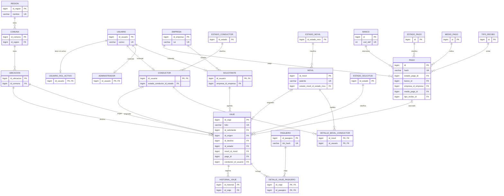

# Aplicacion de Belmonte Spa.
## Especificaciones del proyecto.

**Ultima modificacion:** 17-10-2026

## Integrantes:
* Daniel Muñoz
* Michel Sanhueza

## Indice

- [Integrantes](#integrantes)
- [Introduccion](#introduccion)
  - [Descripcion de la problematica](#descripcion-de-la-problematica)
  - [Actores involucrados](#actores-involucrados)
  - [Casos de uso](#casos-de-uso)
- [Requerimientos funcionales](#requerimientos-funcionales)
- [Requisitos no funcionales](#requisitos-no-funcionales)
- [Historias de usuario y Backlog](#historias-de-usuario-y-backlog)
- [Modelamiento del problema](#modelamiento-del-problema)
  - [Decisiones de modelo](#decisiones-de-modelo)
  - [Modelo relacional](#modelo-relacional)
- [Arquitectura](#arquitectura)
  - [Base de datos MariaDB](#base-de-datos-mariadb)
  - [Backend](#backend)
  - [Frontend](#frontend)
  - [Frontend (Android)](#frontend-android)
    - [Arquitectura y responsabilidades](#arquitectura-y-responsabilidades)
    - [Organización prevista del código](#organización-prevista-del-código)
    - [Estado de pantalla y navegación](#estado-de-pantalla-y-navegación)
    - [API y sesión](#api-y-sesión)
    - [Persistencia y conectividad](#persistencia-y-conectividad)
    - [Notificaciones y navegación externa](#notificaciones-y-navegación-externa)
    - [Entornos y compilación](#entornos-y-compilación)
    - [Pruebas previstas](#pruebas-previstas)
    - [Decisiones abiertas](#decisiones-abiertas)
- [Estructura del backend](#estructura-del-backend)
  - [Propósito](#propósito)
  - [Árbol de carpetas](#árbol-de-carpetas)
  - [Responsabilidad de cada capa](#responsabilidad-de-cada-capa)
  - [CRUD REST](#crud-rest)
  - [Acciones de negocio](#acciones-de-negocio)
  - [Autenticación](#autenticación)
  - [Errores](#errores)
  - [Persistencia MariaDB](#persistencia-mariadb)
  - [Configuración](#configuración)
  - [Notificaciones externas](#notificaciones-externas)
  - [Pruebas](#pruebas)

## Introduccion

Belmonte SpA hace transporte privado corporativo (traslados ejecutivos y aeropuerto).
Este MVP móvil centraliza el flujo de traslados: captura de solicitudes, asignación a
conductores y enlace con navegación externa (Google Maps/Waze).

### Descripcion de la problematica

Hoy las solicitudes se coordinan a mano por teléfono, correo y WhatsApp, lo que
produce datos críticos erróneos (horarios, direcciones), respuestas lentas y retrasos
en que el conductor reciba su ruta.

### Actores involucrados

- **ACT-01 — Cliente corporativo / Solicitante:** agenda el traslado (datos del viaje
  y del pasajero).
- **ACT-02 — Pasajero:** quien viaja; puede no ser el solicitante.
- **ACT-03 — Recepcionista / Administrador:** asigna solicitudes a conductores;
  gestiona flota (vehículos y habilitaciones) y pagos.
- **ACT-04 — Conductor:** ejecuta el traslado; ve sus viajes del día y abre la ruta en
  un navegador externo.
- **ACT-05 — Sistema de navegación externo (Google Maps / Waze):** recibe las
  coordenadas por Intent y traza la ruta.

> **Nota:** el Anexo de Requerimiento (§2.4) agrupa Solicitante y Pasajero. Aquí se
> separan porque el Pasajero no pertenece necesariamente a la empresa que paga
> (`PASAJERO` no tiene FK a `EMPRESA`) y el Solicitante puede no viajar.

### Casos de uso

#### CU-01 — Registrar solicitud de traslado

| Campo | Detalle |
|---|---|
| **Actor(es)** | ACT-01 |
| **Objetivo** | Registrar una solicitud de traslado por formulario. |
| **Precondiciones** | Acceso al formulario. |
| **Flujo principal** | 1. Ingresa pasajero(s), fecha/hora, origen, destino y n.º de vuelo (si aplica).<br>2. El sistema registra el viaje en Pendiente y asocia a él los pasajeros (el cliente lo hace en tres llamadas; ver "Flujo de una solicitud"). |
| **Postcondiciones** | Solicitud almacenada y disponible para gestión. |
| **Alternativos / excepciones** | Datos incompletos o inválidos; las reglas de validación no están definidas en el alcance actual. |

#### CU-02 — Visualizar viajes asignados

| Campo | Detalle |
|---|---|
| **Actor(es)** | ACT-04 |
| **Objetivo** | Consultar los viajes asignados del día. |
| **Precondiciones** | Viajes asignados y conectividad. |
| **Flujo principal** | 1. Accede a la sección de viajes.<br>2. El sistema lista los suyos. |
| **Postcondiciones** | Información de viajes actualizada. |
| **Alternativos / excepciones** | Sin conectividad o sin viajes; comportamiento no definido. |

#### CU-03 — Navegar a la ruta del viaje

| Campo | Detalle |
|---|---|
| **Actor(es)** | ACT-04 |
| **Objetivo** | Abrir una app de navegación externa con el origen y destino del viaje. |
| **Precondiciones** | Viaje asignado con coordenadas. |
| **Flujo principal** | 1. Selecciona un viaje y presiona "Navegar".<br>2. La app genera un Intent con origen y destino.<br>3. El SO lo entrega a una app compatible, que inicia la navegación. |
| **Postcondiciones** | La app externa recibe los puntos del viaje. |
| **Alternativos / excepciones** | No hay app compatible o el Intent no puede procesarse. |

#### CU-04 — Gestionar y distribuir solicitudes

| Campo | Detalle |
|---|---|
| **Actor(es)** | ACT-03 |
| **Objetivo** | Revisar y asignar solicitudes a conductores disponibles. |
| **Precondiciones** | Solicitudes registradas y conductores disponibles. |
| **Flujo principal** | 1. Consulta las solicitudes y selecciona una.<br>2. Selecciona un conductor disponible (el sistema sugiere sus vehículos habilitados).<br>3. Confirma.<br>4. El sistema pasa el traslado a Asignado y marca conductor y vehículo como Ocupado/En uso. |
| **Postcondiciones** | Solicitud asociada a un conductor y a un vehículo habilitado para él. |
| **Alternativos / excepciones** | Sin conductores disponibles. No hay regla de reasignación automática. La reasignación manual de una solicitud Asignado sigue el mismo flujo (RF22). |

#### CU-05 — Actualizar estado del traslado

| Campo | Detalle |
|---|---|
| **Actor(es)** | ACT-03; ACT-04 |
| **Objetivo** | Gestionar el ciclo de vida del traslado por estados. |
| **Precondiciones** | Solicitud registrada. |
| **Flujo principal** | Pendiente → (Administrador asigna) Asignado → (Conductor inicia) En Curso → (Conductor finaliza) Finalizado. Al finalizar, conductor y vehículo vuelven a Disponible. |
| **Postcondiciones** | El estado refleja la etapa actual. |
| **Alternativos / excepciones** | No hay reglas para retroceder o reabrir un traslado. La cancelación es CU-08 (o la anulación de su pago, CU-12). |

#### CU-06 — Trazar ruta óptima hacia el destino

| Campo | Detalle |
|---|---|
| **Actor(es)** | ACT-05 |
| **Objetivo** | Calcular y mostrar la ruta con las coordenadas recibidas. |
| **Precondiciones** | Coordenadas válidas de origen y destino. |
| **Flujo principal** | 1. Recibe origen y destino.<br>2. Calcula la ruta con el tráfico disponible.<br>3. Muestra el trazado al conductor. |
| **Postcondiciones** | Ruta visible en la app externa. |
| **Alternativos / excepciones** | Algoritmo, proveedor de tráfico y criterios pertenecen al sistema externo. |

#### CU-07 — Registrar conductor

| Campo | Detalle |
|---|---|
| **Actor(es)** | ACT-03 |
| **Objetivo** | Crear una cuenta de Conductor con credenciales (no hay autorregistro). |
| **Precondiciones** | Administrador autenticado. |
| **Flujo principal** | 1. Ingresa nombre, correo y contraseña inicial, y opcionalmente teléfono.<br>2. El sistema valida correo único y campos obligatorios.<br>3. Guarda la contraseña como hash.<br>4. El conductor queda disponible de inmediato para autenticarse y ser asignado (CU-04). |
| **Postcondiciones** | Cuenta de Conductor activa. |
| **Alternativos / excepciones** | Correo existente o campo faltante: rechazo. El Conductor no tiene vista de "cambiar contraseña"; el Administrador la reemplaza en su ficha. |

#### CU-08 — Cancelar solicitud de traslado

| Campo | Detalle |
|---|---|
| **Actor(es)** | ACT-01 |
| **Objetivo** | Cancelar una solicitud propia, liberando al conductor si lo había. |
| **Precondiciones** | Solicitud propia en Pendiente o Asignado. |
| **Flujo principal** | 1. Abre el detalle y presiona "Cancelar".<br>2. El sistema valida que el estado sea Pendiente o Asignado.<br>3. Pasa a Cancelado y registra fecha/hora.<br>4. Si había conductor y vehículo: vuelven a Disponible, se notifica al conductor por push (FCM) y el viaje sale de su lista "Viajes del día".<br>5. Si el pago asociado está Pagado, pasa a Reembolsado y se devuelve el 50 % de su monto; en otro estado el pago no cambia. |
| **Postcondiciones** | Solicitud Cancelada; conductor y vehículo liberados; un pago Pagado queda Reembolsado. |
| **Alternativos / excepciones** | En Curso o Finalizado: botón no disponible y cancelación rechazada. |

#### CU-09 — Registrar vehículo

| Campo | Detalle |
|---|---|
| **Actor(es)** | ACT-03 |
| **Objetivo** | Registrar un vehículo de la flota. |
| **Precondiciones** | Administrador autenticado. |
| **Flujo principal** | 1. Ingresa patente y capacidad; serial GPS opcional (el smartphone del conductor también reporta ubicación).<br>2. El sistema valida patente única.<br>3. El vehículo queda Disponible. |
| **Postcondiciones** | Vehículo activo, habilitable a conductores y asignable. |
| **Alternativos / excepciones** | Patente existente o campo faltante: rechazo. |

#### CU-10 — Habilitar conductor para vehículo

| Campo | Detalle |
|---|---|
| **Actor(es)** | ACT-03 |
| **Objetivo** | Habilitar a un conductor para operar un vehículo. |
| **Precondiciones** | Conductor (CU-07) y vehículo (CU-09) registrados. |
| **Flujo principal** | 1. Selecciona un conductor y uno o más vehículos.<br>2. El sistema registra la relación. |
| **Postcondiciones** | Conductor habilitado; relación M:N. |
| **Alternativos / excepciones** | Relación ya existente: se ignora sin duplicar. |

#### CU-11 — Registrar pago de un viaje

| Campo | Detalle |
|---|---|
| **Actor(es)** | ACT-03 |
| **Objetivo** | Registrar el pago asociado a un viaje. |
| **Precondiciones** | Viaje en estado distinto de Cancelado. |
| **Flujo principal** | 1. Abre el viaje e ingresa monto, banco, medio de pago y tipo de recibo.<br>2. El sistema crea el pago en Pendiente y lo asocia al viaje. |
| **Postcondiciones** | Viaje con pago Pendiente. |
| **Alternativos / excepciones** | Viaje Cancelado: no se registra pago. |

#### CU-12 — Actualizar estado de un pago

| Campo | Detalle |
|---|---|
| **Actor(es)** | ACT-03 |
| **Objetivo** | Reflejar si un pago fue cobrado, rechazado o anulado. |
| **Precondiciones** | Pago en Pendiente (o Pagado, solo para anularlo). |
| **Flujo principal** | 1. Selecciona un pago.<br>2. Lo marca Pagado, Rechazado o Anulado (este último por un problema con el banco u otro motivo). Reembolsado es automático al cancelarse el viaje (CU-08), no manual.<br>3. Si lo anula, el viaje en Pendiente o Asignado pasa a Cancelado (conductor y vehículo vuelven a Disponible). |
| **Postcondiciones** | Pago en su nuevo estado (Pagado, Rechazado o Anulado); con Anulado, el viaje queda Cancelado. |
| **Alternativos / excepciones** | Estado terminal (Rechazado, Anulado o Reembolsado): no se puede cambiar. |

#### CU-13 — Recuperar contraseña

| Campo | Detalle |
|---|---|
| **Actor(es)** | ACT-01; ACT-03 |
| **Objetivo** | Recuperar el acceso sin depender de otra persona. |
| **Precondiciones** | Cuenta de Solicitante o Administrador con correo registrado. |
| **Flujo principal** | 1. Ingresa su correo en "olvidé mi contraseña".<br>2. El sistema valida que sea de un Solicitante o Administrador.<br>3. Genera una contraseña temporal aleatoria, la guarda hasheada en `password_hash` y fija `password_temporal_expira`.<br>4. La envía en texto plano solo al correo registrado, vía `EmailClient` (único momento en que existe en texto plano; nunca se persiste así — RNF01).<br>5. El usuario inicia sesión con ella antes de que expire (CU-14). |
| **Postcondiciones** | El usuario puede autenticarse con la contraseña temporal hasta que expire. |
| **Alternativos / excepciones** | Correo inexistente o de un Conductor: mismo mensaje genérico, sin revelar el motivo. Si expira sin usarse, hay que pedir otra. |

> **Nota:** el Conductor queda fuera a propósito: su contraseña solo la reemplaza el
> Administrador (CU-07/RF14), para que un desvinculado no recupere acceso por su cuenta.

#### CU-14 — Iniciar sesión

| Campo | Detalle |
|---|---|
| **Actor(es)** | ACT-01; ACT-03; ACT-04 |
| **Objetivo** | Autenticar al usuario y emitir el JWT que autoriza sus acciones por rol. |
| **Precondiciones** | Cuenta existente: autorregistrada (Solicitante, RF01), creada por el Administrador (Conductor, RF14) o por migración Flyway (Administrador). |
| **Flujo principal** | 1. Ingresa correo y contraseña; la app adjunta el token FCM del dispositivo si lo tiene (RF13).<br>2. El sistema valida contra `USUARIO.password_hash`; rechaza si `password_temporal_expira` no es nulo y ya pasó (RF21).<br>3. Determina el rol según en cuál de `SOLICITANTE`/`ADMINISTRADOR`/`CONDUCTOR` existe el `id_usuario` (único, por `USUARIO_ROL_ACTIVO`).<br>4. Guarda o reemplaza `USUARIO.token_fcm` si vino un token.<br>5. Emite un JWT con `sub` = correo, `rol` y `exp` (RNF01).<br>6. Lo retorna; el cliente lo adjunta en cada request. |
| **Postcondiciones** | Usuario autenticado; el `SecurityFilterChain` valida el JWT en cada request y aplica el mapeo rol→endpoint. |
| **Alternativos / excepciones** | Correo inexistente, contraseña incorrecta o contraseña temporal expirada: mismo error genérico, sin indicar qué falló. |

## Requerimientos funcionales

"Sistema" indica un requisito sin actor que lo inicie.

| ID | Actor | Requisito |
|---|---|---|
| **RF01** | Solicitante | Registrarse (con razón social y RUT de su empresa, que crean o reutilizan una fila en `EMPRESA`) y autenticarse (CU-14). |
| **RF02** | Solicitante | Registrar una solicitud: pasajero, fecha, hora, origen y destino (autocompletado de Google Places, con coordenadas) y n.º de vuelo si aplica. |
| **RF03** | Solicitante | Ver el historial y estado de sus solicitudes. |
| **RF04** | Administrador | Ver las solicitudes pendientes de asignación. |
| **RF05** | Administrador | Asignar un conductor disponible y un vehículo habilitado para él; la solicitud pasa a Asignado y ambos a Ocupado/En uso. |
| **RF06** | Conductor | Autenticarse con credenciales asignadas por el Administrador, sin autorregistro (CU-14). |
| **RF07** | Conductor | Ver en tiempo real los viajes asignados del día. |
| **RF08** | Conductor | Ver el detalle de un viaje asignado (pasajero, origen, destino). |
| **RF09** | Conductor | Pasar un traslado a En Curso y a Finalizado; al finalizar, conductor y vehículo vuelven a Disponible. |
| **RF10** | Sistema | Integrar por Intents de Android una app de navegación externa (Google Maps/Waze) que trace la ruta desde las coordenadas. |
| **RF11** | Sistema | Persistir localmente (Room/SQLite) solicitudes y viajes ya consultados para verlos sin conexión; los cambios hechos offline (p. ej. un cambio de estado) quedan en una cola local y se sincronizan por API REST al reconectar. |
| **RF12** | Sistema | Notificar por push (FCM) a los actores afectados ante cambios relevantes (asignación, En Curso, Finalizado), sin recarga manual. |
| **RF13** | Sistema | Registrar y mantener actualizado el token FCM de cada usuario autenticado. |
| **RF14** | Administrador | Registrar una cuenta de Conductor (nombre, correo y contraseña inicial; teléfono opcional), utilizable de inmediato. |
| **RF15** | Solicitante | Cancelar una solicitud propia en Pendiente o Asignado; si tenía conductor y vehículo se liberan (Disponible) y se notifica al conductor por push; si el pago asociado está Pagado, pasa a Reembolsado y se le devuelve el 50 % de su monto. |
| **RF16** | Administrador | Registrar un vehículo con patente y capacidad; serial GPS opcional (la ubicación también viene del smartphone del conductor). |
| **RF17** | Administrador | Habilitar uno o más conductores para un vehículo. |
| **RF18** | Administrador | Registrar el pago de un viaje en cualquier estado previo a Cancelado (monto, banco, medio de pago, tipo de recibo); nace en Pendiente. |
| **RF19** | Administrador | Marcar un pago como Pagado, Rechazado o Anulado (p. ej. por un problema con el banco); un pago Anulado cancela el viaje en Pendiente o Asignado. Reembolsado lo fija el sistema al cancelar el Solicitante (RF15). |
| **RF20** | Solicitante | Ver el estado de pago de sus viajes en el detalle de la solicitud. |
| **RF21** | Solicitante, Administrador | Recuperar la contraseña con su correo (CU-13): contraseña temporal enviada al correo, con expiración. El Conductor no tiene este autoservicio (solo RF14), para que un desvinculado no recupere acceso. |
| **RF22** | Administrador | Reasignar una solicitud Asignado a un conductor disponible y a un vehículo habilitado para él (puede cambiar uno solo de los dos); la solicitud se mantiene como Asignado, los nuevos pasan a Ocupado/En uso y los anteriores vuelven a Disponible. Se avisa por push al nuevo conductor y al solicitante (RF12). |

## Requisitos no funcionales

- **RNF01 (Seguridad):** contraseñas solo como hash; autenticación app↔backend con
  JWT con expiración (CU-14); acceso a cada endpoint validado por rol en un
  `SecurityFilterChain` centralizado. Única excepción de tránsito al "nunca en texto
  plano": la contraseña temporal de RF21, que se envía una vez por correo y no se
  guarda en claro.
- **RNF02 (Conectividad):** requiere Internet continuo (Anexo §3.3); no es
  offline-first, y crear o recibir una solicitud nueva exige conexión. Tolera cortes
  breves para datos ya sincronizados (Room/SQLite) y para cambios de estado de un
  viaje ya asignado, que se encolan y reintentan al reconectar (RF11).
- **RNF03 (Tiempo de respuesta):** consultas (listar solicitudes, viajes del día) en
  menos de 2 s con 4G/Wi-Fi. Un push (RF12/RF13) se refleja en segundos, no minutos.
- **RNF04 (Usabilidad en terreno):** pantallas del Conductor con botones grandes y
  legibles y mínimos pasos para marcar En Curso/Finalizado o abrir la navegación.
- **RNF05 (Compatibilidad):** Android 8.0 (API 26) o superior. El backend expone solo
  contratos JSON REST, sin acoplarse a un cliente.
- **RNF06 (Mantenibilidad):** capas estrictas (`Controller-Service-Repository` en
  Spring Boot, `View-ViewModel-Repository` en Android), de modo que una regla de
  negocio se cambie en un solo lugar.
- **RNF07 (Servicios externos):** tres dependencias con cuota gratuita limitada —
  Google Places API (autocompletado), Firebase Cloud Messaging (push) y un servicio
  de correo, SMTP o proveedor transaccional (contraseña temporal, RF21/CU-13). El uso
  debe monitorearse para no exceder el nivel gratuito.
- **RNF08 (Privacidad):** nombre, teléfono y dirección de pasajeros y solicitantes no
  van a logs, y solo los ven el Solicitante, el Administrador y el Conductor asignado
  de cada solicitud.
- **RNF09 (Datos académicos):** solo datos ficticios, sintéticos, agregados o públicos
  anonimizados (Anexo §4; Ley N.º 21.719 y Ley N.º 19.628). Los antecedentes se
  comparten por canales institucionales con acceso restringido.
- **RNF10 (Entregable):** colaboración y documentación en Git/GitHub; el ejecutable
  final es un APK firmado en modo release (Anexo, "Alcance tecnológico comprometido").

## Historias de usuario y Backlog

| ID | Historia | Criterios de aceptación | Prioridad | SP |
|---|---|---|---|---|
| HU01 | Como Solicitante, quiero registrarme y autenticarme, para acceder de forma segura a mis solicitudes. (RF01) | El registro se rechaza si el correo existe o falta un campo obligatorio (empresa, contacto, correo, contraseña); el teléfono es opcional.<br>Credenciales válidas llevan a "Mis solicitudes"; inválidas muestran un error sin indicar qué dato falló.<br>"Empresa" (razón social + RUT) crea o reutiliza una fila en `EMPRESA`; no se duplica. | Alta | 3 |
| HU02 | Como Solicitante, quiero registrar una solicitud eligiendo origen y destino con autocompletado de Google Places, para coordinar el viaje con datos exactos. (RF02) | Origen y destino se eligen de la lista de sugerencias, nunca texto libre; al elegir se capturan latitud y longitud.<br>No se puede enviar si origen o destino no vienen de la lista.<br>N.º de vuelo opcional; pasajero (al menos uno), fecha, hora, origen y destino obligatorios: la app lo exige antes de enviar y registra el viaje y sus pasajeros en llamadas separadas (ver "Flujo de una solicitud"). | Alta | 5 |
| HU03 | Como Solicitante, quiero ver el historial y estado de mis solicitudes, para saber si mi viaje ya fue asignado. (RF03) | La lista muestra pasajero, fecha/hora, ruta (origen→destino) y estado de cada solicitud propia.<br>El estado corresponde al último cambio registrado. | Media | 3 |
| HU04 | Como Administrador, quiero ver las solicitudes pendientes de asignación, para distribuirlas rápido. (RF04) | Solo se listan solicitudes en Pendiente.<br>Cada fila lleva a "Asignar conductor" de esa solicitud. | Alta | 3 |
| HU05 | Como Administrador, quiero asignar un conductor disponible a una solicitud, para confirmar el viaje. (RF05) | Solo se listan conductores disponibles (sin viaje en curso).<br>Al confirmar, la solicitud pasa a Asignado y aparece en "Viajes del día" del conductor.<br>También se asigna un vehículo habilitado para él; conductor y vehículo pasan a Ocupado/En uso. | Alta | 5 |
| HU06 | Como Conductor, quiero autenticarme con las credenciales que me entrega el Administrador, para acceder a mis viajes sin registrarme. (RF06) | El login del Conductor no ofrece "crear cuenta".<br>Credenciales inválidas muestran un error sin revelar si el correo existe. | Alta | 2 |
| HU07 | Como Conductor, quiero ver en tiempo real mis viajes del día, para organizar mi jornada. (RF07) | Solo viajes del conductor autenticado, de la fecha actual, ordenados por hora.<br>Cada viaje muestra pasajero, hora y estado. | Alta | 3 |
| HU08 | Como Conductor, quiero ver el detalle de un viaje asignado, para confirmar los datos antes de iniciar. (RF08) | Muestra pasajero, n.º de vuelo (si aplica), origen y destino completos.<br>Incluye el botón "Navegar" y los controles de cambio de estado. | Alta | 3 |
| HU09 | Como Conductor, quiero pasar un traslado a En Curso y a Finalizado, para reflejar el avance real. (RF09) | "Iniciar viaje" solo habilitado en Asignado; "Finalizar viaje" solo en En Curso.<br>Cada cambio registra su fecha/hora.<br>Al finalizar, conductor y vehículo vuelven a Disponible. | Alta | 3 |
| HU10 | Como Conductor, quiero abrir la ruta en Google Maps o Waze desde la app, para no copiar direcciones a mano. (RF10) | "Navegar" abre Google Maps o Waze con el destino precargado.<br>Sin app de navegación instalada, se muestra un aviso en vez de fallar en silencio. | Alta | 3 |
| HU11 | Como Conductor, quiero seguir consultando mis viajes sin conexión y que los cambios se sincronicen al recuperarla, para no perder información en terreno. (RF11) | Solicitudes y viajes ya cargados se consultan sin conexión.<br>Un cambio de estado offline se guarda en una cola local, marcado "pendiente de sincronizar".<br>Al reconectar, la cola se envía sola al backend. | Media | 8 |
| HU12 | Como Solicitante, quiero recibir un push cuando cambie el estado de mi traslado, para enterarme sin recargar la app. (RF12) | Push al pasar a Asignado, En Curso o Finalizado.<br>Al abrir la notificación o "Mis solicitudes", el estado ya está actualizado. | Media | 5 |
| HU13 | Como Conductor, quiero recibir un push cuando se me asigna un viaje, para enterarme de inmediato. (RF12) | Push cuando el Administrador me asigna una solicitud.<br>Al abrirla, el viaje aparece en "Viajes del día" con sus datos completos. | Alta | 5 |
| HU14 | Como usuario autenticado (cualquier rol), quiero que la app registre mi token de notificaciones al iniciar sesión, para recibir avisos dirigidos. (RF13) | Al iniciar sesión, la app registra o actualiza mi token FCM en el backend.<br>Si el token cambia (reinstalación, otro dispositivo), reemplaza al anterior sin duplicar registros. | Alta | 3 |
| HU15 | Como Administrador, quiero registrar una cuenta de Conductor con sus credenciales, para que se autentique sin autorregistrarse. (RF14) | Se rechaza si el correo existe o falta un campo obligatorio; el teléfono es opcional.<br>El Administrador define la contraseña en el formulario (no se genera sola); se guarda como hash.<br>El conductor queda disponible de inmediato en "Asignar conductor" (HU05).<br>No hay vista de "cambiar contraseña" para el Conductor: el Administrador la reemplaza en su ficha. | Alta | 3 |
| HU16 | Como Solicitante, quiero cancelar una solicitud que ya no necesito, para liberar al conductor y evitar un viaje innecesario. (RF15) | "Cancelar" solo disponible en Pendiente o Asignado; no en En Curso ni Finalizado.<br>Al cancelar pasa a Cancelado y se registra la fecha/hora.<br>Si tenía conductor y vehículo, vuelven a Disponible, se notifica al conductor por push (RF12) y el viaje sale de "Viajes del día".<br>Si el pago asociado está Pagado, queda Reembolsado y se devuelve el 50 % del monto; en otro estado no cambia. | Alta | 3 |
| HU17 | Como Administrador, quiero registrar un vehículo con patente y capacidad, para poder asignarlo. (RF16) | Patente obligatoria y única; capacidad mayor a 0.<br>GPS serial opcional (se puede usar el GPS del smartphone del conductor).<br>Queda en estado inicial Disponible. | Media | 3 |
| HU18 | Como Administrador, quiero habilitar conductores para un vehículo, para controlar quién lo opera. (RF17) | Solo conductores ya registrados (HU15).<br>Relación M:N entre vehículos y conductores.<br>Habilitar una relación existente no la duplica. | Media | 2 |
| HU19 | Como Administrador, quiero registrar el pago de un viaje en cualquier momento antes de que se cancele, para no depender de que termine el servicio. (RF18) | Se puede registrar para un viaje en cualquier estado distinto de Cancelado.<br>El hash del pago es único.<br>Banco, medio de pago y tipo de recibo se eligen de catálogos.<br>Nace en Pendiente. | Media | 5 |
| HU20 | Como Administrador, quiero actualizar el estado de un pago, para mantener la facturación al día. (RF19) | Transiciones válidas: Pendiente→Pagado, Pendiente→Rechazado, (Pendiente\|Pagado)→Anulado y Pagado→Reembolsado (automática al cancelar el Solicitante, HU16).<br>Rechazado, Anulado y Reembolsado son terminales.<br>Al anular un pago, el viaje en Pendiente o Asignado pasa a Cancelado (efectos de HU16 sobre conductor y vehículo). | Media | 3 |
| HU21 | Como Solicitante, quiero ver el estado de pago de mis viajes, para saber si ya fueron cobrados. (RF20) | Se muestra en "Detalle de solicitud" (HU03) solo si el viaje tiene pago asociado. | Baja | 2 |
| HU22 | Como Solicitante o Administrador, quiero recuperar mi contraseña si la olvido, para volver a acceder sin depender de otra persona. (RF21) | Solo Solicitante y Administrador; para cualquier otro correo se responde el mismo mensaje genérico.<br>La contraseña temporal expira tras un plazo; si no se usa, hay que pedir otra. | Media | 3 |
| HU23 | Como Administrador, quiero reasignar una solicitud ya Asignada a otro conductor y/o vehículo, para mantenerla cubierta si el original no puede realizarla. (RF22) | Solo disponible en Asignado: En Curso y Finalizado no se reasignan.<br>Puede cambiarse solo el conductor, solo el vehículo o ambos, con las mismas reglas de disponibilidad y habilitación que HU05.<br>El viaje sigue en Asignado; el conductor y el vehículo anteriores vuelven a Disponible y los nuevos pasan a Ocupado/En uso.<br>Se avisa por push al nuevo conductor y al solicitante (RF12).<br>El cambio queda registrado en `HISTORIAL_VIAJE`. | Media | 3 |

## Modelamiento del problema

Motor: **MariaDB**. El esquema se crea con las migraciones Flyway de
`backend/src/main/resources/db/migration`. Las PK simples usan `AUTO_INCREMENT`.

| Entidad | Atributo | Tipo de dato | Clave | Descripción |
|---|---|---|---|---|
| REGION | id_region | BIGINT UNSIGNED | PK, AUTO_INCREMENT | |
| REGION | nombre | VARCHAR(60) | UNIQUE, NOT NULL | |
| COMUNA | id_comuna | BIGINT UNSIGNED | PK, AUTO_INCREMENT | |
| COMUNA | nombre | VARCHAR(80) | NOT NULL (UNIQUE junto a id_region) | |
| COMUNA | id_region | BIGINT UNSIGNED | FK → REGION, NOT NULL | |
| UBICACION | id_ubicacion | BIGINT UNSIGNED | PK, AUTO_INCREMENT | |
| UBICACION | direccion | VARCHAR(200) | NOT NULL (UNIQUE junto a id_comuna, latitud, longitud) | Dirección georreferenciada reutilizable como origen o destino (RF10). |
| UBICACION | id_comuna | BIGINT UNSIGNED | FK → COMUNA, NOT NULL | |
| UBICACION | latitud | DECIMAL(9,6) | NOT NULL (UNIQUE junto a direccion, id_comuna, longitud) | |
| UBICACION | longitud | DECIMAL(9,6) | NOT NULL (UNIQUE junto a direccion, id_comuna, latitud) | |
| USUARIO | id_usuario | BIGINT UNSIGNED | PK, AUTO_INCREMENT | |
| USUARIO | nombre | VARCHAR(120) | NOT NULL | |
| USUARIO | correo | VARCHAR(150) | UNIQUE, NOT NULL | Login. |
| USUARIO | telefono | VARCHAR(20) | — | Opcional, para todos los roles. |
| USUARIO | password_hash | VARCHAR(200) | NOT NULL | Nunca texto plano. |
| USUARIO | password_temporal_expira | DATETIME | — | NULL: contraseña normal. Con valor: `password_hash` es una contraseña temporal válida hasta ese instante (RF21). Siempre NULL para CONDUCTOR. |
| USUARIO | fecha_registro | DATETIME | NOT NULL, DEFAULT CURRENT_TIMESTAMP | |
| USUARIO | token_fcm | VARCHAR(255) | — | Token push del dispositivo actual; NULL hasta el primer login desde la app. Se reemplaza en cada login, no se duplica (RF13). |
| USUARIO_ROL_ACTIVO | id_usuario | BIGINT UNSIGNED | PK, FK → USUARIO | Exclusividad de rol: triggers `BEFORE INSERT` en `SOLICITANTE`/`ADMINISTRADOR`/`CONDUCTOR` insertan aquí primero; la PK rechaza un segundo rol. Sin columnas propias. |
| EMPRESA | id_empresa | BIGINT UNSIGNED | PK, AUTO_INCREMENT | |
| EMPRESA | razon_social | VARCHAR(50) | NOT NULL | |
| EMPRESA | rut | VARCHAR(15) | UNIQUE, NOT NULL | Identificador legal único. |
| SOLICITANTE | id_usuario | BIGINT UNSIGNED | PK, FK → USUARIO | Extensión 1:1 (RF01). |
| SOLICITANTE | empresa_id_empresa | BIGINT UNSIGNED | FK → EMPRESA, NOT NULL | |
| ADMINISTRADOR | id_usuario | BIGINT UNSIGNED | PK, FK → USUARIO | Extensión 1:1, sin atributos propios. Se crea por migración Flyway de carga inicial; no hay autorregistro ni endpoint que lo cree. |
| ESTADO_CONDUCTOR | id_estado | BIGINT UNSIGNED | PK, AUTO_INCREMENT | |
| ESTADO_CONDUCTOR | estado | VARCHAR(20) | UNIQUE | P. ej. disponible/ocupado; sin NOT NULL en el DDL. |
| CONDUCTOR | id_usuario | BIGINT UNSIGNED | PK, FK → USUARIO | Extensión 1:1. |
| CONDUCTOR | estado_conductor_id_estado | BIGINT UNSIGNED | FK → ESTADO_CONDUCTOR, NOT NULL | Estado operativo del Conductor (Disponible u Ocupado); nace Disponible (CU-07). |
| ESTADO_MOVIL | id_estado_mov | BIGINT UNSIGNED | PK, AUTO_INCREMENT | |
| ESTADO_MOVIL | nombre | VARCHAR(20) | UNIQUE, NOT NULL | P. ej. disponible/en mantención. |
| MOVIL | id_movil | BIGINT UNSIGNED | PK, AUTO_INCREMENT | |
| MOVIL | patente | VARCHAR(6) | UNIQUE, NOT NULL | |
| MOVIL | gps_serial | INT | — | Opcional (RF16). |
| MOVIL | estado_movil_id_estado_mov | BIGINT UNSIGNED | FK → ESTADO_MOVIL, NOT NULL | |
| MOVIL | capacidad | INT | NOT NULL | Pasajeros. |
| DETALLE_MOVIL_CONDUCTOR | id_movil | BIGINT UNSIGNED | PK, FK → MOVIL | Habilitación vehículo↔conductor. |
| DETALLE_MOVIL_CONDUCTOR | id_usuario | BIGINT UNSIGNED | PK, FK → CONDUCTOR | |
| PASAJERO | id_pasajero | BIGINT UNSIGNED | PK, AUTO_INCREMENT | |
| PASAJERO | dni_hash | VARCHAR(50) | UNIQUE, NOT NULL | Hash del documento de identidad: RUT chileno o pasaporte extranjero. Es el HMAC-SHA256 del documento normalizado (sin puntos, guion ni espacios, en mayúsculas), en Base64url sin relleno (43 caracteres). El cliente envía el documento en `dni` y el backend calcula el hash; nunca se guarda en claro. |
| PASAJERO | nombre | VARCHAR(120) | NOT NULL | Puede no coincidir con el solicitante (CU-01). |
| ESTADO_SOLICITUD | id_estado | BIGINT UNSIGNED | PK, AUTO_INCREMENT | |
| ESTADO_SOLICITUD | nombre_estado | VARCHAR(20) | UNIQUE, NOT NULL | PENDIENTE, ASIGNADO, EN_CURSO, FINALIZADO (RF05/RF09) y CANCELADO (RF15/CU-08). |
| BANCO | id | BIGINT UNSIGNED | PK, AUTO_INCREMENT | |
| BANCO | nombre | VARCHAR(50) | NOT NULL | |
| BANCO | cod_sbif | INT | UNIQUE, NOT NULL | Código SBIF; identificador externo único. |
| ESTADO_PAGO | id | BIGINT UNSIGNED | PK, AUTO_INCREMENT | |
| ESTADO_PAGO | estado | VARCHAR(20) | UNIQUE, NOT NULL | Pendiente, Pagado, Rechazado, Anulado o Reembolsado (RF18/RF19). Anulado lo genera el pago (banco u otro motivo) y cancela el viaje (RF19); Reembolsado es automático cuando el Solicitante cancela con el pago Pagado (RF15). |
| MEDIO_PAGO | id | BIGINT UNSIGNED | PK, AUTO_INCREMENT | |
| MEDIO_PAGO | nombre | VARCHAR(20) | UNIQUE, NOT NULL | P. ej. transferencia, tarjeta. |
| TIPO_RECIBO | id | BIGINT UNSIGNED | PK, AUTO_INCREMENT | |
| TIPO_RECIBO | nombre | VARCHAR(20) | UNIQUE, NOT NULL | |
| PAGO | id | BIGINT UNSIGNED | PK, AUTO_INCREMENT | |
| PAGO | hash | VARCHAR(50) | UNIQUE, NOT NULL | Generado por el backend al crear el pago; no viene de una pasarela externa. |
| PAGO | monto | INT | NOT NULL | Monto cobrado. En un pago Reembolsado se devolvió el 50 % de este monto. |
| PAGO | estado_pago_id | BIGINT UNSIGNED | FK → ESTADO_PAGO, NOT NULL | |
| PAGO | banco_id | BIGINT UNSIGNED | FK → BANCO, NOT NULL | |
| PAGO | empresa_id_empresa | BIGINT UNSIGNED | FK → EMPRESA, NOT NULL | Empresa que paga. |
| PAGO | medio_pago_id | BIGINT UNSIGNED | FK → MEDIO_PAGO, NOT NULL | |
| PAGO | tipo_recibo_id | BIGINT UNSIGNED | FK → TIPO_RECIBO, NOT NULL | |
| PAGO | fecha_pago | DATETIME | NOT NULL | |
| VIAJE | id_viaje | BIGINT UNSIGNED | PK, AUTO_INCREMENT | |
| VIAJE | folio | VARCHAR(20) | UNIQUE, NOT NULL | Identificador público y clave de ruta en la API; lo genera el backend al crear el viaje. Inmutable. |
| VIAJE | id_solicitante | BIGINT UNSIGNED | FK → SOLICITANTE, NOT NULL | |
| VIAJE | id_origen | BIGINT UNSIGNED | FK → UBICACION, NOT NULL | |
| VIAJE | id_destino | BIGINT UNSIGNED | FK → UBICACION, NOT NULL | |
| VIAJE | id_estado | BIGINT UNSIGNED | FK → ESTADO_SOLICITUD, NOT NULL | |
| VIAJE | movil_id_movil | BIGINT UNSIGNED | FK → MOVIL | NULL hasta la asignación. |
| VIAJE | pago_id | BIGINT UNSIGNED | FK → PAGO | NULL si no hay pago. |
| VIAJE | cantidad_pasajeros | INT | NOT NULL, DEFAULT 0 | Mantenido por trigger desde `DETALLE_VIAJE_PASAJERO` (nunca lo escribe el cliente); no puede superar la capacidad del móvil asignado. |
| VIAJE | fh_creacion | DATETIME | NOT NULL, DEFAULT CURRENT_TIMESTAMP | Registro de la solicitud. Inmutable. |
| VIAJE | fh_agenda | DATETIME | NOT NULL | Fecha y hora agendada del traslado (RF02), ingresada por el Solicitante. |
| VIAJE | fh_asignacion | DATETIME | — | |
| VIAJE | fh_inicio | DATETIME | — | Paso a En Curso. |
| VIAJE | fh_fin | DATETIME | — | Paso a Finalizado. |
| VIAJE | conductor_id_usuario | BIGINT UNSIGNED | FK → CONDUCTOR | NULL hasta la asignación (RF05). Por ser FK a `CONDUCTOR`, solo referencia usuarios con ese rol. |
| VIAJE | numero_vuelo | VARCHAR(20) | — | Opcional. |
| DETALLE_VIAJE_PASAJERO | id_viaje | BIGINT UNSIGNED | PK, FK → VIAJE | |
| DETALLE_VIAJE_PASAJERO | id_pasajero | BIGINT UNSIGNED | PK, FK → PASAJERO | |
| HISTORIAL_VIAJE | id_historial | BIGINT UNSIGNED | PK, AUTO_INCREMENT | |
| HISTORIAL_VIAJE | id_viaje | BIGINT UNSIGNED | FK → VIAJE, NOT NULL | |
| HISTORIAL_VIAJE | campo_modificado | VARCHAR(30) | NOT NULL | Campo de `VIAJE` que cambió (conductor, móvil, estado, cantidad de pasajeros, etc.). |
| HISTORIAL_VIAJE | valor | VARCHAR(200) | NOT NULL | Valor nuevo, como texto. |
| HISTORIAL_VIAJE | fecha_cambio | DATETIME | NOT NULL, DEFAULT CURRENT_TIMESTAMP | |

El actor ACT-05 no tiene tabla: no hay datos propios que persistir.

### Decisiones de modelo

- **`CANCELADO`** se suma a los 4 estados del Anexo (§3.2) para dejar auditoría: la
  solicitud no se borra ni se reutiliza otro estado (RF15/CU-08).
- **`HISTORIAL_VIAJE`** guarda una fila por cada campo que cambia en cada `UPDATE` de
  `VIAJE` (conductor, móvil, estado, cantidad de pasajeros; p. ej. una reasignación,
  HU05). La escriben los triggers de `VIAJE`, no la aplicación. `folio` y
  `fh_creacion` son inmutables y nunca generan fila.
- **Roles como tabla por subtipo** (extensiones 1:1 de `USUARIO`) en vez de un
  `TIPO_USUARIO` con `CHECK`. Como eso no impide que un `id_usuario` tenga dos roles,
  `USUARIO_ROL_ACTIVO` impone la exclusividad.
- **Catálogos en vez de `CHECK`** (`ESTADO_SOLICITUD`, `ESTADO_CONDUCTOR`,
  `ESTADO_MOVIL`, `ESTADO_PAGO`, `MEDIO_PAGO`, `TIPO_RECIBO`): agregar o renombrar un
  valor no altera el DDL de las tablas que lo usan.
- **`VIAJE.cantidad_pasajeros`** es una denormalización deliberada: la mantiene un
  trigger y evita un `COUNT(*)` en cada consulta de "viajes del día" (RNF03).
- **3FN:** `UBICACION` separada de `VIAJE` (las coordenadas dependen de la dirección,
  no del viaje); `PASAJERO` + `DETALLE_VIAJE_PASAJERO` separados (varios pasajeros por
  viaje serían un grupo repetitivo); `id_comuna` es atributo propio de `UBICACION`,
  por lo que `COMUNA`/`REGION` es una jerarquía geográfica normal.

### Modelo relacional



El diagrama solo lista columnas PK/FK/UK; el resto está en la tabla anterior.

## Arquitectura

### Base de datos **MariaDB**

Base de datos oficial. Motor `InnoDB` (ACID), soporte directo en Spring
(`MariaDBDialect`, `mariadb-java-client`), licencia GPL v2 y bajo consumo en
desarrollo local junto a Android Studio y la API.

#### Iniciar los servicios locales

Requiere Docker Compose. El archivo está en `database/docker-compose.yaml` y define dos
servicios:

| Servicio | Contenedor | Puertos en la máquina | Para qué sirve |
|---|---|---|---|
| `mariadb` | `belmonte-mariadb` | `3307` | Base de datos de la API. |
| `mailpit` | `belmonte-mailpit` | `1025` (SMTP) y `8025` (interfaz web) | Servidor SMTP de desarrollo: recibe los correos del backend (contraseña temporal, RF21) y los muestra en <http://localhost:8025> sin entregarlos a nadie. |

Los puertos de `mailpit` solo escuchan en `127.0.0.1` porque el servidor no tiene contraseña.
Desde la raíz del repositorio:

```bash
docker compose -f database/docker-compose.yaml up -d
```

Los valores por defecto sirven para desarrollo. Para cambiarlos (puertos, credenciales de la
base) copia `.env.example` a `.env` (fuera de Git) y pásalo con `--env-file`: como el compose
está en `database/`, Docker Compose no encuentra por sí solo el `.env` de la raíz.

```bash
cp .env.example .env            # en PowerShell: Copy-Item .env.example .env
docker compose --env-file .env -f database/docker-compose.yaml up -d
```

La API usa `DB_URL`, `DB_USER` y `DB_PASSWORD` (valores locales en `.env.example`) y Flyway
migra al iniciar el backend. El `.env` solo lo lee Docker Compose; la API recibe esas
variables del entorno o de la configuración de ejecución del IDE. Cambia las credenciales
en cualquier entorno compartido. Para
detener los contenedores, `docker compose -f database/docker-compose.yaml down` conserva los
datos de MariaDB; con `down -v` también se borran.

### Backend

**Spring Boot**:

* **API REST JSON** para el cliente Android (Retrofit).
* **Seguridad stateless con JWT** (Spring Security como *resource server*, firma HS256). Un
  único `SecurityFilterChain` mapea cada ruta a sus roles y rechaza por defecto (`denyAll`)
  todo endpoint no listado. Rutas sin JWT: `/api/v1/auth/**` (login y recuperación de
  contraseña) y `POST /api/v1/solicitantes` (autorregistro, RF01); no pueden exigir un JWT
  que aún no existe.
* **Capas** `Controller` ➔ `Service` ➔ `Repository`.
* **Spring Data JPA** para la persistencia.
* **Push con Firebase Cloud Messaging:** ante asignación, cambio de estado o cancelación,
  la capa `Service` notifica al actor afectado con el SDK de Firebase Admin. El token de
  dispositivo se actualiza en cada login.
* **Correo por SMTP:** la contraseña temporal de RF21 se envía con `spring-boot-starter-mail`
  a cualquier servidor SMTP configurado por variables de entorno.
* Push y correo salen después de confirmar la operación y en otro hilo; si fallan, solo se
  registra un aviso y la operación de negocio no se ve afectada (ver "Notificaciones
  externas").

#### Mapeo de roles por endpoint

| Recurso | Roles con acceso | Alcance |
|---|---|---|
| `auth` | Público | Login (CU-14) y recuperación de contraseña (CU-13/RF21); junto con `POST /solicitantes`, lo único accesible sin JWT. |
| `usuarios` | Solicitante, Administrador, Conductor | Cada uno solo su propia cuenta (RNF08). `POST` (crear una cuenta sin rol): solo Administrador. El Conductor solo la consulta; su cuenta y contraseña las edita el Administrador (`PUT /conductores`). |
| `administradores` | Administrador | Consulta de cuentas de Administrador (se crean por migración, no por API). |
| `conductores` | Administrador (crea/edita, CU-07); Conductor | El Conductor solo su propia cuenta. |
| `solicitantes` | Público (`POST`, autorregistro RF01); Solicitante (su cuenta: lectura y `PUT`); Administrador (lectura) | El Solicitante solo su propia cuenta. |
| `empresas` | Solicitante (crea/reutiliza al registrarse, RF01); Administrador (lectura) | — |
| `moviles` | Administrador | Gestión de flota (CU-09, CU-10). |
| `habilitaciones-movil-conductor` | Administrador | Habilitar conductores para un vehículo (CU-10). |
| `pagos` | Administrador (gestión, CU-11/CU-12); Solicitante (lectura) | El Solicitante solo los pagos de sus viajes (RF20). |
| `pasajeros` | Solicitante (los registra, CU-01); Administrador (lectura) | — |
| `pasajeros-viaje` | Solicitante (asocia pasajeros a su viaje, CU-01); Administrador (lectura) | El Solicitante solo en viajes propios (ver "Flujo de una solicitud"). |
| `viajes` | Solicitante (los propios, RF02/RF03); Administrador (todos, CU-04); Conductor (los asignados, RF07/RF08) | — |

Los catálogos y `ubicaciones` no son recursos de la API (ver "CRUD REST").

Sin token, o con un token alterado o vencido, la API responde 401; con un rol que no
corresponde, o en una ruta o método que no figura en esta matriz, 403 (ver "Errores").

### Frontend


Vistas del MVP por actor:

**Transversal**
- **Login:** para los tres actores con app. Incluye "Olvidé mi contraseña" (solo Solicitante
  y Administrador, CU-13).
- **Perfil / Cierre de sesión.**

**Cliente corporativo / Solicitante**
- **Registro:** cuenta propia (el Conductor no se autorregistra).
- **Registrar solicitud de traslado:** CU-01.
- **Mis solicitudes (historial):** traslados con su estado.
- **Detalle de solicitud:** datos, estado y conductor una vez asignado; estado de pago si
  existe (RF20) y botón "Cancelar" en Pendiente o Asignado (CU-08/RF15).

**Recepcionista / Administrador**
- **Panel de solicitudes pendientes:** entrada a CU-04.
- **Asignar conductor:** CU-04. Incluye elegir el vehículo habilitado y reasignar una
  solicitud Asignada (RF22).
- **Registrar conductor:** CU-07/RF14.
- **Registrar vehículo:** CU-09/RF16.
- **Habilitar conductores para un vehículo:** CU-10/RF17.
- **Pagos:** registrar el pago de un viaje y actualizar su estado (CU-11/CU-12, RF18/RF19).
- **Panel general / dashboard** *(segunda iteración)*: conteo de viajes por estado.
- **Sistema de distribución de solicitudes** *(mejora futura, fuera del MVP)*:
  asignación automática de conductor (hoy manual, RF05/CU-04). Sin RF ni HU que lo
  respalde.

**Conductor**
- **Viajes del día:** asignados para hoy, por hora. CU-02.
- **Detalle de viaje asignado:** datos, control En Curso/Finalizado y botón de
  navegación. CU-03 y CU-05.
- **Historial de viajes realizados** *(segunda iteración)*.

### Frontend (Android)

La aplicación móvil se desarrolla en **Android Studio**, con **Kotlin y Jetpack Compose**.
El build usa Gradle con Kotlin DSL.

La infraestructura seguirá **MVVM con Repository y fuentes de datos locales y remotas**.
Se comenzará con un único módulo `app`, organizado por responsabilidades.

Las decisiones de presentación y separación de datos siguen las
[recomendaciones oficiales de arquitectura Android](https://developer.android.com/topic/architecture/recommendations).
La gestión de notificaciones se implementará según la
[documentación de FCM para Android](https://firebase.google.com/docs/cloud-messaging/android/get-started).

#### Arquitectura y responsabilidades

El flujo principal será:

```text
Pantalla Compose
      ↓ eventos       ↑ estado
   ViewModel
      ↓               ↑
   Repository
      ↓               ↑
Fuente local       Fuente remota
Room / SQLite      Retrofit / API REST
```

| Componente | Responsabilidad |
|---|---|
| View / Screen | Dibujar la interfaz y enviar las acciones del usuario al ViewModel. |
| ViewModel | Validar entradas de presentación, ejecutar operaciones del Repository y exponer el estado de la pantalla. |
| Repository | Coordinar las fuentes locales y remotas, actualizar la caché y gestionar operaciones pendientes. |
| Remote DataSource | Comunicarse con la API REST mediante Retrofit. |
| Local DataSource | Consultar y guardar datos mediante Room y sus DAO. |
| Modelos y mapeadores | Separar los contratos JSON, las entidades locales y los datos que consume la aplicación. |
| Inyección de dependencias | Construir y proporcionar las dependencias mediante Hilt. |

Las pantallas no accederán directamente a Retrofit, Room ni los DAO. Los ViewModel
dependerán de los repositorios.

El backend conservará la autoridad sobre permisos, asignaciones, disponibilidad y
transiciones de estado. Las validaciones Android mejorarán la experiencia del usuario,
pero no reemplazarán las reglas del servidor.

No se añadirá inicialmente una capa obligatoria de casos de uso. Podrá incorporarse para
operaciones complejas o compartidas si el desarrollo lo requiere.

#### Organización prevista del código

El paquete base es `cl.belmontespa.transporte`.

```text
cl/belmontespa/transporte/
├── BelmonteApplication.kt
├── MainActivity.kt
├── di/
├── model/
├── data/
│   ├── remote/
│   │   ├── api/
│   │   ├── dto/
│   │   └── interceptor/
│   ├── local/
│   │   ├── database/
│   │   ├── dao/
│   │   └── entity/
│   ├── mapper/
│   ├── repository/
│   └── session/
├── ui/
│   ├── navigation/
│   ├── components/
│   ├── theme/
│   ├── auth/
│   ├── solicitante/
│   ├── administrador/
│   └── conductor/
├── notification/
└── sync/
```

Cada pantalla y su ViewModel se ubicarán dentro de la funcionalidad correspondiente.
`model` contendrá los modelos utilizados por la aplicación; las entidades Room y los DTO
remotos permanecerán separados en `data`.

#### Estado de pantalla y navegación

Cada pantalla tendrá un ViewModel que expondrá su estado mediante `StateFlow`: datos,
carga, resultados y errores. Compose lo observará respetando el ciclo de vida.

Navigation Compose organizará un flujo de autenticación y los flujos de Solicitante,
Administrador y Conductor. Después del login, la aplicación abrirá el flujo correspondiente
al rol recibido del backend.

Cerrar sesión eliminará la sesión local y el acceso a las pantallas autenticadas. La
navegación por rol no sustituirá la autorización del backend.

#### API y sesión

La aplicación consumirá los endpoints `/api/v1/` mediante Retrofit. Usará DTO de petición
y respuesta alineados con los contratos del backend.

El login enviará `correo`, `password` y, cuando esté disponible, `tokenFcm`. El JWT recibido
se adjuntará en las peticiones protegidas como `Authorization: Bearer <token>`.

No se guardarán contraseñas en Room, DataStore ni logs. La sesión persistida se almacenará
cifrada con una clave protegida por Android Keystore. DataStore no se considerará un
mecanismo de cifrado por sí mismo.

El backend no ofrece un endpoint para renovar el JWT. Cuando la sesión expire, la
aplicación solicitará iniciar sesión nuevamente.

Los errores HTTP se traducirán a mensajes comprensibles. Los errores de autenticación,
permisos, validación, conflictos de negocio y conectividad tendrán tratamientos diferenciados.

#### Persistencia y conectividad

La aplicación requiere conexión para crear solicitudes y obtener información nueva. No se
plantea como una aplicación completamente offline-first.

Room permitirá consultar viajes y solicitudes previamente sincronizados. También almacenará
los cambios de estado permitidos durante cortes de conexión, identificados como pendientes
de sincronización.

WorkManager enviará estos cambios cuando haya conexión y una sesión válida. Las operaciones
se procesarán en orden por viaje. Un cambio local pendiente no se mostrará como confirmado
por el servidor.

Los fallos temporales de conexión podrán reintentarse. Un rechazo por permisos o reglas de
negocio requerirá actualizar los datos y mostrar el conflicto, evitando reintentos indefinidos.

La caché y la cola se asociarán a la cuenta correspondiente para impedir que otro usuario
vea o envíe sus datos. Al cerrar sesión con cambios pendientes, se advertirá de su existencia
y se permitirá sincronizarlos o descartarlos antes de eliminar los datos locales.

#### Notificaciones y navegación externa

Firebase Cloud Messaging notificará asignaciones, cancelaciones y cambios de estado. Una
notificación identificará el viaje por su folio y provocará una consulta al backend para
obtener información actualizada.

La aplicación gestionará los canales y el permiso de notificaciones cuando corresponda.
Obtendrá el token FCM y lo enviará durante el login.

Cómo actualizar el token si cambia durante una sesión es una decisión abierta (ver
«Decisiones abiertas»).

Google Places se utilizará para seleccionar direcciones y obtener coordenadas. La clave
del SDK tendrá restricciones de aplicación y API.

La ruta se abrirá mediante Intents hacia Google Maps o Waze. Si no hay una aplicación
compatible, se mostrará un aviso. El MVP no requiere implementar un motor de rutas ni un
mapa embebido.

#### Entornos y compilación

Se utilizará JDK 21 para ejecutar Gradle. `compileSdk` y `targetSdk` son 36, y `minSdk` es
26 (Android 8.0), según RNF05; las dependencias deben ser compatibles con ese mínimo.

La URL del backend se configurará por entorno. En el emulador estándar, `10.0.2.2` permite
acceder al servidor de la máquina anfitriona. Un dispositivo físico utilizará una dirección
accesible en la red.

HTTP se permitirá únicamente para el entorno local de desarrollo; el entorno publicado
utilizará HTTPS. Las credenciales de servicios del backend no se incluirán en el APK.

#### Pruebas previstas

Se cubrirán:

- ViewModel y repositorios mediante dependencias falsas.
- Contratos HTTP, autenticación y tratamiento de errores.
- DAO, persistencia y migraciones Room.
- Navegación, formularios y estados de las pantallas Compose.
- Cola de sincronización, reintentos y conflictos.
- Flujos completos por rol contra el backend.

#### Decisiones abiertas

- Definir cómo Android obtendrá los catálogos necesarios, porque el backend no los expone
  como recursos de la API.
- Definir cómo se actualiza el token FCM si cambia durante una sesión, porque el backend lo
  registra en el login (RF13).
- Definir el tratamiento de un reintento cuyo cambio ya fue aplicado por el servidor,
  evitando duplicaciones o conflictos incorrectos.

## Estructura del backend

### Propósito

Monolito Spring Boot por capas; cada capa existe una sola vez y reúne las clases de
todas las entidades. API REST JSON sobre MariaDB con Spring Data JPA y Flyway, en Java 21 y
Spring Boot 4.1. Build con **Gradle** (Groovy DSL, wrapper `gradlew`/`gradlew.bat`). Paquete base:
`cl.belmontespa.transporte`.

### Árbol de carpetas

```text
backend/
├── .gitattributes, .gitignore
├── gradle/wrapper/gradle-wrapper.properties
├── gradlew, gradlew.bat
├── settings.gradle
├── build.gradle
└── src/
    ├── main/
    │   ├── java/cl/belmontespa/transporte/
    │   │   ├── TransporteApplication.java
    │   │   ├── client/       EmailClient, FirebaseClient, FcmSender,
    │   │   │                 FirebaseFcmSender, EnvioDiferido
    │   │   ├── config/       JwtProvider, SecurityConfig, FirebaseConfig
    │   │   ├── controller/   CrudController, AuthController, {E}Controller
    │   │   ├── dto/
    │   │   │   ├── request/  {E}DTORequest, LoginDTORequest,
    │   │   │   │             RecuperarPasswordDTORequest, AsignarViajeDTORequest,
    │   │   │   │             CambiarEstadoViajeDTORequest, CambiarEstadoPagoDTORequest
    │   │   │   └── response/ {E}DTOResponse, LoginDTOResponse, ApiError
    │   │   ├── exception/    ApiExceptionHandler
    │   │   ├── model/        {E}, {C}, Ubicacion, HistorialViaje,
    │   │   │                 DetalleMovilConductorId, DetalleViajePasajeroId
    │   │   ├── repository/   {E}Repository, {C}Repository, UbicacionRepository,
    │   │   │                 HistorialViajeRepository
    │   │   └── service/      CrudService, AuthService, {E}Service, UbicacionService
    │   └── resources/
    │       ├── application.properties
    │       └── db/migration/
    │           ├── V1__esquema.sql
    │           ├── V2__triggers.sql
    │           └── V3__datos_iniciales.sql
    └── test/
        ├── java/cl/belmontespa/transporte/
        │   ├── SeguridadIT, CuentasIT, FlotaIT, PasajeroIT, ViajeIT, PagoIT,
        │   │   NotificacionesIT, TransporteApplicationTests
        │   ├── client/       EmailClientTest, FirebaseClientTest
        │   ├── config/       JwtProviderTest, FirebaseConfigTest
        │   ├── service/      PasajeroServiceTest
        │   └── support/      IntegrationTest, Api, ReiniciarEsquemaConfig,
        │                     ReiniciarEsquemaConfigTest, NotificacionesTestConfig, FcmGrabador
        └── resources/application-test.properties
```

- **`{E}`** — las 11 entidades con recurso en la API: `Administrador`, `Conductor`,
  `DetalleMovilConductor`, `DetalleViajePasajero`, `Empresa`, `Movil`, `Pago`,
  `Pasajero`, `Solicitante`, `Usuario`, `Viaje`. Cada una tiene `Model`, `Repository`,
  `Service`, `Controller`, `DTORequest` y `DTOResponse`.
- **`{C}`** — los 9 catálogos: `Banco`, `Comuna`, `EstadoConductor`, `EstadoMovil`,
  `EstadoPago`, `EstadoSolicitud`, `MedioPago`, `Region`, `TipoRecibo`. Solo `Model` y
  `Repository`: no se exponen ni se modifican por API, solo desde la base de datos.
  Quien necesita validar un valor (p. ej. `PagoService` con `banco_id`) usa
  `existsById` del `Repository` del catálogo.
- **`Ubicacion`** — sin `Controller` ni DTO: su única clave de negocio es compuesta
  (dirección + comuna + coordenadas) y no sirve como clave de ruta. `UbicacionService`
  se usa solo desde `ViajeService`.
- **`HistorialViaje`** — solo `Model` y `Repository`: lo llenan los triggers de `VIAJE`
  (ver `db/migration`). Exponerlo permitiría falsear o borrar el historial.
- **DTO** — el `DTORequest` solo acepta campos que el cliente puede escribir (nunca
  `id` ni `password_hash`); el `DTOResponse` expone la clave de negocio en vez del `id`
  y nunca incluye `password_hash`. Ningún `Controller` recibe ni devuelve un `Model`.
  `CrudController`/`CrudService` operan sobre estos tipos de forma genérica.

### Responsabilidad de cada capa

| Carpeta | Responsabilidad |
|---|---|
| `model` | Entidades JPA; las relaciones M:N usan clases ID compuestas. |
| `repository` | Interfaces Spring Data JPA. |
| `service` | Lógica de aplicación. `CrudService` concentra el CRUD repetido; `AuthService` valida credenciales y coordina la recuperación de contraseña; `ViajeService` y `PagoService` llevan las reglas de asignación, estados, cancelación y pagos. |
| `controller` | Endpoints REST. `CrudController` comparte el CRUD entre controladores y ofrece los puntos de extensión del alcance "solo lo propio"; `AuthController` expone login y recuperación; `ViajeController` y `PagoController` suman las acciones de negocio. |
| `dto` | Contratos de entrada y salida de la API, y `ApiError` para errores. |
| `exception` | Manejo centralizado de excepciones y respuestas de error HTTP. |
| `config` | `SecurityConfig` define la cadena de seguridad; `JwtProvider` emite y valida el JWT (CU-14); `FirebaseConfig` crea el envío por FCM cuando hay credenciales. |
| `client` | Integraciones externas: `EmailClient` (contraseña temporal por SMTP, RF21) y `FirebaseClient` (push por FCM, RF12/RF13, sobre `FcmSender`). `EnvioDiferido` los ejecuta después del commit y fuera de la transacción. |
| `resources/db/migration` | Migraciones SQL versionadas de Flyway. |
| `src/test` | Pruebas unitarias y de integración (ver "Pruebas"). |

### CRUD REST

Prefijo `/api/v1/`. El `id` interno no se expone: las rutas usan la columna `UNIQUE`
de negocio de cada entidad.

| Método | Ruta | Acción |
|---|---|---|
| `GET` | `/api/v1/{recurso}` | Listar |
| `GET` | `/api/v1/{recurso}/{valor_unique_key}` | Consultar uno |
| `POST` | `/api/v1/{recurso}` | Crear |
| `PUT` | `/api/v1/{recurso}/{valor_unique_key}` | Solo `usuarios`, `conductores` y `solicitantes` |

| Recurso | Clave de ruta |
|---|---|
| `usuarios`, `administradores`, `conductores`, `solicitantes` | `correo` (de `USUARIO`) |
| `empresas` | `rut` |
| `moviles` | `patente` |
| `pasajeros` | `dni_hash` |
| `pagos` | `hash` |
| `viajes` | `folio` |

- **Sin `DELETE`** en ningún recurso: ninguna fila se destruye por API, a lo más
  cambia de estado (`CANCELADO`, `HISTORIAL_VIAJE`).
- **`PUT`** solo en `usuarios`, `conductores` y `solicitantes` (p. ej. el Administrador
  reemplazando la contraseña de un Conductor, CU-07). El resto solo tiene `GET`/`POST`.
- **`viajes` y `pagos`** no se mutan por `PUT`: conductor, móvil, estado y cantidad de
  pasajeros de `VIAJE`, y el estado de `PAGO`, los valida y audita la base de datos
  (triggers de `db/migration`) y se cambian solo por "Acciones de negocio".
- **No son recursos:** los 9 catálogos (`bancos`, `comunas`, `estados-conductor`,
  `estados-movil`, `estados-pago`, `estados-solicitud`, `medios-pago`, `regiones`,
  `tipos-recibo`) y `ubicaciones`, que se crea y consulta solo como parte de `viajes`.
- **Tablas puente:** clave de dos columnas, también de negocio; se crean como unidad
  y no tienen `PUT`.
  - `/api/v1/habilitaciones-movil-conductor/{patente}/{correo}`
  - `/api/v1/pasajeros-viaje/{folio}/{dni_hash}`

**Respuestas y alcance por rol**

- `POST` responde `201` con el recurso creado; `PUT` y las acciones de negocio, `200`.
- `GET /usuarios` devuelve solo la cuenta propia. En `usuarios`, `conductores` (Conductor) y
  `solicitantes` (Solicitante), consultar la cuenta de otra persona responde 403 exista o no,
  para no revelar qué correos están registrados.
- `GET /viajes` depende del rol: el Administrador ve todos, o solo los pendientes con
  `?estado=PENDIENTE` (RF04); el Solicitante, los propios (RF03); el Conductor, su agenda del
  día o la de otra fecha con `?fecha=AAAA-MM-DD` (RF07). `GET /pagos` del Solicitante trae
  solo los de sus viajes (RF20).
- `POST /pagos` (CU-11/RF18): 409 si el viaje está cancelado o ya tiene pago; 400 si el banco
  (`codSbif`), el medio de pago o el tipo de recibo no existen en su catálogo.
- `POST /pasajeros` recibe el documento en `dni` y el backend calcula el `dni_hash` (ver
  "Configuración"); si el documento ya existe, devuelve ese pasajero en vez de duplicarlo.

#### Flujo de una solicitud (CU-01 / RF02)

Registrar una solicitud son tres llamadas, porque viaje, pasajero y su asociación son recursos
distintos. Las hace el Solicitante autenticado.

| Paso | Llamada | Cuerpo | Resultado |
|---|---|---|---|
| 1 | `POST /api/v1/pasajeros` | `dni`, `nombre` | Devuelve el pasajero con su `dniHash`; si el documento ya existe, devuelve el existente. Se repite por cada pasajero. |
| 2 | `POST /api/v1/viajes` | `fhAgenda` (futura), `origen` y `destino` (`direccion`, `comuna`, `region`, `latitud`, `longitud`), `numeroVuelo` opcional | Crea el viaje en Pendiente a nombre del Solicitante del JWT y devuelve su `folio`. |
| 3 | `POST /api/v1/pasajeros-viaje` | `folio`, `dniHash` | Asocia el pasajero al viaje; repetir una asociación existente no la duplica. |

Los pasos 1 y 2 son independientes; el 3 necesita el `dniHash` del 1 y el `folio` del 2. Solo el
Solicitante dueño del viaje agrega pasajeros, y solo mientras esté Pendiente o Asignado (409 si
no). Con vehículo asignado, no se admiten más pasajeros que su capacidad (409). Cada asociación
suma 1 a `VIAJE.cantidad_pasajeros` por trigger.

### Acciones de negocio

| Método | Ruta | Acción | Cuerpo |
|---|---|---|---|
| `POST` | `/api/v1/viajes/{folio}/asignar` | Asignar conductor y vehículo; el viaje pasa a Asignado (CU-04/RF05; reasignar, RF22). Administrador. | `correoConductor`, `patente` |
| `POST` | `/api/v1/viajes/{folio}/estado` | Marcar En Curso o Finalizado (CU-05/RF09). Conductor, solo sus viajes. | `estado`: `EN_CURSO` o `FINALIZADO` |
| `POST` | `/api/v1/viajes/{folio}/cancelar` | Cancelar el viaje propio (CU-08/RF15). Solicitante. | — |
| `POST` | `/api/v1/pagos/{hash}/estado` | Marcar Pagado, Rechazado o Anulado (CU-12/RF19). Administrador. Reembolsado es automático al cancelar el viaje y no pasa por esta ruta. | `estado`: `PAGADO`, `RECHAZADO` o `ANULADO` |

Son métodos adicionales de `ViajeController`/`PagoController`, fuera de
`CrudController`. Usan `AsignarViajeDTORequest`, `CambiarEstadoViajeDTORequest` y
`CambiarEstadoPagoDTORequest`, y devuelven `ViajeDTOResponse`/`PagoDTOResponse`. Las
transiciones inválidas responden 409; los triggers de `db/migration` las vuelven a validar.

- **Asignar** (viaje Pendiente o Asignado; la reasignación, RF22, está permitida): el conductor debe estar
  Disponible y habilitado para el vehículo, el vehículo Disponible y los pasajeros no pueden
  superar su capacidad. El viaje pasa a Asignado con su fecha de asignación, el conductor a
  Ocupado y el vehículo a En uso; al reasignar se liberan los anteriores. Avisa por push al
  conductor y al solicitante.
- **Estado:** solo el conductor asignado. Asignado → En Curso (fecha de inicio) y En Curso →
  Finalizado (fecha de fin, conductor y vehículo vuelven a Disponible). Avisa al solicitante.
- **Cancelar:** solo el solicitante dueño y con el viaje Pendiente o Asignado. Pasa a
  Cancelado, libera conductor y vehículo y avisa al conductor si ya había uno. Si el pago
  está Pagado, pasa a Reembolsado y se devuelve el 50 % del monto; en otro estado no cambia.
  No modifica `fh_fin`: el momento de la cancelación queda en `HISTORIAL_VIAJE`.
- **Estado de un pago:** un pago Pendiente pasa a Pagado, Rechazado o Anulado; uno Pagado, a
  Anulado (manual) o a Reembolsado (automático al cancelar el Solicitante). Al anularlo, el
  viaje en Pendiente o Asignado se cancela como en **Cancelar**, sin devolución del 50 %.

### Autenticación

| Método | Ruta | Acción |
|---|---|---|
| `POST` | `/api/v1/auth/login` | Autenticar con correo/contraseña y emitir el JWT (CU-14). |
| `POST` | `/api/v1/auth/recuperar-password` | Solicitar una contraseña temporal por correo (CU-13/RF21). |

Sin JWT se puede llamar a estas dos rutas y a `POST /api/v1/solicitantes` (autorregistro,
RF01). Las atiende `AuthController` con `LoginDTORequest`/`LoginDTOResponse` y
`RecuperarPasswordDTORequest`.

- **Login:** recibe `correo`, `password` y, opcional, `tokenFcm` del dispositivo (RF13; se
  guarda en `USUARIO.token_fcm` y reemplaza al anterior). Responde `accessToken`,
  `tokenType` (`Bearer`), `expiresIn` (segundos), `correo` y `rol`. Cualquier fallo (correo
  desconocido, contraseña incorrecta, contraseña temporal vencida o usuario sin rol) da el
  mismo 401 "Credenciales inválidas", sin indicar qué falló.
- **JWT:** firmado con HS256 (`JWT_SECRET`); lleva `sub` (el correo), `rol` y `exp` (vigencia
  `JWT_EXPIRATION_SECONDS`, 3600 s por defecto). Se envía en cada petición como
  `Authorization: Bearer <token>`.
- **Contraseñas:** se guardan con BCrypt.
- **Recuperar contraseña:** solo para Solicitante y Administrador (el Conductor la recupera
  con el Administrador, CU-07/RF14). Responde siempre `204`, exista o no el correo. Genera una
  contraseña temporal de 12 caracteres que reemplaza a la actual y vence a los
  `PASSWORD_TEMPORAL_MINUTOS` (30); se envía por correo (ver "Notificaciones externas") y no se
  registra en los logs. Cambiar la contraseña con `PUT /api/v1/usuarios/{correo}` anula la
  expiración.
- **Administrador inicial:** la migración `V3` crea `admin@belmontespa.cl` con una contraseña
  temporal de desarrollo (indicada en el comentario de la migración) que vence a los 30 días;
  hay que reemplazarla en cualquier entorno compartido.

### Errores

Los errores de la aplicación responden JSON con el formato `ApiError`:

```json
{"timestamp": "2026-10-16T18:30:00Z", "status": 409, "error": "Conflict",
 "message": "El correo ya está registrado", "path": "/api/v1/conductores"}
```

| Código | Cuándo | Cuerpo |
|---|---|---|
| `400` | Validación del cuerpo (`message` lista `campo: motivo`), JSON ilegible ("Cuerpo inválido"), parámetro mal formado (p. ej. `fecha`) o un dato que no existe en su catálogo o geografía. | `ApiError` |
| `401` | Sin token, o token alterado o vencido (cabecera `WWW-Authenticate: Bearer`). También el login fallido. | Vacío; el login fallido lleva `ApiError` |
| `403` | Rol que no corresponde a la ruta, o ruta o método que no figura en la matriz de roles (cabecera `WWW-Authenticate`). También un recurso o cuenta ajena. | Vacío en los dos primeros casos; `ApiError` en el recurso ajeno |
| `404` | El recurso no existe. | `ApiError` |
| `405` | El método no existe en un recurso permitido (p. ej. `PUT /moviles/{patente}`). | `ApiError` |
| `409` | Regla de negocio o restricción: correo o patente repetidos, transición de estado inválida, capacidad superada, o un rechazo de los triggers ("La operación viola una restricción de datos"). | `ApiError` |
| `500` | Error inesperado; el mensaje es genérico ("Error interno") y el detalle queda solo en el log. | `ApiError` |

### Persistencia MariaDB

`application.properties` toma la conexión de `DB_URL`, `DB_USER` y `DB_PASSWORD`, con valores
locales de desarrollo como respaldo. Hibernate solo valida el esquema (`ddl-auto=validate`) y
Flyway lo administra al iniciar:

| Migración | Contenido |
|---|---|
| `V1__esquema.sql` | Tablas, claves y restricciones del modelo de este documento. |
| `V2__triggers.sql` | Reglas que vigila la base: rol exclusivo por usuario, folio de `VIAJE`, transiciones de estado de viaje y de pago, conductor habilitado para el vehículo, capacidad del vehículo, `cantidad_pasajeros` e `HISTORIAL_VIAJE`. |
| `V3__datos_iniciales.sql` | Catálogos, bancos, regiones y comunas, y el Administrador inicial. |

Cada sesión de la base usa la hora de Chile (`DB_TIME_ZONE`, por defecto `America/Santiago`)
para que `NOW()`/`CURRENT_TIMESTAMP` coincidan con los `LocalDateTime` de la aplicación; el
servidor debe tener cargadas las zonas horarias (la imagen oficial de MariaDB las trae).

### Configuración

Todo se define por variables de entorno; `application.properties` trae valores de desarrollo
como respaldo. La tabla muestra solo lo que cambia entre entornos.

| Variable | Por defecto | Descripción |
|---|---|---|
| `DB_URL` | `jdbc:mariadb://localhost:3307/belmonte` | Conexión a MariaDB. |
| `DB_USER`, `DB_PASSWORD` | `belmonte`, `belmonte_dev` | Credenciales de la base. |
| `DB_TIME_ZONE` | `America/Santiago` | Zona horaria de cada sesión de la base. |
| `JWT_SECRET` | valor de desarrollo | Clave Base64 de al menos 256 bits con la que se firma el JWT. |
| `JWT_EXPIRATION_SECONDS` | `3600` | Vigencia del JWT. |
| `DNI_SECRET` | valor de desarrollo | Clave del HMAC-SHA256 con que se calcula `PASAJERO.dni_hash`. |
| `PASSWORD_TEMPORAL_MINUTOS` | `30` | Vigencia de la contraseña temporal (RF21). |
| `SPRING_MAIL_HOST` | sin valor | Servidor SMTP. Sin él el correo queda desactivado. |
| `SPRING_MAIL_PORT` | `25` (valor de Spring) | Puerto SMTP. |
| `SPRING_MAIL_USERNAME`, `SPRING_MAIL_PASSWORD` | sin valor | Credenciales SMTP. |
| `MAIL_FROM` | `no-reply@belmontespa.cl` | Remitente de los correos. |
| `MAIL_SMTP_AUTH`, `MAIL_SMTP_STARTTLS` | `true`, `true` | Autenticación y STARTTLS; ponlos en `false` solo para un relay interno sin credenciales. |
| `FIREBASE_CREDENTIALS_FILE` | sin valor | Ruta del JSON de la cuenta de servicio de Firebase. Sin ella el push queda desactivado. |
| `TEST_DB_URL`, `TEST_DB_USER`, `TEST_DB_PASSWORD` | `jdbc:mariadb://localhost:3307/belmonte_test`, `belmonte`, `belmonte_dev` | Base de las pruebas de integración (ver "Pruebas"). |

Fuera de desarrollo hay que definir `JWT_SECRET` y `DNI_SECRET`, y las credenciales de la base.
Cambiar `DNI_SECRET` después invalida los `dni_hash` ya guardados, así que se fija una vez.
El JSON de Firebase nunca va dentro del repositorio.

### Notificaciones externas

El backend avisa por correo y por push. Los dos funcionan igual:

- **Sin configurar** (sin `SPRING_MAIL_HOST` o sin `FIREBASE_CREDENTIALS_FILE`) la aplicación
  arranca y solo registra en el log que no envió nada. La contraseña temporal nunca se
  escribe en el log. Si se indica un archivo de Firebase que no existe o no es una cuenta de servicio, la
  aplicación no arranca.
- **Después de confirmar la operación y en otro hilo:** si una transacción se revierte, no sale
  ningún aviso, y si el envío falla solo queda un aviso en el log: nunca afecta la respuesta.
- **Sin datos personales:** los push llevan el folio y la fecha agendada, no nombres ni
  direcciones (RNF08).

**Push (RF12/RF13).** Solo se envía a quien registró un token FCM al iniciar sesión. Cada
mensaje incluye `data.folio` para que la app abra el viaje.

| Evento | Destinatario | Título | Mensaje |
|---|---|---|---|
| Asignar o reasignar | Conductor | Nuevo viaje asignado | Viaje `{folio}` para `{fecha}` |
| Asignar o reasignar | Solicitante | Viaje asignado | Tu viaje `{folio}` ya tiene conductor y vehículo |
| Pasar a En Curso o Finalizado | Solicitante | Viaje `{folio}` | Estado: `EN_CURSO` o `FINALIZADO` |
| Cancelar un viaje con conductor (por el Solicitante o por la anulación de su pago) | Conductor | Viaje cancelado | El viaje `{folio}` fue cancelado |

**Correo (RF21).** Un mensaje de texto con el asunto "Belmonte SpA: tu contraseña temporal", la
contraseña y su vigencia.

**Probar el correo en local con Mailpit.** El servicio `mailpit` del compose recibe los
correos sin entregarlos. Con él arriba, arranca la API con estas variables (el usuario y la
clave pueden ser cualesquiera, pero deben estar definidos porque la API autentica por
defecto), pide "olvidé mi contraseña" y lee el correo en <http://localhost:8025>. Desde
`backend/`:

```bash
SPRING_MAIL_HOST=localhost SPRING_MAIL_PORT=1025 \
SPRING_MAIL_USERNAME=dev SPRING_MAIL_PASSWORD=dev ./gradlew bootRun
```

### Pruebas

```bash
cd backend
./gradlew test          # en Windows: gradlew.bat test
```

Las pruebas de integración levantan la aplicación completa detrás de MockMvc y usan la
MariaDB real del compose, porque los triggers de `V2` llevan parte de las reglas de negocio.
Necesitan el contenedor `mariadb` arriba y un esquema aparte, `belmonte_test`, que se crea una
sola vez:

```bash
mariadb -h127.0.0.1 -P3307 -uroot -proot_dev -e "CREATE DATABASE IF NOT EXISTS belmonte_test CHARACTER SET utf8mb4 COLLATE utf8mb4_unicode_ci; GRANT ALL ON belmonte_test.* TO 'belmonte'@'%';"
```

- **El esquema se reinicia en cada ejecución** (Flyway `clean` y `migrate`), con una guarda que
  solo lo permite si el nombre del esquema termina en `_test`: las pruebas no pueden borrar
  `belmonte`.
- **No salen avisos reales:** el correo va a un servidor SMTP en memoria (GreenMail) y el push
  a un grabador que reemplaza a Firebase.
- Cada prueba crea sus propios datos por la API real, así que no dependen del orden.

| Pruebas | Cubren |
|---|---|
| `SeguridadIT` | JWT (ausente, alterado, vencido, otra clave), roles, ruta no listada, login y errores de validación. |
| `CuentasIT` | Autorregistro, alta y edición de cuentas, recuperación de contraseña y el 403 en cuentas ajenas. |
| `FlotaIT` | Vehículos y habilitación de conductores. |
| `PasajeroIT` | Hash del documento, pasajeros de un viaje, capacidad y contador (trigger). |
| `ViajeIT` | Creación, ciclo Pendiente → Finalizado, asignación y reasignación, cancelación, historial (trigger) y consultas por rol. |
| `PagoIT` | Registro, estados y anulación al cancelar el viaje. |
| `NotificacionesIT` | Correo de recuperación (con la clave se inicia sesión) y push de cada evento. |
| Unitarias | `JwtProviderTest`, `PasajeroServiceTest`, `EmailClientTest`, `FirebaseClientTest`, `FirebaseConfigTest` y la guarda del esquema. |

